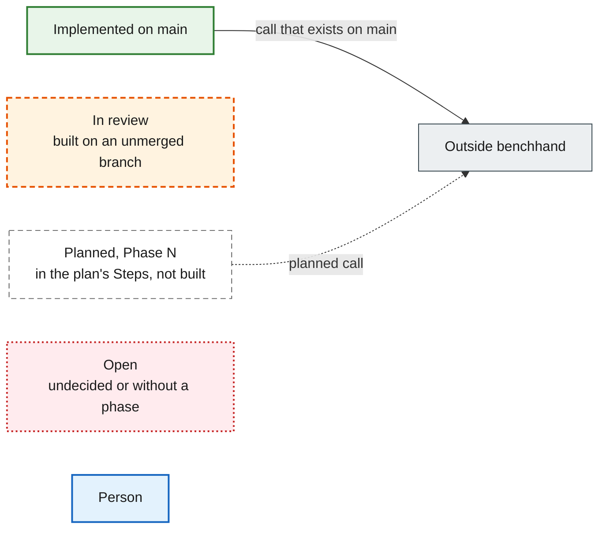

# Architecture diagrams

These pages draw benchhand's architecture from the design plan, the ADRs and the code on `main`.
Each page cites where every element comes from, and marks what is planned, in review or still open.
Start with the [overview](overview.md).

## Pages

| Page | What it shows | Kind |
|---|---|---|
| [overview.md](overview.md) | The entry page: the software in layers, with the contracts beside them, and the deployment and runtime: processes, transports, the native install and the container option | hand-written, D2 |
| [context.md](context.md) | C4 system context: the user, the agent hosts, benchhand, FreeCAD, the optional container, the project files and the external services | hand-written |
| [containers.md](containers.md) | C4 containers and components: the MCP server, the CLI, the core services, the providers, the preview host and UI, and the contracts pipeline, each with its phase | hand-written |
| [data-flow.md](data-flow.md) | Sequences: one MCP tool call, a long job, evidence and freeze, release, and migrate | hand-written |
| [flow.md](flow.md) | The design flow as a state machine: stages, gates, PROVISIONAL, APPROVED and VOID, the VOID cascade and engineering change | hand-written until Phase 2 generates it from `flow.yaml` |
| [layers.md](layers.md) | The layered architecture, the repository layout, and the package dependencies as `pyproject.toml` declares them | hand-written |
| [domain-model](../contract/generated/domain-model/README.md) | The domain model of the contracts: D2 diagrams and field tables, one page per contract | generated |
| [function-map.md](function-map.md) | The function map: where each prototype file ends up, with its status (ported, partial, in progress, planned or dropped) and phase, from [`reference-map.yaml`](reference-map.yaml) | generated |

The generated pages come from their own generator. Don't edit them by hand.

## Legend

Every hand-written page uses these styles. The status is relative to `main` at `71c1a54`; the overview's is relative to `518c2ae`. The overview draws the same styles in D2, with its own legend in each diagram.

- **Implemented** (solid green): the code exists on `main`.
- **In review** (orange, dashed): built on an unmerged branch, which the page names. The Mermaid source marks each such element with a `%% in-review: <lane>` comment. At `71c1a54` only `docs/architecture/` itself is in review, in [layers.md](layers.md#repository-layout).
- **Planned, Phase N** (grey, dashed): the plan places it in phase N of its Steps, and it isn't built.
- **Open** (red, dotted): the plan or an ADR names it, but its phase, its shape or a host result is undecided. The label says what is open. Where the plan's [Open questions](../design-plan.md#open-questions) list the item, the page links it.
- Sequence diagrams can't dash a participant. They put the status in the participant's name, shade in-review steps orange, and shade green a run of steps on `main` inside a sequence that `main` doesn't run yet.

## Sources

- `docs/design-plan.md`: [Steps (phased)](../design-plan.md#steps-phased) for the phase of each element, and [Open questions](../design-plan.md#open-questions).
- `docs/phases/phase-0-1.md`: [What was built](../phases/phase-0-1.md#what-was-built) and [Not built, which the plan puts in Phase 1](../phases/phase-0-1.md#not-built-which-the-plan-puts-in-phase-1), for the implemented and in-review status.
