# Capability catalogue

Generated by tools/catalogue (`just capabilities --write`) from capabilities.yaml. Do not edit.

The general model of benchhand: each capability (a feature), the MCP tools and CLI commands that expose it, and the prototype commands they replace. Per-feature specs split it into work blocks.

- **built**: on `main`; its evidence points at the code. **partial**: part of it is on `main`; its note says what is left.
- **planned**: a phase of the design plan's Steps builds it. **proposed**: no source plans it. A proposed name comes from this catalogue (`catalogue`), for a prototype command or a gap the plan implies, or from the CAD-libraries study (`study`), whose reports aren't in this repository.
- `P2` is Phase 2 of the plan's Steps. `no phase` means no phase delivers it; an open question says why.
- A capability's status is its core's. Each tool and CLI command has its own status and phase. A tool is **unresolved** when a source names it only in an example and an open question asks whether it exists; it has no phase until that is answered.

| Phase | Capabilities | built | partial | planned | proposed | dropped |
|---|---|---|---|---|---|---|
| P0 | 2 | 1 | 1 | 0 | 0 | 0 |
| P1 | 7 | 5 | 2 | 0 | 0 | 0 |
| P2 | 15 | 0 | 1 | 14 | 0 | 0 |
| P3 | 11 | 0 | 1 | 8 | 2 | 0 |
| P4 | 24 | 0 | 0 | 21 | 3 | 0 |
| P5 | 8 | 0 | 0 | 7 | 1 | 0 |
| P6 | 2 | 0 | 0 | 2 | 0 | 0 |
| P7 | 2 | 0 | 0 | 2 | 0 | 0 |
| no phase | 6 | 0 | 0 | 6 | 0 | 0 |
| **all** | **77** | 6 | 5 | 60 | 6 | 0 |

MCP tools: 105 (37 planned, 2 unresolved, 64 proposed, 2 dropped). CLI commands: 30 (2 built, 15 planned, 13 proposed). Prototype commands: 73. Open questions: 28.

## Capabilities by phase

### P0

| Capability | Title | Layer | Container | Status | Owner | Tools | CLI |
|---|---|---|---|---|---|---|---|
| [provider-protocol-contract](#provider-protocol-contract) | Provider protocol contract | contracts | `containers.md:published` | built | `contracts` | 0 | 0 |
| [client-capability-probe](#client-capability-probe) | Client capability probe (dev only) | dev-tooling | `layers.md:support` | partial | `tools/probe` | 0 | 0 |

### P1

| Capability | Title | Layer | Container | Status | Owner | Tools | CLI |
|---|---|---|---|---|---|---|---|
| [contracts-pipeline](#contracts-pipeline) | Contracts and code generation | contracts | `containers.md:published` | built | `contracts`, `tools/gen` | 0 | 0 |
| [contract-validation](#contract-validation) | Runtime contract validation | contracts | `containers.md:validator` | built | `packages/benchhand-contracts` | 0 | 0 |
| [record-store](#record-store) | Record store, typed reads and writes | core | `containers.md:store` | built | `packages/benchhand-core` | 1 | 0 |
| [record-validate](#record-validate) | Record validation | core | `containers.md:validate` | partial | `packages/benchhand-core` | 1 | 0 |
| [record-migrate](#record-migrate) | Record migration | core | `containers.md:migrate` | built | `packages/benchhand-core`, `packages/benchhand` | 1 | 1 |
| [evidence-assessment](#evidence-assessment) | Evidence assessment | core | `containers.md:evidence` | partial | `packages/benchhand-core` | 2 | 0 |
| [job-service](#job-service) | Job service | core | `containers.md:jobService` | built | `packages/benchhand-core` | 5 | 0 |

### P2

| Capability | Title | Layer | Container | Status | Owner | Tools | CLI |
|---|---|---|---|---|---|---|---|
| [flow-engine](#flow-engine) | Flow engine | core | `containers.md:flowEngine` | planned | `packages/benchhand-core`, `flow` | 1 | 0 |
| [cel-rule-pipeline](#cel-rule-pipeline) | CEL rule pipeline | core | `containers.md:celTypes` | planned | `packages/benchhand-core`, `tools/celcheck`, `tools/gen` | 0 | 1 |
| [rule-lists](#rule-lists) | Rule lists | core | `layers.md:flowDir` | planned | `flow` | 0 | 0 |
| [gate-policy](#gate-policy) | Gate policy | core | `containers.md:flowEngine` | planned | `packages/benchhand-core` | 2 | 2 |
| [decision-records](#decision-records) | Gate decisions and decision records | core | `containers.md:flowEngine` | planned | `packages/benchhand-core` | 2 | 0 |
| [scoped-reapproval](#scoped-reapproval) | Scoped approvals and changed-since-approval | core | `containers.md:flowEngine` | planned | `packages/benchhand-core` | 0 | 0 |
| [result-envelope](#result-envelope) | Result envelope and next actions | mcp-surface | `containers.md:surface` | partial | `packages/benchhand-core`, `contracts` | 0 | 0 |
| [guide-service](#guide-service) | Guidance from the server | core | `containers.md:guide` | planned | `packages/benchhand-core`, `flow` | 1 | 0 |
| [version-snapshots](#version-snapshots) | Version snapshots, seal and verify | core | `containers.md:versions` | planned | `packages/benchhand-core` | 1 | 2 |
| [project-profile](#project-profile) | Project-start profile | core | `containers.md:flowEngine` | planned | `packages/benchhand-core` | 3 | 0 |
| [selection-assessment](#selection-assessment) | Use case and candidate selection | core | `containers.md:record` | planned | `packages/benchhand-core` | 1 | 0 |
| [change-impact](#change-impact) | Change impact | core | `containers.md:flowEngine` | planned | `packages/benchhand-core` | 1 | 0 |
| [existing-equipment](#existing-equipment) | Existing equipment and occurrence roles | core | `containers.md:record` | planned | `contracts`, `packages/benchhand-core` | 0 | 0 |
| [assembly-steps-and-coupons](#assembly-steps-and-coupons) | Assembly steps and joint evidence | core | `containers.md:record` | planned | `contracts`, `packages/benchhand-core` | 1 | 0 |
| [annotation-set](#annotation-set) | Annotation set | contracts | `containers.md:record` | planned | `contracts`, `packages/benchhand-core` | 0 | 0 |

### P3

| Capability | Title | Layer | Container | Status | Owner | Tools | CLI |
|---|---|---|---|---|---|---|---|
| [mcp-server](#mcp-server) | MCP server | mcp-surface | `containers.md:surface` | planned | `packages/benchhand` | 0 | 3 |
| [cli-app](#cli-app) | The benchhand CLI | cli | `containers.md:cli` | partial | `packages/benchhand` | 0 | 1 |
| [project-session](#project-session) | Project session | mcp-surface | `containers.md:surface` | planned | `packages/benchhand` | 1 | 0 |
| [env-doctor](#env-doctor) | Environment doctor | cli | `containers.md:cli` | planned | `packages/benchhand` | 1 | 1 |
| [setup](#setup) | Setup and the managed FreeCAD install | cli | `containers.md:cli` | planned | `packages/benchhand` | 0 | 1 |
| [record-ops](#record-ops) | Typed record operations | mcp-surface | `containers.md:recordOps` | planned | `packages/benchhand`, `packages/benchhand-core` | 6 | 0 |
| [machine-profile](#machine-profile) | Machine capability profile | core | `containers.md:record` | planned | `packages/benchhand-core` | 2 | 0 |
| [interaction-chat-fallbacks](#interaction-chat-fallbacks) | Interaction layer, chat baseline | interaction | `containers.md:interaction` | planned | `packages/benchhand` | 0 | 0 |
| [gate-packet](#gate-packet) | Gate packet | core | `containers.md:flowEngine` | planned | `packages/benchhand-core` | 1 | 0 |
| [bounded-results](#bounded-results) | Bounded results with a retrieve handle | mcp-surface | `containers.md:surface` | proposed | `packages/benchhand`, `contracts` | 0 | 0 |
| [docs-index](#docs-index) | benchhand's own manual over MCP | mcp-surface | `containers.md:surface` | proposed | `packages/benchhand` | 1 | 1 |

### P4

| Capability | Title | Layer | Container | Status | Owner | Tools | CLI |
|---|---|---|---|---|---|---|---|
| [provider-runtime](#provider-runtime) | Provider runtime and conformance kit | providers | `containers.md:providerRuntime` | planned | `packages/benchhand-provider` | 0 | 0 |
| [provider-environments](#provider-environments) | Provider environments | providers | `containers.md:providerRuntime` | planned | `packages/benchhand-provider` | 0 | 0 |
| [provider-cli](#provider-cli) | Provider-declared CLI subcommands | cli | `containers.md:cli` | planned | `packages/benchhand`, `packages/benchhand-provider` | 0 | 1 |
| [freecad-runtime](#freecad-runtime) | FreeCAD provider and supported versions | providers | `containers.md:freecadProvider` | planned | `providers/freecad` | 0 | 1 |
| [model-build](#model-build) | Build a version | providers | `containers.md:kernels` | planned | `providers/kernel-cadquery`, `providers/kernel-build123d` | 1 | 0 |
| [model-export](#model-export) | Mesh exports | providers | `containers.md:kernels` | planned | `providers/kernel-cadquery`, `providers/kernel-build123d` | 1 | 0 |
| [model-inspect](#model-inspect) | Inspect geometry | providers | `containers.md:kernels` | planned | `providers/kernel-cadquery`, `providers/kernel-build123d` | 6 | 2 |
| [model-diff](#model-diff) | Version diff | providers | `containers.md:kernels` | planned | `providers/kernel-cadquery`, `providers/kernel-build123d` | 1 | 1 |
| [part-sdk](#part-sdk) | Part SDK | providers | `containers.md:sdk` | planned | `packages/benchhand-sdk` | 0 | 0 |
| [generators](#generators) | Parametric generators | providers | `containers.md:sdk` | planned | `packages/benchhand-sdk` | 0 | 0 |
| [process-checks](#process-checks) | Process and form checks | providers | `containers.md:checks` | planned | `providers/checks-process` | 1 | 0 |
| [check-orchestration](#check-orchestration) | Running a version's checks | core | `containers.md:evidence` | planned | `packages/benchhand-core` | 1 | 0 |
| [fits-calculators](#fits-calculators) | Fits and stack-ups | core | `containers.md:domain` | planned | `packages/benchhand-core` | 2 | 0 |
| [fea-analysis](#fea-analysis) | Structural analysis | providers | `containers.md:solver` | planned | `providers/solver-calculix`, `providers/freecad` | 3 | 0 |
| [motion-analysis](#motion-analysis) | Motion, sweeps and access | providers | `containers.md:collision` | planned | `packages/benchhand-core`, `providers/collision-fcl`, `providers/freecad` | 9 | 0 |
| [render-output](#render-output) | Product renders | providers | `containers.md:renderer` | planned | `providers/render-chromium` | 2 | 0 |
| [drawings](#drawings) | Part and assembly drawings | providers | `containers.md:freecadProvider` | planned | `providers/freecad` | 5 | 0 |
| [bom](#bom) | Engineering BOM | core | `containers.md:domain` | planned | `packages/benchhand-core` | 1 | 0 |
| [release-packaging](#release-packaging) | Release packaging | core | `containers.md:release` | planned | `packages/benchhand-core` | 1 | 0 |
| [documentation-set](#documentation-set) | Documentation set | providers | `containers.md:freecadProvider` | planned | `providers/freecad`, `providers/render-chromium`, `packages/benchhand-core` | 0 | 0 |
| [store-provider](#store-provider) | Artifact store provider | providers | `containers.md:store` | planned | `providers/store-fs` | 0 | 0 |
| [standards-parts-data](#standards-parts-data) | Standards and parts data | core | `containers.md:domain` | proposed | `packages/benchhand-core` | 5 | 2 |
| [step-import](#step-import) | Supplier STEP import | core | `containers.md:recordOps` | proposed | `packages/benchhand-core` | 1 | 0 |
| [product-docs](#product-docs) | Product documents (Typst) | providers | `containers.md:providers` | proposed | `packages/benchhand-core`, `providers/docs-typst` | 4 | 4 |

### P5

| Capability | Title | Layer | Container | Status | Owner | Tools | CLI |
|---|---|---|---|---|---|---|---|
| [preview-host](#preview-host) | Preview host | preview-host | `containers.md:preview` | planned | `packages/benchhand` | 3 | 1 |
| [viewer](#viewer) | Viewer | ui | `containers.md:ui` | planned | `ui/viewer`, `providers/viewer-ocp` | 8 | 1 |
| [concept-scene](#concept-scene) | Concept scenes | ui | `containers.md:ui` | planned | `ui/concept`, `providers/viewer-ocp` | 4 | 0 |
| [draft-preview](#draft-preview) | Draft preview | preview-host | `containers.md:preview` | planned | `packages/benchhand` | 2 | 0 |
| [layout-skeleton](#layout-skeleton) | Layout skeleton from the concept | core | `containers.md:recordOps` | planned | `packages/benchhand-core` | 1 | 0 |
| [flow-view](#flow-view) | Flow view | ui | `containers.md:ui` | planned | `ui/flow-view` | 0 | 0 |
| [rich-interactions](#rich-interactions) | Apps, image results and tasks | interaction | `containers.md:interaction` | planned | `packages/benchhand`, `ui/gate-card` | 0 | 0 |
| [live-project-viewer](#live-project-viewer) | Live project viewer | ui | `containers.md:ui` | proposed | `ui/viewer`, `packages/benchhand` | 2 | 0 |

### P6

| Capability | Title | Layer | Container | Status | Owner | Tools | CLI |
|---|---|---|---|---|---|---|---|
| [harness-install](#harness-install) | Harness install | harness-integration | `layers.md:harnessDir` | planned | `harness`, `packages/benchhand` | 0 | 2 |
| [skills-over-mcp](#skills-over-mcp) | Skills over MCP | mcp-surface | `containers.md:surface` | planned | `packages/benchhand` | 0 | 0 |

### P7

| Capability | Title | Layer | Container | Status | Owner | Tools | CLI |
|---|---|---|---|---|---|---|---|
| [distribution](#distribution) | Packaging and distribution | distribution | `layers.md:containerDir` | planned | `packages/benchhand`, `container`, `harness` | 0 | 0 |
| [golden-parity](#golden-parity) | Golden end-to-end parity | dev-tooling | `layers.md:support` | planned | `tools/golden` | 0 | 0 |

### no phase

| Capability | Title | Layer | Container | Status | Owner | Tools | CLI |
|---|---|---|---|---|---|---|---|
| [middleware-chain](#middleware-chain) | Middleware chain | core | `containers.md:middleware` | planned | `packages/benchhand-core` | 0 | 0 |
| [design-recheck](#design-recheck) | Design recheck record | core | `containers.md:domain` | planned | `packages/benchhand-core` | 3 | 0 |
| [scratch-workspaces](#scratch-workspaces) | Scratch workspaces for worker units | core | `containers.md:domain` | planned | `packages/benchhand-core` | 3 | 0 |
| [provider-host](#provider-host) | Provider host | core | `containers.md:providerHost` | planned | `packages/benchhand-core` | 0 | 0 |
| [policy-provider](#policy-provider) | Default policy provider | providers | `containers.md:policy` | planned | `providers/policy-default` | 0 | 0 |
| [container-launcher](#container-launcher) | Container launcher | distribution | `layers.md:containerDir` | planned | `packages/benchhand`, `container` | 0 | 2 |

## Dependency graph

An arrow points from a capability to one it depends on. A solid box or arrow is on `main`: green is built, pale green with a dashed border is partial, and a solid arrow joins two of them. A dashed box or arrow is planned, with its phase in the label. Red and dotted has no phase; purple and dotted is proposed.

```mermaid
flowchart LR
  subgraph phase_P0["P0"]
    provider_protocol_contract["Provider protocol contract<br/>P0, built"]:::built
    client_capability_probe["Client capability probe (dev only)<br/>P0, partial"]:::partial
  end
  subgraph phase_P1["P1"]
    contracts_pipeline["Contracts and code generation<br/>P1, built"]:::built
    contract_validation["Runtime contract validation<br/>P1, built"]:::built
    record_store["Record store, typed reads and writes<br/>P1, built"]:::built
    record_validate["Record validation<br/>P1, partial"]:::partial
    record_migrate["Record migration<br/>P1, built"]:::built
    evidence_assessment["Evidence assessment<br/>P1, partial"]:::partial
    job_service["Job service<br/>P1, built"]:::built
  end
  subgraph phase_P2["P2"]
    flow_engine["Flow engine<br/>P2, planned"]:::planned
    cel_rule_pipeline["CEL rule pipeline<br/>P2, planned"]:::planned
    rule_lists["Rule lists<br/>P2, planned"]:::planned
    gate_policy["Gate policy<br/>P2, planned"]:::planned
    decision_records["Gate decisions and decision records<br/>P2, planned"]:::planned
    scoped_reapproval["Scoped approvals and changed-since-approval<br/>P2, planned"]:::planned
    result_envelope["Result envelope and next actions<br/>P2, partial"]:::partial
    guide_service["Guidance from the server<br/>P2, planned"]:::planned
    version_snapshots["Version snapshots, seal and verify<br/>P2, planned"]:::planned
    project_profile["Project-start profile<br/>P2, planned"]:::planned
    selection_assessment["Use case and candidate selection<br/>P2, planned"]:::planned
    change_impact["Change impact<br/>P2, planned"]:::planned
    existing_equipment["Existing equipment and occurrence roles<br/>P2, planned"]:::planned
    assembly_steps_and_coupons["Assembly steps and joint evidence<br/>P2, planned"]:::planned
    annotation_set["Annotation set<br/>P2, planned"]:::planned
  end
  subgraph phase_P3["P3"]
    mcp_server["MCP server<br/>P3, planned"]:::planned
    cli_app["The benchhand CLI<br/>P3, partial"]:::partial
    project_session["Project session<br/>P3, planned"]:::planned
    env_doctor["Environment doctor<br/>P3, planned"]:::planned
    setup["Setup and the managed FreeCAD install<br/>P3, planned"]:::planned
    record_ops["Typed record operations<br/>P3, planned"]:::planned
    machine_profile["Machine capability profile<br/>P3, planned"]:::planned
    interaction_chat_fallbacks["Interaction layer, chat baseline<br/>P3, planned"]:::planned
    gate_packet["Gate packet<br/>P3, planned"]:::planned
    bounded_results["Bounded results with a retrieve handle<br/>P3, proposed"]:::proposed
    docs_index["benchhand's own manual over MCP<br/>P3, proposed"]:::proposed
  end
  subgraph phase_P4["P4"]
    provider_runtime["Provider runtime and conformance kit<br/>P4, planned"]:::planned
    provider_environments["Provider environments<br/>P4, planned"]:::planned
    provider_cli["Provider-declared CLI subcommands<br/>P4, planned"]:::planned
    freecad_runtime["FreeCAD provider and supported versions<br/>P4, planned"]:::planned
    model_build["Build a version<br/>P4, planned"]:::planned
    model_export["Mesh exports<br/>P4, planned"]:::planned
    model_inspect["Inspect geometry<br/>P4, planned"]:::planned
    model_diff["Version diff<br/>P4, planned"]:::planned
    part_sdk["Part SDK<br/>P4, planned"]:::planned
    generators["Parametric generators<br/>P4, planned"]:::planned
    process_checks["Process and form checks<br/>P4, planned"]:::planned
    check_orchestration["Running a version's checks<br/>P4, planned"]:::planned
    fits_calculators["Fits and stack-ups<br/>P4, planned"]:::planned
    fea_analysis["Structural analysis<br/>P4, planned"]:::planned
    motion_analysis["Motion, sweeps and access<br/>P4, planned"]:::planned
    render_output["Product renders<br/>P4, planned"]:::planned
    drawings["Part and assembly drawings<br/>P4, planned"]:::planned
    bom["Engineering BOM<br/>P4, planned"]:::planned
    release_packaging["Release packaging<br/>P4, planned"]:::planned
    documentation_set["Documentation set<br/>P4, planned"]:::planned
    store_provider["Artifact store provider<br/>P4, planned"]:::planned
    standards_parts_data["Standards and parts data<br/>P4, proposed"]:::proposed
    step_import["Supplier STEP import<br/>P4, proposed"]:::proposed
    product_docs["Product documents (Typst)<br/>P4, proposed"]:::proposed
  end
  subgraph phase_P5["P5"]
    preview_host["Preview host<br/>P5, planned"]:::planned
    viewer["Viewer<br/>P5, planned"]:::planned
    concept_scene["Concept scenes<br/>P5, planned"]:::planned
    draft_preview["Draft preview<br/>P5, planned"]:::planned
    layout_skeleton["Layout skeleton from the concept<br/>P5, planned"]:::planned
    flow_view["Flow view<br/>P5, planned"]:::planned
    rich_interactions["Apps, image results and tasks<br/>P5, planned"]:::planned
    live_project_viewer["Live project viewer<br/>P5, proposed"]:::proposed
  end
  subgraph phase_P6["P6"]
    harness_install["Harness install<br/>P6, planned"]:::planned
    skills_over_mcp["Skills over MCP<br/>P6, planned"]:::planned
  end
  subgraph phase_P7["P7"]
    distribution["Packaging and distribution<br/>P7, planned"]:::planned
    golden_parity["Golden end-to-end parity<br/>P7, planned"]:::planned
  end
  subgraph phase_no phase["no phase"]
    middleware_chain["Middleware chain<br/>no phase, planned"]:::open
    design_recheck["Design recheck record<br/>no phase, planned"]:::open
    scratch_workspaces["Scratch workspaces for worker units<br/>no phase, planned"]:::open
    provider_host["Provider host<br/>no phase, planned"]:::open
    policy_provider["Default policy provider<br/>no phase, planned"]:::open
    container_launcher["Container launcher<br/>no phase, planned"]:::open
  end
  contract_validation --> contracts_pipeline
  provider_protocol_contract --> contracts_pipeline
  record_store --> contract_validation
  record_validate --> record_store
  record_migrate --> record_store
  record_migrate --> record_validate
  evidence_assessment --> record_store
  job_service --> contract_validation
  flow_engine -.-> record_store
  flow_engine -.-> cel_rule_pipeline
  cel_rule_pipeline -.-> contracts_pipeline
  rule_lists -.-> cel_rule_pipeline
  gate_policy -.-> flow_engine
  gate_policy -.-> decision_records
  gate_policy -.-> rule_lists
  decision_records -.-> flow_engine
  decision_records -.-> record_store
  scoped_reapproval -.-> decision_records
  scoped_reapproval -.-> evidence_assessment
  result_envelope --> contracts_pipeline
  result_envelope -.-> flow_engine
  guide_service -.-> flow_engine
  version_snapshots -.-> record_store
  project_profile -.-> record_store
  project_profile -.-> flow_engine
  selection_assessment -.-> evidence_assessment
  change_impact -.-> evidence_assessment
  change_impact -.-> scoped_reapproval
  existing_equipment -.-> record_store
  assembly_steps_and_coupons -.-> record_store
  assembly_steps_and_coupons -.-> evidence_assessment
  annotation_set -.-> record_store
  middleware_chain -.-> contract_validation
  middleware_chain -.-> gate_policy
  design_recheck -.-> evidence_assessment
  scratch_workspaces -.-> record_store
  scratch_workspaces -.-> model_build
  mcp_server -.-> result_envelope
  mcp_server -.-> contract_validation
  mcp_server -.-> guide_service
  cli_app --> record_migrate
  project_session -.-> mcp_server
  project_session -.-> record_store
  env_doctor -.-> provider_environments
  setup -.-> freecad_runtime
  record_ops -.-> record_store
  record_ops -.-> mcp_server
  machine_profile -.-> record_store
  interaction_chat_fallbacks -.-> mcp_server
  interaction_chat_fallbacks -.-> decision_records
  interaction_chat_fallbacks -.-> job_service
  gate_packet -.-> decision_records
  gate_packet -.-> scoped_reapproval
  gate_packet -.-> evidence_assessment
  provider_runtime -.-> provider_protocol_contract
  provider_runtime -.-> contract_validation
  provider_host -.-> provider_runtime
  provider_host -.-> job_service
  provider_environments -.-> provider_runtime
  provider_cli -.-> provider_runtime
  provider_cli -.-> provider_host
  freecad_runtime -.-> provider_runtime
  model_build -.-> provider_host
  model_build -.-> provider_environments
  model_build -.-> version_snapshots
  model_build -.-> existing_equipment
  model_export -.-> model_build
  model_inspect -.-> model_build
  model_diff -.-> model_inspect
  model_diff -.-> version_snapshots
  generators -.-> part_sdk
  process_checks -.-> provider_host
  process_checks -.-> rule_lists
  check_orchestration -.-> evidence_assessment
  check_orchestration -.-> rule_lists
  check_orchestration -.-> job_service
  check_orchestration -.-> process_checks
  fits_calculators -.-> record_store
  fea_analysis -.-> freecad_runtime
  fea_analysis -.-> job_service
  fea_analysis -.-> model_build
  motion_analysis -.-> model_build
  motion_analysis -.-> job_service
  motion_analysis -.-> provider_host
  render_output -.-> model_build
  render_output -.-> provider_host
  drawings -.-> freecad_runtime
  drawings -.-> model_build
  drawings -.-> job_service
  bom -.-> model_build
  bom -.-> existing_equipment
  release_packaging -.-> version_snapshots
  release_packaging -.-> evidence_assessment
  release_packaging -.-> existing_equipment
  documentation_set -.-> annotation_set
  documentation_set -.-> drawings
  documentation_set -.-> render_output
  documentation_set -.-> existing_equipment
  store_provider -.-> provider_host
  policy_provider -.-> provider_host
  policy_provider -.-> gate_policy
  preview_host -.-> mcp_server
  preview_host -.-> job_service
  viewer -.-> preview_host
  viewer -.-> model_build
  viewer -.-> annotation_set
  concept_scene -.-> preview_host
  draft_preview -.-> model_build
  draft_preview -.-> viewer
  layout_skeleton -.-> concept_scene
  layout_skeleton -.-> record_ops
  flow_view -.-> flow_engine
  flow_view -.-> preview_host
  rich_interactions -.-> interaction_chat_fallbacks
  rich_interactions -.-> preview_host
  rich_interactions -.-> gate_packet
  harness_install -.-> mcp_server
  harness_install -.-> guide_service
  skills_over_mcp -.-> guide_service
  container_launcher -.-> mcp_server
  container_launcher -.-> env_doctor
  container_launcher -.-> job_service
  distribution -.-> harness_install
  distribution -.-> container_launcher
  distribution -.-> cel_rule_pipeline
  golden_parity -.-> mcp_server
  golden_parity -.-> model_build
  golden_parity -.-> drawings
  golden_parity -.-> bom
  golden_parity -.-> release_packaging
  golden_parity -.-> interaction_chat_fallbacks
  bounded_results -.-> result_envelope
  bounded_results -.-> job_service
  docs_index -.-> guide_service
  docs_index -.-> part_sdk
  standards_parts_data -.-> record_store
  standards_parts_data -.-> evidence_assessment
  step_import -.-> model_inspect
  step_import -.-> record_ops
  live_project_viewer -.-> viewer
  live_project_viewer -.-> model_diff
  live_project_viewer -.-> flow_view
  product_docs -.-> documentation_set
  product_docs -.-> version_snapshots
  product_docs -.-> bom
  product_docs -.-> release_packaging
  classDef built fill:#e8f5e9,stroke:#2e7d32,stroke-width:2px,color:#1b1b1b
  classDef partial fill:#f1faf3,stroke:#2e7d32,stroke-width:2px,stroke-dasharray:6 3,color:#1b1b1b
  classDef planned fill:#ffffff,stroke:#616161,stroke-width:1px,stroke-dasharray:6 4,color:#1b1b1b
  classDef open fill:#ffebee,stroke:#c62828,stroke-width:2px,stroke-dasharray:2 3,color:#1b1b1b
  classDef proposed fill:#f3e5f5,stroke:#6a1b9a,stroke-width:1px,stroke-dasharray:2 3,color:#1b1b1b
  classDef dropped fill:#eeeeee,stroke:#888888,stroke-dasharray:4 3,color:#666666
```

## MCP tools

Every tool returns the result envelope (`envelope/envelope.schema.json`); *output* is its payload. *Envelope* `sync-or-job` returns `ok`, or `pending` with a job handle when the work would pass the long-call threshold (ADR-0018). *Gate* `unspecified` means the tool writes and no source says whether the call is checked against the stage.

| Tool | Capability | Access | Input | Output | Envelope | Gate | Phase | Status | Source | Replaces |
|---|---|---|---|---|---|---|---|---|---|---|
| `bom.rollup` | [bom](#bom) | write | not yet defined | `record/bom-row.schema.json` | sync-or-job | unspecified | P4 | proposed | catalogue: `bom.py, under the plan's bom.*` | `bom.py` |
| `checks.form` | [process-checks](#process-checks) | write | not yet defined | not yet defined | sync-or-job | unspecified | P4 | proposed | catalogue: `form_check.py` | `form_check.py` |
| `checks.run` | [check-orchestration](#check-orchestration) | write | not yet defined | not yet defined | sync-or-job | unspecified | P4 | proposed | catalogue: `evidence.py` | `evidence.py run` |
| `concept.add_variant` | [concept-scene](#concept-scene) | write | not yet defined | not yet defined | sync | unspecified | P5 | planned | plan: `docs/design-plan.md:375` | – |
| `concept.check` | [concept-scene](#concept-scene) | read | not yet defined | not yet defined | sync | none | P5 | proposed | catalogue: `concept.py` | `concept.py check` |
| `concept.set_primitive` | [concept-scene](#concept-scene) | write | not yet defined | not yet defined | sync | unspecified | P5 | planned | plan: `docs/design-plan.md:375` | – |
| `concept.snapshot` | [concept-scene](#concept-scene) | read | not yet defined | not yet defined | sync | none | P5 | planned | plan: `docs/design-plan.md:375` | – |
| `docs.get` | [docs-index](#docs-index) | read | not yet defined | not yet defined | sync | none | P3 | proposed | study: `lane8-agentcad.md section 6, item 5` | – |
| `docset.build` | [product-docs](#product-docs) | write | not yet defined | not yet defined | job-handle | unspecified | P4 | proposed | study: `lane8b-product-docs.md section 5.3` | `build_guide.py` |
| `docset.list` | [product-docs](#product-docs) | read | not yet defined | not yet defined | sync | none | P4 | proposed | study: `lane8b-product-docs.md section 5.3` | – |
| `docset.show` | [product-docs](#product-docs) | read | not yet defined | not yet defined | sync | none | P4 | proposed | study: `lane8b-product-docs.md section 5.3` | – |
| `docset.unknowns` | [product-docs](#product-docs) | read | not yet defined | not yet defined | sync | none | P4 | proposed | study: `lane8b-product-docs.md section 5.3` | – |
| `drawing.assembly` | [drawings](#drawings) | write | not yet defined | not yet defined | sync-or-job | unspecified | P4 | proposed | catalogue: `assembly_drawing.py, under the plan's drawing.*` | `assembly_drawing.py` |
| `drawing.check` | [drawings](#drawings) | read | not yet defined | not yet defined | sync-or-job | none | P4 | proposed | catalogue: `assembly_check.py, under the plan's drawing.*` | `assembly_check.py` |
| `drawing.draft` | [drawings](#drawings) | read | not yet defined | not yet defined | sync-or-job | none | P4 | proposed | catalogue: `drawing_draft.py, under the plan's drawing.*` | `drawing_draft.py` |
| `drawing.merge` | [drawings](#drawings) | write | not yet defined | not yet defined | sync | unspecified | P4 | proposed | catalogue: `drawing_merge.py, under the plan's drawing.*` | `drawing_merge.py` |
| `drawing.part` | [drawings](#drawings) | write | not yet defined | not yet defined | sync-or-job | unspecified | P4 | proposed | catalogue: `drawing.py, under the plan's drawing.*` | `drawing.py` |
| `env.doctor` | [env-doctor](#env-doctor) | read | not yet defined | not yet defined | sync | none | P3 | planned | plan: `docs/design-plan.md:258` | `preflight.py` |
| `evidence.assess` | [evidence-assessment](#evidence-assessment) | read | not yet defined | `record/evidence-assessment.schema.json` | sync-or-job | none | P3 | proposed | catalogue: `evidence.py` | `evidence.py check` |
| `evidence.digest` | [evidence-assessment](#evidence-assessment) | read | not yet defined | not yet defined | sync | none | P3 | proposed | catalogue: `evidence.py` | `evidence.py digest` |
| `fea.case_from_requirement` | [fea-analysis](#fea-analysis) | write | not yet defined | not yet defined | sync | unspecified | P4 | planned | plan: `docs/design-plan.md:379` | – |
| `fea.static` | [fea-analysis](#fea-analysis) | write | not yet defined | not yet defined | sync-or-job | unspecified | P4 | proposed | catalogue: `fea_static.py` | `fea_static.py` |
| `fea.stop_reaction` | [fea-analysis](#fea-analysis) | write | not yet defined | not yet defined | sync-or-job | unspecified | P4 | proposed | catalogue: `stop_reaction.py` | `stop_reaction.py` |
| `fits.lookup` | [fits-calculators](#fits-calculators) | read | not yet defined | not yet defined | sync | none | P4 | planned | plan: `docs/design-plan.md:379` | `fits.py` |
| `fits.stackup` | [fits-calculators](#fits-calculators) | write | not yet defined | not yet defined | sync | unspecified | P4 | planned | plan: `docs/design-plan.md:379` | `stackup.py` |
| `flow.advance` | [flow-engine](#flow-engine) | write | not yet defined | not yet defined | sync | requests-transition | P3 | proposed | catalogue: `c7q.2, the stage CLI` | – |
| `flow.gate_packet` | [gate-packet](#gate-packet) | read | not yet defined | not yet defined | sync | none | P3 | proposed | catalogue: `the chat baseline of the human gate` | – |
| `flow.guide` | [guide-service](#guide-service) | read | not yet defined | not yet defined | sync | none | P3 | planned | plan: `docs/design-plan.md:309` | – |
| `flow.impact` | [change-impact](#change-impact) | read | not yet defined | not yet defined | sync | none | P3 | proposed | catalogue: `impact.py` | `impact.py` |
| `flow.record_decision` | [decision-records](#decision-records) | write | `flow/flow.schema.json#/$defs/GateDecisionRequest` | not yet defined | sync | records-decision | P3 | planned | plan: `docs/design-plan.md:341` | – |
| `flow.record_provisional` | [decision-records](#decision-records) | write | not yet defined | not yet defined | sync | records-decision | no phase | unresolved | contract: `contracts/envelope/envelope.tsp:105` | – |
| `jobs.cancel` | [job-service](#job-service) | write | not yet defined | not yet defined | sync | none | P3 | proposed | catalogue: `tasks/cancel without its baseline` | – |
| `jobs.result` | [job-service](#job-service) | read | not yet defined | not yet defined | sync | none | P3 | planned | plan: `docs/design-plan.md:345` | – |
| `jobs.start` | [job-service](#job-service) | write | not yet defined | not yet defined | job-handle | unspecified | P3 | planned | plan: `docs/design-plan.md:345` | – |
| `jobs.status` | [job-service](#job-service) | read | not yet defined | not yet defined | sync | none | P3 | planned | plan: `docs/design-plan.md:345` | – |
| `jobs.strays` | [job-service](#job-service) | read | not yet defined | not yet defined | sync | none | P4 | proposed | catalogue: `process_lifecycle.py` | `process_lifecycle.py strays` |
| `layout.from_concept` | [layout-skeleton](#layout-skeleton) | write | not yet defined | not yet defined | sync | unspecified | P5 | planned | plan: `docs/design-plan.md:380` | `concept.py handoff` |
| `model.build` | [model-build](#model-build) | write | not yet defined | not yet defined | sync-or-job | unspecified | P4 | planned | plan: `docs/design-plan.md:363` | `cad_model.py run` |
| `model.check` | [model-inspect](#model-inspect) | write | not yet defined | not yet defined | sync-or-job | unspecified | P4 | proposed | catalogue: `cad_model.py` | `cad_model.py check` |
| `model.diff` | [model-diff](#model-diff) | read | not yet defined | not yet defined | sync-or-job | none | P4 | proposed | study: `lane8-agentcad.md section 6, item 4` | `cad_model.py diff` |
| `model.export` | [model-export](#model-export) | write | not yet defined | not yet defined | sync-or-job | unspecified | P4 | planned | plan: `docs/design-plan.md:364` | – |
| `model.inspect` | [model-inspect](#model-inspect) | read | not yet defined | not yet defined | sync-or-job | none | P4 | proposed | study: `lane8-agentcad.md section 6, item 3` | – |
| `model.interference` | [model-inspect](#model-inspect) | read | not yet defined | not yet defined | sync-or-job | none | P4 | planned | plan: `docs/design-plan.md:373` | – |
| `model.mass_props` | [model-inspect](#model-inspect) | read | not yet defined | not yet defined | sync-or-job | none | P4 | planned | plan: `docs/design-plan.md:373` | – |
| `model.measure` | [model-inspect](#model-inspect) | read | not yet defined | not yet defined | sync-or-job | none | P4 | planned | plan: `docs/design-plan.md:373` | – |
| `model.section` | [model-inspect](#model-inspect) | read | not yet defined | not yet defined | sync-or-job | none | P4 | planned | plan: `docs/design-plan.md:373` | – |
| `motion.access` | [motion-analysis](#motion-analysis) | write | not yet defined | not yet defined | sync-or-job | unspecified | P4 | proposed | catalogue: `access.py` | `access.py` |
| `motion.check` | [motion-analysis](#motion-analysis) | write | not yet defined | not yet defined | sync-or-job | unspecified | P4 | dropped | catalogue: `motion.py` | – |
| `motion.plan` | [motion-analysis](#motion-analysis) | write | not yet defined | not yet defined | sync-or-job | unspecified | P4 | proposed | catalogue: `motion.py` | `motion.py plan` |
| `motion.play` | [motion-analysis](#motion-analysis) | write | not yet defined | not yet defined | sync-or-job | unspecified | P4 | proposed | catalogue: `play.py` | `play.py` |
| `motion.pose` | [motion-analysis](#motion-analysis) | write | not yet defined | not yet defined | sync-or-job | unspecified | P4 | planned | plan: `docs/design-plan.md:379` | `pose.py` |
| `motion.render` | [motion-analysis](#motion-analysis) | write | not yet defined | not yet defined | sync-or-job | unspecified | P4 | planned | plan: `docs/design-plan.md:365` | `motion.py render` |
| `motion.simulate` | [motion-analysis](#motion-analysis) | write | not yet defined | not yet defined | sync-or-job | unspecified | P4 | proposed | catalogue: `freecad_assembly.py` | `freecad_assembly.py` |
| `motion.spot_check` | [motion-analysis](#motion-analysis) | read | not yet defined | not yet defined | sync-or-job | none | P4 | proposed | catalogue: `spot_check.py` | `spot_check.py` |
| `motion.sweep` | [motion-analysis](#motion-analysis) | write | not yet defined | not yet defined | sync-or-job | unspecified | P4 | proposed | catalogue: `sweep.py` | `sweep.py`, `merge_sweeps.py` |
| `part.import_step` | [step-import](#step-import) | write | not yet defined | not yet defined | sync-or-job | unspecified | P4 | proposed | study: `lane8-agentcad.md section 6, item 8` | – |
| `parts.search` | [standards-parts-data](#standards-parts-data) | read | not yet defined | not yet defined | sync | none | P4 | proposed | study: `lane8-agentcad.md section 6, item 7` | – |
| `parts.show` | [standards-parts-data](#standards-parts-data) | read | not yet defined | not yet defined | sync | none | P4 | proposed | study: `lane8-agentcad.md section 6, item 7` | – |
| `policy.get` | [gate-policy](#gate-policy) | read | not yet defined | `record/policy.schema.json` | sync | none | P3 | proposed | catalogue: `D3 policy.* resources` | – |
| `policy.set` | [gate-policy](#gate-policy) | write | not yet defined | not yet defined | sync | records-policy-change | P3 | proposed | catalogue: `D3 policy.* resources` | – |
| `preview.assembly` | [draft-preview](#draft-preview) | read | not yet defined | not yet defined | sync-or-job | none | P5 | planned | plan: `docs/design-plan.md:374` | – |
| `preview.list` | [preview-host](#preview-host) | read | not yet defined | not yet defined | sync | none | P5 | planned | plan: `docs/design-plan.md:377` | – |
| `preview.part` | [draft-preview](#draft-preview) | read | not yet defined | not yet defined | sync-or-job | none | P5 | planned | plan: `docs/design-plan.md:374` | – |
| `preview.serve` | [preview-host](#preview-host) | read | not yet defined | not yet defined | sync | none | P5 | planned | plan: `docs/design-plan.md:377` | `viewer.py serve`, `viewer.py gallery`, `serve.py` |
| `preview.stop` | [preview-host](#preview-host) | read | not yet defined | not yet defined | sync | none | P5 | planned | plan: `docs/design-plan.md:377` | `viewer.py stop` |
| `project.check_profile` | [project-profile](#project-profile) | read | not yet defined | not yet defined | sync | none | P3 | proposed | catalogue: `flow_profile.py` | `flow_profile.py check` |
| `project.open` | [project-session](#project-session) | read | not yet defined | not yet defined | sync | none | P3 | planned | plan: `docs/design-plan.md:301` | – |
| `project.questions` | [project-profile](#project-profile) | read | not yet defined | not yet defined | sync | none | P3 | proposed | catalogue: `flow_profile.py` | `flow_profile.py questions` |
| `project.record_profile` | [project-profile](#project-profile) | write | not yet defined | not yet defined | sync | unspecified | P3 | proposed | catalogue: `flow_profile.py` | `flow_profile.py record` |
| `recheck.diff` | [design-recheck](#design-recheck) | read | not yet defined | not yet defined | sync | none | no phase | dropped | catalogue: `stamp.py` | – |
| `recheck.stamp` | [design-recheck](#design-recheck) | write | not yet defined | not yet defined | sync | unspecified | no phase | proposed | catalogue: `stamp.py` | `stamp.py` |
| `recheck.verify` | [design-recheck](#design-recheck) | read | not yet defined | not yet defined | sync | none | no phase | proposed | catalogue: `stamp.py` | `stamp.py --verify`, `stamp.py --verify --committed` |
| `record.add_bom_row` | [record-ops](#record-ops) | write | not yet defined | not yet defined | sync | unspecified | P3 | planned | plan: `docs/design-plan.md:378` | – |
| `record.add_evidence` | [record-ops](#record-ops) | write | not yet defined | not yet defined | sync | unspecified | P3 | planned | plan: `docs/design-plan.md:378` | – |
| `record.add_interface` | [record-ops](#record-ops) | write | not yet defined | not yet defined | sync | unspecified | P3 | planned | plan: `docs/design-plan.md:378` | – |
| `record.add_part` | [record-ops](#record-ops) | write | not yet defined | not yet defined | sync | unspecified | P3 | planned | plan: `docs/design-plan.md:378` | – |
| `record.add_requirement` | [record-ops](#record-ops) | write | not yet defined | not yet defined | sync | unspecified | P3 | planned | plan: `docs/design-plan.md:378` | – |
| `record.check_machine_profile` | [machine-profile](#machine-profile) | read | not yet defined | not yet defined | sync | none | P3 | proposed | catalogue: `machine_profile.py` | `machine_profile.py check` |
| `record.cite_source` | [standards-parts-data](#standards-parts-data) | write | not yet defined | not yet defined | sync | unspecified | P4 | proposed | study: `lane8-agentcad.md section 6, item 7` | – |
| `record.migrate` | [record-migrate](#record-migrate) | write | not yet defined | not yet defined | sync | unspecified | no phase | unresolved | contract: `contracts/envelope/envelope.tsp:183` | – |
| `record.propose_coupons` | [assembly-steps-and-coupons](#assembly-steps-and-coupons) | write | not yet defined | not yet defined | sync | unspecified | P3 | proposed | catalogue: `plan section 12b, coupons from the requirement` | – |
| `record.read` | [record-store](#record-store) | read | not yet defined | not yet defined | sync | none | P3 | proposed | catalogue: `ADR-0018 readable content` | – |
| `record.set_machine_profile` | [machine-profile](#machine-profile) | write | not yet defined | not yet defined | sync | unspecified | P3 | proposed | catalogue: `machine_profile.py` | `machine_profile.py write` |
| `record.set_route` | [record-ops](#record-ops) | write | not yet defined | not yet defined | sync | unspecified | P3 | planned | plan: `docs/design-plan.md:378` | – |
| `record.validate` | [record-validate](#record-validate) | read | not yet defined | `common/finding.schema.json` | sync | none | P3 | proposed | catalogue: `validate.py` | `validate.py` |
| `release.package` | [release-packaging](#release-packaging) | write | not yet defined | `record/bundle-manifest.schema.json` | sync-or-job | unspecified | P4 | proposed | catalogue: `release.py, the plan's release tools` | `release.py` |
| `render.compare` | [render-output](#render-output) | read | not yet defined | not yet defined | sync | none | P4 | proposed | catalogue: `compare_renders.py, under the plan's render.*` | `compare_renders.py` |
| `render.product` | [render-output](#render-output) | write | not yet defined | not yet defined | sync-or-job | unspecified | P4 | proposed | catalogue: `render.py, under the plan's render.*` | `render.py` |
| `selection.assess` | [selection-assessment](#selection-assessment) | read | not yet defined | `record/manufacturing-selection.schema.json` | sync | none | P3 | proposed | catalogue: `selection.py` | `selection.py` |
| `standards.search` | [standards-parts-data](#standards-parts-data) | read | not yet defined | not yet defined | sync | none | P4 | proposed | study: `lane8-agentcad.md section 6, item 7` | – |
| `standards.show` | [standards-parts-data](#standards-parts-data) | read | not yet defined | not yet defined | sync | none | P4 | proposed | study: `lane8-agentcad.md section 6, item 7` | – |
| `version.parts` | [version-snapshots](#version-snapshots) | read | not yet defined | not yet defined | sync | none | P3 | proposed | study: `lane8-agentcad.md section 3, CLI table` | – |
| `viewer.animate` | [viewer](#viewer) | read | not yet defined | not yet defined | sync | none | P5 | proposed | catalogue: `viewer.py` | `viewer.py animate` |
| `viewer.camera` | [viewer](#viewer) | read | not yet defined | not yet defined | sync | none | P5 | planned | plan: `docs/design-plan.md:376` | – |
| `viewer.capture` | [viewer](#viewer) | write | not yet defined | not yet defined | sync | unspecified | P5 | planned | plan: `docs/design-plan.md:376` | `viewer.py capture` |
| `viewer.compare` | [viewer](#viewer) | read | not yet defined | not yet defined | sync | none | P5 | planned | plan: `docs/design-plan.md:376` | `viewer.py compare` |
| `viewer.export` | [live-project-viewer](#live-project-viewer) | read | not yet defined | not yet defined | sync | none | P5 | proposed | study: `lane8-agentcad.md section 6, item 10` | – |
| `viewer.mode` | [viewer](#viewer) | read | not yet defined | not yet defined | sync | none | P5 | proposed | catalogue: `viewer.py` | `viewer.py mode` |
| `viewer.open` | [live-project-viewer](#live-project-viewer) | read | not yet defined | not yet defined | sync | none | P5 | proposed | study: `lane8-agentcad.md section 3, CLI table` | – |
| `viewer.parts` | [viewer](#viewer) | read | not yet defined | not yet defined | sync | none | P5 | proposed | catalogue: `viewer.py` | `viewer.py parts` |
| `viewer.show` | [viewer](#viewer) | read | not yet defined | not yet defined | sync | none | P5 | planned | plan: `docs/design-plan.md:376` | `viewer.py show` |
| `viewer.studio` | [viewer](#viewer) | read | not yet defined | not yet defined | sync | none | P5 | proposed | catalogue: `viewer.py` | `viewer.py studio` |
| `work.build` | [scratch-workspaces](#scratch-workspaces) | write | not yet defined | not yet defined | sync-or-job | unspecified | no phase | proposed | catalogue: `scratch.py` | `scratch.py build` |
| `work.deliver` | [scratch-workspaces](#scratch-workspaces) | write | not yet defined | not yet defined | sync | unspecified | no phase | proposed | catalogue: `scratch.py` | `scratch.py deliver` |
| `work.init` | [scratch-workspaces](#scratch-workspaces) | write | not yet defined | not yet defined | sync | unspecified | no phase | proposed | catalogue: `scratch.py` | `scratch.py init` |

## MCP resources, prompts and Apps

Each is an enhancement over a tool that returns the same content (ADR-0018).

| Capability | Resources | Prompts | Apps | Phase | Source |
|---|---|---|---|---|---|
| [record-store](#record-store) | `record` | – | – | P3 | `docs/design-plan.md:574` |
| [gate-policy](#gate-policy) | `policy.*` | – | – | P3 | `docs/design-plan.md:11` |
| [guide-service](#guide-service) | `guide://stage/<stage>` | `/benchhand:stage` | – | P3 | `docs/design-plan.md:320` |
| [record-ops](#record-ops) | `record`, `schemas`, `accepted values` | – | – | P3 | `docs/design-plan.md:574` |
| [part-sdk](#part-sdk) | `sdk://describe` | – | – | P4 | `docs/design-plan.md:366` |
| [viewer](#viewer) | – | – | `ui://benchhand/viewer` | P5 | `docs/design-plan.md:342` |
| [rich-interactions](#rich-interactions) | – | – | `gate card`, `ui://benchhand/viewer` | P5 | `docs/design-plan.md:597` |
| [docs-index](#docs-index) | `docs://` | – | – | P3 | `docs/adr/0018-baseline-and-no-forms.md:28` |

## CLI commands

*Role* is the command's place under ADR-0001. `read-only-adapter` is the CAD-libraries study's proposed ADR-0001 amendment: a read-only command over the same core as an MCP tool.

| Command | Capability | Status | Phase | MCP equivalent | Access | Role | Source |
|---|---|---|---|---|---|---|---|
| `benchhand version` | [cli-app](#cli-app) | built | P1 | – | read | admin | code: `packages/benchhand/src/benchhand/cli.py:26` |
| `benchhand record migrate` | [record-migrate](#record-migrate) | built | P1 | `record.migrate` | write | admin | code: `packages/benchhand/src/benchhand/cli.py:33` |
| `benchhand mcp` | [mcp-server](#mcp-server) | planned | P3 | – | write | launcher | plan: `docs/design-plan.md:246` |
| `benchhand mcp --http` | [mcp-server](#mcp-server) | planned | P3 | – | write | launcher | plan: `docs/design-plan.md:246` |
| `benchhand mcp --container` | [container-launcher](#container-launcher) | planned | no phase | – | write | launcher | plan: `docs/design-plan.md:10` |
| `benchhand serve` | [preview-host](#preview-host) | planned | P5 | – | read | launcher | plan: `docs/design-plan.md:247` |
| `benchhand install` | [harness-install](#harness-install) | planned | P6 | – | write | admin | plan: `docs/design-plan.md:248` |
| `benchhand install --container` | [harness-install](#harness-install) | planned | P6 | – | write | admin | plan: `docs/design-plan.md:602` |
| `benchhand doctor` | [env-doctor](#env-doctor) | planned | P3 | `env.doctor` | read | admin | plan: `docs/design-plan.md:249` |
| `benchhand doctor --clean` | [container-launcher](#container-launcher) | planned | no phase | – | write | admin | plan: `docs/design-plan.md:293` |
| `benchhand setup` | [setup](#setup) | planned | P3 | – | write | admin | plan: `docs/design-plan.md:249` |
| `benchhand policy get` | [gate-policy](#gate-policy) | planned | P3 | `policy.get` | read | admin | plan: `docs/design-plan.md:250` |
| `benchhand policy set` | [gate-policy](#gate-policy) | planned | P3 | `policy.set` | write | admin | plan: `docs/design-plan.md:250` |
| `benchhand rules compile` | [cel-rule-pipeline](#cel-rule-pipeline) | planned | P3 | – | write | admin | plan: `docs/design-plan.md:251` |
| `benchhand debug call` | [mcp-server](#mcp-server) | planned | P3 | – | write | dev | plan: `docs/design-plan.md:252` |
| `benchhand <provider> <cmd>` | [provider-cli](#provider-cli) | planned | P4 | – | write | provider | plan: `docs/design-plan.md:254` |
| `benchhand freecad probe` | [freecad-runtime](#freecad-runtime) | planned | P4 | – | read | provider | plan: `docs/design-plan.md:254` |
| `benchhand inspect` | [model-inspect](#model-inspect) | proposed | P3 | `model.inspect` | read | read-only-adapter | study: `lane8-agentcad.md section 3` |
| `benchhand measure` | [model-inspect](#model-inspect) | proposed | P3 | `model.measure` | read | read-only-adapter | study: `lane8-agentcad.md section 3` |
| `benchhand parts list` | [version-snapshots](#version-snapshots) | proposed | P3 | `version.parts` | read | read-only-adapter | study: `lane8-agentcad.md section 3` |
| `benchhand parts show` | [version-snapshots](#version-snapshots) | proposed | P3 | `version.parts` | read | read-only-adapter | study: `lane8-agentcad.md section 3` |
| `benchhand diff` | [model-diff](#model-diff) | proposed | P3 | `model.diff` | read | read-only-adapter | study: `lane8-agentcad.md section 3` |
| `benchhand view` | [viewer](#viewer) | proposed | P3 | `viewer.compare` | read | read-only-adapter | study: `lane8-agentcad.md section 3` |
| `benchhand docs` | [docs-index](#docs-index) | proposed | P3 | `docs.get` | read | read-only-adapter | study: `lane8-agentcad.md section 3` |
| `benchhand standards search` | [standards-parts-data](#standards-parts-data) | proposed | P3 | `standards.search` | read | read-only-adapter | study: `lane8-agentcad.md section 3` |
| `benchhand standards show` | [standards-parts-data](#standards-parts-data) | proposed | P3 | `standards.show` | read | read-only-adapter | study: `lane8-agentcad.md section 3` |
| `benchhand docset list` | [product-docs](#product-docs) | proposed | P4 | `docset.list` | read | read-only-adapter | study: `lane8b-product-docs.md section 5.3` |
| `benchhand docset show` | [product-docs](#product-docs) | proposed | P4 | `docset.show` | read | read-only-adapter | study: `lane8b-product-docs.md section 5.3` |
| `benchhand docset unknowns` | [product-docs](#product-docs) | proposed | P4 | `docset.unknowns` | read | read-only-adapter | study: `lane8b-product-docs.md section 5.3` |
| `benchhand docset preview` | [product-docs](#product-docs) | proposed | P4 | – | read | read-only-adapter | study: `lane8b-product-docs.md section 5.3` |

## Prototype commands

Every command line the prototype can run at the pin, as `prototype-inventory.json` lists them, and the flag-only modes its skills told the agent to run through `cad-flow/scripts/run.py`. `just capabilities` checks the list against the inventory both ways.

| Command | Prototype path | Capability | Replaced by | Note |
|---|---|---|---|---|
| `fea_static.py` | `skills/cad-analysis/scripts/fea_static.py` | [fea-analysis](#fea-analysis) | `fea.static` |  |
| `stop_reaction.py` | `skills/cad-analysis/scripts/stop_reaction.py` | [fea-analysis](#fea-analysis) | `fea.stop_reaction` |  |
| `bom.py` | `skills/cad-bom/scripts/bom.py` | [bom](#bom) | `bom.rollup` |  |
| `concept.py check` | `skills/cad-concept/scripts/concept.py` | [concept-scene](#concept-scene) | `concept.check` |  |
| `concept.py handoff` | `skills/cad-concept/scripts/concept.py` | [layout-skeleton](#layout-skeleton) | `layout.from_concept` |  |
| `serve.py` | `skills/cad-concept/scripts/serve.py` | [preview-host](#preview-host) | `preview.serve` |  |
| `build_reference.py` | `skills/cad-design/scripts/build_reference.py` | [model-build](#model-build) | – | Builds the cad-design reference parts in one kernel; a development fixture, so no tool. |
| `form_check.py` | `skills/cad-design/scripts/form_check.py` | [process-checks](#process-checks) | `checks.form` |  |
| `review_render.py` | `skills/cad-design/scripts/review_render.py` | [render-output](#render-output) | – | Review renders of the reference lamp arm per kernel; a development fixture, so no tool. |
| `assembly_check.py` | `skills/cad-drawings/scripts/assembly_check.py` | [drawings](#drawings) | `drawing.check` |  |
| `assembly_drawing.py` | `skills/cad-drawings/scripts/assembly_drawing.py` | [drawings](#drawings) | `drawing.assembly` |  |
| `drawing_draft.py` | `skills/cad-drawings/scripts/drawing_draft.py` | [drawings](#drawings) | `drawing.draft` |  |
| `drawing_merge.py` | `skills/cad-drawings/scripts/drawing_merge.py` | [drawings](#drawings) | `drawing.merge` |  |
| `drawing.py` | `skills/cad-drawings/scripts/drawing.py` | [drawings](#drawings) | `drawing.part` |  |
| `fits.py` | `skills/cad-fits/scripts/fits.py` | [fits-calculators](#fits-calculators) | `fits.lookup` |  |
| `stackup.py` | `skills/cad-fits/scripts/stackup.py` | [fits-calculators](#fits-calculators) | `fits.stackup` |  |
| `clean_envs.py` | `skills/cad-flow/scripts/clean_envs.py` | [provider-environments](#provider-environments) | – | The provider host owns the environments; no tool lists or deletes them. |
| `flow_profile.py questions` | `skills/cad-flow/scripts/flow_profile.py` | [project-profile](#project-profile) | `project.questions` |  |
| `flow_profile.py record` | `skills/cad-flow/scripts/flow_profile.py` | [project-profile](#project-profile) | `project.record_profile` |  |
| `flow_profile.py check` | `skills/cad-flow/scripts/flow_profile.py` | [project-profile](#project-profile) | `project.check_profile` |  |
| `preflight.py` | `skills/cad-flow/scripts/preflight.py` | [env-doctor](#env-doctor) | `env.doctor` |  |
| `process_lifecycle.py strays` | `skills/cad-flow/scripts/process_lifecycle.py` | [job-service](#job-service) | `jobs.strays` |  |
| `run.py` | `skills/cad-flow/scripts/run.py` | [provider-environments](#provider-environments) | – | The launcher of every other command; D1 drops the per-skill uv run --script commands. |
| `scratch.py init` | `skills/cad-flow/scripts/scratch.py` | [scratch-workspaces](#scratch-workspaces) | `work.init` |  |
| `scratch.py build` | `skills/cad-flow/scripts/scratch.py` | [scratch-workspaces](#scratch-workspaces) | `work.build` |  |
| `scratch.py deliver` | `skills/cad-flow/scripts/scratch.py` | [scratch-workspaces](#scratch-workspaces) | `work.deliver` |  |
| `setup.py` | `skills/cad-flow/scripts/setup.py` | [setup](#setup) | – |  |
| `cad_model.py run` | `skills/cad-model/scripts/cad_model.py` | [model-build](#model-build) | `model.build` |  |
| `cad_model.py check` | `skills/cad-model/scripts/cad_model.py` | [model-inspect](#model-inspect) | `model.check` |  |
| `cad_model.py diff` | `skills/cad-model/scripts/cad_model.py` | [model-diff](#model-diff) | `model.diff` |  |
| `cad_model.py latest` | `skills/cad-model/scripts/cad_model.py` | [model-build](#model-build) | – | Repoints hw/versions/latest.json at the newest sealed version after a run that sealed one and could not write it. |
| `cad_model.py store` | `skills/cad-model/scripts/cad_model.py` | [model-build](#model-build) | – | Maintains the part store under hw/.cad/cache. |
| `run_build123d.py` | `skills/cad-model/scripts/run_build123d.py` | [model-build](#model-build) | – | The build123d kernel runner that cad_model.py starts; the kernel build hook replaces it. |
| `run_cadquery.py` | `skills/cad-model/scripts/run_cadquery.py` | [model-build](#model-build) | – | The CadQuery kernel runner that cad_model.py starts; the kernel build hook replaces it. |
| `access.py` | `skills/cad-motion/scripts/access.py` | [motion-analysis](#motion-analysis) | `motion.access` |  |
| `freecad_assembly.py` | `skills/cad-motion/scripts/freecad_assembly.py` | [motion-analysis](#motion-analysis) | `motion.simulate` |  |
| `merge_sweeps.py` | `skills/cad-motion/scripts/merge_sweeps.py` | [motion-analysis](#motion-analysis) | `motion.sweep` |  |
| `motion.py plan` | `skills/cad-motion/scripts/motion.py` | [motion-analysis](#motion-analysis) | `motion.plan` |  |
| `motion.py render` | `skills/cad-motion/scripts/motion.py` | [motion-analysis](#motion-analysis) | `motion.render` |  |
| `play.py` | `skills/cad-motion/scripts/play.py` | [motion-analysis](#motion-analysis) | `motion.play` |  |
| `pose.py` | `skills/cad-motion/scripts/pose.py` | [motion-analysis](#motion-analysis) | `motion.pose` |  |
| `spot_check.py` | `skills/cad-motion/scripts/spot_check.py` | [motion-analysis](#motion-analysis) | `motion.spot_check` |  |
| `sweep.py` | `skills/cad-motion/scripts/sweep.py` | [motion-analysis](#motion-analysis) | `motion.sweep` |  |
| `stamp.py` | `skills/cad-recheck/scripts/stamp.py` | [design-recheck](#design-recheck) | `recheck.stamp` |  |
| `stamp.py --verify` | `skills/cad-recheck/scripts/stamp.py` | [design-recheck](#design-recheck) | `recheck.verify` |  |
| `stamp.py --verify --committed` | `skills/cad-recheck/scripts/stamp.py` | [design-recheck](#design-recheck) | `recheck.verify` |  |
| `build_guide.py` | `skills/cad-record/scripts/build_guide.py` | [documentation-set](#documentation-set) | `docset.build` |  |
| `emit.py` | `skills/cad-record/scripts/emit.py` | [result-envelope](#result-envelope) | – | Printed a producer's result; every tool's envelope replaces it. |
| `evidence.py check` | `skills/cad-record/scripts/evidence.py` | [evidence-assessment](#evidence-assessment) | `evidence.assess` |  |
| `evidence.py digest` | `skills/cad-record/scripts/evidence.py` | [evidence-assessment](#evidence-assessment) | `evidence.digest` |  |
| `evidence.py run` | `skills/cad-record/scripts/evidence.py` | [check-orchestration](#check-orchestration) | `checks.run` |  |
| `impact.py` | `skills/cad-record/scripts/impact.py` | [change-impact](#change-impact) | `flow.impact` |  |
| `layout.py` | `skills/cad-record/scripts/layout.py` | [version-snapshots](#version-snapshots) | – | Resolves and audits hw/ paths and publishes sealed bundles; no tool is proposed for it. |
| `machine_profile.py check` | `skills/cad-record/scripts/machine_profile.py` | [machine-profile](#machine-profile) | `record.check_machine_profile` |  |
| `machine_profile.py write` | `skills/cad-record/scripts/machine_profile.py` | [machine-profile](#machine-profile) | `record.set_machine_profile` |  |
| `release.py` | `skills/cad-record/scripts/release.py` | [release-packaging](#release-packaging) | `release.package` |  |
| `selection.py` | `skills/cad-record/scripts/selection.py` | [selection-assessment](#selection-assessment) | `selection.assess` |  |
| `validate.py` | `skills/cad-record/scripts/validate.py` | [record-validate](#record-validate) | `record.validate` |  |
| `compare_renders.py` | `skills/cad-render/scripts/compare_renders.py` | [render-output](#render-output) | `render.compare` |  |
| `render.py` | `skills/cad-render/scripts/render.py` | [render-output](#render-output) | `render.product` |  |
| `viewer.py serve` | `skills/cad-viewer/scripts/viewer.py` | [preview-host](#preview-host) | `preview.serve` |  |
| `viewer.py stop` | `skills/cad-viewer/scripts/viewer.py` | [preview-host](#preview-host) | `preview.stop` |  |
| `viewer.py gallery` | `skills/cad-viewer/scripts/viewer.py` | [preview-host](#preview-host) | `preview.serve` |  |
| `viewer.py host` | `skills/cad-viewer/scripts/viewer.py` | [preview-host](#preview-host) | – | The hidden subcommand the viewer host runs as; the preview host replaces it. |
| `viewer.py show` | `skills/cad-viewer/scripts/viewer.py` | [viewer](#viewer) | `viewer.show` |  |
| `viewer.py compare` | `skills/cad-viewer/scripts/viewer.py` | [viewer](#viewer) | `viewer.compare` |  |
| `viewer.py mode` | `skills/cad-viewer/scripts/viewer.py` | [viewer](#viewer) | `viewer.mode` |  |
| `viewer.py parts` | `skills/cad-viewer/scripts/viewer.py` | [viewer](#viewer) | `viewer.parts` |  |
| `viewer.py animate` | `skills/cad-viewer/scripts/viewer.py` | [viewer](#viewer) | `viewer.animate` |  |
| `viewer.py studio` | `skills/cad-viewer/scripts/viewer.py` | [viewer](#viewer) | `viewer.studio` |  |
| `viewer.py capture` | `skills/cad-viewer/scripts/viewer.py` | [viewer](#viewer) | `viewer.capture` |  |
| `generate.py` | `harness/generate.py` | [harness-install](#harness-install) | – |  |
| `install.py` | `harness/install.py` | [harness-install](#harness-install) | – |  |

## Gaps

### Capabilities with no MCP tool (6)

- [scoped-reapproval](#scoped-reapproval) (P2, planned)
- [annotation-set](#annotation-set) (P2, planned)
- [part-sdk](#part-sdk) (P4, planned)
- [generators](#generators) (P4, planned)
- [documentation-set](#documentation-set) (P4, planned)
- [bounded-results](#bounded-results) (P3, proposed)

### Capabilities with no MCP tool by design (27)

- [contracts-pipeline](#contracts-pipeline): Build-time tooling; nothing runs it through MCP.
- [contract-validation](#contract-validation): A library that every boundary calls.
- [provider-protocol-contract](#provider-protocol-contract): A contract; the provider runtime and host implement it.
- [client-capability-probe](#client-capability-probe): Its MCP tools are the probe's own, not benchhand's.
- [cel-rule-pipeline](#cel-rule-pipeline): Load-time machinery; the CLI's rules compile is its user surface.
- [rule-lists](#rule-lists): Data the flow engine and the check tools evaluate.
- [result-envelope](#result-envelope): The shape every tool returns.
- [existing-equipment](#existing-equipment): Record fields that the build, BOM, drawing and release tools read.
- [middleware-chain](#middleware-chain): Runs inside every tool call.
- [mcp-server](#mcp-server): The server hosts the tools; it has none of its own.
- [cli-app](#cli-app): The CLI is a launcher, not a workflow surface (ADR-0001).
- [setup](#setup): The plan makes setup a CLI command (section 7).
- [interaction-chat-fallbacks](#interaction-chat-fallbacks): It shapes how the other tools answer.
- [provider-runtime](#provider-runtime): Providers are reached through the host, not through tools.
- [provider-host](#provider-host): Internal to the server.
- [provider-environments](#provider-environments): env.doctor reports on it; nothing else drives it.
- [provider-cli](#provider-cli): A CLI extension point.
- [freecad-runtime](#freecad-runtime): env.doctor reports it and setup installs it; the output tools use it.
- [store-provider](#store-provider): The host uses it to place artifacts.
- [policy-provider](#policy-provider): The flow engine calls it.
- [flow-view](#flow-view): A page; preview.serve hosts it.
- [rich-interactions](#rich-interactions): It changes how the existing tools answer.
- [harness-install](#harness-install): An install-time CLI command.
- [skills-over-mcp](#skills-over-mcp): Another publication of flow.guide's content.
- [container-launcher](#container-launcher): A launcher mode of the CLI.
- [distribution](#distribution): Release engineering.
- [golden-parity](#golden-parity): A test that drives the other tools.

### Tools with no contract (105)

- `bom.rollup`: input
- `checks.form`: input and output
- `checks.run`: input and output
- `concept.add_variant`: input and output
- `concept.check`: input and output
- `concept.set_primitive`: input and output
- `concept.snapshot`: input and output
- `docs.get`: input and output
- `docset.build`: input and output
- `docset.list`: input and output
- `docset.show`: input and output
- `docset.unknowns`: input and output
- `drawing.assembly`: input and output
- `drawing.check`: input and output
- `drawing.draft`: input and output
- `drawing.merge`: input and output
- `drawing.part`: input and output
- `env.doctor`: input and output
- `evidence.assess`: input
- `evidence.digest`: input and output
- `fea.case_from_requirement`: input and output
- `fea.static`: input and output
- `fea.stop_reaction`: input and output
- `fits.lookup`: input and output
- `fits.stackup`: input and output
- `flow.advance`: input and output
- `flow.gate_packet`: input and output
- `flow.guide`: input and output
- `flow.impact`: input and output
- `flow.record_decision`: output
- `flow.record_provisional`: input and output
- `jobs.cancel`: input and output
- `jobs.result`: input and output
- `jobs.start`: input and output
- `jobs.status`: input and output
- `jobs.strays`: input and output
- `layout.from_concept`: input and output
- `model.build`: input and output
- `model.check`: input and output
- `model.diff`: input and output
- `model.export`: input and output
- `model.inspect`: input and output
- `model.interference`: input and output
- `model.mass_props`: input and output
- `model.measure`: input and output
- `model.section`: input and output
- `motion.access`: input and output
- `motion.check`: input and output
- `motion.plan`: input and output
- `motion.play`: input and output
- `motion.pose`: input and output
- `motion.render`: input and output
- `motion.simulate`: input and output
- `motion.spot_check`: input and output
- `motion.sweep`: input and output
- `part.import_step`: input and output
- `parts.search`: input and output
- `parts.show`: input and output
- `policy.get`: input
- `policy.set`: input and output
- `preview.assembly`: input and output
- `preview.list`: input and output
- `preview.part`: input and output
- `preview.serve`: input and output
- `preview.stop`: input and output
- `project.check_profile`: input and output
- `project.open`: input and output
- `project.questions`: input and output
- `project.record_profile`: input and output
- `recheck.diff`: input and output
- `recheck.stamp`: input and output
- `recheck.verify`: input and output
- `record.add_bom_row`: input and output
- `record.add_evidence`: input and output
- `record.add_interface`: input and output
- `record.add_part`: input and output
- `record.add_requirement`: input and output
- `record.check_machine_profile`: input and output
- `record.cite_source`: input and output
- `record.migrate`: input and output
- `record.propose_coupons`: input and output
- `record.read`: input and output
- `record.set_machine_profile`: input and output
- `record.set_route`: input and output
- `record.validate`: input
- `release.package`: input
- `render.compare`: input and output
- `render.product`: input and output
- `selection.assess`: input
- `standards.search`: input and output
- `standards.show`: input and output
- `version.parts`: input and output
- `viewer.animate`: input and output
- `viewer.camera`: input and output
- `viewer.capture`: input and output
- `viewer.compare`: input and output
- `viewer.export`: input and output
- `viewer.mode`: input and output
- `viewer.open`: input and output
- `viewer.parts`: input and output
- `viewer.show`: input and output
- `viewer.studio`: input and output
- `work.build`: input and output
- `work.deliver`: input and output
- `work.init`: input and output

### Prototype commands with no capability (0)

None.

### Prototype commands no tool replaces (14)

- `build_reference.py` ([model-build](#model-build))
- `review_render.py` ([render-output](#render-output))
- `clean_envs.py` ([provider-environments](#provider-environments))
- `run.py` ([provider-environments](#provider-environments))
- `setup.py` ([setup](#setup))
- `cad_model.py latest` ([model-build](#model-build))
- `cad_model.py store` ([model-build](#model-build))
- `run_build123d.py` ([model-build](#model-build))
- `run_cadquery.py` ([model-build](#model-build))
- `emit.py` ([result-envelope](#result-envelope))
- `layout.py` ([version-snapshots](#version-snapshots))
- `viewer.py host` ([preview-host](#preview-host))
- `generate.py` ([harness-install](#harness-install))
- `install.py` ([harness-install](#harness-install))

### Dependencies on a later phase (11)

- [provider-protocol-contract](#provider-protocol-contract) (P0) depends on [contracts-pipeline](#contracts-pipeline) (P1)
- [env-doctor](#env-doctor) (P3) depends on [provider-environments](#provider-environments) (P4)
- [setup](#setup) (P3) depends on [freecad-runtime](#freecad-runtime) (P4)
- [provider-cli](#provider-cli) (P4) depends on [provider-host](#provider-host) (no phase)
- [model-build](#model-build) (P4) depends on [provider-host](#provider-host) (no phase)
- [process-checks](#process-checks) (P4) depends on [provider-host](#provider-host) (no phase)
- [motion-analysis](#motion-analysis) (P4) depends on [provider-host](#provider-host) (no phase)
- [render-output](#render-output) (P4) depends on [provider-host](#provider-host) (no phase)
- [store-provider](#store-provider) (P4) depends on [provider-host](#provider-host) (no phase)
- [distribution](#distribution) (P7) depends on [container-launcher](#container-launcher) (no phase)
- [docs-index](#docs-index) (P3) depends on [part-sdk](#part-sdk) (P4)

## Open questions

`existing`: a source already lists it as open. `catalogue`: found while building this catalogue, mostly where two sources disagree; each position quotes one source.

### cli-command-list

Which subcommands does the CLI have? The lists differ, and `main` has two commands neither list names. (catalogue)

- Pointers: `docs/design-plan.md:9`, `docs/adr/0001-mcp-only-interface.md:11`, `docs/architecture/layers.md:157`
- `docs/design-plan.md:9`: D1 lists mcp, serve, install, doctor, setup, policy, rules compile and debug call.
- `docs/adr/0001-mcp-only-interface.md:11`: ADR-0001 lists mcp, serve, install, doctor, setup, policy and debug call, without rules compile (ADR-0020 adds it).
- `packages/benchhand/src/benchhand/cli.py:15`: main has version and record migrate, and neither list names them.
- Cited by: [record-migrate](#record-migrate), [mcp-server](#mcp-server), [cli-app](#cli-app), `benchhand version`, `benchhand record migrate`, `benchhand rules compile`

### record-migrate-tool

Is there a record.migrate MCP tool, and in which phase? The envelope contract's example names it; the architecture pages say no tool for migration is named, and no phase lists one. (catalogue)

- Pointers: `contracts/envelope/envelope.tsp:183`, `docs/architecture/data-flow.md:351`
- `contracts/envelope/envelope.tsp:183`: an error result's next action is the tool record.migrate.
- `docs/architecture/data-flow.md:351`: no MCP tool for migration is named; main has the CLI subcommand.
- Cited by: [record-migrate](#record-migrate), `record.migrate`, `benchhand record migrate`

### provisional-recording

Who records a PROVISIONAL approval: a tool call, or the interpreter? The envelope example names a flow.record_provisional tool; the plan names only flow.record_decision, and the flow contract's gate request covers human-gate decisions. (catalogue)

- Pointers: `contracts/envelope/envelope.tsp:105`, `docs/design-plan.md:341`, `docs/contract/flow.md:53`
- `contracts/envelope/envelope.tsp:105`: after fast checks pass, the next action is the tool flow.record_provisional.
- `docs/contract/flow.md:53`: GateDecisionRequest records a human-gate decision; the interpreter records the other VOIDs itself.
- Cited by: [decision-records](#decision-records), `flow.record_provisional`

### long-call-threshold

The long-call threshold after which a tool returns a job handle; Phase 3 settles it. (existing)

- Pointers: `docs/contract/envelope.md:37`, `docs/design-plan.md:353`
- `docs/contract/envelope.md:37`: the envelope page cites plan section 11 as about 50 s and ADR-0018 as about 30 s.
- `docs/design-plan.md:353`: plan section 11 now says about 30 s, citing ADR-0018.
- Cited by: [job-service](#job-service), [result-envelope](#result-envelope), `model.build`

### policy-resources

How does the agent read and change gate modes over MCP? D3 says the `policy.*` resources change them, but an MCP resource is read-only, and ADR-0018 makes a tool the baseline for readable content. No policy tool is named. (catalogue)

- Pointers: `docs/design-plan.md:11`, `docs/adr/0018-baseline-and-no-forms.md:28`
- `docs/design-plan.md:11`: `benchhand policy` and the `policy.*` resources change it, and every relaxation is recorded in a DR.
- `docs/adr/0018-baseline-and-no-forms.md:28`: readable content comes from a tool; a resource is an enhancement.
- Cited by: [gate-policy](#gate-policy), `policy.get`, `policy.set`

### policy-composition

How contributed policy rule lists compose with the flow's own; the owner decides. (existing)

- Pointers: `docs/adr/0020-cel-rule-pipeline.md:207`, `docs/design-plan.md:648`
- Cited by: [gate-policy](#gate-policy), [policy-provider](#policy-provider)

### tool-stage-check

Whether a tool call such as model.build is checked against flow.stage; CEL guards run on transitions only. (existing)

- Pointers: `docs/architecture/data-flow.md:344`
- Cited by: [flow-engine](#flow-engine), [record-ops](#record-ops), [model-build](#model-build), `project.record_profile`, `record.add_requirement`, `record.add_interface`, `record.add_part`, `record.set_route`, `record.add_evidence`, `record.add_bom_row`, `model.build`

### cancel-tool

The plan names jobs.start, jobs.status and jobs.result, and no cancel tool, although the job service cancels. (existing)

- Pointers: `docs/architecture/data-flow.md:349`
- Cited by: [job-service](#job-service), `jobs.cancel`

### no-phase

The plan names the middleware chain, the provider host, viewer-ocp, policy-default and the recheck and work modules, and no phase of its Steps delivers them. (existing)

- Pointers: `docs/architecture/containers.md:179`
- Cited by: [middleware-chain](#middleware-chain), [design-recheck](#design-recheck), [scratch-workspaces](#scratch-workspaces), [provider-host](#provider-host), [policy-provider](#policy-provider), `recheck.stamp`, `recheck.verify`, `recheck.diff`, `work.init`, `work.build`, `work.deliver`

### artifact-placement

Which component moves a provider's verified artifacts into hw/; the record store writes YAML, CSV and decisions only. (existing)

- Pointers: `docs/architecture/data-flow.md:345`
- Cited by: [provider-host](#provider-host), [model-build](#model-build), [store-provider](#store-provider)

### freeze-digest

A freeze whose evidence assessment refuses has no digest; product.yaml allows flow.frozen without evidence_sha256. (existing)

- Pointers: `docs/architecture/data-flow.md:346`
- Cited by: [evidence-assessment](#evidence-assessment), [release-packaging](#release-packaging)

### provider-job

How a provider request becomes a job; JobService runs a command under a supervisor. (existing)

- Pointers: `docs/architecture/data-flow.md:348`
- Cited by: [job-service](#job-service), [provider-host](#provider-host)

### release-refusals

The full list of release refusal checks; the plan names the acceptance digest and the context and tooling refusal only. (existing)

- Pointers: `docs/architecture/data-flow.md:350`
- Cited by: [release-packaging](#release-packaging), `release.package`

### envelope-phase

Phase 1 writes the envelope contract and Phase 2 lists the result envelope and next_actions. (existing)

- Pointers: `docs/architecture/layers.md:154`
- Cited by: [result-envelope](#result-envelope)

### annotation-set-phase

Phase 2 lists the annotation set as a record contract addition, and Phase 4 lists the annotation-set contract. (existing)

- Pointers: `docs/architecture/layers.md:155`, `docs/design-plan.md:568`, `docs/design-plan.md:585`
- Cited by: [annotation-set](#annotation-set), [documentation-set](#documentation-set)

### unscoped-decisions

How a migrated decision without an approval scope is treated, as covering the whole stage or as needing confirmation. (existing)

- Pointers: `docs/adr/0019-scoped-reapproval.md:31`
- Cited by: [scoped-reapproval](#scoped-reapproval)

### interval-citation

How a gate request cites the decision that accepts unproved intervals. (existing)

- Pointers: `docs/phases/phase-0-1.md:170`
- Cited by: [decision-records](#decision-records)

### dispatch-explanation

ADR-0020's restricted profile has no `explanation`, so dispatch findings lose the prototype's "no handler for" text. (existing)

- Pointers: `docs/phases/phase-0-1.md:169`
- Cited by: [rule-lists](#rule-lists)

### validate-surface

Neither CLI list names validate or evidence; they arrive as record.* tools, which no source names one by one. (existing)

- Pointers: `docs/phases/phase-0-1.md:154`
- Cited by: [record-validate](#record-validate), [record-ops](#record-ops), `record.validate`

### guideline-asset

The shipped guideline sets become a package asset when the guideline catalog is ported; until then the caller names the directory. (existing)

- Pointers: `docs/design-plan.md:649`
- Cited by: [evidence-assessment](#evidence-assessment)

### user-bundle-location

Where a project's and a provider's rules bundle lives, and how a scope is declared; Phase 2 picks. (existing)

- Pointers: `docs/adr/0020-cel-rule-pipeline.md:214`, `docs/adr/0020-cel-rule-pipeline.md:215`
- Cited by: [cel-rule-pipeline](#cel-rule-pipeline), `benchhand rules compile`

### container-launcher-phase

No phase of the Steps delivers the --container launcher; Phase 6 lists install --container and Phase 7 the image. (existing)

- Pointers: `docs/architecture/overview.md:79`, `docs/design-plan.md:602`
- Cited by: [container-launcher](#container-launcher), `benchhand mcp --container`, `benchhand doctor --clean`

### document-export-hook

Is the structured .FCStd export a cad-app hook? Phase 4 names `cad-app` `document.export`; the plan's hook table and the provider protocol list drawing, assembly and fem only. (catalogue)

- Pointers: `docs/design-plan.md:590`, `docs/design-plan.md:202`, `docs/contract/provider-protocol.md:77`
- `docs/design-plan.md:590`: the structured .FCStd export is `cad-app` `document.export`.
- `docs/contract/provider-protocol.md:77`: the cad-app hooks are cad-app/drawing, cad-app/assembly and cad-app/fem.
- Cited by: [documentation-set](#documentation-set)

### viewer-provider-phase

Which phase builds viewer-ocp? The reference map homes the prototype viewer there in Phase 5; the containers page says no phase of the Steps delivers it. (catalogue)

- Pointers: `docs/architecture/reference-map.yaml:1058`, `docs/architecture/containers.md:179`
- `docs/architecture/reference-map.yaml:1058`: skills/cad-viewer/scripts/viewer.py goes to providers/viewer-ocp/ and ui/viewer/ in Phase 5.
- `docs/architecture/containers.md:179`: viewer-ocp has no phase in the Steps.
- Cited by: [viewer](#viewer)

### new-project

What creates a new project's hw/? The reference map homes the prototype's project template in the CLI package (Phase 3), and neither the CLI list nor any tool names a command that creates a project. (catalogue)

- Pointers: `docs/architecture/reference-map.yaml:919`, `docs/design-plan.md:246`
- `docs/architecture/reference-map.yaml:919`: skills/cad-record/assets/project-template/ goes to packages/benchhand/src/benchhand/cli/, Phase 3.
- `docs/design-plan.md:246`: the CLI subcommands are mcp, serve, install, doctor, setup, policy, rules compile and debug call.
- Cited by: [project-session](#project-session)

### read-only-cli

Does the CLI get read-only adapters over the MCP tools' core (inspect, measure, parts, diff, view, docs, standards, docset)? The CAD-libraries study (lane 8 section 3) proposes it as an ADR-0001 amendment for the owner; ADR-0001 keeps the CLI to launching and administration. (catalogue)

- Pointers: `docs/adr/0001-mcp-only-interface.md:11`, `docs/client-support.md:15`
- Cited by: [cli-app](#cli-app), [standards-parts-data](#standards-parts-data), [product-docs](#product-docs), `benchhand inspect`, `benchhand measure`, `benchhand parts list`, `benchhand parts show`, `benchhand diff`, `benchhand view`, `benchhand docs`, `benchhand standards search`, `benchhand standards show`, `benchhand docset list`, `benchhand docset show`, `benchhand docset unknowns`, `benchhand docset preview`

### bounded-results

The CAD-libraries study (lane 8, adoption item 1) proposes a bounded envelope with `truncated`, `estimate` and a `retrieve` handle. The envelope contract has none of them, and no tool that retrieves a saved result is named. (catalogue)

- Pointers: `contracts/envelope/envelope.tsp:16`
- Cited by: [bounded-results](#bounded-results)

### setup-over-mcp

Can the agent run setup? The plan makes setup a CLI command that includes the managed FreeCAD install, and env.doctor only reports; no tool installs anything. (catalogue)

- Pointers: `docs/design-plan.md:249`, `docs/design-plan.md:258`
- Cited by: [setup](#setup), `benchhand setup`

## Capability details

### contracts-pipeline

**Contracts and code generation.** Every owned shape has one TypeSpec source under contracts/, emitted to JSON Schema 2020-12 and split into one published schema per contract. The Pydantic models, TypeScript types, conformance fixtures and reference docs are generated from the published schemas, and CI fails on drift, a TypeSpec warning, a lint finding or a breaking change without a major bump. Later phases add the MCP tool schemas, the CEL environment and the preview-host API.

- Layer and container: contracts, `containers.md:published`
- Phase and status: P1, built
- Owner: `contracts`, `tools/gen`
- Contracts: –
- MCP tools: –
- CLI: –
- Depends on: –
- ADRs: ADR-0017
- Evidence: `justfile:106`, `tools/gen/contracts_gen/__main__.py:24`, `docs/contract/versioning.md`
- Contracts not yet published: MCP tool inputs and outputs (plan section 6a); benchhand.toml; the preview-host HTTP API and the App postMessage payloads
- Prototype: `skills/cad-record/schemas/`

### contract-validation

**Runtime contract validation.** Validate any instance against a published schema by its $id and report every violation with its schema path, never a silent coercion. The record service uses it on every read and write; the MCP server, the provider host and the preview host are to use it at their boundaries in both directions.

- Layer and container: contracts, `containers.md:validator`
- Phase and status: P1, built
- Owner: `packages/benchhand-contracts`
- Contracts: `record/product.schema.json`
- MCP tools: –
- CLI: –
- Depends on: [contracts-pipeline](#contracts-pipeline)
- ADRs: ADR-0017
- Evidence: `packages/benchhand-contracts/src/benchhand_contracts/validation.py:52`
- Prototype: `skills/cad-record/scripts/schema_registry.py`

### provider-protocol-contract

**Provider protocol contract.** The JSON-RPC 2.0 protocol between the host and each provider process: LSP framing, initialize with version and capability negotiation, the hook params and results of every provider kind, progress, log and artifact messages, cancellation and error codes, plus the pre-spawn manifest. The prose and the TypeSpec contract are on main; the runtime that speaks it is Phase 4.

- Layer and container: contracts, `containers.md:published`
- Phase and status: P0, built
- Owner: `contracts`
- Contracts: `provider/protocol.schema.json`, `provider/manifest.schema.json`
- MCP tools: –
- CLI: –
- Depends on: [contracts-pipeline](#contracts-pipeline)
- ADRs: ADR-0006, ADR-0013, ADR-0017
- Evidence: `contracts/provider/protocol.tsp`, `contracts/provider/manifest.tsp`, `docs/contract/provider-protocol.md`

### client-capability-probe

**Client capability probe (dev only).** A throwaway stdio MCP server that a developer registers by hand in each host. It records what the host advertises and tries each interaction: forms, images, progress, long calls, resources, prompts and Apps. Its results in docs/client-support.md set the ADR-0018 baseline. It isn't shipped and isn't run in CI.

- Layer and container: dev-tooling, `layers.md:support`
- Phase and status: P0, partial
- Owner: `tools/probe`
- Contracts: –
- MCP tools: –
- CLI: –
- Depends on: –
- ADRs: ADR-0016, ADR-0018
- Evidence: `tools/probe/probe.py`, `docs/client-support.md`
- Note: The Codex / ChatGPT desktop app was never run, and Kiro lists the probe tools without passing them to the model (docs/phases/phase-0-1.md:24).

### record-store

**Record store, typed reads and writes.** Read and write the hw/ design record as typed documents: YAML, CSV and decision records, each validated against its contract before it touches disk, with file identity and round-trip checks on save. Every other record capability reads and writes through it.

- Layer and container: core, `containers.md:store`
- Phase and status: P1, built
- Owner: `packages/benchhand-core`
- Contracts: `record/product.schema.json`, `record/part.schema.json`, `record/assembly.schema.json`, `record/interfaces.schema.json`, `record/requirements.schema.json`, `record/bom-row.schema.json`, `record/verification-row.schema.json`, `record/decision.schema.json`, `record/policy.schema.json`, `record/common.schema.json`
- MCP tools: `record.read`
- CLI: –
- Depends on: [contract-validation](#contract-validation)
- ADRs: ADR-0017
- Evidence: `packages/benchhand-core/src/benchhand_core/record/store.py:313`, `packages/benchhand-core/src/benchhand_core/record/documents.py`
- Prototype: `skills/cad-record/layout.json`, `skills/cad-record/scripts/yaml_loader.py`

### record-validate

**Record validation.** Check a whole record against its contracts and the cross-document rules (BOM, interfaces, assembly, drawing, decisions, verification) and report findings. It is how direct edits to hw/ are caught, as findings and not prevented (D3).

- Layer and container: core, `containers.md:validate`
- Phase and status: P1, partial
- Owner: `packages/benchhand-core`
- Contracts: `common/finding.schema.json`
- MCP tools: `record.validate`
- CLI: –
- Depends on: [record-store](#record-store)
- ADRs: ADR-0003, ADR-0017
- Evidence: `packages/benchhand-core/src/benchhand_core/record/validate.py:43`
- Note: The library is on main with no CLI or tool. The reference map keeps part of the prototype's validate.py for later phases, and its SARIF output is homed in Phase 3 (skills/cad-record/scripts/sarif.py).
- Prototype: `skills/cad-record/scripts/validate.py`, `skills/cad-record/scripts/design_rules.py`, `skills/cad-record/scripts/assembly_data.py`, `skills/cad-record/scripts/sarif.py`, `skills/cad-record/vendor/`
- Open questions: [validate-surface](#validate-surface)

### record-migrate

**Record migration.** Migrate a prototype record (record_version 2) to record version 3 as a table of rules, one row per prototype change: a dry run by default, an apply that backs up every file it changes, resume after a stop, and undo from the backup. Each later prototype change is ported as its own row with a fixture (ADR-0015).

- Layer and container: core, `containers.md:migrate`
- Phase and status: P1, built
- Owner: `packages/benchhand-core`, `packages/benchhand`
- Contracts: `record/product.schema.json`, `record/decision.schema.json`
- MCP tools: `record.migrate`
- CLI: `benchhand record migrate`
- Depends on: [record-store](#record-store), [record-validate](#record-validate)
- ADRs: ADR-0015, ADR-0017
- Evidence: `packages/benchhand-core/src/benchhand_core/record/migrate/service.py:674`, `packages/benchhand/src/benchhand/cli.py:34`
- Open questions: [record-migrate-tool](#record-migrate-tool), [cli-command-list](#cli-command-list)

### evidence-assessment

**Evidence assessment.** Read a built version and assess what each expected check, requirement and part has shown: obligations, sealed packets, waivers, staleness from input fingerprints, and the acceptance digest a freeze binds. It reads and assesses; nothing writes evidence yet.

- Layer and container: core, `containers.md:evidence`
- Phase and status: P1, partial
- Owner: `packages/benchhand-core`
- Contracts: `record/evidence-assessment.schema.json`, `record/manufacturing-evidence.schema.json`, `record/manufacturing-check-result.schema.json`, `record/manufacturing-guideline.schema.json`, `record/bundle-manifest.schema.json`
- MCP tools: `evidence.assess`, `evidence.digest`
- CLI: –
- Depends on: [record-store](#record-store)
- ADRs: ADR-0017, ADR-0019
- Evidence: `packages/benchhand-core/src/benchhand_core/record/evidence/assess.py:383`, `packages/benchhand-core/src/benchhand_core/record/evidence/reader.py:394`
- Note: Left out: the stage and selection gates (Phase 2), release policy, stamped packets and version acceptance (Phase 4), and producer orchestration, which goes to check-orchestration (reference-map entry skills/cad-record/scripts/evidence.py).
- Prototype: `skills/cad-record/scripts/evidence.py`, `skills/cad-record/scripts/evidence_paths.py`, `skills/cad-record/scripts/check_packet.py`, `skills/cad-record/scripts/guidelines.py`, `skills/cad-record/scripts/manufacturing_intent.py`, `skills/cad-record/assets/manufacturing/`, `skills/cad-model/scripts/cadmodel/record.py`
- Open questions: [guideline-asset](#guideline-asset), [freeze-digest](#freeze-digest)

### job-service

**Job service.** Run long work as jobs: each in its own session and process group, with pid-reuse-safe identity, progress, cancellation, reaping, and a run record under .benchhand/runs/. It is the baseline for work over the long-call threshold (ADR-0018): the jobs tools return a handle and the agent polls it.

- Layer and container: core, `containers.md:jobService`
- Phase and status: P1, built
- Owner: `packages/benchhand-core`
- Contracts: `jobs/job.schema.json`
- MCP tools: `jobs.start`, `jobs.status`, `jobs.result`, `jobs.cancel`, `jobs.strays`
- CLI: –
- Depends on: [contract-validation](#contract-validation)
- ADRs: ADR-0004, ADR-0018
- Evidence: `packages/benchhand-core/src/benchhand_core/jobs/service.py:119`, `packages/benchhand-core/src/benchhand_core/jobs/supervisor.py`
- Note: The scoped run claims and the stray-run report of the prototype's process_lifecycle.py are left to Phase 4, with the tools that run those jobs.
- Prototype: `skills/cad-flow/scripts/process_lifecycle.py`
- Open questions: [cancel-tool](#cancel-tool), [provider-job](#provider-job), [long-call-threshold](#long-call-threshold)

### flow-engine

**Flow engine.** Load flow.yaml (stages, gates and edges as data, every condition in CEL), check every standalone expression at load, and run the state machine: refuse an out-of-order transition with a reason and the next action, cascade a VOID to the later stages, and be the normal writer of flow.stage. Gates steer; they are not a security control (D3).

- Layer and container: core, `containers.md:flowEngine`
- Phase and status: P2, planned
- Owner: `packages/benchhand-core`, `flow`
- Contracts: `flow/flow.schema.json`, `record/product.schema.json`, `common/cel.schema.json`
- MCP tools: `flow.advance`
- CLI: –
- Depends on: [record-store](#record-store), [cel-rule-pipeline](#cel-rule-pipeline)
- ADRs: ADR-0003, ADR-0014, ADR-0019, ADR-0020
- Prototype: `skills/cad-record/scripts/stages.py`, `skills/cad-flow/references/`
- Open questions: [tool-stage-check](#tool-stage-check)

### cel-rule-pipeline

**CEL rule pipeline.** The CEL environment as data: a FileDescriptorSet and a profile manifest per rule scope, generated from the published schemas with a JCS digest; a pinned cel-go tool that compiles rule lists into a rules bundle; and the host's cel-expr-python adapter, which verifies the bundle and refuses a missing or stale entry, naming `benchhand rules compile`.

- Layer and container: core, `containers.md:celTypes`
- Phase and status: P2, planned
- Owner: `packages/benchhand-core`, `tools/celcheck`, `tools/gen`
- Contracts: `common/cel.schema.json`, `flow/rules.schema.json`
- MCP tools: –
- CLI: `benchhand rules compile`
- Depends on: [contracts-pipeline](#contracts-pipeline)
- ADRs: ADR-0014, ADR-0020
- Contracts not yet published: the environment profile manifest; the rules bundle
- Open questions: [user-bundle-location](#user-bundle-location)

### rule-lists

**Rule lists.** The ordered first-match CEL rule lists that replace the prototype's decision tables: checks by iteration, process-check dispatch, fidelity per stage, and rigor. Dispatch ends in `unknown`, recorded as UNKNOWN coverage and never PASS.

- Layer and container: core, `layers.md:flowDir`
- Phase and status: P2, planned
- Owner: `flow`
- Contracts: `flow/rules.schema.json`
- MCP tools: –
- CLI: –
- Depends on: [cel-rule-pipeline](#cel-rule-pipeline)
- ADRs: ADR-0014, ADR-0020
- Prototype: `skills/cad-design/scripts/process_checks/dispatch.py`, `skills/cad-record/scripts/fail_fast.py`
- Open questions: [dispatch-explanation](#dispatch-explanation)

### gate-policy

**Gate policy.** Each project sets a mode per gate in hw/policy.yaml (ask, chat or auto) and names its rigor; every relaxation is recorded in a DR. Policy providers contribute rule lists and gate requirements in CEL, which hold as well as the flow's own.

- Layer and container: core, `containers.md:flowEngine`
- Phase and status: P2, planned
- Owner: `packages/benchhand-core`
- Contracts: `record/policy.schema.json`, `policy/contribution.schema.json`
- MCP tools: `policy.get`, `policy.set`
- CLI: `benchhand policy get`, `benchhand policy set`
- Depends on: [flow-engine](#flow-engine), [decision-records](#decision-records), [rule-lists](#rule-lists)
- ADRs: ADR-0003, ADR-0006, ADR-0020
- Open questions: [policy-composition](#policy-composition), [policy-resources](#policy-resources)

### decision-records

**Gate decisions and decision records.** Record who approved what, through which channel (app, chat or auto), with the user's words quoted; an empty or declined answer leaves the gate open. The engine writes hw/decisions/ itself, including the VOIDs it records after a failing full check.

- Layer and container: core, `containers.md:flowEngine`
- Phase and status: P2, planned
- Owner: `packages/benchhand-core`
- Contracts: `flow/flow.schema.json#/$defs/GateDecisionRequest`, `record/decision.schema.json`
- MCP tools: `flow.record_decision`, `flow.record_provisional`
- CLI: –
- Depends on: [flow-engine](#flow-engine), [record-store](#record-store)
- ADRs: ADR-0003, ADR-0018, ADR-0019
- Prototype: `skills/cad-record/scripts/decision_records.py`
- Open questions: [provisional-recording](#provisional-recording), [interval-citation](#interval-citation)

### scoped-reapproval

**Scoped approvals and changed-since-approval.** A human-gate approval records the items it covers with their fingerprints. A later change marks only the changed items changed_since_approval; the stage stays where it is, and the next human gate confirms each item with a diff. A CEL selector in flow.yaml picks the affected items.

- Layer and container: core, `containers.md:flowEngine`
- Phase and status: P2, planned
- Owner: `packages/benchhand-core`
- Contracts: `flow/flow.schema.json#/$defs/ApprovalScope`, `flow/flow.schema.json#/$defs/ApprovedItemState`
- MCP tools: –
- CLI: –
- Depends on: [decision-records](#decision-records), [evidence-assessment](#evidence-assessment)
- ADRs: ADR-0019
- Open questions: [unscoped-decisions](#unscoped-decisions)

### result-envelope

**Result envelope and next actions.** Every tool returns one envelope as structuredContent: status (ok, refused, pending or error), a verdict for checks, findings, artifacts by absolute path, guidance, and next_actions, the tool calls that make sense next, so the agent rarely needs flow.guide again.

- Layer and container: mcp-surface, `containers.md:surface`
- Phase and status: P2, partial
- Owner: `packages/benchhand-core`, `contracts`
- Contracts: `envelope/envelope.schema.json`, `common/finding.schema.json`, `provider/protocol.schema.json#/$defs/Artifact`
- MCP tools: –
- CLI: –
- Depends on: [contracts-pipeline](#contracts-pipeline), [flow-engine](#flow-engine)
- ADRs: ADR-0011, ADR-0017, ADR-0018
- Evidence: `contracts/envelope/envelope.tsp`, `docs/contract/envelope.md`
- Note: The contract is on main at 0.1.0, provisional. Phase 2 builds next_actions in the flow engine, and Phase 3 the tools that return the envelope.
- Prototype: `skills/cad-record/scripts/emit.py`
- Open questions: [envelope-phase](#envelope-phase), [long-call-threshold](#long-call-threshold)

### guide-service

**Guidance from the server.** flow.guide returns the current stage and its goal, the steps for the stage and role from flow/guides/<stage>.md (the prototype's SKILL.md and flow.md prose, cut per stage), the tools relevant now, the open gates and what each needs, and the next action. The same content is served as prompts and resources.

- Layer and container: core, `containers.md:guide`
- Phase and status: P2, planned
- Owner: `packages/benchhand-core`, `flow`
- Contracts: `flow/flow.schema.json#/$defs/FlowGuides`
- MCP tools: `flow.guide`
- CLI: –
- Depends on: [flow-engine](#flow-engine)
- ADRs: ADR-0011, ADR-0018
- Prototype: `skills/cad-flow/SKILL.md`, `skills/cad-analysis/SKILL.md`, `skills/cad-bom/SKILL.md`, `skills/cad-concept/SKILL.md`, `skills/cad-design/SKILL.md`, `skills/cad-drawings/SKILL.md`, `skills/cad-fits/SKILL.md`, `skills/cad-model/SKILL.md`, `skills/cad-motion/SKILL.md`, `skills/cad-recheck/SKILL.md`, `skills/cad-record/SKILL.md`, `skills/cad-render/SKILL.md`, `skills/cad-review-dfm/SKILL.md`, `skills/cad-review-mech/SKILL.md`, `skills/cad-viewer/SKILL.md`, `skills/cad-record/references/`

### version-snapshots

**Version snapshots, seal and verify.** Capture the version a build is made from, seal it under hw/versions/<V>/ with a files sha256 map, and verify it later. The freeze and the --since-version baselines use it, and it honours the project ignore rules.

- Layer and container: core, `containers.md:versions`
- Phase and status: P2, planned
- Owner: `packages/benchhand-core`
- Contracts: `record/bundle-manifest.schema.json`
- MCP tools: `version.parts`
- CLI: `benchhand parts list`, `benchhand parts show`
- Depends on: [record-store](#record-store)
- ADRs: ADR-0017
- Prototype: `skills/cad-record/scripts/layout.py`, `skills/cad-record/scripts/prune.py`

### project-profile

**Project-start profile.** The project-start questions, the record of their answers in product.yaml flow.profile (such as whether generated results are stored in git), and the check on that record.

- Layer and container: core, `containers.md:flowEngine`
- Phase and status: P2, planned
- Owner: `packages/benchhand-core`
- Contracts: `record/product.schema.json`
- MCP tools: `project.questions`, `project.record_profile`, `project.check_profile`
- CLI: –
- Depends on: [record-store](#record-store), [flow-engine](#flow-engine)
- ADRs: ADR-0003
- Prototype: `skills/cad-flow/scripts/flow_profile.py`, `skills/cad-record/scripts/flow_profile_gate.py`

### selection-assessment

**Use case and candidate selection.** Assess a record's use case and compare its material, process and architecture candidates; the selection gate reads the result.

- Layer and container: core, `containers.md:record`
- Phase and status: P2, planned
- Owner: `packages/benchhand-core`
- Contracts: `record/manufacturing-selection.schema.json`, `record/manufacturing-materials.schema.json`
- MCP tools: `selection.assess`
- CLI: –
- Depends on: [evidence-assessment](#evidence-assessment)
- ADRs: ADR-0017
- Prototype: `skills/cad-record/scripts/selection.py`

### change-impact

**Change impact.** Work out what a change affects over the manufacturing-intent dependency domains of the record, so the right evidence goes stale and the right approvals reopen.

- Layer and container: core, `containers.md:flowEngine`
- Phase and status: P2, planned
- Owner: `packages/benchhand-core`
- Contracts: –
- MCP tools: `flow.impact`
- CLI: –
- Depends on: [evidence-assessment](#evidence-assessment), [scoped-reapproval](#scoped-reapproval)
- ADRs: ADR-0019
- Prototype: `skills/cad-record/scripts/impact.py`

### existing-equipment

**Existing equipment and occurrence roles.** The record side, which Phase 2 adds: make_buy `existing` for customer equipment, with a dimension range and its basis, the occurrence role (product, context or tooling), and obligation generation that marks parts nobody orders not_applicable with a reason. Its Phase 4 consumers are model-build, which exports product and scene files by role, and release-packaging, which refuses a product export with a context or tooling part.

- Layer and container: core, `containers.md:record`
- Phase and status: P2, planned
- Owner: `contracts`, `packages/benchhand-core`
- Contracts: `record/part.schema.json`, `record/assembly.schema.json`
- MCP tools: –
- CLI: –
- Depends on: [record-store](#record-store)
- ADRs: ADR-0017

### assembly-steps-and-coupons

**Assembly steps and joint evidence.** The 13 assembly operation kinds of ADR-0021: the pin's 10, plus `place`, `bench` and `hold`. `place` installs a part or a bench unit without making a joint, and #334's `install` becomes `place`. Its `retained_by` is a list of later joining steps in the same build, or an open fact with a reason; the record validator requires it only when the placed part is delivered (`role: product`). `bench` opens a sub-build and names its base, and `hold` is a dwell with duration, fixture and orientation. Existing equipment may be the `part` of `place` and `disassemble` only. Joint evidence that needs a physical test comes from test coupons proposed from the verification rows, whose results record method, instrument, values, uncertainty and test conditions; a result passes only the conditions it was tested under.

- Layer and container: core, `containers.md:record`
- Phase and status: P2, planned
- Owner: `contracts`, `packages/benchhand-core`
- Contracts: `record/assembly.schema.json`, `record/verification-row.schema.json`, `record/manufacturing-evidence.schema.json`
- MCP tools: `record.propose_coupons`
- CLI: –
- Depends on: [record-store](#record-store), [evidence-assessment](#evidence-assessment)
- ADRs: ADR-0017, ADR-0021
- Note: ADR-0021 supersedes plan section 12b, which requires `retained_by` naming one step on every `place` and never lets existing equipment be a step's `part` (docs/design-plan.md:439-441).
- Source: adr: `docs/adr/0021-assembly-operation-kinds.md:18`
- Prototype: `skills/cad-record/scripts/assembly_operations.py`

### annotation-set

**Annotation set.** One annotation set per part and assembly, derived from the record and editable by the user: groups (subassemblies and sourcing), callout targets, one material per body, surface finish, notes and weld callouts, and the numbered assembly order. The drawings, renders, viewer and .FCStd export all read it.

- Layer and container: contracts, `containers.md:record`
- Phase and status: P2, planned
- Owner: `contracts`, `packages/benchhand-core`
- Contracts: –
- MCP tools: –
- CLI: –
- Depends on: [record-store](#record-store)
- ADRs: ADR-0017
- Contracts not yet published: contracts/record/annotations
- Open questions: [annotation-set-phase](#annotation-set-phase)

### middleware-chain

**Middleware chain.** The chain every call passes through: validation, policy, audit, provenance, cache and telemetry. The reference map homes the prototype's build store and provenance in it.

- Layer and container: core, `containers.md:middleware`
- Phase and status: no phase, planned
- Owner: `packages/benchhand-core`
- Contracts: –
- MCP tools: –
- CLI: –
- Depends on: [contract-validation](#contract-validation), [gate-policy](#gate-policy)
- ADRs: ADR-0017
- Prototype: `skills/cad-record/scripts/store.py`, `skills/cad-model/scripts/cadmodel/store.py`, `skills/cad-model/scripts/cadmodel/provenance.py`
- Open questions: [no-phase](#no-phase)

### design-recheck

**Design recheck record.** Write or verify the recheck record for the staged index before a commit of hw/ changes, and show what changed since it was stamped.

- Layer and container: core, `containers.md:domain`
- Phase and status: no phase, planned
- Owner: `packages/benchhand-core`
- Contracts: –
- MCP tools: `recheck.stamp`, `recheck.verify`, `recheck.diff`
- CLI: –
- Depends on: [evidence-assessment](#evidence-assessment)
- ADRs: ADR-0003
- Prototype: `skills/cad-recheck/scripts/stamp.py`
- Open questions: [no-phase](#no-phase)

### scratch-workspaces

**Scratch workspaces for worker units.** The workspace of one worker unit: copy hw/, build and check the copy, then deliver the unit's parts back.

- Layer and container: core, `containers.md:domain`
- Phase and status: no phase, planned
- Owner: `packages/benchhand-core`
- Contracts: –
- MCP tools: `work.init`, `work.build`, `work.deliver`
- CLI: –
- Depends on: [record-store](#record-store), [model-build](#model-build)
- ADRs: ADR-0004
- Prototype: `skills/cad-flow/scripts/scratch.py`
- Open questions: [no-phase](#no-phase)

### mcp-server

**MCP server.** `benchhand mcp` on stdio by default, or loopback streamable HTTP with --http, built on the MCP Python SDK v2. It registers each tool's input and output schema from the contracts, validates inputs and its own outputs, and returns the envelope. The server instructions tell the agent to call flow.guide. `debug call` reaches a tool through the same code path.

- Layer and container: mcp-surface, `containers.md:surface`
- Phase and status: P3, planned
- Owner: `packages/benchhand`
- Contracts: `envelope/envelope.schema.json`
- MCP tools: –
- CLI: `benchhand mcp`, `benchhand mcp --http`, `benchhand debug call`
- Depends on: [result-envelope](#result-envelope), [contract-validation](#contract-validation), [guide-service](#guide-service)
- ADRs: ADR-0001, ADR-0004, ADR-0010, ADR-0011, ADR-0017, ADR-0018
- Contracts not yet published: MCP tool inputs and outputs
- Open questions: [cli-command-list](#cli-command-list)

### cli-app

**The benchhand CLI.** A thin Typer launcher and admin tool. On main it has `version` and `record migrate`; Phase 3 adds the launcher and admin subcommands.

- Layer and container: cli, `containers.md:cli`
- Phase and status: P3, partial
- Owner: `packages/benchhand`
- Contracts: –
- MCP tools: –
- CLI: `benchhand version`
- Depends on: [record-migrate](#record-migrate)
- ADRs: ADR-0001
- Evidence: `packages/benchhand/src/benchhand/cli.py:15`
- Note: Only version and record migrate are on main; the plan's subcommands arrive in Phases 3 to 6.
- Open questions: [cli-command-list](#cli-command-list), [read-only-cli](#read-only-cli)

### project-session

**Project session.** Resolve the project the server works on: from the working directory, from MCP roots when the client sends them, from --project, or from a project.open call where the host starts the server with no project directory (Claude Desktop). The server also reads Codex's sandbox state to report a read-only project.

- Layer and container: mcp-surface, `containers.md:surface`
- Phase and status: P3, planned
- Owner: `packages/benchhand`
- Contracts: –
- MCP tools: `project.open`
- CLI: –
- Depends on: [mcp-server](#mcp-server), [record-store](#record-store)
- ADRs: ADR-0001, ADR-0009
- Prototype: `skills/cad-record/assets/project-template/`
- Open questions: [new-project](#new-project)

### env-doctor

**Environment doctor.** The checks of the prototype's preflight: uv, the provider environments, Chromium, the three.js vendor cache and FreeCAD, plus the provider manifests, the MCP registration of each installed harness and the startup-timeout settings. Each failed check comes with an explicit fix; --json gives machine output, and env.doctor returns the same report to the agent, including the background warm-up's progress.

- Layer and container: cli, `containers.md:cli`
- Phase and status: P3, planned
- Owner: `packages/benchhand`
- Contracts: `provider/manifest.schema.json`
- MCP tools: `env.doctor`
- CLI: `benchhand doctor`
- Depends on: [provider-environments](#provider-environments)
- ADRs: ADR-0001, ADR-0002, ADR-0005
- Prototype: `skills/cad-flow/scripts/preflight.py`

### setup

**Setup and the managed FreeCAD install.** `benchhand setup [--yes]` replaces the prototype's setup: it plans and, with --yes, installs the prerequisites, including the managed FreeCAD download from the supported list.

- Layer and container: cli, `containers.md:cli`
- Phase and status: P3, planned
- Owner: `packages/benchhand`
- Contracts: –
- MCP tools: –
- CLI: `benchhand setup`
- Depends on: [freecad-runtime](#freecad-runtime)
- ADRs: ADR-0001, ADR-0002, ADR-0005
- Prototype: `skills/cad-flow/scripts/setup.py`
- Open questions: [setup-over-mcp](#setup-over-mcp)

### record-ops

**Typed record operations.** Write the record through typed tools validated on write instead of hand-edited YAML: requirements, interfaces, parts, routes, evidence and BOM rows (closes c7q.13). The record, its schemas and the accepted values are also served as resources.

- Layer and container: mcp-surface, `containers.md:recordOps`
- Phase and status: P3, planned
- Owner: `packages/benchhand`, `packages/benchhand-core`
- Contracts: `record/requirements.schema.json`, `record/interfaces.schema.json`, `record/part.schema.json`, `record/bom-row.schema.json`, `record/manufacturing-evidence.schema.json`
- MCP tools: `record.add_requirement`, `record.add_interface`, `record.add_part`, `record.set_route`, `record.add_evidence`, `record.add_bom_row`
- CLI: –
- Depends on: [record-store](#record-store), [mcp-server](#mcp-server)
- ADRs: ADR-0007, ADR-0017, ADR-0018
- Open questions: [validate-surface](#validate-surface), [tool-stage-check](#tool-stage-check)

### machine-profile

**Machine capability profile.** Guided machine setup: check a capability profile built from published specs, and write it into the record, kept apart from the design requirements.

- Layer and container: core, `containers.md:record`
- Phase and status: P3, planned
- Owner: `packages/benchhand-core`
- Contracts: `record/manufacturing-capabilities.schema.json`
- MCP tools: `record.check_machine_profile`, `record.set_machine_profile`
- CLI: –
- Depends on: [record-store](#record-store)
- ADRs: ADR-0017
- Prototype: `skills/cad-record/scripts/machine_profile.py`

### interaction-chat-fallbacks

**Interaction layer, chat baseline.** Read the client's capabilities and pick a channel per interaction from an ordered chain whose last entry always works. Phase 3 builds the baseline every workflow must complete on: the agent asks at a gate in chat and records the reply with channel chat; previews are loopback URLs and paths in the text result; long work returns a job handle.

- Layer and container: interaction, `containers.md:interaction`
- Phase and status: P3, planned
- Owner: `packages/benchhand`
- Contracts: –
- MCP tools: –
- CLI: –
- Depends on: [mcp-server](#mcp-server), [decision-records](#decision-records), [job-service](#job-service)
- ADRs: ADR-0008, ADR-0009, ADR-0018

### gate-packet

**Gate packet.** What the user approves at a human gate: the packet with renders, the evidence for the gate, the flow view, and since ADR-0019 a "changed since approval" section. On the baseline the agent presents the packet and the gate-page URL in chat and asks.

- Layer and container: core, `containers.md:flowEngine`
- Phase and status: P3, planned
- Owner: `packages/benchhand-core`
- Contracts: –
- MCP tools: `flow.gate_packet`
- CLI: –
- Depends on: [decision-records](#decision-records), [scoped-reapproval](#scoped-reapproval), [evidence-assessment](#evidence-assessment)
- ADRs: ADR-0008, ADR-0018, ADR-0019

### provider-runtime

**Provider runtime and conformance kit.** The package a provider is built on: framing, initialize negotiation, hook dispatch, cancellation, progress, artifacts, and the conformance kit that every built-in provider passes in CI, generated from the contract's valid and invalid examples.

- Layer and container: providers, `containers.md:providerRuntime`
- Phase and status: P4, planned
- Owner: `packages/benchhand-provider`
- Contracts: `provider/protocol.schema.json`, `provider/manifest.schema.json`
- MCP tools: –
- CLI: –
- Depends on: [provider-protocol-contract](#provider-protocol-contract), [contract-validation](#contract-validation)
- ADRs: ADR-0006, ADR-0013
- Note: Built ahead on an unmerged branch (docs/phases/phase-0-1.md:51); not on main.
- Prototype: `skills/cad-model/scripts/cadmodel/runner.py`

### provider-host

**Provider host.** The core side of the provider protocol: start each provider in its own environment, negotiate, own the per-hook deadlines and the cancel grace period, verify artifacts, and kill the whole process group so no provider outlives the server. A missing provider or hook gives UNKNOWN coverage, never PASS.

- Layer and container: core, `containers.md:providerHost`
- Phase and status: no phase, planned
- Owner: `packages/benchhand-core`
- Contracts: `provider/protocol.schema.json`
- MCP tools: –
- CLI: –
- Depends on: [provider-runtime](#provider-runtime), [job-service](#job-service)
- ADRs: ADR-0004, ADR-0006, ADR-0013
- Open questions: [no-phase](#no-phase), [artifact-placement](#artifact-placement), [provider-job](#provider-job)

### provider-environments

**Provider environments.** Build each provider's uv environment from its manifest, keyed by dependency set, so CadQuery (OCP 7.9) and build123d (OCP 8.0) never share a process; long-lived providers stay resident with warm imports, which replaces the prototype's warm-up and its per-script launcher.

- Layer and container: providers, `containers.md:providerRuntime`
- Phase and status: P4, planned
- Owner: `packages/benchhand-provider`
- Contracts: `provider/manifest.schema.json`
- MCP tools: –
- CLI: –
- Depends on: [provider-runtime](#provider-runtime)
- ADRs: ADR-0002, ADR-0013
- Prototype: `skills/cad-flow/scripts/run.py`, `skills/cad-flow/scripts/clean_envs.py`, `skills/cad-model/scripts/cadmodel/scriptenv.py`

### provider-cli

**Provider-declared CLI subcommands.** A provider manifest may declare [cli] subcommands, mounted as `benchhand <provider> <cmd>` and run through the provider protocol, such as `benchhand freecad probe`; the benchhand.cli entry point is the in-process alternative for core packages.

- Layer and container: cli, `containers.md:cli`
- Phase and status: P4, planned
- Owner: `packages/benchhand`, `packages/benchhand-provider`
- Contracts: `provider/manifest.schema.json`, `provider/protocol.schema.json#/$defs/CliRunParams`
- MCP tools: –
- CLI: `benchhand <provider> <cmd>`
- Depends on: [provider-runtime](#provider-runtime), [provider-host](#provider-host)
- ADRs: ADR-0001, ADR-0013

### freecad-runtime

**FreeCAD provider and supported versions.** Find FreeCAD (FREECADCMD, PATH, the macOS bundle, an AppImage, the managed directory), install a supported version with consent from freecad-versions.toml, refuse a version that isn't on the list with a fix, and run freecadcmd jobs. A compatibility suite qualifies each new FreeCAD release in CI.

- Layer and container: providers, `containers.md:freecadProvider`
- Phase and status: P4, planned
- Owner: `providers/freecad`
- Contracts: `provider/manifest.schema.json`
- MCP tools: –
- CLI: `benchhand freecad probe`
- Depends on: [provider-runtime](#provider-runtime)
- ADRs: ADR-0005, ADR-0006
- Note: Built ahead on an unmerged branch (docs/phases/phase-0-1.md:52); not on main.
- Prototype: `skills/cad-drawings/scripts/freecad_runtime.py`, `skills/cad-analysis/scripts/freecad_lookup.py`

### model-build

**Build a version.** Build a version from the agent's model.py in the CadQuery or build123d kernel provider and return STEP AP242, GLB and the build manifest as artifacts. The agent writes geometry, and nothing else is scripted. Each version exports product.step and product.glb with product occurrences only, and scene.step and scene.glb with all of them (plan section 12a).

- Layer and container: providers, `containers.md:kernels`
- Phase and status: P4, planned
- Owner: `providers/kernel-cadquery`, `providers/kernel-build123d`
- Contracts: `provider/protocol.schema.json#/$defs/KernelBuildParams`, `provider/protocol.schema.json#/$defs/KernelBuildResult`
- MCP tools: `model.build`
- CLI: –
- Depends on: [provider-host](#provider-host), [provider-environments](#provider-environments), [version-snapshots](#version-snapshots), [existing-equipment](#existing-equipment)
- ADRs: ADR-0007, ADR-0013
- Prototype: `skills/cad-model/scripts/cad_model.py`, `skills/cad-model/scripts/cadmodel/build.py`, `skills/cad-model/scripts/cadmodel/agreement.py`, `skills/cad-model/scripts/cadmodel/stepfile.py`, `skills/cad-model/scripts/cadmodel/manufacture.py`, `skills/cad-model/scripts/run_cadquery.py`, `skills/cad-model/scripts/run_build123d.py`, `skills/cad-design/scripts/build_reference.py`
- Open questions: [tool-stage-check](#tool-stage-check), [artifact-placement](#artifact-placement)

### model-export

**Mesh exports.** Export a version's parts as STL and 3MF.

- Layer and container: providers, `containers.md:kernels`
- Phase and status: P4, planned
- Owner: `providers/kernel-cadquery`, `providers/kernel-build123d`
- Contracts: `provider/protocol.schema.json#/$defs/KernelExportParams`, `provider/protocol.schema.json#/$defs/KernelExportResult`
- MCP tools: `model.export`
- CLI: –
- Depends on: [model-build](#model-build)
- ADRs: ADR-0007
- Prototype: `skills/cad-model/scripts/cadmodel/threemf.py`, `skills/cad-model/scripts/cadmodel/mesh.py`

### model-inspect

**Inspect geometry.** Measure, section, mass properties and interference on a built version, and the prototype's static check of a version, through the kernel inspect hook.

- Layer and container: providers, `containers.md:kernels`
- Phase and status: P4, planned
- Owner: `providers/kernel-cadquery`, `providers/kernel-build123d`
- Contracts: `provider/protocol.schema.json#/$defs/KernelInspectParams`, `provider/protocol.schema.json#/$defs/KernelInspectResult`
- MCP tools: `model.check`, `model.measure`, `model.section`, `model.mass_props`, `model.interference`, `model.inspect`
- CLI: `benchhand inspect`, `benchhand measure`
- Depends on: [model-build](#model-build)
- ADRs: ADR-0007
- Prototype: `skills/cad-model/scripts/cad_model.py`, `skills/cad-model/scripts/cadmodel/check.py`, `skills/cad-model/scripts/cadmodel/occ.py`

### model-diff

**Version diff.** Compare two versions part by part. The plan homes the prototype's diff in the kernel providers; the CAD-libraries study proposes the tool and a result contract (a STEP-sha256 fast path, an exact partition under a time budget, a labelled voxel fallback, the changed fingerprint domains).

- Layer and container: providers, `containers.md:kernels`
- Phase and status: P4, planned
- Owner: `providers/kernel-cadquery`, `providers/kernel-build123d`
- Contracts: –
- MCP tools: `model.diff`
- CLI: `benchhand diff`
- Depends on: [model-inspect](#model-inspect), [version-snapshots](#version-snapshots)
- ADRs: ADR-0007
- Contracts not yet published: a version-diff result contract (study)
- Prototype: `skills/cad-model/scripts/cad_model.py`, `skills/cad-model/scripts/cadmodel/diff.py`

### part-sdk

**Part SDK.** The package model.py imports: safe booleans with volume-envelope checks, holes, fillets, components and fonts with stable imports. sdk://describe lists the signatures.

- Layer and container: providers, `containers.md:sdk`
- Phase and status: P4, planned
- Owner: `packages/benchhand-sdk`
- Contracts: –
- MCP tools: –
- CLI: –
- Depends on: –
- ADRs: ADR-0007, ADR-0012
- Prototype: `skills/cad-model/scripts/cadmodel/safe.py`, `skills/cad-model/scripts/cadmodel/holes.py`, `skills/cad-model/scripts/cadmodel/fillets.py`, `skills/cad-model/scripts/cadmodel/components.py`, `skills/cad-model/scripts/cadmodel/fonts.py`, `skills/cad-model/scripts/cadmodel/occ_derived.py`, `skills/cad-model/scripts/cadmodel/orientation.py`, `skills/cad-model/NOTICE`

### generators

**Parametric generators.** Generators for ISO and ASME holes and counterbores, purchased fasteners and bearings (bd_warehouse), and bosses, ribs and sheet flanges. They emit reviewable model.py fragments.

- Layer and container: providers, `containers.md:sdk`
- Phase and status: P4, planned
- Owner: `packages/benchhand-sdk`
- Contracts: –
- MCP tools: –
- CLI: –
- Depends on: [part-sdk](#part-sdk)
- ADRs: ADR-0007

### process-checks

**Process and form checks.** The fidelity self-check over per-part STEP files (B-rep validity, form metrics, joint bores) and the manufacturing process checks (additive, machining, sheet, shaping, purchased, secondary, route), dispatched by the CEL dispatch rule list.

- Layer and container: providers, `containers.md:checks`
- Phase and status: P4, planned
- Owner: `providers/checks-process`
- Contracts: `provider/protocol.schema.json#/$defs/ProcessCheckCheckParams`, `record/manufacturing-check-result.schema.json`, `record/manufacturing-findings.schema.json`
- MCP tools: `checks.form`
- CLI: –
- Depends on: [provider-host](#provider-host), [rule-lists](#rule-lists)
- ADRs: ADR-0006, ADR-0014
- Prototype: `skills/cad-design/scripts/form_check.py`, `skills/cad-design/scripts/process_checks/__init__.py`, `skills/cad-design/scripts/process_checks/core.py`, `skills/cad-design/scripts/process_checks/additive.py`, `skills/cad-design/scripts/process_checks/machining.py`, `skills/cad-design/scripts/process_checks/purchased.py`, `skills/cad-design/scripts/process_checks/route.py`, `skills/cad-design/scripts/process_checks/secondary.py`, `skills/cad-design/scripts/process_checks/shaping.py`, `skills/cad-design/scripts/process_checks/sheet.py`

### check-orchestration

**Running a version's checks.** Run the checks a stage and iteration select for a built version, collect each producer's result into a sealed packet, and return the verdict. The reference map leaves producer orchestration to a tool that runs the checks, not yet named.

- Layer and container: core, `containers.md:evidence`
- Phase and status: P4, planned
- Owner: `packages/benchhand-core`
- Contracts: `record/manufacturing-check-result.schema.json`, `envelope/envelope.schema.json`
- MCP tools: `checks.run`
- CLI: –
- Depends on: [evidence-assessment](#evidence-assessment), [rule-lists](#rule-lists), [job-service](#job-service), [process-checks](#process-checks)
- ADRs: ADR-0014, ADR-0018
- Prototype: `skills/cad-record/scripts/evidence.py`, `skills/cad-record/scripts/check_packet.py`

### fits-calculators

**Fits and stack-ups.** ISO 286 limits of size and fit classification on the hole basis, and one-dimensional linear tolerance stack-ups, worst case and statistics only where justified.

- Layer and container: core, `containers.md:domain`
- Phase and status: P4, planned
- Owner: `packages/benchhand-core`
- Contracts: –
- MCP tools: `fits.lookup`, `fits.stackup`
- CLI: –
- Depends on: [record-store](#record-store)
- ADRs: ADR-0007, ADR-0012
- Prototype: `skills/cad-fits/scripts/fits.py`, `skills/cad-fits/scripts/stackup.py`, `skills/cad-fits/data/`, `skills/cad-fits/references/`

### fea-analysis

**Structural analysis.** Static linear FEM cases from a case file through FreeCAD FEM and CalculiX, the stop-reaction check of every critical structural interface, and building an FEA case from a requirement.

- Layer and container: providers, `containers.md:solver`
- Phase and status: P4, planned
- Owner: `providers/solver-calculix`, `providers/freecad`
- Contracts: `provider/protocol.schema.json#/$defs/SolverSolveParams`, `provider/protocol.schema.json#/$defs/CadAppFemParams`
- MCP tools: `fea.case_from_requirement`, `fea.static`, `fea.stop_reaction`
- CLI: –
- Depends on: [freecad-runtime](#freecad-runtime), [job-service](#job-service), [model-build](#model-build)
- ADRs: ADR-0006, ADR-0007
- Prototype: `skills/cad-analysis/scripts/fea_static.py`, `skills/cad-analysis/scripts/stop_reaction.py`, `skills/cad-analysis/scripts/ccx_failure.py`, `skills/cad-analysis/scripts/fea_conditions.py`, `skills/cad-analysis/scripts/fea_linearise.py`, `skills/cad-analysis/scripts/fea_modes.py`, `skills/cad-analysis/scripts/fea_near_support.py`, `skills/cad-analysis/scripts/fea_part_selection.py`, `skills/cad-analysis/scripts/fea_reaction.py`, `skills/cad-analysis/scripts/fea_stress.py`, `skills/cad-analysis/scripts/fea_stress_study.py`, `skills/cad-analysis/scripts/mesh_quality.py`, `skills/cad-analysis/scripts/stop_extrema.py`, `skills/cad-analysis/scripts/stop_statics.py`, `skills/cad-flow/scripts/fea_solvers.py`, `skills/cad-flow/scripts/fea_solvers_job.py`

### motion-analysis

**Motion, sweeps and access.** Pose an assembly at joint values; plan, check and render its motion; sweep for interference, clearance, reach and worst-case pose; check assembly and service access and mechanism play; build and simulate a FreeCAD Assembly from the joint record.

- Layer and container: providers, `containers.md:collision`
- Phase and status: P4, planned
- Owner: `packages/benchhand-core`, `providers/collision-fcl`, `providers/freecad`
- Contracts: `provider/protocol.schema.json#/$defs/CollisionSweepParams`, `provider/protocol.schema.json#/$defs/CadAppAssemblyParams`, `record/assembly.schema.json`
- MCP tools: `motion.pose`, `motion.render`, `motion.plan`, `motion.check`, `motion.sweep`, `motion.spot_check`, `motion.access`, `motion.play`, `motion.simulate`
- CLI: –
- Depends on: [model-build](#model-build), [job-service](#job-service), [provider-host](#provider-host)
- ADRs: ADR-0006, ADR-0007
- Prototype: `skills/cad-motion/scripts/motion.py`, `skills/cad-motion/scripts/pose.py`, `skills/cad-motion/scripts/sweep.py`, `skills/cad-motion/scripts/merge_sweeps.py`, `skills/cad-motion/scripts/spot_check.py`, `skills/cad-motion/scripts/access.py`, `skills/cad-motion/scripts/play.py`, `skills/cad-motion/scripts/freecad_assembly.py`, `skills/cad-motion/scripts/plan.py`, `skills/cad-motion/scripts/continuous.py`, `skills/cad-motion/scripts/coupling.py`, `skills/cad-motion/scripts/engagement.py`, `skills/cad-motion/scripts/incremental.py`, `skills/cad-motion/scripts/mesh_bound.py`, `skills/cad-motion/scripts/motion_glb.py`, `skills/cad-motion/scripts/pair_measure.py`, `skills/cad-motion/scripts/pair_policy.py`, `skills/cad-motion/scripts/subsystems.py`, `skills/cad-motion/scripts/code_shas.py`

### render-output

**Product renders.** Render verified versions to product PNG bundles through a static three.js PBR page in headless Chromium, and compare two render bundles by their decisions and pixel parity.

- Layer and container: providers, `containers.md:renderer`
- Phase and status: P4, planned
- Owner: `providers/render-chromium`
- Contracts: `provider/protocol.schema.json#/$defs/RendererRenderParams`
- MCP tools: `render.product`, `render.compare`
- CLI: –
- Depends on: [model-build](#model-build), [provider-host](#provider-host)
- ADRs: ADR-0006, ADR-0007
- Prototype: `skills/cad-render/scripts/render.py`, `skills/cad-render/scripts/compare_renders.py`, `skills/cad-render/scripts/materials.py`, `skills/cad-render/scripts/parity_policy.py`, `skills/cad-render/scripts/versions.py`, `skills/cad-render/assets/`, `skills/cad-design/scripts/review_render.py`

### drawings

**Part and assembly drawings.** Producer-ready TechDraw part drawings and the checked assembly drawing package of a built version (exploded view, balloons, parts list), a reviewable drawing-intent draft proposed from a part's B-rep, the merge of a reviewed draft into part.yaml, and the check of a published package.

- Layer and container: providers, `containers.md:freecadProvider`
- Phase and status: P4, planned
- Owner: `providers/freecad`
- Contracts: `provider/protocol.schema.json#/$defs/CadAppDrawingParams`, `record/drawing.schema.json`
- MCP tools: `drawing.part`, `drawing.assembly`, `drawing.draft`, `drawing.merge`, `drawing.check`
- CLI: –
- Depends on: [freecad-runtime](#freecad-runtime), [model-build](#model-build), [job-service](#job-service)
- ADRs: ADR-0006, ADR-0007
- Prototype: `skills/cad-drawings/scripts/drawing.py`, `skills/cad-drawings/scripts/assembly_drawing.py`, `skills/cad-drawings/scripts/assembly_check.py`, `skills/cad-drawings/scripts/drawing_draft.py`, `skills/cad-drawings/scripts/drawing_merge.py`, `skills/cad-drawings/scripts/drawing_contract.py`, `skills/cad-drawings/scripts/drawing_document.py`, `skills/cad-drawings/scripts/drawing_intent.py`, `skills/cad-drawings/scripts/feature_recognition.py`, `skills/cad-drawings/scripts/section_hatch.py`, `skills/cad-drawings/scripts/techdraw_job.py`

### bom

**Engineering BOM.** Roll an engineering BOM up from a STEP AP242 assembly and the record, leaving out context and tooling occurrences.

- Layer and container: core, `containers.md:domain`
- Phase and status: P4, planned
- Owner: `packages/benchhand-core`
- Contracts: `record/bom-row.schema.json`
- MCP tools: `bom.rollup`
- CLI: –
- Depends on: [model-build](#model-build), [existing-equipment](#existing-equipment)
- ADRs: ADR-0007
- Prototype: `skills/cad-bom/scripts/bom.py`, `skills/cad-bom/fixtures/`

### release-packaging

**Release packaging.** Seal a release of the frozen version under hw/releases/<REV>/: byte copies and a manifest, the refusal checks, and the acceptance digest checked against the freeze. One refusal is a product export that holds a context or tooling part (plan section 12a).

- Layer and container: core, `containers.md:release`
- Phase and status: P4, planned
- Owner: `packages/benchhand-core`
- Contracts: `record/bundle-manifest.schema.json`, `record/evidence-assessment.schema.json`
- MCP tools: `release.package`
- CLI: –
- Depends on: [version-snapshots](#version-snapshots), [evidence-assessment](#evidence-assessment), [existing-equipment](#existing-equipment)
- ADRs: ADR-0017
- Prototype: `skills/cad-record/scripts/release.py`
- Open questions: [release-refusals](#release-refusals), [freeze-digest](#freeze-digest)

### documentation-set

**Documentation set.** Beside the STEP AP242 deliverable, from the same version: part drawings with surface finish, weld symbols and notes; keynoted section details; assembly drawings grouped by make, buy and existing with one sheet per assembly step; labelled views; a structured .FCStd; and the build guide. Each output has a text baseline (ADR-0018).

- Layer and container: providers, `containers.md:freecadProvider`
- Phase and status: P4, planned
- Owner: `providers/freecad`, `providers/render-chromium`, `packages/benchhand-core`
- Contracts: –
- MCP tools: –
- CLI: –
- Depends on: [annotation-set](#annotation-set), [drawings](#drawings), [render-output](#render-output), [existing-equipment](#existing-equipment)
- ADRs: ADR-0007, ADR-0018
- Prototype: `skills/cad-record/scripts/build_guide.py`, `skills/cad-record/scripts/generated_docs.py`, `skills/cad-record/assets/docs-templates/`
- Open questions: [document-export-hook](#document-export-hook), [annotation-set-phase](#annotation-set-phase)

### store-provider

**Artifact store provider.** Artifact storage behind the store provider kind (put, get, list), filesystem first.

- Layer and container: providers, `containers.md:store`
- Phase and status: P4, planned
- Owner: `providers/store-fs`
- Contracts: `provider/protocol.schema.json#/$defs/StorePutParams`
- MCP tools: –
- CLI: –
- Depends on: [provider-host](#provider-host)
- ADRs: ADR-0006
- Open questions: [artifact-placement](#artifact-placement)

### policy-provider

**Default policy provider.** The policy provider kind (evaluate), whose default implementation is named in the plan.

- Layer and container: providers, `containers.md:policy`
- Phase and status: no phase, planned
- Owner: `providers/policy-default`
- Contracts: `provider/protocol.schema.json#/$defs/PolicyEvaluateParams`, `policy/contribution.schema.json`
- MCP tools: –
- CLI: –
- Depends on: [provider-host](#provider-host), [gate-policy](#gate-policy)
- ADRs: ADR-0006
- Open questions: [no-phase](#no-phase), [policy-composition](#policy-composition)

### preview-host

**Preview host.** A separate loopback HTTP listener in the server process, with ephemeral ports, Host-header and DNS-rebinding checks and a random path token. It hosts the viewer, concept, gallery, gate page, flow view and prototype pages, and its URLs appear in tool results. `benchhand serve` runs it without an agent.

- Layer and container: preview-host, `containers.md:preview`
- Phase and status: P5, planned
- Owner: `packages/benchhand`
- Contracts: –
- MCP tools: `preview.serve`, `preview.stop`, `preview.list`
- CLI: `benchhand serve`
- Depends on: [mcp-server](#mcp-server), [job-service](#job-service)
- ADRs: ADR-0004, ADR-0010
- Contracts not yet published: the preview-host HTTP API
- Prototype: `skills/cad-concept/scripts/serve.py`, `skills/cad-viewer/scripts/viewer.py`, `skills/cad-viewer/scripts/cadviewer/host.py`, `skills/cad-viewer/scripts/cadviewer/session.py`, `skills/cad-viewer/scripts/cadviewer/gallery.py`

### viewer

**Viewer.** Show a version, compare two side by side with a synced camera, capture the displayed version into an immutable bundle, and set the camera. Viewer layers from the annotation set add callouts, a legend, group toggles and assembly-step playback.

- Layer and container: ui, `containers.md:ui`
- Phase and status: P5, planned
- Owner: `ui/viewer`, `providers/viewer-ocp`
- Contracts: `provider/protocol.schema.json#/$defs/ViewerShowParams`, `provider/protocol.schema.json#/$defs/ViewerCompareParams`, `provider/protocol.schema.json#/$defs/ViewerCaptureParams`
- MCP tools: `viewer.show`, `viewer.compare`, `viewer.capture`, `viewer.camera`, `viewer.mode`, `viewer.parts`, `viewer.animate`, `viewer.studio`
- CLI: `benchhand view`
- Depends on: [preview-host](#preview-host), [model-build](#model-build), [annotation-set](#annotation-set)
- ADRs: ADR-0004, ADR-0007, ADR-0008
- Prototype: `skills/cad-viewer/scripts/viewer.py`, `skills/cad-viewer/scripts/cadviewer/__init__.py`, `skills/cad-viewer/scripts/cadviewer/capture.py`, `skills/cad-viewer/scripts/cadviewer/motion.py`, `skills/cad-viewer/scripts/cadviewer/record.py`, `skills/cad-viewer/assets/`
- Open questions: [viewer-provider-phase](#viewer-provider-phase)

### concept-scene

**Concept scenes.** Edit a concept scene with tools (add a variant, set a primitive, take a snapshot), check the scene contract after each edit, and show it in the concept page.

- Layer and container: ui, `containers.md:ui`
- Phase and status: P5, planned
- Owner: `ui/concept`, `providers/viewer-ocp`
- Contracts: –
- MCP tools: `concept.add_variant`, `concept.set_primitive`, `concept.snapshot`, `concept.check`
- CLI: –
- Depends on: [preview-host](#preview-host)
- ADRs: ADR-0007
- Prototype: `skills/cad-concept/scripts/concept.py`, `skills/cad-concept/assets/`, `skills/cad-concept/references/`

### draft-preview

**Draft preview.** Build a part or an assembly without making a version, return snapshots, and update the live viewer.

- Layer and container: preview-host, `containers.md:preview`
- Phase and status: P5, planned
- Owner: `packages/benchhand`
- Contracts: –
- MCP tools: `preview.part`, `preview.assembly`
- CLI: –
- Depends on: [model-build](#model-build), [viewer](#viewer)
- ADRs: ADR-0007

### layout-skeleton

**Layout skeleton from the concept.** Write a layout draft from the concept, recording each inferred value as a bounded assumption that must be accepted or edited at LAYOUT freeze; the draft can never be frozen as it is. It replaces the prototype's concept-to-CAD handoff manifest.

- Layer and container: core, `containers.md:recordOps`
- Phase and status: P5, planned
- Owner: `packages/benchhand-core`
- Contracts: `record/interfaces.schema.json`, `record/requirements.schema.json`
- MCP tools: `layout.from_concept`
- CLI: –
- Depends on: [concept-scene](#concept-scene), [record-ops](#record-ops)
- ADRs: ADR-0007
- Prototype: `skills/cad-concept/scripts/concept.py`

### flow-view

**Flow view.** React Flow draws flow.yaml and the project's live state in the preview host and the gate card: the current stage, open gates, provisional and void history, and the evidence for each gate.

- Layer and container: ui, `containers.md:ui`
- Phase and status: P5, planned
- Owner: `ui/flow-view`
- Contracts: `flow/flow.schema.json`
- MCP tools: –
- CLI: –
- Depends on: [flow-engine](#flow-engine), [preview-host](#preview-host)
- ADRs: ADR-0014

### rich-interactions

**Apps, image results and tasks.** The enhancements over the baseline, only where a host declares them: the MCP App gate card and viewer shells embedding the preview page, image content and resource links for the agent, and the tasks adapter behind a flag. Form elicitation isn't used (ADR-0018).

- Layer and container: interaction, `containers.md:interaction`
- Phase and status: P5, planned
- Owner: `packages/benchhand`, `ui/gate-card`
- Contracts: –
- MCP tools: –
- CLI: –
- Depends on: [interaction-chat-fallbacks](#interaction-chat-fallbacks), [preview-host](#preview-host), [gate-packet](#gate-packet)
- ADRs: ADR-0008, ADR-0018
- Contracts not yet published: the App postMessage payloads

### harness-install

**Harness install.** `benchhand install --harness X` writes, per host, the MCP registration with its timeouts, the bootstrap skill, the agent profiles generated from the neutral agents/*.md (keeping the tier and model rendering and the CHEAP_ELIGIBLE allowlist), and host extras such as the Pi package's gate dialog.

- Layer and container: harness-integration, `layers.md:harnessDir`
- Phase and status: P6, planned
- Owner: `harness`, `packages/benchhand`
- Contracts: –
- MCP tools: –
- CLI: `benchhand install`, `benchhand install --container`
- Depends on: [mcp-server](#mcp-server), [guide-service](#guide-service)
- ADRs: ADR-0002, ADR-0009, ADR-0011
- Prototype: `harness/generate.py`, `harness/install.py`, `harness/claude/agents/`, `harness/codex/agents/`, `harness/kiro/agents/`, `harness/opencode/agents/`, `harness/opencode/commands/cad-flow.md`, `agents/cad-analyst.md`, `agents/cad-clerk.md`, `agents/cad-concept-designer.md`, `agents/cad-dfm-reviewer.md`, `agents/cad-mech-reviewer.md`, `agents/cad-part-designer.md`, `agents/cad-sourcing-researcher.md`

### skills-over-mcp

**Skills over MCP.** Serve the guide content as Skills over MCP where a host supports it, from the same source as flow.guide.

- Layer and container: mcp-surface, `containers.md:surface`
- Phase and status: P6, planned
- Owner: `packages/benchhand`
- Contracts: –
- MCP tools: –
- CLI: –
- Depends on: [guide-service](#guide-service)
- ADRs: ADR-0011

### container-launcher

**Container launcher.** `benchhand mcp --container` resolves the project, picks a container runtime by profile (docker, podman, nerdctl), pulls the pinned image, runs it with the project mounted at the same path, pumps stdio, and cleans up on every exit path; with no runtime it serves a one-tool error server whose env.doctor explains the fix.

- Layer and container: distribution, `layers.md:containerDir`
- Phase and status: no phase, planned
- Owner: `packages/benchhand`, `container`
- Contracts: –
- MCP tools: –
- CLI: `benchhand mcp --container`, `benchhand doctor --clean`
- Depends on: [mcp-server](#mcp-server), [env-doctor](#env-doctor), [job-service](#job-service)
- ADRs: ADR-0002
- Open questions: [container-launcher-phase](#container-launcher-phase)

### distribution

**Packaging and distribution.** Publish benchhand and the benchhand-celcheck platform wheels on PyPI, the OCI image on GHCR, the Claude Code plugin and marketplace, the Claude Desktop .mcpb, the Codex plugin and the Pi package, with the repo name read from release.toml.

- Layer and container: distribution, `layers.md:containerDir`
- Phase and status: P7, planned
- Owner: `packages/benchhand`, `container`, `harness`
- Contracts: –
- MCP tools: –
- CLI: –
- Depends on: [harness-install](#harness-install), [container-launcher](#container-launcher), [cel-rule-pipeline](#cel-rule-pipeline)
- ADRs: ADR-0002, ADR-0009, ADR-0015, ADR-0020

### golden-parity

**Golden end-to-end parity.** examples/lamp-arm goes from GROUND to RELEASE through MCP tools only, driven by a scripted MCP client, once per capability profile (chat only is the release gate), and its STEP, drawings, EBOM and verification match the prototype's baseline; then the repos swap.

- Layer and container: dev-tooling, `layers.md:support`
- Phase and status: P7, planned
- Owner: `tools/golden`
- Contracts: –
- MCP tools: –
- CLI: –
- Depends on: [mcp-server](#mcp-server), [model-build](#model-build), [drawings](#drawings), [bom](#bom), [release-packaging](#release-packaging), [interaction-chat-fallbacks](#interaction-chat-fallbacks)
- ADRs: ADR-0015, ADR-0018
- Prototype: `examples/lamp-arm/`

### bounded-results

**Bounded results with a retrieve handle.** Bound large results: mark them truncated with an estimate, save the full result, and return a handle to retrieve it; also idempotency keys on model.build and jobs.start so a lost response can be retried.

- Layer and container: mcp-surface, `containers.md:surface`
- Phase and status: P3, proposed
- Owner: `packages/benchhand`, `contracts`
- Contracts: `envelope/envelope.schema.json`
- MCP tools: –
- CLI: –
- Depends on: [result-envelope](#result-envelope), [job-service](#job-service)
- ADRs: ADR-0018
- Source: study: `lane8-agentcad.md section 6, items 1 and 2`
- Open questions: [bounded-results](#bounded-results)

### docs-index

**benchhand's own manual over MCP.** An index-first, bounded docs tool generated from the guides, the SDK, the contracts, the provider manifests and the data tables, with docs:// resources.

- Layer and container: mcp-surface, `containers.md:surface`
- Phase and status: P3, proposed
- Owner: `packages/benchhand`
- Contracts: –
- MCP tools: `docs.get`
- CLI: `benchhand docs`
- Depends on: [guide-service](#guide-service), [part-sdk](#part-sdk)
- ADRs: ADR-0018
- Source: study: `lane8-agentcad.md section 6, item 5`

### standards-parts-data

**Standards and parts data.** A pinned data package whose rows carry their provenance, searched through tools; a cited row is frozen into hw/manufacturing/sources/, which the acceptance inventory already hashes.

- Layer and container: core, `containers.md:domain`
- Phase and status: P4, proposed
- Owner: `packages/benchhand-core`
- Contracts: –
- MCP tools: `standards.search`, `standards.show`, `parts.search`, `parts.show`, `record.cite_source`
- CLI: `benchhand standards search`, `benchhand standards show`
- Depends on: [record-store](#record-store), [evidence-assessment](#evidence-assessment)
- ADRs: ADR-0017
- Source: study: `lane8-agentcad.md section 6, item 7`
- Open questions: [read-only-cli](#read-only-cli)

### step-import

**Supplier STEP import.** Freeze supplier STEP bytes and their sha256 into sources/, read them back, inspect them, and draft the procurement entry.

- Layer and container: core, `containers.md:recordOps`
- Phase and status: P4, proposed
- Owner: `packages/benchhand-core`
- Contracts: –
- MCP tools: `part.import_step`
- CLI: –
- Depends on: [model-inspect](#model-inspect), [record-ops](#record-ops)
- ADRs: ADR-0017
- Source: study: `lane8-agentcad.md section 6, item 8`

### live-project-viewer

**Live project viewer.** One stable per-project viewer page through every stage, with stage tabs (Concept, Model, Compare, Gate, Flow) driven by the flow engine's events, keep-last-good with a failure banner, and a self-contained export.

- Layer and container: ui, `containers.md:ui`
- Phase and status: P5, proposed
- Owner: `ui/viewer`, `packages/benchhand`
- Contracts: –
- MCP tools: `viewer.open`, `viewer.export`
- CLI: –
- Depends on: [viewer](#viewer), [model-diff](#model-diff), [flow-view](#flow-view)
- ADRs: ADR-0004
- Source: study: `lane8-agentcad.md section 6, items 9 and 10`

### product-docs

**Product documents (Typst).** Deterministic product documents from a sealed version: one JSON projection per document built in core (rendering only `known` facts, with an UNKNOWN inventory), compiled by a pinned, hermetic docs-typst provider into a sealed docs bundle that the release copies.

- Layer and container: providers, `containers.md:providers`
- Phase and status: P4, proposed
- Owner: `packages/benchhand-core`, `providers/docs-typst`
- Contracts: –
- MCP tools: `docset.build`, `docset.unknowns`, `docset.show`, `docset.list`
- CLI: `benchhand docset list`, `benchhand docset show`, `benchhand docset unknowns`, `benchhand docset preview`
- Depends on: [documentation-set](#documentation-set), [version-snapshots](#version-snapshots), [bom](#bom), [release-packaging](#release-packaging)
- ADRs: ADR-0006, ADR-0018
- Source: study: `lane8b-product-docs.md section 6, items 1 to 9`
- Contracts not yet published: a docset-input projection contract (study)
- Open questions: [read-only-cli](#read-only-cli)
