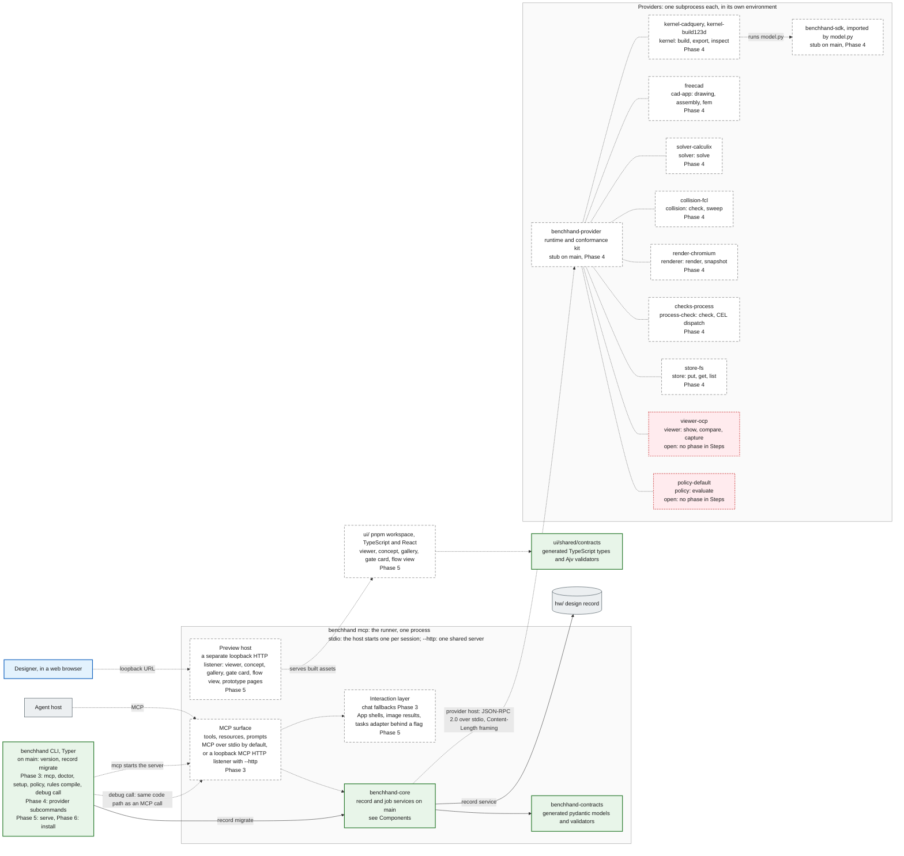
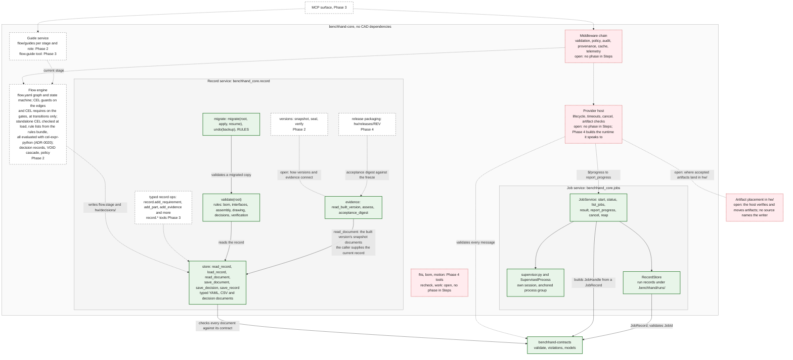
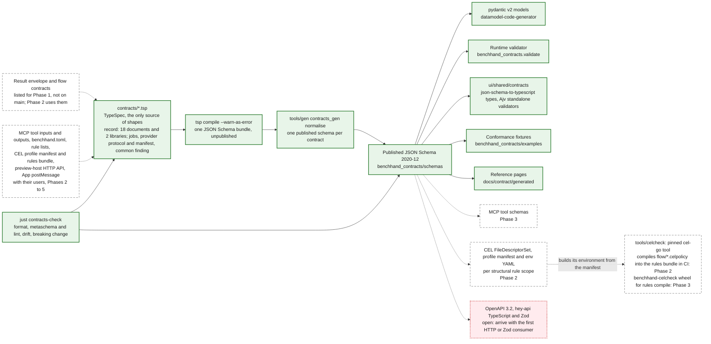

# Containers and components

The C4 containers of benchhand and the components of its core, each with the phase that delivers it.
The third diagram is the contracts pipeline that generates every message and record shape.

## Containers

## Components of benchhand-core

## Contracts and codegen

## Legend

- Styles as in the [legend](README.md#legend). Solid arrows exist on `main`, and dashed arrows are planned.
- **Open: no phase in Steps.** The plan names the middleware chain, the provider host, `viewer-ocp`, `policy-default`, and the `recheck` and `work` modules, but no phase of its Steps delivers them. The plan's [Open questions](../design-plan.md#open-questions) don't list them.
- **Open: OpenAPI and Zod.** ADR-0017 adds them with the first HTTP or Zod consumer, which no phase names yet.
- **Open: the integration points.** Plan section 5 puts CEL on transitions only: guards on the edges, `requires` on the gates. No source says a guard runs on every tool call. The provider host verifies artifacts and moves them into `hw/`, but no source routes them through the typed record store, which reads and writes YAML, CSV and decision documents only. No source names a call between record versions and the evidence service.
- The record counts come from the generated [domain model](../contract/generated/domain-model/README.md): the documents (blue) and the libraries (amber) of its overview.
- The `benchhand` CLI node is solid because the CLI exists; on `main` it has `version` and `record migrate`. The provider and SDK packages exist on `main` as empty stubs, so their nodes stay dashed until Phase 4.

## Sources

- `docs/design-plan.md`:
  - [Decisions](../design-plan.md#decisions), D1 (CLI), D4 (runner), D6 (providers), D10 (transport), D13 (provider protocol), D17 (contracts).
  - [1. Layered architecture](../design-plan.md#1-layered-architecture): the MCP surface, interaction layer, preview host, the core services and the provider list.
  - [2. Repository and package layout](../design-plan.md#2-repository-and-package-layout-temporary-repo-benchhandbenchhand-next): the packages, `ui/` and `providers/`.
  - [3. Transport: stdio vs localhost HTTP (D10)](../design-plan.md#3-transport-stdio-vs-localhost-http-d10): the lifecycle of each transport, and the preview host as a separate loopback listener.
  - [5. Flow engine and rules (D14)](../design-plan.md#5-flow-engine-and-rules-d14): the edges with CEL guards and the gates with CEL `requires`; the interpreter writes `flow.stage` and `hw/decisions/`; the CEL pipeline, with the generated profile, the cel-go tool and the rules bundle.
  - [6. Provider protocol (D13)](../design-plan.md#6-provider-protocol-d13): the hook families.
  - [6a. Contracts: generated and enforced (D17)](../design-plan.md#6a-contracts-generated-and-enforced-d17): the contract list, the generated outputs and runtime validation.
  - [7. CLI (D1)](../design-plan.md#7-cli-d1), [11. Adaptive interaction layer (D8)](../design-plan.md#11-adaptive-interaction-layer-d8) and [12. Build API (D7)](../design-plan.md#12-build-api-d7): typed record ops.
  - [Behavioural reference map](../design-plan.md#behavioural-reference-map-from-benchhandbenchhand-into-benchhandbenchhand-next): `benchhand-core/{fits,bom,recheck,motion,work}`.
  - [Steps (phased)](../design-plan.md#steps-phased): the phase of every node.
- `docs/adr/`: [0001](../adr/0001-mcp-only-interface.md), [0004](../adr/0004-server-is-runner.md), [0006](../adr/0006-providers-everywhere.md), [0010](../adr/0010-stdio-transport.md), [0011](../adr/0011-guidance-from-server.md), [0013](../adr/0013-provider-protocol.md), [0014](../adr/0014-flow-rules-cel.md), [0017](../adr/0017-contracts.md) ("Decision": TypeSpec source, the generator table, OpenAPI with the first consumer) and [0018](../adr/0018-baseline-and-no-forms.md) (no form elicitation) and [0020](../adr/0020-cel-rule-pipeline.md) (the CEL rule pipeline). Each under its "Decision" heading.
- `docs/contract/provider-protocol.md`: [1. Transport](../contract/provider-protocol.md#1-transport), [4. Hooks](../contract/provider-protocol.md#4-hooks), [5. Notifications from the provider](../contract/provider-protocol.md#5-notifications-from-the-provider) and [6. Artifacts and paths](../contract/provider-protocol.md#6-artifacts-and-paths).
- `docs/contract/versioning.md`: [Generated outputs](../contract/versioning.md#generated-outputs) and [Drift check](../contract/versioning.md#drift-check).
- `docs/phases/phase-0-1.md`: [What was built](../phases/phase-0-1.md#what-was-built) and [Not built, which the plan puts in Phase 1](../phases/phase-0-1.md#not-built-which-the-plan-puts-in-phase-1).
- Code on `main`: `packages/benchhand-core/src/benchhand_core/record/` (`store.py`, `validate.py`, `rules/`, `migrate/`, `evidence/`; `evidence/reader.py` reads snapshot documents with `read_document`), `packages/benchhand-core/src/benchhand_core/jobs/` (`service.py` `handle_of`, `supervisor.py`, `process.py`, `store.py` `RecordStore`), `packages/benchhand/src/benchhand/cli.py`, `contracts/`, `tools/gen/contracts_gen/`, `ui/shared/contracts/`.
- `docs/contract/record-migration.md`: [Dry run and apply](../contract/record-migration.md#dry-run-and-apply).
