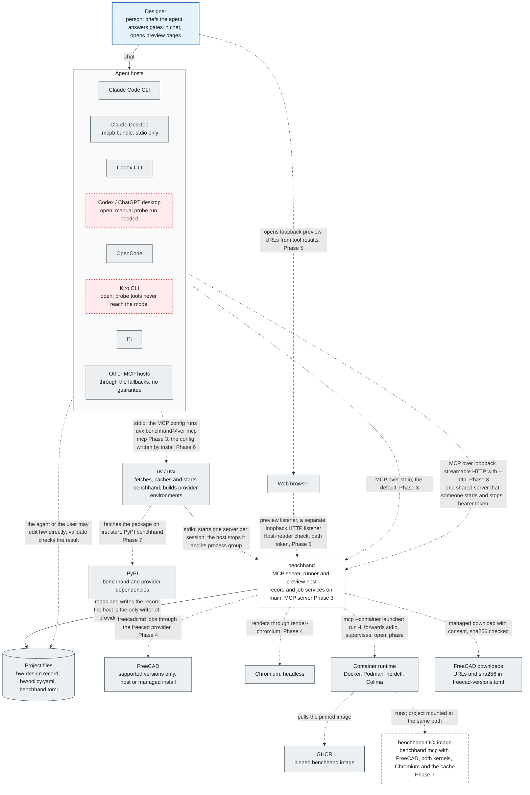

# System context

The C4 system context of benchhand: who uses it, which agent hosts start it, and which systems and files it works with.
Read it first; [containers.md](containers.md) opens the benchhand box.

## Legend

- Styles as in the [legend](README.md#legend). Solid arrows exist on `main`, and dashed arrows are planned.
- `benchhand` is dashed because its MCP server, the part every host talks to, arrives in Phase 3. The record and job services inside it are on `main` ([containers.md](containers.md)), so its arrow to `hw/` is solid.
- **Lifecycle by transport.** On stdio the host starts one server per session and stops it with its process group. With `--http` one shared server outlives the sessions, and someone has to start and stop it. The preview listener is a third, separate loopback listener in the same process, whichever transport MCP uses.
- **Only writer.** The host is the only writer of provider output into `hw/`: a provider writes under its `outDir`, and the host moves the accepted artifacts. That rule doesn't stop the agent or the user editing `hw/`.
- **Open: Codex / ChatGPT desktop.** The probe hasn't run there. **Open: Kiro CLI.** Kiro connects and lists the tools, but they never reach the model, under the default or a custom agent. Both settle the "?" cells of the [Open questions](../design-plan.md#open-questions).
- **Open: container launcher phase.** Phase 6 delivers `install --container` and Phase 7 the image. No step names the phase of the `mcp --container` launcher itself.
- The arrow from the hosts to `hw/` is not a planned interface. The server doesn't stop direct edits, because gates guide and are no security control; `validate` checks the record that results.

## Sources

- `docs/design-plan.md`:
  - [Decisions](../design-plan.md#decisions), D2 (uvx and the container), D4 (server is the runner), D5 (FreeCAD versions), D9 (hosts tested at release), D10 (transport).
  - [1. Layered architecture](../design-plan.md#1-layered-architecture): the harness list and the transports.
  - [3. Transport: stdio vs localhost HTTP (D10)](../design-plan.md#3-transport-stdio-vs-localhost-http-d10): the lifecycle, sessions and auth rows of each transport; the preview listener, the Host-header check and the path token; Claude Desktop is stdio only.
  - [5. Flow engine and rules (D14)](../design-plan.md#5-flow-engine-and-rules-d14), "Scope": direct edits to `hw/` aren't stopped, and `validate` reports them.
  - [8. Prerequisites, FreeCAD and the container](../design-plan.md#8-prerequisites-freecad-and-the-container): the FreeCAD lookup and managed install, the container runtimes, the launcher steps, GHCR and the same-path mount.
  - [10. Harness integration and distribution](../design-plan.md#10-harness-integration-and-distribution): the `.mcpb` bundle.
  - [Steps (phased)](../design-plan.md#steps-phased): Phases 3 (`benchhand mcp`), 4, 5, 6 (`install`) and 7 (PyPI `benchhand`).
- `docs/adr/`: [0002](../adr/0002-install-uvx-and-container.md) (install and container), [0003](../adr/0003-gates-guide.md) (gates guide), [0004](../adr/0004-server-is-runner.md) (server is the runner), [0005](../adr/0005-freecad-supported-versions.md) (FreeCAD list and download), [0009](../adr/0009-first-class-hosts.md) (hosts), [0010](../adr/0010-stdio-transport.md) (stdio). Each under its "Decision" heading.
- `docs/contract/provider-protocol.md`: [4. Hooks](../contract/provider-protocol.md#4-hooks) ("Writes stay in the output directory") and [6. Artifacts and paths](../contract/provider-protocol.md#6-artifacts-and-paths): the host moves accepted provider artifacts into `hw/`.
- `docs/client-support.md`: [Client support](../client-support.md#client-support), the Kiro CLI and Codex / ChatGPT desktop rows.
