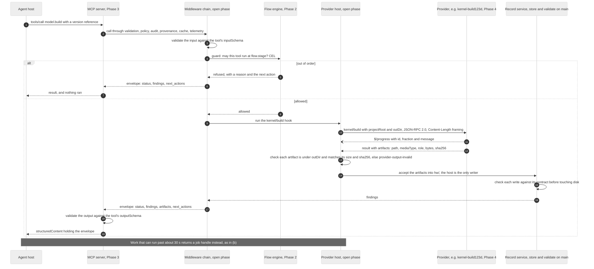
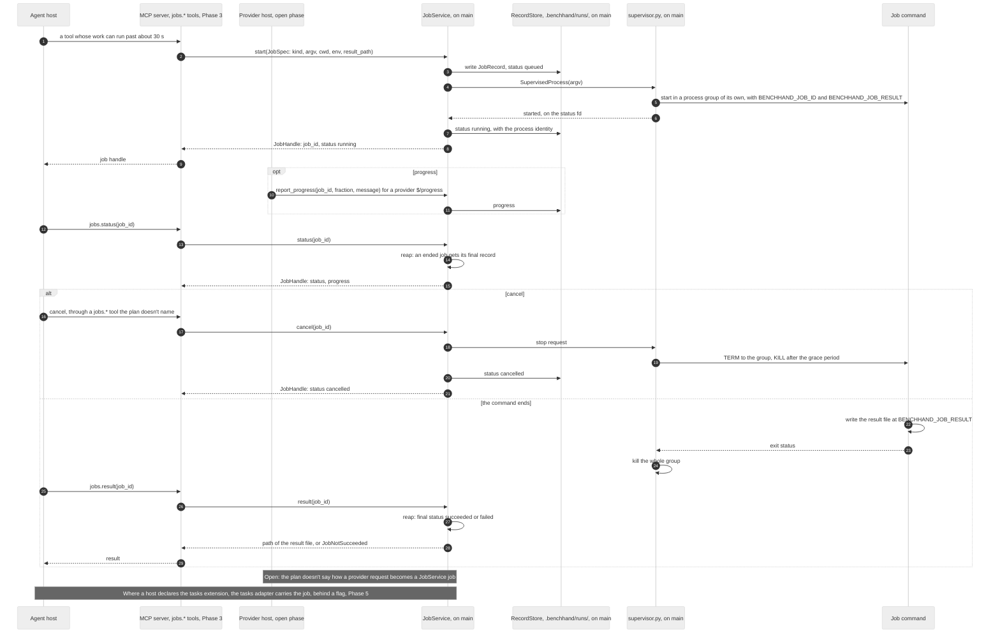
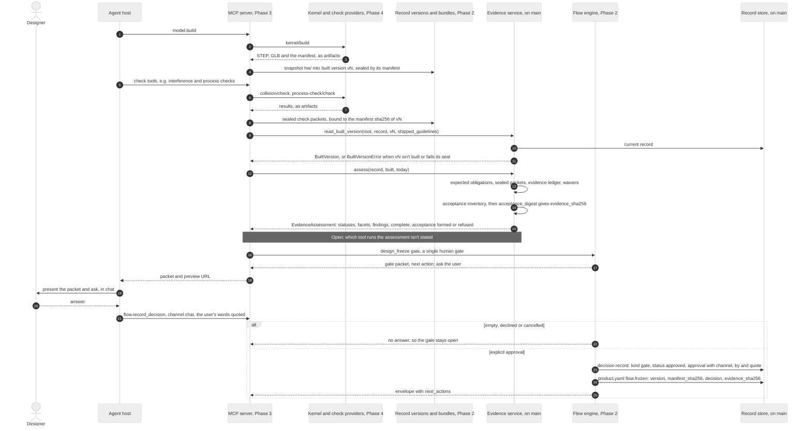
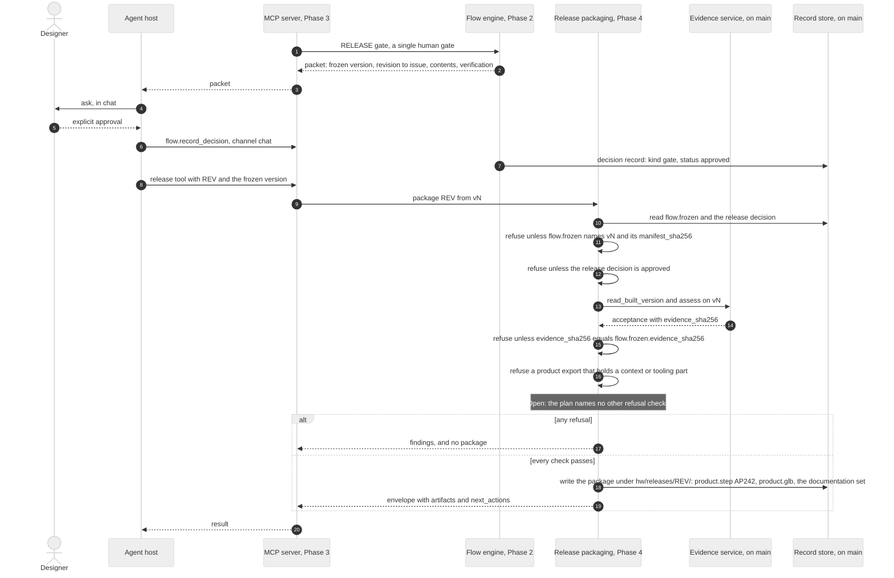
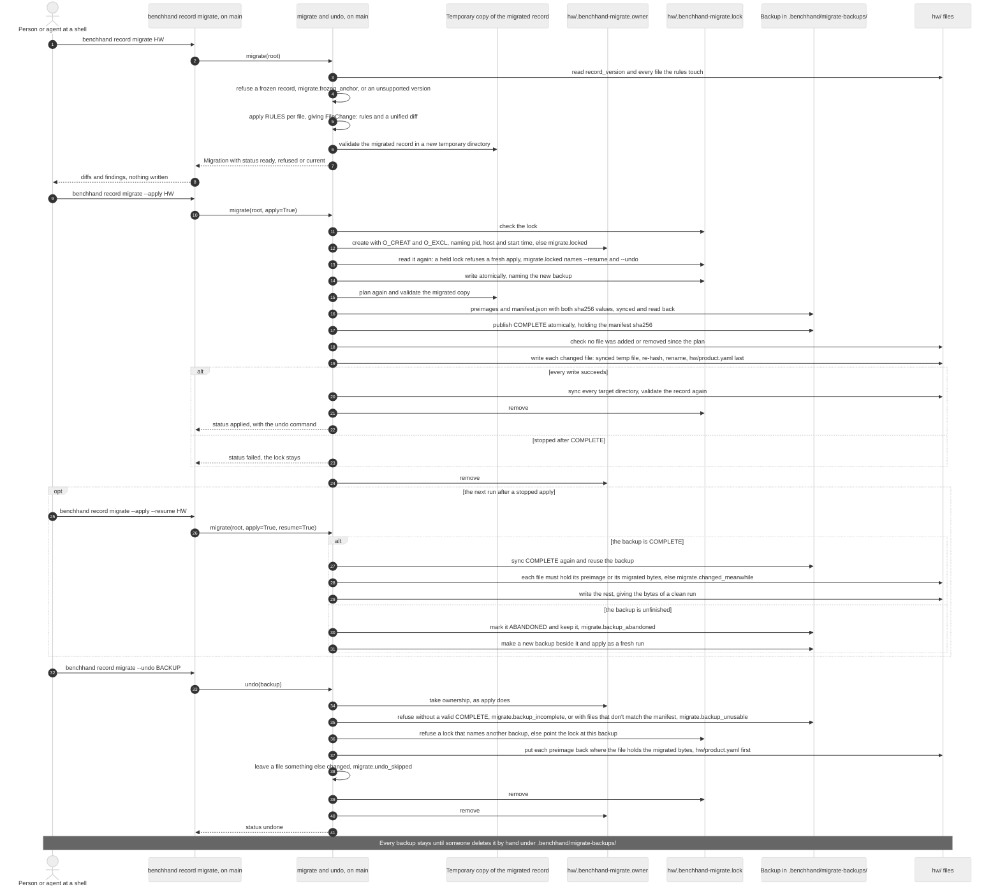

# Data flow

Five sequences: one MCP tool call, a long job, evidence and freeze, release, and record migration.
Names come from the code where it exists on `main`, and from the plan otherwise.

## (a) One MCP tool call

## (b) A long-running job

## (c) Evidence and freeze

## (d) Release

## (e) Migrate

## Legend

- Each participant's name carries its status: "on main", "Phase N" (planned) or "open phase" (named in the plan, with no phase in its Steps). See the [legend](README.md#legend).
- A solid arrow is a call or a message, and a dashed arrow is its reply. An open arrowhead is a notification.
- **Open: 30 s or 50 s.** ADR-0018 sends work over about 30 s to a job handle; plan section 11 and provider-protocol section 8 say about 50 s. The diagrams follow ADR-0018, the later decision.
- **Open: provider request to job.** The plan says the server manages provider workers and jobs, and that `$/progress` feeds job-handle status. `JobService` runs a command under a supervisor, and no document says how a provider request becomes such a job.
- **Open: the cancel tool.** The plan names `jobs.start`, `jobs.status` and `jobs.result`, and `jobs.*` for Phase 3; no cancel tool name.
- **Open: release refusals.** The plan names refusal checks and the acceptance digest against the freeze, and section 12a names the context and tooling refusal. It doesn't list the rest.
- **Open: migrate entry point.** The plan's CLI list (D1) has no `record migrate`, and no MCP tool for migration is named. `main` has the CLI subcommand.
- None of these are in the plan's [Open questions](../design-plan.md#open-questions).

## Sources

- (a) One tool call:
  - `docs/design-plan.md`: [1. Layered architecture](../design-plan.md#1-layered-architecture) (middleware order), [5. Flow engine and rules (D14)](../design-plan.md#5-flow-engine-and-rules-d14) ("The engine refuses out-of-order transitions with a reason and the next action"), [6a. Contracts](../design-plan.md#6a-contracts-generated-and-enforced-d17) ("Runtime, both directions"; the envelope fields), [9. Guidance from the server](../design-plan.md#9-guidance-from-the-server-minimal-steering-d11) (`next_actions`), [12. Build API (D7)](../design-plan.md#12-build-api-d7) (`model.build`).
  - `docs/contract/provider-protocol.md`: [1. Transport](../contract/provider-protocol.md#1-transport), [5. Notifications from the provider](../contract/provider-protocol.md#5-notifications-from-the-provider), [6. Artifacts and paths](../contract/provider-protocol.md#6-artifacts-and-paths), [8. Requests in flight, cancellation and timeouts](../contract/provider-protocol.md#8-requests-in-flight-cancellation-and-timeouts).
  - ADRs: [0011](../adr/0011-guidance-from-server.md), [0013](../adr/0013-provider-protocol.md), [0014](../adr/0014-flow-rules-cel.md), [0017](../adr/0017-contracts.md), [0018](../adr/0018-baseline-and-no-forms.md), each under "Decision".
  - Code on `main`: `benchhand_core/record/store.py` (`save_document`, `check_document`).
- (b) Long job:
  - Code on `main`: `benchhand_core/jobs/service.py` (`JobService`, `JobSpec`), `jobs/process.py` (`SupervisedProcess`), `jobs/supervisor.py`, `jobs/store.py` (`RecordStore`), `contracts/jobs/job.tsp` (`JobRecord`, `JobHandle`, `JobStatus`).
  - `docs/design-plan.md`: [11. Adaptive interaction layer (D8)](../design-plan.md#11-adaptive-interaction-layer-d8) (the long-jobs row, the tasks adapter behind a flag), [Steps (phased)](../design-plan.md#steps-phased) (Phases 3 and 5); [Decisions](../design-plan.md#decisions), D4.
  - `docs/contract/provider-protocol.md`: [5. Notifications from the provider](../contract/provider-protocol.md#5-notifications-from-the-provider).
- (c) Evidence and freeze:
  - `docs/design-plan.md`: [Steps (phased)](../design-plan.md#steps-phased), Phase 2 (version snapshots, seal and verify; decision records) and Phase 4 (providers); [11. Adaptive interaction layer (D8)](../design-plan.md#11-adaptive-interaction-layer-d8) (the human-gate row, `flow.record_decision`, "An empty or declined answer means no answer").
  - `contracts/record/product.tsp` (`flow.frozen`) and `contracts/record/decision.tsp` (gate decisions), on `main`.
  - Code on `main`: `packages/benchhand-core/src/benchhand_core/record/evidence/` (`reader.py` `read_built_version`, `assess.py` `assess`, `digest.py` `acceptance_digest`).
  - Prototype `benchhand/benchhand` at `release.toml` `reference_commit` `412b5d9`: [`skills/cad-flow/references/flow.md` "Gate control"](https://github.com/benchhand/benchhand/blob/412b5d9ae2faa420f909c1f50cc98a696651539f/skills/cad-flow/references/flow.md#gate-control) (DESIGN freeze is a single human gate).
- (d) Release:
  - `docs/design-plan.md`: [Steps (phased)](../design-plan.md#steps-phased), Phase 4 ("Release packaging (`hw/releases/<REV>/`, refusal checks and the acceptance digest against the freeze)"); [12a. Documentation set](../design-plan.md#12a-documentation-set-annotations-groups-materials-and-finish) (STEP AP242 as the primary deliverable, `product.step` and `product.glb`, the context and tooling refusal).
  - Prototype `skills/cad-flow/references/flow.md` "Gate control" at `412b5d9`: RELEASE is a single human gate, and a release decision that isn't approved is refused.
- (e) Migrate:
  - `docs/contract/record-migration.md`: [Dry run and apply](../contract/record-migration.md#dry-run-and-apply), on `main`.
  - Code on `main`: `packages/benchhand-core/src/benchhand_core/record/migrate/` (`service.py` `migrate`, `undo`, `MigrationStatus`; `recovery.py` `acquire_owner`, `write_lock`, `write_backup`, `abandon`) and `packages/benchhand/src/benchhand/cli.py` (`record migrate`).
  - `docs/design-plan.md`: [Steps (phased)](../design-plan.md#steps-phased), Phase 1 ("typed reads and writes, validate, migrate and evidence").
  - `docs/phases/phase-0-1.md`: [Not built, which the plan puts in Phase 1](../phases/phase-0-1.md#not-built-which-the-plan-puts-in-phase-1).
