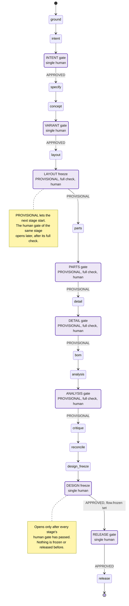
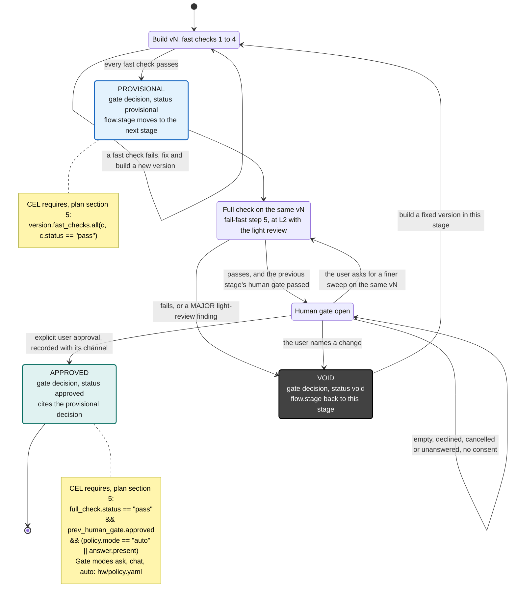
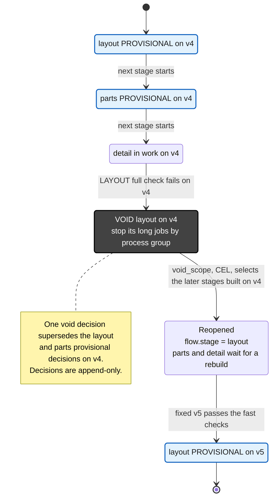
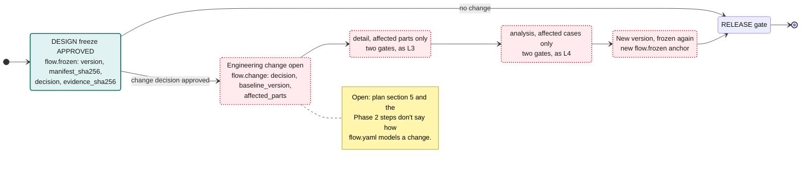

# Design flow

The design flow as a state machine: the stages, the gates between them, PROVISIONAL, APPROVED and VOID, the VOID cascade and engineering change.
It is drawn by hand from the prototype's flow at the reference commit and plan section 5. Phase 2 will generate it from `flow.yaml`.

Nothing on this page runs on `main`. The flow engine is Phase 2 work. On `main`, the stage names are the `stage` enum of the record contract, and PROVISIONAL, APPROVED and VOID are the statuses of a gate decision record.

## Stages and gates

## One two-gate stage

LAYOUT freeze, PARTS, DETAIL and ANALYSIS each approve a built version vN in three steps: PROVISIONAL, the full check, and the human gate.

The single human gates (INTENT, VARIANT, DESIGN freeze and RELEASE) have no PROVISIONAL step. They present a packet, ask the user, and record APPROVED only on explicit approval; `flow.stage` advances only then.

## VOID cascade

An example: the LAYOUT full check on v4 fails while PARTS and DETAIL already run on v4.

Each reopened later stage is rebuilt on the fixed version. Its human gate stays closed until its own full check passes on a version built from the fix.

## Engineering change after the freeze

## Legend

- White states are stages, named by the record contract's `stage` enum. Purple states are gates.
- Blue is PROVISIONAL, teal is APPROVED and dark grey is VOID. These are the three statuses of a gate decision, `kind: gate`, in `hw/decisions/`.
- **Open** (red, dotted): engineering change. The record contract has `flow.change`, and the prototype reopens affected parts as L3 and then affected cases as L4. Neither the plan nor an ADR says how `flow.yaml` represents it; the in-review migrate lane refuses frozen records until "the Phase 2 flow engine can record an engineering change". The plan's [Open questions](../design-plan.md#open-questions) don't list it.
- The VOID cascade example uses v4 and v5 for illustration.
- In the prototype the statuses were MADR `proposed`, `accepted` and `rejected`. The record contract renames them `provisional`, `approved` and `void`.

## Sources

- Prototype `benchhand/benchhand` at `release.toml` `reference_commit` `412b5d9`:
  - [`skills/cad-flow/references/flow.md` "Stages, gates, and durable outputs"](https://github.com/benchhand/benchhand/blob/412b5d9ae2faa420f909c1f50cc98a696651539f/skills/cad-flow/references/flow.md#stages-gates-and-durable-outputs): the stage order, the stage enum and the gate per stage.
  - [`skills/cad-flow/references/flow.md` "Gate control"](https://github.com/benchhand/benchhand/blob/412b5d9ae2faa420f909c1f50cc98a696651539f/skills/cad-flow/references/flow.md#gate-control): the single human gates, the three steps of a two-gate stage, the VOID causes and the cascade, and "no consent" on a cancelled or unanswered question.
  - [`skills/cad-flow/references/flow.md` "Stage loop and recheck boundary"](https://github.com/benchhand/benchhand/blob/412b5d9ae2faa420f909c1f50cc98a696651539f/skills/cad-flow/references/flow.md#stage-loop-and-recheck-boundary): after the freeze, reopen only affected parts, then build a new version and freeze it again.
  - [`skills/cad-flow/SKILL.md` "Workflow" and "Delegation"](https://github.com/benchhand/benchhand/blob/412b5d9ae2faa420f909c1f50cc98a696651539f/skills/cad-flow/SKILL.md): the stage list in step 3, and the ECO row ("As L3, then as L4").
- `docs/design-plan.md`:
  - [Context](../design-plan.md#context): `flow.md` "Gate control" defines PROVISIONAL, APPROVED and VOID.
  - [5. Flow engine and rules (D14)](../design-plan.md#5-flow-engine-and-rules-d14):
    - `flow.yaml` holds the nodes, gates and edges, with the gate kinds `single-human` and `provisional+full+human`.
    - The CEL `requires` examples for PROVISIONAL and APPROVED, and the CEL `void_scope`.
    - The interpreter is the normal writer of `flow.stage` and `hw/decisions/`.
  - [Decisions](../design-plan.md#decisions), D3: the gate modes in `hw/policy.yaml`.
  - [Steps (phased)](../design-plan.md#steps-phased), Phase 2: `flow.yaml`, the interpreter, CEL guards, decision records and the VOID cascade.
  - [Verification](../design-plan.md#verification), "Flow tests".
- `docs/adr/`: [0003](../adr/0003-gates-guide.md) (gates guide; modes ask, chat, auto) and [0014](../adr/0014-flow-rules-cel.md) (the flow is data, the rules are CEL), each under "Decision".
- `docs/contract/record-migration.md`: [Decision record format](../contract/record-migration.md#decision-record-format): `kind: gate` with `approved`, `provisional` or `void`, and the prototype's MADR statuses.
- Contracts on `main`: `contracts/record/common.tsp` (`stage`), `contracts/record/product.tsp` (`flow.frozen`, `flow.change`), `contracts/record/decision.tsp` (gate statuses).
- In review: `docs/contract/record-migration.md` "Dry run and apply", its "Frozen records" paragraph, on branch `pi-subagents/task-1-c25b8e0-b8d5-s0-t0`.
