# Function map: prototype to benchhand-next

Generated by tools/map (`just reference-map --write`) from reference-map.yaml. Do not edit.

Each diagram follows one area of the prototype at `412b5d9`. A prototype file is on the left and its home in benchhand-next is on the right. The arrow names the phase that builds the home: `P1` is Phase 1 of the design plan. `phase open` means the home waits on an open question.

- Green: ported.
- Pale green with a dashed green border: partial. Part of the file is ported; the list below says what is left and which phase owns it.
- Amber: in progress.
- Blue: planned.
- Gray and dashed: dropped. The box it points to gives the reason.

| Area | Entries | planned | in-progress | partial | ported | dropped |
|---|---|---|---|---|---|---|
| cad-analysis | 17 | 17 | 0 | 0 | 0 | 0 |
| cad-bom | 3 | 3 | 0 | 0 | 0 | 0 |
| cad-concept | 5 | 5 | 0 | 0 | 0 | 0 |
| cad-design | 15 | 15 | 0 | 0 | 0 | 0 |
| cad-drawings | 27 | 26 | 0 | 0 | 0 | 1 |
| cad-fits | 5 | 5 | 0 | 0 | 0 | 0 |
| cad-flow | 11 | 10 | 0 | 1 | 0 | 0 |
| cad-model | 29 | 26 | 0 | 1 | 0 | 2 |
| cad-motion | 21 | 21 | 0 | 0 | 0 | 0 |
| cad-recheck | 2 | 2 | 0 | 0 | 0 | 0 |
| cad-record | 36 | 24 | 0 | 8 | 2 | 2 |
| cad-render | 7 | 7 | 0 | 0 | 0 | 0 |
| cad-review-dfm | 1 | 1 | 0 | 0 | 0 | 0 |
| cad-review-mech | 1 | 1 | 0 | 0 | 0 | 0 |
| cad-viewer | 10 | 10 | 0 | 0 | 0 | 0 |
| agents and harness | 14 | 10 | 0 | 0 | 0 | 4 |
| examples | 1 | 1 | 0 | 0 | 0 | 0 |
| **all** | **205** | 184 | 0 | 10 | 2 | 9 |

Partly ported:

- `skills/cad-flow/scripts/process_lifecycle.py`: Ported: the process identity and the supervision of a process group. Left out: the scoped run claims (`claim_run`, `RunGuard`) and the stray-run report (`strays`) that the build, FEA and sweep scripts use; Phase 4 owns them, with the tools that run those jobs.
- `skills/cad-model/scripts/cadmodel/record.py`: Ported: reading a written version snapshot (`read_snapshot`). Left out: capturing and writing the snapshot a version is built from (`snapshot`, `write_snapshot`, `read_folder`), which the Phase 2 version service owns. Its loaders of sibling modules are dropped: service boundaries replace them.
- `skills/cad-record/scripts/assembly_data.py`: Ported: the occurrence inventory and placements. Left out: the drawing item resolver (`drawing_item`) for the drawing tools and the joint tree (`joint_tree`) for the motion tools, both Phase 4.
- `skills/cad-record/scripts/check_packet.py`: Ported: the seal and binding checks of a published packet (reader.py), and whether a sealed packet counts and what its outcomes show (packets.py). Left out: building and publishing a packet (`build`, `emit`), which the check producers do (Phase 4).
- `skills/cad-record/scripts/evidence.py`: Ported: the assessment of one built version and its acceptance digest. Left out: the stage gates and the selection gate (Phase 2); release policy, stamped packets and version acceptance (Phase 4); producer orchestration and the CLI, which go to the tool that runs the checks, not yet named.
- `skills/cad-record/scripts/guidelines.py`: Ported: discovery, validation and applicability of the guideline sets, and their digests. Phase 4 owns limit resolution and its trace (`resolve_guidelines`, `write_trace`), and the calibration flag and packet keys; the process checks and stack-up use them. Phase 2 owns the shipped-set copies a version build makes (`snapshot_files`). Phase 3 owns the pin warnings that machine_profile.py reports.
- `skills/cad-record/scripts/manufacturing_intent.py`: Ported: the expected obligations, the use-case assessment and joint property resolution; the record contracts and the record store do its schema and unit checks. Left out: route and capability resolution for the process checks (`part_route`, `capability_limit`, Phase 4); the use-case question templates (`use_case_questions`, `blank_use_case`), for the record.* tools (Phase 3); the x-plausible value warnings validate.py reports (`plausibility_problems`), which no phase names.
- `skills/cad-record/scripts/schema_registry.py`: Ported: the document and `$ref` validators over the published schemas. Left out: the validator with one extra keyword (`keyword_validator`), which reads the x-plausible value warnings; no phase names those warnings.
- `skills/cad-record/scripts/validate.py`: Ported: the contract and cross-document rules of the record. Left out: the motion-case check (`check_motion_cases`) and the release-readiness check (`check_release_readiness`), which go with the motion and release tools in Phase 4.
- `skills/cad-record/layout.json`: Ported: the record document paths, the OS and tool junk the reader skips, the sealed history migrate leaves alone, and reading the version and check layout with its seal manifests. Left out: publishing versions and bundles, the cache locations, the layout findings and the full layout API (Phase 2); the release package (Phase 4); the git storage rules setup writes (Phase 3).

Phase open:

- `skills/cad-flow/scripts/scratch.py`: No phase of the design-plan Steps names the `work` module; containers.md marks it open.
- `skills/cad-recheck/scripts/stamp.py`: Verify belongs with versions. No phase of the design-plan Steps names the `recheck` module; containers.md marks it open.
- `skills/cad-record/assets/manufacturing/`: The evidence code reads these guideline and material-profile sets, but they aren't a package asset yet: they become one when the guideline catalog is ported, a design-plan [Open question](../design-plan.md#open-questions).

## cad-analysis

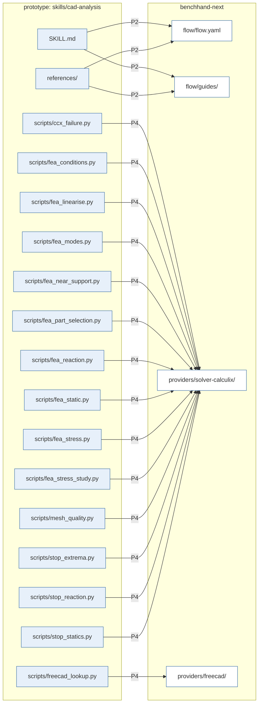

## cad-bom

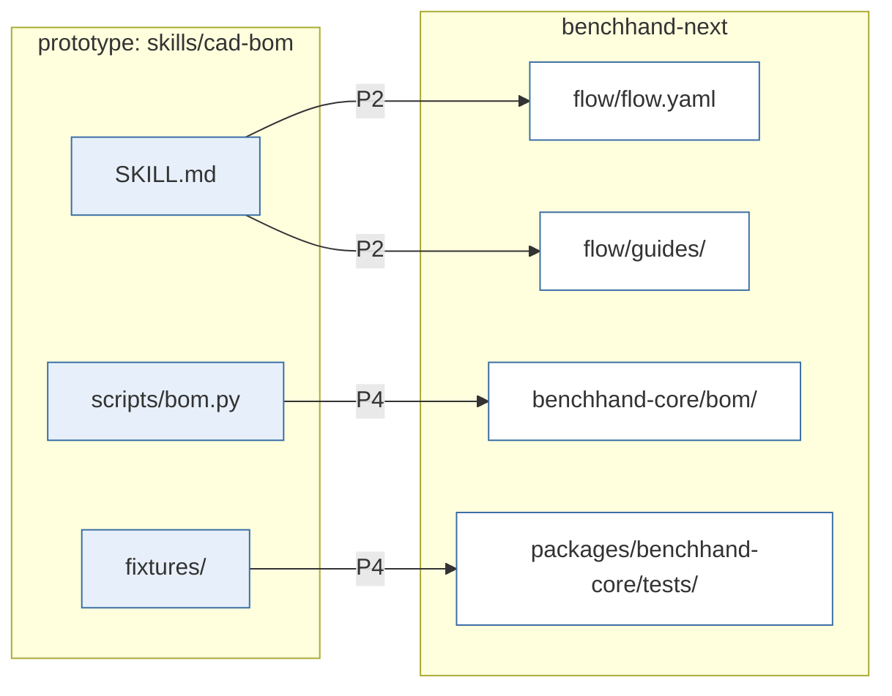

## cad-concept

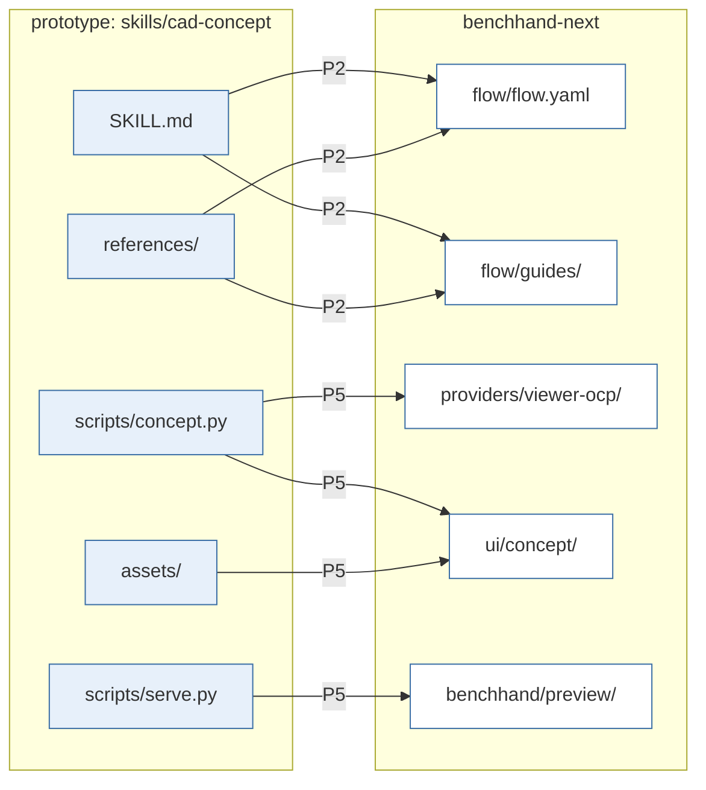

## cad-design

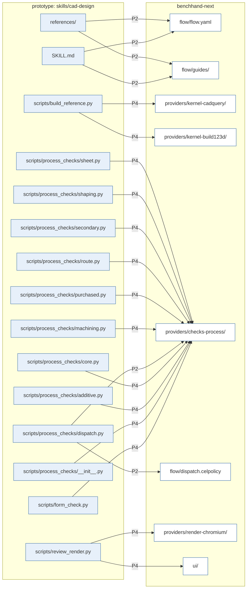

## cad-drawings

```mermaid
flowchart LR
    subgraph prototype["prototype: skills/cad-drawings"]
        p0["SKILL.md"]
        p1["scripts/assembly_check.py"]
        p2["scripts/assembly_drawing.py"]
        p3["scripts/assembly_geometry.py"]
        p4["scripts/assembly_sheet.py"]
        p5["scripts/assembly_techdraw_job.py"]
        p6["scripts/completeness.py"]
        p7["scripts/drawing.py"]
        p8["scripts/drawing_contract.py"]
        p9["scripts/drawing_document.py"]
        p10["scripts/drawing_draft.py"]
        p11["scripts/drawing_intent.py"]
        p12["scripts/drawing_merge.py"]
        p13["scripts/export_job.py"]
        p14["scripts/feature_coverage.py"]
        p15["scripts/feature_geometry.py"]
        p16["scripts/feature_recognition.py"]
        p17["scripts/freecad_runtime.py"]
        p18["scripts/freecad_views.py"]
        p19["scripts/layout_check.py"]
        p20["scripts/part_views.py"]
        p21["scripts/section_hatch.py"]
        p22["scripts/shared_module.py"]
        p23["scripts/sheet.py"]
        p24["scripts/sheet_export.py"]
        p25["scripts/techdraw_job.py"]
        p26["references/"]
    end
    subgraph next["benchhand-next"]
        h0["flow/flow.yaml"]
        h1["flow/guides/"]
        h2["providers/freecad/"]
        h3["dropped: loads a sibling script by path; providers replace that"]
    end
    p0 -->|"P2"| h0
    p0 -->|"P2"| h1
    p1 -->|"P4"| h2
    p2 -->|"P4"| h2
    p3 -->|"P4"| h2
    p4 -->|"P4"| h2
    p5 -->|"P4"| h2
    p6 -->|"P4"| h2
    p7 -->|"P4"| h2
    p8 -->|"P4"| h2
    p9 -->|"P4"| h2
    p10 -->|"P4"| h2
    p11 -->|"P4"| h2
    p12 -->|"P4"| h2
    p13 -->|"P4"| h2
    p14 -->|"P4"| h2
    p15 -->|"P4"| h2
    p16 -->|"P4"| h2
    p17 -->|"P4"| h2
    p18 -->|"P4"| h2
    p19 -->|"P4"| h2
    p20 -->|"P4"| h2
    p21 -->|"P4"| h2
    p22 -. dropped .-> h3
    p23 -->|"P4"| h2
    p24 -->|"P4"| h2
    p25 -->|"P4"| h2
    p26 -->|"P2"| h0
    p26 -->|"P2"| h1
    class p0 planned
    class p1 planned
    class p2 planned
    class p3 planned
    class p4 planned
    class p5 planned
    class p6 planned
    class p7 planned
    class p8 planned
    class p9 planned
    class p10 planned
    class p11 planned
    class p12 planned
    class p13 planned
    class p14 planned
    class p15 planned
    class p16 planned
    class p17 planned
    class p18 planned
    class p19 planned
    class p20 planned
    class p21 planned
    class p22 dropped
    class p23 planned
    class p24 planned
    class p25 planned
    class p26 planned
    class h0 home
    class h1 home
    class h2 home
    class h3 dropped
    classDef ported fill:#d8f3dc,stroke:#2d6a4f
    classDef partial fill:#f1faf3,stroke:#2d6a4f,stroke-width:2px,stroke-dasharray: 6 3
    classDef inprogress fill:#fff3bf,stroke:#b08900
    classDef planned fill:#e7f0fa,stroke:#3a6ea5
    classDef dropped fill:#eeeeee,stroke:#888888,stroke-dasharray: 4 3,color:#666666
    classDef home fill:#ffffff,stroke:#3a6ea5
```

## cad-fits

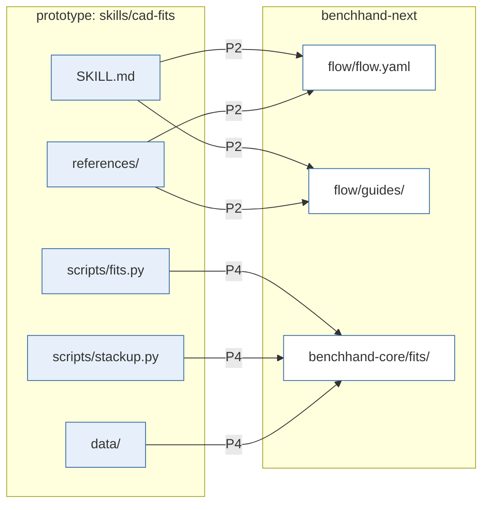

## cad-flow

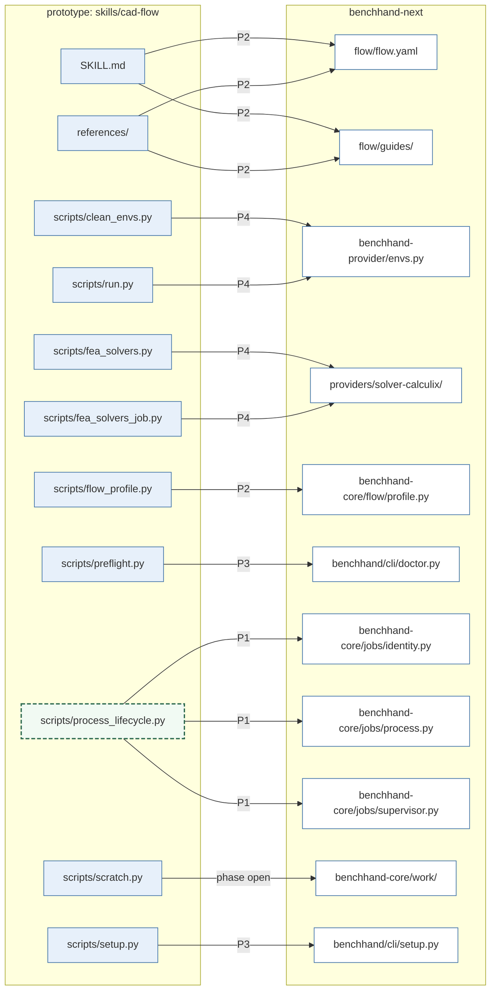

## cad-model

```mermaid
flowchart LR
    subgraph prototype["prototype: skills/cad-model"]
        p0["SKILL.md"]
        p1["scripts/cad_model.py"]
        p2["scripts/cadmodel/__init__.py"]
        p3["scripts/cadmodel/agreement.py"]
        p4["scripts/cadmodel/build.py"]
        p5["scripts/cadmodel/check.py"]
        p6["scripts/cadmodel/components.py"]
        p7["scripts/cadmodel/diff.py"]
        p8["scripts/cadmodel/fillets.py"]
        p9["scripts/cadmodel/fonts.py"]
        p10["scripts/cadmodel/holes.py"]
        p11["scripts/cadmodel/manufacture.py"]
        p12["scripts/cadmodel/mesh.py"]
        p13["scripts/cadmodel/motion.py"]
        p14["scripts/cadmodel/occ.py"]
        p15["scripts/cadmodel/occ_derived.py"]
        p16["scripts/cadmodel/orientation.py"]
        p17["scripts/cadmodel/provenance.py"]
        p18["scripts/cadmodel/record.py"]
        p19["scripts/cadmodel/runner.py"]
        p20["scripts/cadmodel/safe.py"]
        p21["scripts/cadmodel/scriptenv.py"]
        p22["scripts/cadmodel/stepfile.py"]
        p23["scripts/cadmodel/store.py"]
        p24["scripts/cadmodel/threemf.py"]
        p25["scripts/run_build123d.py"]
        p26["scripts/run_cadquery.py"]
        p27["NOTICE"]
        p28["references/"]
    end
    subgraph next["benchhand-next"]
        h0["flow/flow.yaml"]
        h1["flow/guides/"]
        h2["providers/kernel-cadquery/"]
        h3["providers/kernel-build123d/"]
        h4["dropped: a package docstring only"]
        h5["benchhand-sdk/"]
        h6["dropped: loads sibling modules by path; service boundaries replace that"]
        h7["benchhand-core/middleware/provenance.py"]
        h8["benchhand-core/record/evidence/reader.py"]
        h9["benchhand-provider/envs.py"]
        h10["benchhand-core/middleware/cache.py"]
    end
    p0 -->|"P2"| h0
    p0 -->|"P2"| h1
    p1 -->|"P4"| h2
    p1 -->|"P4"| h3
    p2 -. dropped .-> h4
    p3 -->|"P4"| h2
    p3 -->|"P4"| h3
    p4 -->|"P4"| h2
    p4 -->|"P4"| h3
    p5 -->|"P4"| h2
    p5 -->|"P4"| h3
    p6 -->|"P4"| h5
    p7 -->|"P4"| h2
    p7 -->|"P4"| h3
    p8 -->|"P4"| h5
    p9 -->|"P4"| h5
    p10 -->|"P4"| h5
    p11 -->|"P4"| h2
    p11 -->|"P4"| h3
    p12 -->|"P4"| h2
    p12 -->|"P4"| h3
    p13 -. dropped .-> h6
    p14 -->|"P4"| h5
    p15 -->|"P4"| h5
    p16 -->|"P4"| h5
    p17 -->|"P2"| h7
    p18 -->|"P1"| h8
    p19 -->|"P4"| h2
    p19 -->|"P4"| h3
    p20 -->|"P4"| h5
    p21 -->|"P4"| h9
    p22 -->|"P4"| h2
    p22 -->|"P4"| h3
    p23 -->|"P2"| h10
    p24 -->|"P4"| h2
    p24 -->|"P4"| h3
    p25 -->|"P4"| h3
    p26 -->|"P4"| h2
    p27 -->|"P4"| h5
    p28 -->|"P2"| h0
    p28 -->|"P2"| h1
    class p0 planned
    class p1 planned
    class p2 dropped
    class p3 planned
    class p4 planned
    class p5 planned
    class p6 planned
    class p7 planned
    class p8 planned
    class p9 planned
    class p10 planned
    class p11 planned
    class p12 planned
    class p13 dropped
    class p14 planned
    class p15 planned
    class p16 planned
    class p17 planned
    class p18 partial
    class p19 planned
    class p20 planned
    class p21 planned
    class p22 planned
    class p23 planned
    class p24 planned
    class p25 planned
    class p26 planned
    class p27 planned
    class p28 planned
    class h0 home
    class h1 home
    class h2 home
    class h3 home
    class h4 dropped
    class h5 home
    class h6 dropped
    class h7 home
    class h8 home
    class h9 home
    class h10 home
    classDef ported fill:#d8f3dc,stroke:#2d6a4f
    classDef partial fill:#f1faf3,stroke:#2d6a4f,stroke-width:2px,stroke-dasharray: 6 3
    classDef inprogress fill:#fff3bf,stroke:#b08900
    classDef planned fill:#e7f0fa,stroke:#3a6ea5
    classDef dropped fill:#eeeeee,stroke:#888888,stroke-dasharray: 4 3,color:#666666
    classDef home fill:#ffffff,stroke:#3a6ea5
```

## cad-motion

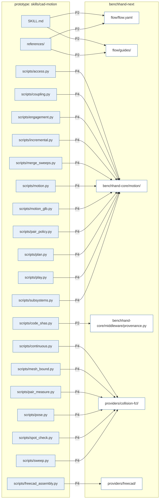

## cad-recheck

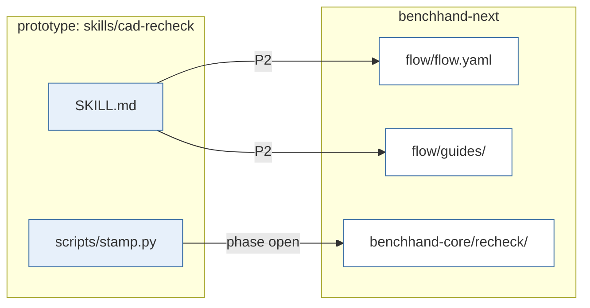

## cad-record

```mermaid
flowchart LR
    subgraph prototype["prototype: skills/cad-record"]
        p0["SKILL.md"]
        p1["scripts/assembly_data.py"]
        p2["scripts/assembly_operations.py"]
        p3["scripts/build_guide.py"]
        p4["scripts/cad_api.py"]
        p5["scripts/check_packet.py"]
        p6["scripts/cli.py"]
        p7["scripts/decision_records.py"]
        p8["scripts/design_rules.py"]
        p9["scripts/emit.py"]
        p10["scripts/evidence.py"]
        p11["scripts/evidence_paths.py"]
        p12["scripts/fail_fast.py"]
        p13["scripts/flow_profile_gate.py"]
        p14["scripts/generated_docs.py"]
        p15["scripts/guidelines.py"]
        p16["scripts/impact.py"]
        p17["scripts/layout.py"]
        p18["scripts/machine_profile.py"]
        p19["scripts/manufacturing_intent.py"]
        p20["scripts/prune.py"]
        p21["scripts/release.py"]
        p22["scripts/sarif.py"]
        p23["scripts/schema_registry.py"]
        p24["scripts/selection.py"]
        p25["scripts/stages.py"]
        p26["scripts/store.py"]
        p27["scripts/validate.py"]
        p28["scripts/yaml_loader.py"]
        p29["assets/docs-templates/"]
        p30["assets/manufacturing/"]
        p31["assets/project-template/"]
        p32["layout.json"]
        p33["references/"]
        p34["schemas/"]
        p35["vendor/"]
    end
    subgraph next["benchhand-next"]
        h0["flow/flow.yaml"]
        h1["flow/guides/"]
        h2["benchhand-core/record/rules/assembly.py"]
        h3["benchhand-core/record/docs/"]
        h4["dropped: generated from contracts/ (ADR-0017)"]
        h5["benchhand-core/record/evidence/packets.py"]
        h6["benchhand-core/record/evidence/reader.py"]
        h7["benchhand/cli/"]
        h8["benchhand-core/flow/decisions.py"]
        h9["benchhand-core/record/rules/interfaces.py"]
        h10["benchhand-core/flow/envelope.py"]
        h11["benchhand-core/record/evidence/"]
        h12["benchhand-core/record/evidence/paths.py"]
        h13["benchhand-core/record/evidence/path_judge.py"]
        h14["flow/checks-by-iteration.celpolicy"]
        h15["benchhand-core/flow/profile.py"]
        h16["benchhand-core/record/evidence/guidelines.py"]
        h17["benchhand-core/record/evidence/guideline_files.py"]
        h18["benchhand-core/flow/impact.py"]
        h19["benchhand-core/record/documents.py"]
        h20["benchhand-core/record/machine_profile.py"]
        h21["benchhand-core/record/evidence/obligations.py"]
        h22["benchhand-core/record/evidence/use_case.py"]
        h23["benchhand-core/record/evidence/joints.py"]
        h24["benchhand-core/record/versions/prune.py"]
        h25["benchhand-core/record/release/"]
        h26["benchhand-core/record/sarif.py"]
        h27["benchhand-contracts/validation.py"]
        h28["benchhand-core/record/selection.py"]
        h29["benchhand-core/middleware/cache.py"]
        h30["benchhand-core/record/validate.py"]
        h31["dropped: replaced by the strict reader in record/formats.py (`parse_yaml`), which refuses a duplicate or non-text key and keeps dates as text; the prototype's libyaml fast path isn't carried over"]
        h32["benchhand-core/record/ignore.py"]
        h33["benchhand-core/record/migrate/inventory.py"]
        h34["contracts/record/"]
    end
    p0 -->|"P2"| h0
    p0 -->|"P2"| h1
    p1 -->|"P1"| h2
    p2 -->|"P2"| h2
    p3 -->|"P4"| h3
    p4 -. dropped .-> h4
    p5 -->|"P1"| h5
    p5 -->|"P1"| h6
    p6 -->|"P3"| h7
    p7 -->|"P2"| h8
    p8 -->|"P2"| h9
    p9 -->|"P2"| h10
    p10 -->|"P1"| h11
    p11 -->|"P1"| h12
    p11 -->|"P1"| h13
    p12 -->|"P2"| h14
    p13 -->|"P2"| h15
    p14 -->|"P4"| h3
    p15 -->|"P1"| h16
    p15 -->|"P1"| h17
    p16 -->|"P2"| h18
    p17 -->|"P2"| h19
    p18 -->|"P3"| h20
    p19 -->|"P1"| h21
    p19 -->|"P1"| h22
    p19 -->|"P1"| h23
    p20 -->|"P2"| h24
    p21 -->|"P4"| h25
    p22 -->|"P3"| h26
    p23 -->|"P1"| h27
    p24 -->|"P2"| h28
    p25 -->|"P2"| h0
    p26 -->|"P2"| h29
    p27 -->|"P1"| h30
    p28 -. dropped .-> h31
    p29 -->|"P4"| h3
    p30 -->|"phase open"| h11
    p31 -->|"P3"| h7
    p32 -->|"P1"| h19
    p32 -->|"P1"| h32
    p32 -->|"P1"| h33
    p32 -->|"P1"| h6
    p33 -->|"P2"| h1
    p34 -->|"P1"| h34
    p35 -->|"P3"| h26
    class p0 planned
    class p1 partial
    class p2 planned
    class p3 planned
    class p4 dropped
    class p5 partial
    class p6 planned
    class p7 planned
    class p8 planned
    class p9 planned
    class p10 partial
    class p11 ported
    class p12 planned
    class p13 planned
    class p14 planned
    class p15 partial
    class p16 planned
    class p17 planned
    class p18 planned
    class p19 partial
    class p20 planned
    class p21 planned
    class p22 planned
    class p23 partial
    class p24 planned
    class p25 planned
    class p26 planned
    class p27 partial
    class p28 dropped
    class p29 planned
    class p30 planned
    class p31 planned
    class p32 partial
    class p33 planned
    class p34 ported
    class p35 planned
    class h0 home
    class h1 home
    class h2 home
    class h3 home
    class h4 dropped
    class h5 home
    class h6 home
    class h7 home
    class h8 home
    class h9 home
    class h10 home
    class h11 home
    class h12 home
    class h13 home
    class h14 home
    class h15 home
    class h16 home
    class h17 home
    class h18 home
    class h19 home
    class h20 home
    class h21 home
    class h22 home
    class h23 home
    class h24 home
    class h25 home
    class h26 home
    class h27 home
    class h28 home
    class h29 home
    class h30 home
    class h31 dropped
    class h32 home
    class h33 home
    class h34 home
    classDef ported fill:#d8f3dc,stroke:#2d6a4f
    classDef partial fill:#f1faf3,stroke:#2d6a4f,stroke-width:2px,stroke-dasharray: 6 3
    classDef inprogress fill:#fff3bf,stroke:#b08900
    classDef planned fill:#e7f0fa,stroke:#3a6ea5
    classDef dropped fill:#eeeeee,stroke:#888888,stroke-dasharray: 4 3,color:#666666
    classDef home fill:#ffffff,stroke:#3a6ea5
```

## cad-render

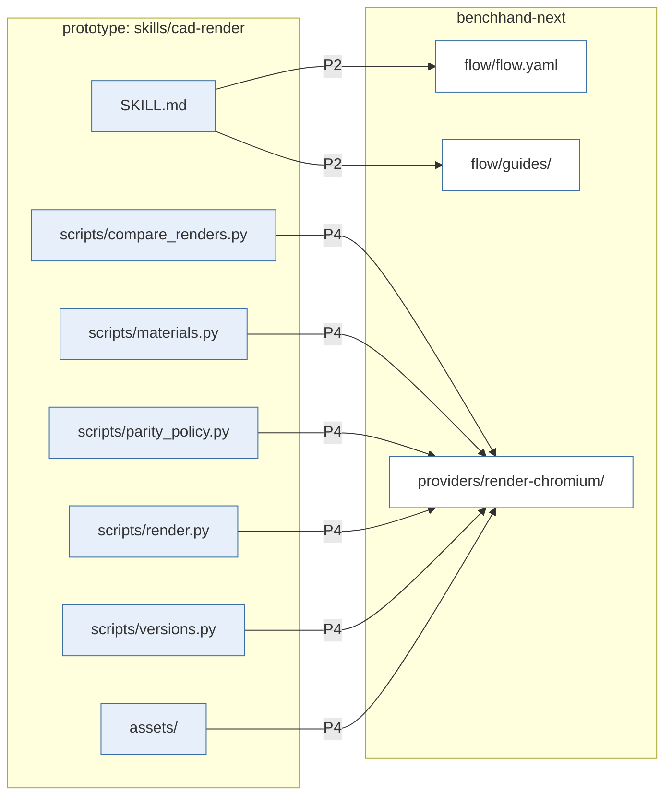

## cad-review-dfm

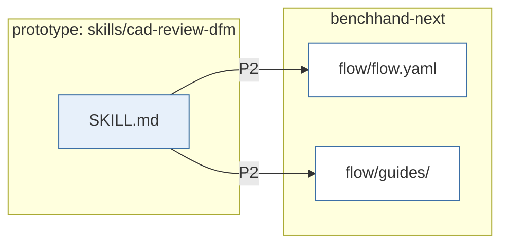

## cad-review-mech

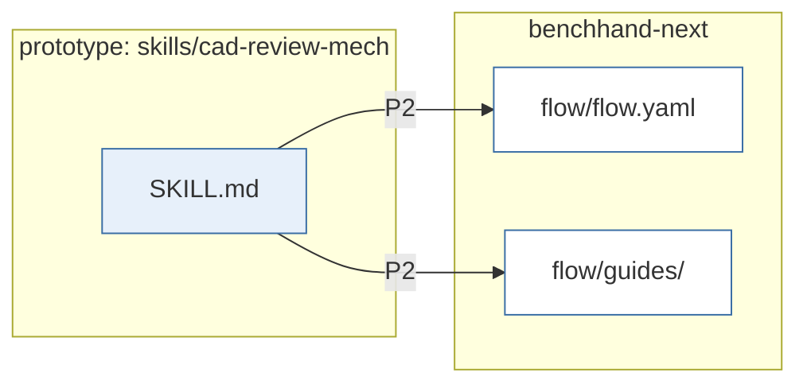

## cad-viewer

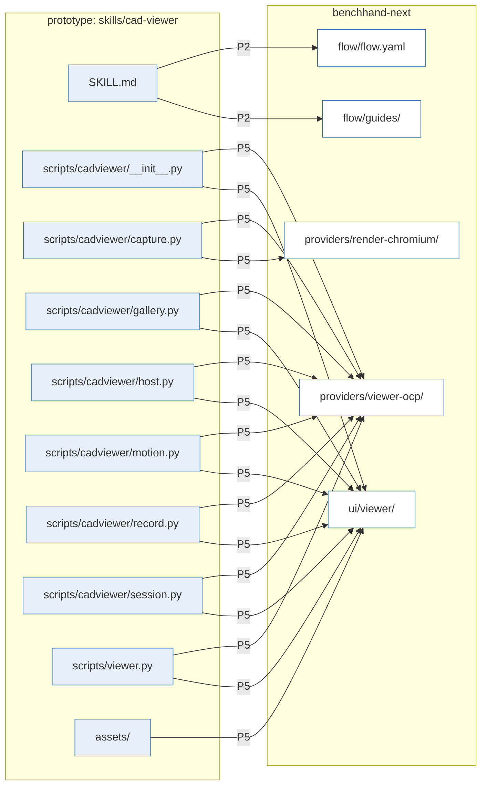

## agents and harness

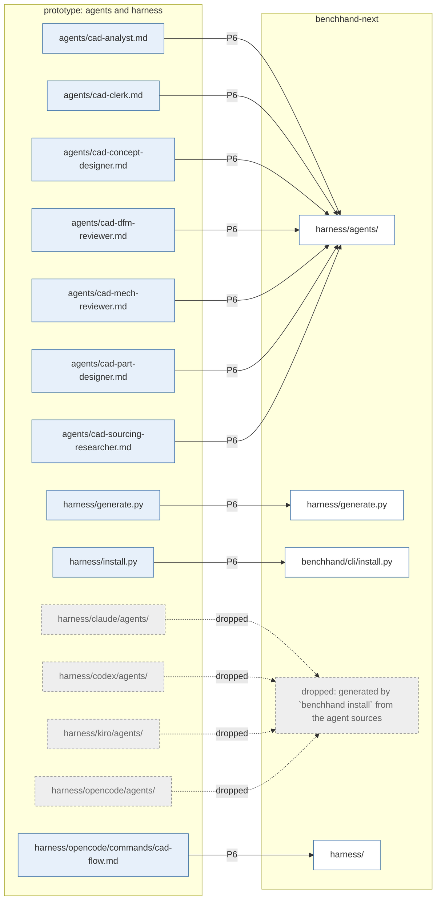

## examples

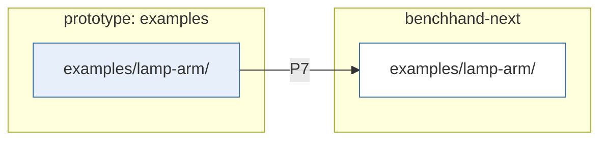
