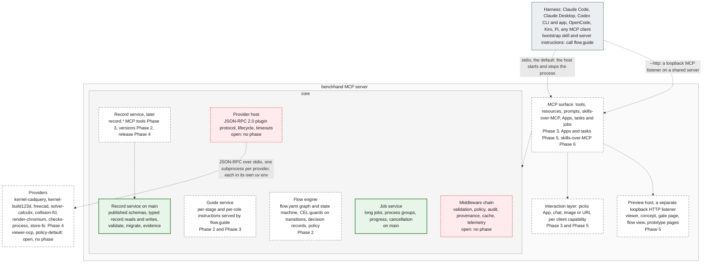
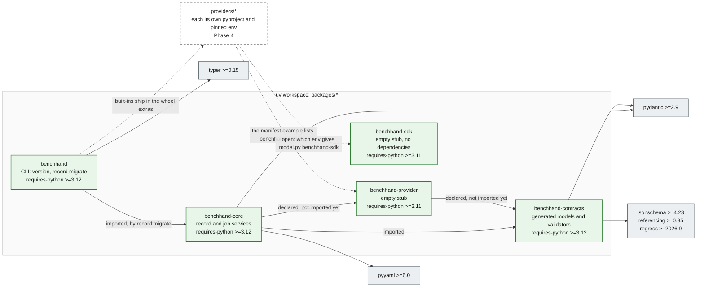

# Layers and packages

The layered architecture of plan section 1, the repository layout of section 2, and the package dependencies as the `pyproject.toml` files on `main` declare them.
The last section lists where the plan and the code differ.

## Layered architecture

## Package dependencies

Solid arrows are the `dependencies` of each `pyproject.toml` on `main`, and nothing else. Each arrow between workspace packages says whether the source code imports the target yet.

## Repository layout

```mermaid
flowchart TB
  repo["benchhand-next/"]:::ext
  subgraph code["Code and contracts"]
    direction TB
    packagesDir["packages/<br/>benchhand, benchhand-contracts, benchhand-core,<br/>benchhand-provider, benchhand-sdk"]:::impl
    contractsDir["contracts/<br/>TypeSpec sources"]:::impl
    uiShared["ui/shared/<br/>generated contract types"]:::impl
    uiApps["ui/ viewer, concept, gate-card, flow-view<br/>Phase 5"]:::planned
    providersDir["providers/<br/>Phase 4"]:::planned
  end
  subgraph product["Process and distribution"]
    direction TB
    flowDir["flow/<br/>flow.yaml, guides, CEL rule lists<br/>Phase 2"]:::planned
    harnessDir["harness/<br/>install templates<br/>Phase 6"]:::planned
    containerDir["container/<br/>OCI image<br/>Phase 7"]:::planned
    releaseToml["release.toml<br/>repo name, image, reference_commit"]:::impl
  end
  subgraph support["Tools, docs and reference"]
    direction TB
    probe["tools/probe/<br/>dev-only capability probe"]:::impl
    toolsGen["tools/gen/, tools/equiv/<br/>contracts generator, TypeSpec equivalence evidence"]:::impl
    docsDir["docs/<br/>adr/, contract/, phases/, client-support.md"]:::impl
    %% in-review: diagrams
    archDir["docs/architecture/<br/>these pages, in review on this branch"]:::review
    reference["reference/<br/>prototype tests, examples, agents, harness"]:::impl
    examples["examples/lamp-arm/<br/>golden fixture, on main only under reference/"]:::planned
  end

  repo --> code & product & support

  style code fill:#fafafa,stroke:#9e9e9e,color:#1b1b1b
  style product fill:#fafafa,stroke:#9e9e9e,color:#1b1b1b
  style support fill:#fafafa,stroke:#9e9e9e,color:#1b1b1b

  classDef impl fill:#e8f5e9,stroke:#2e7d32,stroke-width:2px,color:#1b1b1b
  classDef review fill:#fff3e0,stroke:#e65100,stroke-width:2px,stroke-dasharray:6 4,color:#1b1b1b
  classDef planned fill:#ffffff,stroke:#616161,stroke-width:1px,stroke-dasharray:6 4,color:#1b1b1b
  classDef open fill:#ffebee,stroke:#c62828,stroke-width:2px,stroke-dasharray:2 3,color:#1b1b1b
  classDef ext fill:#eceff1,stroke:#37474f,stroke-width:1px,color:#1b1b1b
  classDef person fill:#e3f2fd,stroke:#1565c0,stroke-width:2px,color:#1b1b1b
```

## Legend

- Styles as in the [legend](README.md#legend). Solid arrows exist on `main`, and dashed arrows are planned.
- The record service on `main` holds the published schemas, typed reads and writes (`store.py`), `validate`, `migrate` and `evidence`. The `record.*` MCP tools that expose those reads and writes come in Phase 3, versions in Phase 2 and release in Phase 4 ([containers.md](containers.md#components-of-benchhand-core)).
- `docs/architecture/` is in review: it first appears on this branch, `pi-subagents/task-2-191ee0d-d83e-s0-t0`.
- Plan section 1 also lists elicitation on the MCP surface, and forms in the interaction layer. ADR-0018 drops form elicitation from v1, so neither is drawn.
- **Open: no phase.** The middleware chain, the provider host, `viewer-ocp` and `policy-default` have no phase in the plan's Steps. **Open: the SDK's environment.** The plan says `model.py` imports `benchhand-sdk`, but the kernel manifest example doesn't list it among its dependencies. The plan's [Open questions](../design-plan.md#open-questions) list neither item.

## Where the plan and the code differ

The contract source, the repo name, the TypeSpec timing, forms and the long-call threshold were settled in the plan on 2026-11-26, following ADR-0015, ADR-0017 and ADR-0018.

| Topic | Plan | ADRs and `main` |
|---|---|---|
| Core to provider runtime | Section 2 lists the packages and states no edges between them | `benchhand-core` declares `benchhand-provider`, and doesn't import it |
| Declared, unused | Not stated | `benchhand-provider` declares `benchhand-contracts`, and doesn't import it yet |
| Phase 1 contracts | Phase 1: record, envelope, provider protocol, flow, policy | No envelope or flow contract on `main`; `docs/phases/phase-0-1.md` doesn't list them as not built |
| Envelope phase | Phase 1 writes the envelope contract; Phase 2 lists "the result envelope and `next_actions`" | Two phases name the envelope; neither is on `main` |
| Annotation-set phase | Phase 2 lists the annotation set as a record contract addition; Phase 4 lists "the annotation-set contract" | Two phases name it; neither is on `main` |
| Phase 1 services | Phase 1: migrate and evidence | Both are on `main`. `docs/phases/phase-0-1.md` still lists both under "Not built": migrate as "built on a branch, not yet reviewed", and evidence as "Nothing writes evidence or checks what it cites". The evidence service now checks what evidence cites, and still writes nothing: `evidence/reader.py` only reads |
| CLI | D1 and section 7: `mcp`, `serve`, `install`, `doctor`, `setup`, `policy`, `debug call` | `main` has `version` and `record migrate`, and D1 lists neither |
| Golden fixture | Section 2: `examples/lamp-arm/` | Only `reference/examples/lamp-arm/` |
| Tools | Section 2 lists `tools/probe/` | `main` also has `tools/gen/` and `tools/equiv/` |

## Sources

- `docs/design-plan.md`:
  - [1. Layered architecture](../design-plan.md#1-layered-architecture): every node of the first diagram.
  - [2. Repository and package layout](../design-plan.md#2-repository-and-package-layout-temporary-repo-benchhandbenchhand-next): the packages, `providers/`, `ui/`, `contracts/`, `flow/`, `harness/`, `container/`, `tools/probe/`, `examples/lamp-arm/`, and `BENCHHAND_REPO`.
  - [6. Provider protocol (D13)](../design-plan.md#6-provider-protocol-d13): one uv environment per provider.
  - [6a. Contracts: generated and enforced (D17)](../design-plan.md#6a-contracts-generated-and-enforced-d17), [7. CLI (D1)](../design-plan.md#7-cli-d1), [11. Adaptive interaction layer (D8)](../design-plan.md#11-adaptive-interaction-layer-d8) and [12. Build API (D7)](../design-plan.md#12-build-api-d7) (the part SDK).
  - [Steps (phased)](../design-plan.md#steps-phased): the phase of every node, and the Phase 1 and Phase 2 lists.
- `docs/adr/`: [0006](../adr/0006-providers-everywhere.md), [0010](../adr/0010-stdio-transport.md), [0013](../adr/0013-provider-protocol.md), [0015](../adr/0015-temporary-repo.md), [0016](../adr/0016-dev-only-probe.md), [0017](../adr/0017-contracts.md) and [0018](../adr/0018-baseline-and-no-forms.md), each under "Decision".
- `docs/contract/provider-protocol.md`: [7. Provider manifest](../contract/provider-protocol.md#7-provider-manifest): the example's `dependencies`.
- `docs/phases/phase-0-1.md`: [What was built](../phases/phase-0-1.md#what-was-built) and [Not built, which the plan puts in Phase 1](../phases/phase-0-1.md#not-built-which-the-plan-puts-in-phase-1).
- Code on `main`: `packages/*/pyproject.toml` (`dependencies`, `requires-python`, `[tool.uv.sources]`), the root `pyproject.toml` (`[tool.uv.workspace] members`), the imports under `packages/*/src/`, `packages/benchhand-core/src/benchhand_core/record/store.py` (typed reads and writes), `record/evidence/reader.py` (read-only), `release.toml`, and the top-level directories.
- `docs/design-plan.md` [3. Transport](../design-plan.md#3-transport-stdio-vs-localhost-http-d10): the lifecycle of each transport.
