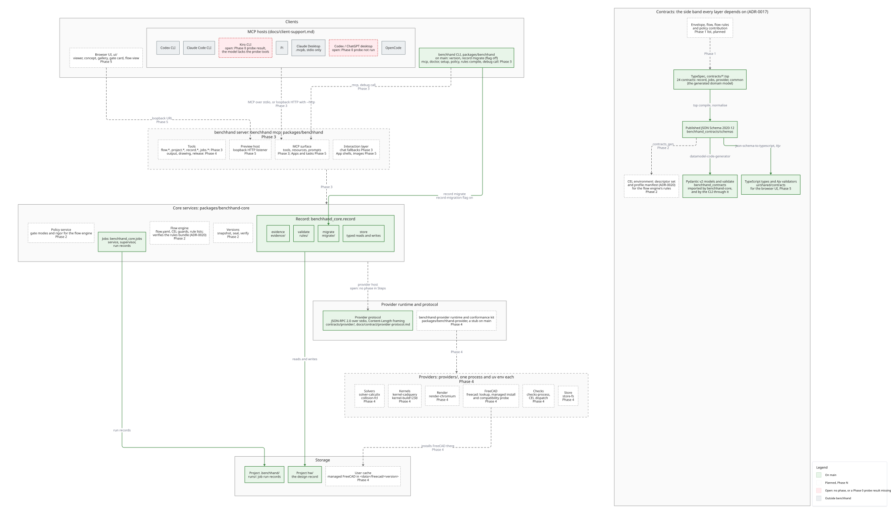
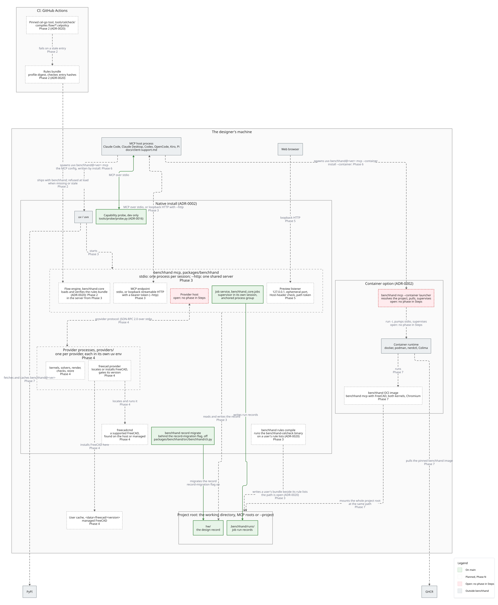

# Architecture overview

Start here. This page draws benchhand in two diagrams: the software in layers, and the processes that run it. The other pages go further into each part:

- [context.md](context.md): the system context, with the user, the agent hosts and the systems benchhand works with.
- [containers.md](containers.md): the containers, the components of `benchhand-core`, and the contracts pipeline.
- [layers.md](layers.md): the layered architecture of plan section 1, the repository layout, and the package dependencies.
- [data-flow.md](data-flow.md): sequences for one MCP call, a long job, evidence and freeze, release, and migrate.
- [flow.md](flow.md) and the generated [domain model](../contract/generated/domain-model/README.md).
- [capabilities.md](capabilities.md), generated: the capability catalogue, which lists each feature, MCP tool and CLI command with its phase and status.

The diagrams are D2, the format of the domain model. Each has its source and its rendered SVG in [`overview/`](overview/).

## The diagram rule

- A solid box or arrow is on `main`, checked against the code at `fb9cb2e`.
- A dashed box or arrow is in a later phase, or open. Its label gives its phase from the [Steps](../design-plan.md#steps-phased) of the design plan, or says why it has none. Work that exists only on an unmerged branch is drawn with its phase, like work not yet started.
- A count comes from generated output only. The contract count is from the generated [domain model](../contract/generated/domain-model/README.md).
- Each box names a package path or a doc. The tables below cite why each box has its style.
- The colours follow the [legend](README.md#legend) of the other pages. Green is on `main`, white is a later phase, red is open and grey is outside benchhand.

## The software in layers



The layers stack from the clients down to storage. The contracts sit beside them, because every layer reads its shapes from them (ADR-0017).

| Box | Style | Evidence |
|---|---|---|
| Claude Code CLI, Claude Desktop, Codex CLI, OpenCode, Pi | Outside benchhand | Probe runs in `docs/client-support.md`; run records for Claude Code, Codex, OpenCode and Pi in `tools/probe/runs/` |
| Codex / ChatGPT desktop | Open, Phase 0 | `docs/client-support.md`: "manual run needed". Phase 0 runs the probe in the 7 hosts |
| Kiro CLI | Open, Phase 0 | `docs/client-support.md`: Kiro connects and lists the probe tools, and the model's tools lack them, under the default and a custom agent |
| benchhand CLI | On `main` | `packages/benchhand/src/benchhand/cli.py` has `version` and `record migrate`. The other subcommands, `rules compile` included, are in Phase 3 |
| Browser UI | Phase 5 | `ui/` holds only `shared/` on `main`. Phase 5 builds the viewer, concept, gallery, gate card and flow view |
| benchhand server and its MCP surface, interaction layer and tools | Phase 3, Apps and tasks Phase 5 | No `benchhand mcp` on `main`. Phase 3 lists the tools; Phase 4 the output, drawing and release tools |
| Preview host | Phase 5 | Not on `main` |
| Flow engine | Phase 2 | Plan section 1 puts it in core. No `flow/` directory and no flow code on `main`. Phase 2 builds the interpreter and the host's bundle verification ([ADR-0020](../adr/0020-cel-rule-pipeline.md)) |
| Record: store, validate, migrate, evidence | On `main` | `packages/benchhand-core/src/benchhand_core/record/`: `store.py`, `validate.py` with `rules/`, `migrate/`, `evidence/` |
| Versions | Phase 2 | Not on `main`; the Phase 1 step moves snapshot, seal and verify to Phase 2 |
| Jobs | On `main` | `packages/benchhand-core/src/benchhand_core/jobs/`: `service.py`, `supervisor.py`, `store.py` |
| Policy service | Phase 2 | Phase 2 lists policy (`hw/policy.yaml`) with the interpreter. On `main` the record already reads `hw/policy.yaml` (`record/documents.py`), and `rules/decisions.py` checks an approved gate against its mode |
| Provider protocol | On `main` | `contracts/provider/protocol.tsp`, `contracts/provider/manifest.tsp` and [provider-protocol.md](../contract/provider-protocol.md) |
| Provider runtime and conformance kit | Phase 4 | `packages/benchhand-provider/src/benchhand_provider/__init__.py` is a one-line stub on `main` |
| Provider host, the arrow from core | Open | No phase in the Steps ([containers.md](containers.md#legend)) |
| Kernels, FreeCAD, solvers, render, checks, store | Phase 4 | No `providers/` directory on `main`. Phase 4 lists the freecad provider with its managed install and compatibility probe |
| Project `hw/` | On `main` | The record service reads and writes it |
| Project `.benchhand/` | On `main` | `jobs/store.py` `RecordStore` writes `.benchhand/runs/<jobId>.json` |
| User cache with managed FreeCAD | Phase 4 | Plan section 8 and D5: the freecad provider installs a supported FreeCAD there |
| TypeSpec, JSON Schema, Pydantic, TypeScript | On `main` | `contracts/*.tsp`, `benchhand_contracts/schemas/`, `benchhand_contracts/models/`, `ui/shared/contracts/`. `benchhand-core` imports the models and `validate`. The 24 contracts are from the generated domain model |
| Envelope, flow, flow rules and policy contribution contracts | Phase 1 | The Phase 1 step lists them. `main` has no `contracts/envelope/`, `contracts/flow/` or `contracts/policy/` |
| CEL environment: descriptor set and profile manifest | Phase 2 | [ADR-0020](../adr/0020-cel-rule-pipeline.md): `contracts_gen` generates them from the published schemas. Not on `main` |

## Deployment and runtime



On `main` at `fb9cb2e`, three parts run:

- the capability probe, which a host starts as a stdio MCP server;
- `benchhand record migrate`, which migrates `hw/`;
- the job service, which supervises each job in its own process group and writes its run record under `.benchhand/runs/`.

The rest of the diagram is for later phases. In Phase 3 the host talks MCP to `benchhand mcp` over stdio, or over loopback HTTP with `--http`. From Phase 4 the server talks to each provider process over stdio with the provider protocol, and from Phase 5 the browser reaches the preview listener on loopback. The container option replaces the native process with a launcher that runs the same server in the OCI image, with the whole project root mounted at the same path (ADR-0002).

| Box or arrow | Style | Evidence |
|---|---|---|
| MCP host process, web browser, uv, PyPI, container runtime, GHCR | Outside benchhand | [context.md](context.md) |
| Host to `uvx benchhand@<ver> mcp` | Phase 3, the config Phase 6 | ADR-0002 "Decision"; `install` is in Phase 6 |
| uvx fetches `benchhand@<ver>` from PyPI | Phase 7 | Phase 7 publishes `benchhand` on PyPI |
| `benchhand mcp`, MCP endpoint | Phase 3 | Plan section 3; not on `main` |
| Preview listener | Phase 5 | Plan section 3: a separate loopback listener with a Host-header check and a path token |
| Flow engine, which verifies the rules bundle | Phase 2; in the server from Phase 3 | [ADR-0020](../adr/0020-cel-rule-pipeline.md) "Compilation and the rules bundle": at load the host refuses a missing or stale entry. Phase 2 builds the verification, Phase 3 the server |
| Job service | On `main` | `jobs/supervisor.py` and `jobs/process.py` start each job in its own session and process group |
| Provider host to provider processes | Phase 4, the provider host open | [provider-protocol.md](../contract/provider-protocol.md#1-transport); no phase names the provider host |
| freecad provider to the user cache, and to `freecadcmd` | Phase 4 | Plan section 8: the provider looks FreeCAD up (`FREECADCMD`, PATH, the macOS bundle, an AppImage, the managed directory), or installs a supported one, gates its version, and runs `freecadcmd` |
| `benchhand record migrate` to `hw/` | On `main` | `cli.py` calls `benchhand_core.record.migrate` |
| `benchhand rules compile` | Phase 3 | [ADR-0020](../adr/0020-cel-rule-pipeline.md): it runs the `benchhand-celcheck` binary on a user's rule lists. Where the bundle lives in a project is open there |
| Capability probe over stdio | On `main` | `tools/probe/probe.py`, a stdio MCP server (ADR-0016), with runs in `tools/probe/runs/` |
| Job service to `.benchhand/runs/` | On `main` | `jobs/store.py` |
| `--container` launcher, and its call to the runtime | Open | Plan section 8 describes it; no phase of the Steps delivers it ([context.md](context.md#legend)) |
| OCI image, the pull from GHCR, the project-root mount | Phase 7 | Plan section 8: `-v <project>:<project>`, the project directory the launcher resolved. Phase 7 publishes the image |
| Pinned cel-go tool in CI and the rules bundle | Phase 2 | [ADR-0020](../adr/0020-cel-rule-pipeline.md): `tools/celcheck/` compiles `flow/*.celpolicy`, and CI fails on a stale entry. No `tools/celcheck/` on `main` |

## Rendering

The SVGs are rendered with d2 0.9.0, the version the root `mise.toml` pins, and the ELK layout:

```sh
cd docs/architecture/overview
d2 --layout elk --pad 40 layers.d2 layers.svg
d2 --layout elk --pad 40 deployment.d2 deployment.svg
```

`tests/test_architecture_d2.py` renders every `.d2` under `docs/architecture/` with the domain model's render settings, and fails when the result differs from the committed SVG. Without d2 on `PATH` it skips locally (`mise install` provides it). CI installs d2 from `mise.toml`.

## Sources

- `docs/design-plan.md`: [1. Layered architecture](../design-plan.md#1-layered-architecture), [3. Transport](../design-plan.md#3-transport-stdio-vs-localhost-http-d10), [5. Flow engine and rules](../design-plan.md#5-flow-engine-and-rules-d14), [6a. Contracts](../design-plan.md#6a-contracts-generated-and-enforced-d17), [8. Prerequisites, FreeCAD and the container](../design-plan.md#8-prerequisites-freecad-and-the-container) and [Steps (phased)](../design-plan.md#steps-phased).
- `docs/adr/`: [0002](../adr/0002-install-uvx-and-container.md) (install and container), [0010](../adr/0010-stdio-transport.md) (stdio), [0013](../adr/0013-provider-protocol.md) (provider protocol), [0014](../adr/0014-flow-rules-cel.md) (CEL), [0016](../adr/0016-dev-only-probe.md) (probe), [0017](../adr/0017-contracts.md) (contracts) and [0020](../adr/0020-cel-rule-pipeline.md) (the CEL rule pipeline).
- [docs/client-support.md](../client-support.md), [docs/contract/provider-protocol.md](../contract/provider-protocol.md) and the generated [domain model](../contract/generated/domain-model/README.md).
- Code on `main` at `fb9cb2e`: `packages/*/src/`, `contracts/`, `ui/shared/contracts/`, `tools/probe/` and `mise.toml`.
