# Domain model

Generated by tools/gen (`just contracts`). Do not edit. Source: the published schemas of `contracts/`.

Each class is a contract root, a named `$defs` object or union, or an object written inline; a class named `a.b` is the inline object of property `b` of `a`. A member is `name: type`, with `?` after the name of an optional property, and an enum's values are written out when it has 6 or fewer.

- `A "1" *-- "0..*" B`: composition, B is nested in A (inline, or a `$ref` in the same contract).
- `A --> "0..1" B`: association, a `$ref` from A to a definition of another contract.
- `A <|-- B`: B is a branch of the union A, or extends A with `allOf`. A union whose branches each fix one property with a `const` is `<<abstract>>`, with one subclass per value; any other union is `<<union>>`.
- The number at B is how many B an A holds: `1..*` is at least one, `0..*` any number, `2` exactly two, `0..1` an optional, nullable or alternative one. Bounds of nested arrays and maps multiply.
- In a member's type, `T[]` is an array of any length, `T[1..*]` at least one, `T[2]` exactly two; `face[2][1..*]` is one or more arrays of two faces. `[A, B]` is a tuple. `T by key` is an object whose every value is a T (`additionalProperties`), and a `[key]` member holds the other keys of an object with named properties. Literals are JSON: `null`, `true`, and a string bare.
- `<<external>>` is a class of another document, shown so that a relation has both ends.

## Overview: the record documents

18 documents of the record, with their top-level properties, and 2 libraries: record contracts that hold shared definitions and no document of their own. An arrow counts the `$ref`s, anywhere in a document's schema, to another record contract.

```mermaid
classDiagram
    class record_assembly["assembly"] {
        <<document>>
        operations?: assembly_operation[] or fact_unknown
        occurrences?: object[1..*]
        profiles?: profile by key
        mechanisms?: mechanism[1..*]
        subassemblies: object[1..*]
        joints: object[]
        drawing?: assembly_drawing
    }
    class record_bom_row["bom-row"] {
        <<document>>
        level: integer
        PN: pn
        rev: string or null
        qty: integer
        title: string or null
        material: string or null
        process: primary_process or null
        make_buy: enum make|buy|null
        supplier: string or null
        mass: number or null
        unit?: enum pcs
        designation?: string or null
        manufacturer?: string or null
        manufacturer_part_number?: string or null
        supplier_part_number?: string or null
        specification_reference?: string or null
        specification_revision?: string or null
    }
    class record_bundle_manifest["bundle-manifest"] {
        <<document>>
        files: sha256 by key
        version_manifest_sha256?: sha256
        parts?: version_part by key
    }
    class record_decision["decision"] {
        <<document>>
        id: decision
        kind: enum gate|design
    }
    class record_evidence_assessment["evidence-assessment"] {
        <<document>>
        version: version
        manifest_sha256: sha256
        build_staleness: enum computed|not_computed
        expected_sha256: sha256
        statuses: obligation_status[]
        facets: facets by key
        findings: finding[]
        critical: critical_finding[]
        complete: boolean
        acceptance: acceptance_formed or acceptance_refused
    }
    class record_interfaces["interfaces"] {
        <<document>>
        interfaces: object[]
    }
    class record_manufacturing_capabilities["manufacturing-capabilities"] {
        <<document>>
        profiles: profile[]
    }
    class record_manufacturing_check_result["manufacturing-check-result"] {
        <<document>>
        schema_version: const 1
        record_version: record_version
        producer: text
        scope: subject[1..*]
        expected: obligation[]
        outcomes: obligation_outcome[]
        findings: finding[]
        dependencies: sha256 by key
        complete: boolean
        result: outcome = pass|fail|unknown|not_applicable|not_assessed
    }
    class record_manufacturing_evidence["manufacturing-evidence"] {
        <<document>>
        entries: entry[]
    }
    class record_manufacturing_findings["manufacturing-findings"] {
        <<document>>
        dispositions: disposition[]
    }
    class record_manufacturing_guideline["manufacturing-guideline"] {
        <<document>>
        schema_version: const 1
        id: guideline_id
        revision: integer
        title: text
        extends?: guideline_id[1..*]
        abstract?: boolean
        scope: scope
        limits: limit[]
    }
    class record_manufacturing_materials["manufacturing-materials"] {
        <<document>>
        profiles: profile[]
    }
    class record_manufacturing_selection["manufacturing-selection"] {
        <<document>>
        status: enum not_assessed|assessed|confirmed
        assessment?: object
        candidates: candidate[]
        recommendation?: recommendation
    }
    class record_part["part"] {
        <<document>>
        PN: pn
        rev: revision
        title: string
        material: string
        process: primary_process
        finish: string
        mass_target: number or null
        make_buy: enum make|buy
        supplier?: string or null
        decisions?: decision[]
        model_frame?: enum assembly_zero|part_local
        form_class?: enum solid|frame|plate|skeleton|shell
        transparency?: enum opaque|translucent|transparent
        procurement?: procurement
        drawing?: part_drawing
        manufacture?: object
        intent?: intent
    }
    class record_policy["policy"] {
        <<document>>
        policy_version: const 1
        default?: mode = ask|chat|auto
        decision?: decision
        gates?: gate by key
    }
    class record_product["product"] {
        <<document>>
        record_version: record_version
        id: string
        units: const mm
        regime: enum iso|asme
        general_tolerance: number or string or fact_unknown
        license?: object
        flow: object
        build_volume?: object
        design?: object
        manufacturing?: object
        storage?: object
        drawing?: product_drawing
        use_case: use_case
    }
    class record_requirements["requirements"] {
        <<document>>
        preferences?: object[]
        assumptions?: object[]
        open_questions?: object[]
        requirements: object[1..*]
    }
    class record_verification_row["verification-row"] {
        <<document>>
        requirement: requirement_id
        method: enum I|A|D|T
        criteria: string
        result: enum planned|pass|fail|waived|not_assessed
        evidence: string
    }
    class record_common["common"] {
        <<library>>
    }
    class record_drawing["drawing"] {
        <<library>>
    }
    record_assembly --> record_common : 31 refs
    record_bom_row --> record_common : 2 refs
    record_bundle_manifest --> record_common : 3 refs
    record_decision --> record_common : 12 refs
    record_evidence_assessment --> record_common : 13 refs
    record_interfaces --> record_assembly : 1 refs
    record_interfaces --> record_common : 44 refs
    record_interfaces --> record_drawing : 5 refs
    record_manufacturing_capabilities --> record_common : 56 refs
    record_manufacturing_check_result --> record_common : 9 refs
    record_manufacturing_evidence --> record_common : 34 refs
    record_manufacturing_findings --> record_common : 8 refs
    record_manufacturing_guideline --> record_common : 13 refs
    record_manufacturing_guideline --> record_manufacturing_capabilities : 18 refs
    record_manufacturing_materials --> record_common : 26 refs
    record_manufacturing_selection --> record_common : 56 refs
    record_manufacturing_selection --> record_part : 2 refs
    record_part --> record_common : 117 refs
    record_part --> record_drawing : 2 refs
    record_policy --> record_common : 3 refs
    record_product --> record_common : 63 refs
    record_product --> record_drawing : 1 refs
    record_requirements --> record_assembly : 2 refs
    record_requirements --> record_common : 29 refs
    record_verification_row --> record_common : 1 refs
```

## `common`

1 classes, from `common/finding`.

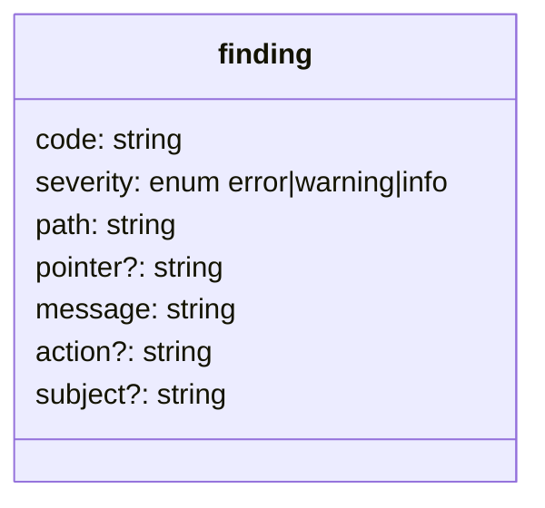

## `jobs`

5 classes, from `jobs/job`.

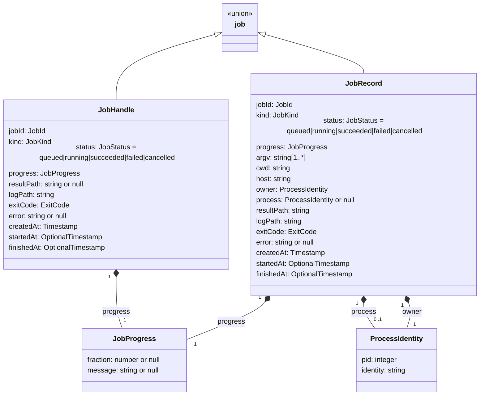

## `provider`

33 classes, from `provider/manifest`, `provider/protocol`.

```mermaid
classDiagram
    class provider_manifest["manifest"] {
        name: string
        version: string
        summary?: string
        protocol: object
        kinds: HookKind[1..*]
        hooks: HookDecl[1..*]
        resident?: boolean
        command: string[1..*]
        timeouts?: integer by key
        environment: object
        needs: Needs
        cli?: object[]
    }
    class provider_manifest__protocol["manifest.protocol"] {
        min: integer
        max: integer
    }
    class provider_protocol__HookDecl["HookDecl"] {
        kind: HookKind
        id: HookId
    }
    class provider_manifest__environment["manifest.environment"] {
        <<abstract>>
        kind: discriminator
    }
    class provider_manifest__environment__uv["manifest.environment.uv"] {
        kind: const uv
        requires-python: string
        dependencies: string[]
    }
    class provider_manifest__environment__freecad["manifest.environment.freecad"] {
        kind: const freecad
    }
    class provider_manifest__environment__system["manifest.environment.system"] {
        kind: const system
    }
    class provider_protocol__Needs["Needs"] {
        freecad: boolean
        chromium: boolean
        network: boolean
    }
    class provider_manifest__cli["manifest.cli"] {
        name: string
        summary: string
    }
    class provider_protocol["protocol"] {
        <<union>>
    }
    class provider_protocol__Request["Request"] {
        jsonrpc: const '2.0'
        id: RequestId
        method: Method
        params?: any
    }
    class provider_protocol__Notification["Notification"] {
        jsonrpc: const '2.0'
        method: Method
        params?: any
    }
    class provider_protocol__SuccessResponse["SuccessResponse"] {
        jsonrpc: const '2.0'
        id: RequestId
        result: any
    }
    class provider_protocol__ErrorResponse["ErrorResponse"] {
        jsonrpc: const '2.0'
        id: RequestId or null
        error: ErrorObject
    }
    class provider_protocol__ErrorObject["ErrorObject"] {
        code: integer
        message: string
        data: object
    }
    class provider_protocol__ErrorObject__data["ErrorObject.data"] {
        code: enum
        supported?: object
        fix?: string
        detail?: any
    }
    class provider_protocol__ErrorObject__data__supported["ErrorObject.data.supported"] {
        min: ProtocolVersion
        max: ProtocolVersion
    }
    class provider_protocol__Limits["Limits"] {
        maxMessageBytes?: integer
        maxInFlight?: integer
    }
    class provider_protocol__InitializeParams["InitializeParams"] {
        protocolVersion: ProtocolVersion
        minProtocolVersion?: ProtocolVersion
        host: object
        capabilities: object
        limits: Limits
        projectRoot?: AbsPath
    }
    class provider_protocol__InitializeParams__host["InitializeParams.host"] {
        name: const benchhand
        version: string
    }
    class provider_protocol__InitializeParams__capabilities["InitializeParams.capabilities"] {
        hooks: HookKind[]
        features: FeatureName[]
    }
    class provider_protocol__InitializeResult["InitializeResult"] {
        protocolVersion: ProtocolVersion
        provider: object
        hooks: HookDecl[1..*]
        features: object
        limits: Limits
        needs: Needs
    }
    class provider_protocol__InitializeResult__provider["InitializeResult.provider"] {
        name: string
        version: string
    }
    class provider_protocol__InitializeResult__features["InitializeResult.features"] {
        required: FeatureName[]
        optional: FeatureName[]
    }
    class provider_protocol__CancelParams["CancelParams"] {
        id: RequestId
    }
    class provider_protocol__ProgressParams["ProgressParams"] {
        id: RequestId
        fraction?: number
        message?: string
        stage?: string
    }
    class provider_protocol__LogParams["LogParams"] {
        level: enum debug|info|warning|error
        message: string
        data?: any
    }
    class provider_protocol__Artifact["Artifact"] {
        path: AbsPath
        mediaType: string
        role: string
        bytes: integer
        sha256: Sha256
    }
    class provider_protocol__Coverage["Coverage"] {
        status: enum pass|fail|unknown
        reason?: string
    }
    class provider_protocol__HookParamsBase["HookParamsBase"] {
        projectRoot: AbsPath
        outDir: AbsPath
        input: object
    }
    class provider_protocol__HookResultBase["HookResultBase"] {
        coverage: Coverage
        artifacts: Artifact[]
        nondeterministic?: boolean
        output?: object
    }
    class provider_protocol__KernelBuildPart["KernelBuildPart"] {
        pn: string
        name?: string
        model: AbsPath
        modelFrame?: string
        step: AbsPath
        manufactureStep?: AbsPath
    }
    class provider_protocol__KernelBuildPartResult["KernelBuildPartResult"] {
        pn: string
        status: enum pass|fail
        error?: string
        seconds?: number
    }
    provider_manifest "1" *-- "1" provider_manifest__protocol : protocol
    provider_manifest --> "1..*" provider_protocol__HookDecl : hooks
    provider_manifest__environment <|-- provider_manifest__environment__uv
    provider_manifest__environment <|-- provider_manifest__environment__freecad
    provider_manifest__environment <|-- provider_manifest__environment__system
    provider_manifest "1" *-- "1" provider_manifest__environment : environment
    provider_manifest --> "1" provider_protocol__Needs : needs
    provider_manifest "1" *-- "0..*" provider_manifest__cli : cli
    provider_protocol <|-- provider_protocol__Request
    provider_protocol <|-- provider_protocol__Notification
    provider_protocol <|-- provider_protocol__SuccessResponse
    provider_protocol__ErrorObject__data "1" *-- "0..1" provider_protocol__ErrorObject__data__supported : supported
    provider_protocol__ErrorObject "1" *-- "1" provider_protocol__ErrorObject__data : data
    provider_protocol__ErrorResponse "1" *-- "1" provider_protocol__ErrorObject : error
    provider_protocol <|-- provider_protocol__ErrorResponse
    provider_protocol__InitializeParams "1" *-- "1" provider_protocol__InitializeParams__host : host
    provider_protocol__InitializeParams "1" *-- "1" provider_protocol__InitializeParams__capabilities : capabilities
    provider_protocol__InitializeParams "1" *-- "1" provider_protocol__Limits : limits
    provider_protocol__InitializeResult "1" *-- "1" provider_protocol__InitializeResult__provider : provider
    provider_protocol__InitializeResult "1" *-- "1..*" provider_protocol__HookDecl : hooks
    provider_protocol__InitializeResult "1" *-- "1" provider_protocol__InitializeResult__features : features
    provider_protocol__InitializeResult "1" *-- "1" provider_protocol__Limits : limits
    provider_protocol__InitializeResult "1" *-- "1" provider_protocol__Needs : needs
    provider_protocol__HookResultBase "1" *-- "1" provider_protocol__Coverage : coverage
    provider_protocol__HookResultBase "1" *-- "0..*" provider_protocol__Artifact : artifacts
```

## `record`

254 classes, more than 40, so there is one diagram per document.

### `record/assembly`

23 classes.

```mermaid
classDiagram
    class record_assembly["assembly"] {
        operations?: assembly_operation[] or fact_unknown
        occurrences?: object[1..*]
        profiles?: profile by key
        mechanisms?: mechanism[1..*]
        subassemblies: object[1..*]
        joints: object[]
        drawing?: assembly_drawing
    }
    class record_assembly__assembly_operation["assembly_operation"] {
        id: string
        kind: enum
        part: part_ref
        into?: part_ref
        interface?: interface_id
        direction?: vector
        acceptance?: object
        tools?: string[]
        consumables?: string[]
        verify_joint?: string
        predecessors?: string[1..*]
        closes?: part_ref[1..*]
        tool_access?: object[1..*]
        engagement?: quantity_fact
        torque?: quantity_fact
        retention?: text_fact
        service_access?: text_fact
        edge_distance?: object
        path?: object
        inspection?: string
    }
    class record_assembly__assembly_operation__acceptance["assembly_operation.acceptance"] {
        kind: enum
        features: string[1..2]
    }
    class record_assembly__assembly_operation__tool_access["assembly_operation.tool_access"] {
        tool: string
        capability?: profile_id
        approach?: vector
        reach?: quantity_fact
        envelope?: text_fact
    }
    class record_assembly__assembly_operation__edge_distance["assembly_operation.edge_distance"] {
        criterion: criterion
        distance: quantity_fact
    }
    class record_assembly__assembly_operation__edge_distance__criterion["assembly_operation.edge_distance.criterion"] {
        property?: const edge_distance
        operator?: enum ]=|between
        units: enum mm|um|m
    }
    class record_assembly__assembly_operation__path["assembly_operation.path"] {
        start: vector
        via?: vector[1..*]
    }
    class record_assembly__occurrences["assembly.occurrences"] {
        id: occurrence_id
        PN: pn
        placement?: placement
    }
    class record_assembly__placement["placement"] {
        translation_mm?: vector
        rotation?: object
    }
    class record_assembly__placement__rotation["placement.rotation"] {
        axis: vector
        angle_deg: number
    }
    class record_assembly__profile["profile"] {
        input_unit: const deg
        output_unit: enum mm|deg
        period_deg: number
        interpolation: const linear
        samples: [number, number][2..*]
    }
    class record_assembly__mechanism["mechanism"] {
        id: string
        type: const slider_crank
        driver: joint_id
        origin_mm: vector
        crank_axis: vector
        bank_axis: vector
        crank_radius_mm: number
        rod_length_mm: number
        phase_deg?: number
    }
    class record_assembly__subassemblies["assembly.subassemblies"] {
        id: string
        title: string
        parts?: pn[1..*]
        occurrences?: occurrence_ref[1..*]
    }
    class record_assembly__joints["assembly.joints"] {
        id: joint_id
        type: enum revolute|prismatic|fixed
        parent: part_ref
        child: part_ref
        axis: vector
        origin: vector
        min: number
        max: number
        nominal?: number
        coupling?: coupling
        torque?: enum transmitted|none
        torque_path?: torque_path
    }
    class record_assembly__coupling["coupling"] {
        <<abstract>>
        type: discriminator
    }
    class record_assembly__coupling__linear["coupling.linear"] {
        type: const linear
        driver: joint_id
        ratio: number
        offset?: number
    }
    class record_assembly__coupling__periodic_table["coupling.periodic_table"] {
        type: const periodic_table
        driver: joint_id
        profile: string
        phase_deg?: number
    }
    class record_assembly__coupling__slider_crank["coupling.slider_crank"] {
        type: const slider_crank
        mechanism: string
        output: enum displacement|rod_angle
    }
    class record_assembly__torque_path["torque_path"] {
        type: enum
        parts?: part_ref[1..*]
        decision?: decision
    }
    class record_assembly__assembly_drawing["assembly_drawing"] {
        number: string
        rev: string
        title: string
        scope?: enum modeled_mechanical_assembly|complete_assembly
        excludes?: string[]
        views: object[1..*]
        explode?: object[]
        items: drawing_item[1..*]
        subassembly_sheets?: string[]
    }
    class record_assembly__assembly_drawing__views["assembly_drawing.views"] {
        id: string
        kind: enum assembled|exploded
        direction: enum
    }
    class record_assembly__assembly_drawing__explode["assembly_drawing.explode"] {
        ref: part_ref
        offset_mm: vector
    }
    class record_assembly__drawing_item["drawing_item"] {
        item: integer
        PN: pn
        occurrences?: occurrence_ref[1..*]
    }
    class record_common__criterion["record/common.criterion"] {
        <<external>>
    }
    class record_common__fact_unknown["record/common.fact_unknown"] {
        <<external>>
    }
    class record_common__quantity_fact["record/common.quantity_fact"] {
        <<external>>
    }
    class record_common__text_fact["record/common.text_fact"] {
        <<external>>
    }
    record_assembly__assembly_operation "1" *-- "0..1" record_assembly__assembly_operation__acceptance : acceptance
    record_assembly__assembly_operation__tool_access --> "0..1" record_common__quantity_fact : reach
    record_assembly__assembly_operation__tool_access --> "0..1" record_common__text_fact : envelope
    record_assembly__assembly_operation "1" *-- "0..*" record_assembly__assembly_operation__tool_access : tool_access
    record_assembly__assembly_operation --> "0..1" record_common__quantity_fact : engagement
    record_assembly__assembly_operation --> "0..1" record_common__quantity_fact : torque
    record_assembly__assembly_operation --> "0..1" record_common__text_fact : retention
    record_assembly__assembly_operation --> "0..1" record_common__text_fact : service_access
    record_common__criterion <|-- record_assembly__assembly_operation__edge_distance__criterion
    record_assembly__assembly_operation__edge_distance "1" *-- "1" record_assembly__assembly_operation__edge_distance__criterion : criterion
    record_assembly__assembly_operation__edge_distance --> "1" record_common__quantity_fact : distance
    record_assembly__assembly_operation "1" *-- "0..1" record_assembly__assembly_operation__edge_distance : edge_distance
    record_assembly__assembly_operation "1" *-- "0..1" record_assembly__assembly_operation__path : path
    record_assembly "1" *-- "0..*" record_assembly__assembly_operation : operations
    record_assembly --> "0..1" record_common__fact_unknown : operations
    record_assembly__placement "1" *-- "0..1" record_assembly__placement__rotation : rotation
    record_assembly__occurrences "1" *-- "0..1" record_assembly__placement : placement
    record_assembly "1" *-- "0..*" record_assembly__occurrences : occurrences
    record_assembly "1" *-- "0..*" record_assembly__profile : profiles
    record_assembly "1" *-- "0..*" record_assembly__mechanism : mechanisms
    record_assembly "1" *-- "1..*" record_assembly__subassemblies : subassemblies
    record_assembly__coupling <|-- record_assembly__coupling__linear
    record_assembly__coupling <|-- record_assembly__coupling__periodic_table
    record_assembly__coupling <|-- record_assembly__coupling__slider_crank
    record_assembly__joints "1" *-- "0..1" record_assembly__coupling : coupling
    record_assembly__joints "1" *-- "0..1" record_assembly__torque_path : torque_path
    record_assembly "1" *-- "0..*" record_assembly__joints : joints
    record_assembly__assembly_drawing "1" *-- "1..*" record_assembly__assembly_drawing__views : views
    record_assembly__assembly_drawing "1" *-- "0..*" record_assembly__assembly_drawing__explode : explode
    record_assembly__assembly_drawing "1" *-- "1..*" record_assembly__drawing_item : items
    record_assembly "1" *-- "0..1" record_assembly__assembly_drawing : drawing
```

### `record/bom-row`

1 classes.

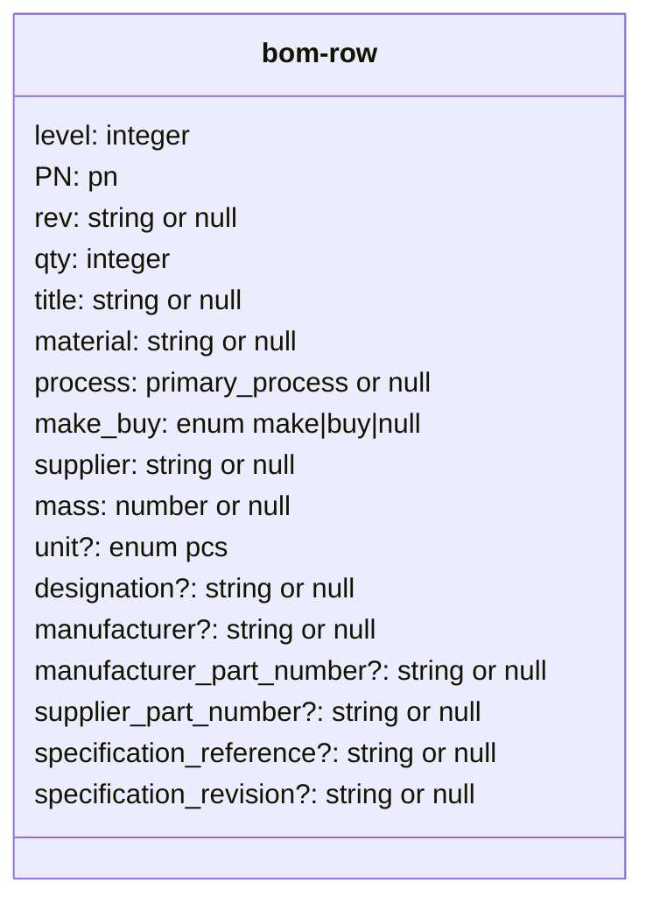

### `record/bundle-manifest`

2 classes.

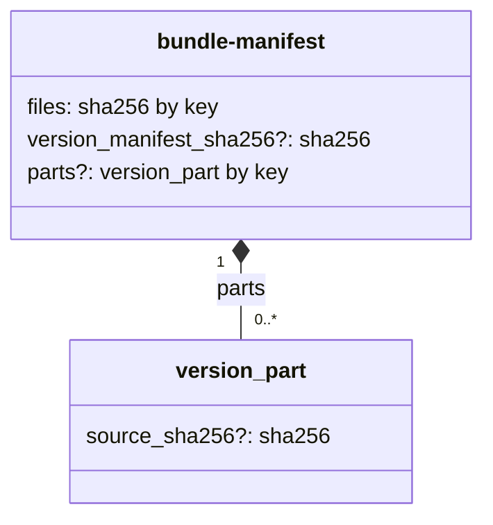

### `record/common`

35 classes.

```mermaid
classDiagram
    class record_common__quantity_fact["quantity_fact"] {
        <<abstract>>
        status: discriminator
    }
    class record_common__quantity_fact__known["quantity_fact.known"] {
        value?: quantity
    }
    class record_common__fact_known["fact_known"] {
        status: const known
        value: any
        sources: sources
        basis: basis
        uncertainty?: uncertainty
        conditions?: text
        assumption?: assumption_id
        derivation?: text
        decision?: decision
        note?: text
    }
    class record_common__source["source"] {
        kind: enum
        reference: text
        revision?: text
        url?: url
        accessed?: date
        artifact?: artifact_path
        sha256?: sha256
        conditions?: text
        origin?: text
        document?: text
        reason?: text
        decision?: decision
        date?: date
        locator?: text
    }
    class record_common__uncertainty["uncertainty"] {
        lower?: number
        upper?: number
        confidence?: number
        note: text
    }
    class record_common__quantity["quantity"] {
        value?: number
        lower?: number
        upper?: number
        units: units
    }
    class record_common__fact_unknown["fact_unknown"] {
        status: const unknown
        reason: text
        question?: question_id
    }
    class record_common__fact_not_applicable["fact_not_applicable"] {
        status: const not_applicable
        reason: text
        decision?: decision
    }
    class record_common__text_fact["text_fact"] {
        <<abstract>>
        status: discriminator
    }
    class record_common__text_fact__known["text_fact.known"] {
        value?: text
    }
    class record_common__criterion["criterion"] {
        id?: semantic_id
        property: semantic_id
        operator: enum
        value: any
        units?: units
        state?: dimension_state = as_manufactured|after_finish|assembled
        source: source
        conditions?: text
        note?: text
    }
    class record_common__money["money"] {
        amount: number
        currency: string
    }
    class record_common__fact_open["fact_open"] {
        <<abstract>>
        status: discriminator
    }
    class record_common__fact["fact"] {
        <<abstract>>
        status: discriminator
    }
    class record_common__texts_fact["texts_fact"] {
        <<abstract>>
        status: discriminator
    }
    class record_common__texts_fact__known["texts_fact.known"] {
        value?: texts
    }
    class record_common__boolean_fact["boolean_fact"] {
        <<abstract>>
        status: discriminator
    }
    class record_common__boolean_fact__known["boolean_fact.known"] {
        value?: boolean
    }
    class record_common__money_fact["money_fact"] {
        <<abstract>>
        status: discriminator
    }
    class record_common__money_fact__known["money_fact.known"] {
        value?: money
    }
    class record_common__function_entry["function_entry"] {
        function: function
        description?: text
        requirements?: requirement_ids
    }
    class record_common__criterion_or_unknown["criterion_or_unknown"] {
        <<union>>
    }
    class record_common__subject["subject"] {
        product?: const true
        PN?: pn
        occurrence?: occurrence_ref
        component?: semantic_id
        operation?: semantic_id
        feature?: semantic_id
        region?: semantic_id
        interface?: interface_id
        assembly_operation?: assembly_operation_id
        requirements?: requirement_ids
    }
    class record_common__target["target"] {
        feature: semantic_id
        region?: semantic_id
        component?: semantic_id
    }
    class record_common__load["load"] {
        id: semantic_id
        kind: enum static|sustained|cyclic|impact|vibration
        magnitude: quantity_fact
        direction: number[3]
        application?: subject
        duration?: quantity_fact
        frequency?: quantity_fact
        cycles?: quantity_fact
        requirements?: requirement_ids
        note?: text
    }
    class record_common__obligation["obligation"] {
        id: obligation_id
        family: check_family
        subject: subject
        level: evidence_level = cad_valid|geometrically_manufacturable|process_planned|simulation_supported|physically_validated
        stage: stage
        basis: text
        requirement?: requirement_id
        criterion?: semantic_id
    }
    class record_common__file_hash["file_hash"] {
        path: project_path
        sha256: sha256
    }
    class record_common__finding["finding"] {
        id: semantic_id
        code: finding_code
        obligation?: obligation_id
        subject: subject
        severity: severity = critical|major|minor|info
        outcome: outcome = pass|fail|unknown|not_applicable|not_assessed
        reason?: not_assessed_reason = calibration_off|no_capability_profile
        measured: quantity or object or fact_unknown
        criterion: criterion_or_unknown
        requirements?: requirement_ids
        method: object
        uncertainty: text
        assumptions?: texts
        coverage?: text
        consequence: text
        remedy?: text
        alternatives?: object[1..*]
        recheck: object
        decisions?: decision[1..*]
    }
    class record_common__finding__measured["finding.measured"] {
        <<union>>
    }
    class record_common__finding__measured__2["finding.measured.2"] {
        text: text
    }
    class record_common__finding__method["finding.method"] {
        name: text
        tool?: text
        evidence?: file_hash[1..*]
    }
    class record_common__finding__alternatives["finding.alternatives"] {
        text: text
        tradeoffs: text
    }
    class record_common__finding__recheck["finding.recheck"] {
        families: check_family[1..*]
        scope?: subject[1..*]
        inputs?: texts
        earliest_stage: stage
    }
    class record_common__obligation_outcome["obligation_outcome"] {
        obligation: obligation_id
        outcome: outcome = pass|fail|unknown|not_applicable|not_assessed
        reason?: not_assessed_reason = calibration_off|no_capability_profile
        level?: evidence_level = cad_valid|geometrically_manufacturable|process_planned|simulation_supported|physically_validated
        method: text
        source?: source
        uncertainty?: text
        coverage: text
        findings?: semantic_ids
    }
    class record_common__waiver["waiver"] {
        decision: decision
        subject: subject
        obligation?: obligation_id
        criterion: text
        operating_envelope: text
        valid_until?: date
        until_change?: text
        reason: text
        consequence: text
        authority: text
    }
    class record_assembly__assembly_operation__edge_distance__criterion["record/assembly.assembly_operation.edge_distance.criterion"] {
        <<external>>
    }
    class record_manufacturing_guideline__limit__quantities["record/manufacturing-guideline.limit.quantities"] {
        <<external>>
    }
    class record_manufacturing_guideline__relative__floor["record/manufacturing-guideline.relative.floor"] {
        <<external>>
    }
    class record_manufacturing_guideline__scope__nozzle_diameter["record/manufacturing-guideline.scope.nozzle_diameter"] {
        <<external>>
    }
    class record_part__intent__service["record/part.intent.service"] {
        <<external>>
    }
    class record_part__operation__orientation["record/part.operation.orientation"] {
        <<external>>
    }
    class record_part__operation__supports["record/part.operation.supports"] {
        <<external>>
    }
    class record_product__use_case__consequences__severity["record/product.use_case.consequences.severity"] {
        <<external>>
    }
    class record_product__use_case__consequences__severity__known["record/product.use_case.consequences.severity.known"] {
        <<external>>
    }
    class record_product__use_case__evidence_policy["record/product.use_case.evidence_policy"] {
        <<external>>
    }
    class record_product__use_case__service_class["record/product.use_case.service_class"] {
        <<external>>
    }
    class record_product__use_case__service_class__known["record/product.use_case.service_class.known"] {
        <<external>>
    }
    record_common__fact_known "1" *-- "1..*" record_common__source : sources
    record_common__fact_known "1" *-- "0..1" record_common__uncertainty : uncertainty
    record_common__fact_known <|-- record_common__quantity_fact__known
    record_common__quantity_fact__known "1" *-- "0..1" record_common__quantity : value
    record_common__quantity_fact <|-- record_common__quantity_fact__known
    record_common__quantity_fact <|-- record_common__fact_unknown
    record_common__quantity_fact <|-- record_common__fact_not_applicable
    record_common__fact_known <|-- record_common__text_fact__known
    record_common__text_fact <|-- record_common__text_fact__known
    record_common__text_fact <|-- record_common__fact_unknown
    record_common__text_fact <|-- record_common__fact_not_applicable
    record_common__criterion "1" *-- "1" record_common__source : source
    record_common__criterion <|-- record_assembly__assembly_operation__edge_distance__criterion
    record_common__fact_open <|-- record_common__fact_unknown
    record_common__fact_open <|-- record_common__fact_not_applicable
    record_common__fact <|-- record_common__fact_known
    record_common__fact <|-- record_common__fact_unknown
    record_common__fact <|-- record_common__fact_not_applicable
    record_common__fact_known <|-- record_common__texts_fact__known
    record_common__texts_fact <|-- record_common__texts_fact__known
    record_common__texts_fact <|-- record_common__fact_unknown
    record_common__texts_fact <|-- record_common__fact_not_applicable
    record_common__fact_known <|-- record_common__boolean_fact__known
    record_common__boolean_fact <|-- record_common__boolean_fact__known
    record_common__boolean_fact <|-- record_common__fact_unknown
    record_common__boolean_fact <|-- record_common__fact_not_applicable
    record_common__fact_known <|-- record_common__money_fact__known
    record_common__money_fact__known "1" *-- "0..1" record_common__money : value
    record_common__money_fact <|-- record_common__money_fact__known
    record_common__money_fact <|-- record_common__fact_unknown
    record_common__money_fact <|-- record_common__fact_not_applicable
    record_common__criterion_or_unknown <|-- record_common__criterion
    record_common__criterion_or_unknown <|-- record_common__fact_unknown
    record_common__load "1" *-- "1" record_common__quantity_fact : magnitude
    record_common__load "1" *-- "0..1" record_common__subject : application
    record_common__load "1" *-- "0..1" record_common__quantity_fact : duration
    record_common__load "1" *-- "0..1" record_common__quantity_fact : frequency
    record_common__load "1" *-- "0..1" record_common__quantity_fact : cycles
    record_common__obligation "1" *-- "1" record_common__subject : subject
    record_common__finding "1" *-- "1" record_common__subject : subject
    record_common__finding__measured <|-- record_common__quantity
    record_common__finding__measured <|-- record_common__finding__measured__2
    record_common__finding__measured <|-- record_common__fact_unknown
    record_common__finding "1" *-- "1" record_common__finding__measured : measured
    record_common__finding "1" *-- "1" record_common__criterion_or_unknown : criterion
    record_common__finding__method "1" *-- "0..*" record_common__file_hash : evidence
    record_common__finding "1" *-- "1" record_common__finding__method : method
    record_common__finding "1" *-- "0..*" record_common__finding__alternatives : alternatives
    record_common__finding__recheck "1" *-- "0..*" record_common__subject : scope
    record_common__finding "1" *-- "1" record_common__finding__recheck : recheck
    record_common__obligation_outcome "1" *-- "0..1" record_common__source : source
    record_common__waiver "1" *-- "1" record_common__subject : subject
    record_common__quantity <|-- record_manufacturing_guideline__scope__nozzle_diameter
    record_common__quantity <|-- record_manufacturing_guideline__relative__floor
    record_common__quantity <|-- record_manufacturing_guideline__limit__quantities
    record_part__intent__service <|-- record_common__fact_open
    record_part__operation__orientation <|-- record_common__fact_open
    record_part__operation__supports <|-- record_common__fact_open
    record_common__fact_known <|-- record_product__use_case__service_class__known
    record_product__use_case__service_class <|-- record_common__fact_unknown
    record_common__fact_known <|-- record_product__use_case__consequences__severity__known
    record_product__use_case__consequences__severity <|-- record_common__fact_unknown
    record_product__use_case__evidence_policy <|-- record_common__fact_unknown
```

### `record/decision`

4 classes.

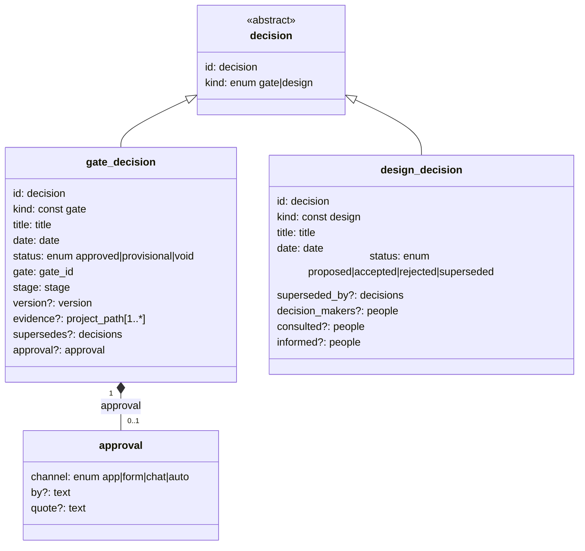

### `record/drawing`

36 classes.

```mermaid
classDiagram
    class record_drawing__sheet["sheet"] {
        sizes?: sheet_size[1..*]
        orientation?: enum landscape|portrait
        scale?: scale
        multi_sheet?: boolean
    }
    class record_drawing__direction["direction"] {
        normal_to?: reference
        parallel_to?: reference
        toward?: reference
        toward_axis?: reference
    }
    class record_drawing__tolerance["tolerance"] {
        <<union>>
    }
    class record_drawing__tolerance__1["tolerance.1"] {
        policy: policy_name
    }
    class record_drawing__tolerance__2["tolerance.2"] {
        deviation_mm: number[2]
    }
    class record_drawing__tolerance_policy["tolerance_policy"] {
        <<abstract>>
        kind: discriminator
    }
    class record_drawing__tolerance_policy__standard["tolerance_policy.standard"] {
        kind: const standard
        standard: const ISO 2768-1:1989
        class: enum f|m|c|v
        applies_to: primary_process[1..*]
    }
    class record_drawing__tolerance_policy__limits["tolerance_policy.limits"] {
        kind: const limits
        linear_mm: number
        angular_deg?: number
        applies_to: primary_process[1..*]
        reference: string
    }
    class record_drawing__product_drawing["product_drawing"] {
        definition: const model_and_drawing
        projection: enum first_angle|third_angle
        standards: string by key
        default_sheet: sheet
        tolerance_policies: tolerance_policy by key
        general_tolerance_policy: policy_name
    }
    class record_drawing__product_drawing__default_sheet["product_drawing.default_sheet"]
    class record_drawing__view["view"] {
        id: semantic_id
        kind: enum orthographic|auxiliary|section|detail
        normal_to?: reference
        along_axis?: reference
        parallel_to?: reference
        perpendicular_to?: reference
        opposite?: semantic_id
        through?: references
        normal_axis?: enum x|y|z
        sheet?: integer
        toward?: reference
        feature?: semantic_id
        scale?: scale
    }
    class record_drawing__feature_intent["feature_intent"] {
        size?: enum general|interface
        location?: const datum_coordinates
        profile?: const controlled_model
        profile_tolerance_mm?: number
        presentation?: enum auto|visible|section|detail|general_note
        axial_location_from?: reference
        tolerance_policy?: policy_name
        thread?: thread
        surface_texture?: texture_requirement
        edges?: edges
    }
    class record_drawing__thread["thread"] {
        designation: string
        standard: string
        operation: enum tap|thread_form|roll|cut|vendor
        full_depth_anchor?: semantic_id
    }
    class record_drawing__texture_requirement["texture_requirement"] {
        parameter: enum Ra|Rz
        limit_um: number
        process: enum any|removal_required|removal_prohibited
    }
    class record_drawing__edges["edges"] {
        external?: edge_limits
        internal?: edge_limits
    }
    class record_drawing__geometric_tolerance["geometric_tolerance"] {
        id: semantic_id
        characteristic: enum
        features: semantic_id[1..*]
        zone_mm: number
        diameter_zone?: boolean
        datum_frame?: datum_label[1..3]
    }
    class record_drawing__dimension_request["dimension_request"] {
        id: semantic_id
        operation: enum
        features: semantic_id[1..*]
        at?: semantic_id
        instance?: integer
        datum_frame?: datum_label[1..3]
        tolerance?: tolerance
        presentation?: enum auto|visible|section|detail
        reference?: boolean
    }
    class record_drawing__part_drawing["part_drawing"] {
        type: enum detail|vendor_specification|source_control
        tolerance_policy?: policy_name
        datum_features?: object by key
        coordinate_frame?: object
        views?: view[1..*]
        features?: feature_intent by key
        dimensions?: dimension_request[1..*]
        geometric_tolerances?: geometric_tolerance[1..*]
        edges?: edges
        surface_texture?: texture_requirement or object
        notes?: object[1..*]
        manufacturing?: object
        sheet?: sheet
    }
    class record_drawing__part_drawing__datum_features["part_drawing.datum_features"] {
        feature: semantic_id
        role: enum plane|axis|point|center_plane|clocking_feature
    }
    class record_drawing__part_drawing__coordinate_frame["part_drawing.coordinate_frame"] {
        origin: object
        x?: direction
        y?: direction
        z?: direction
    }
    class record_drawing__part_drawing__coordinate_frame__origin["part_drawing.coordinate_frame.origin"] {
        <<union>>
    }
    class record_drawing__part_drawing__coordinate_frame__origin__1["part_drawing.coordinate_frame.origin.1"] {
        intersection: reference[2..3]
    }
    class record_drawing__part_drawing__coordinate_frame__origin__2["part_drawing.coordinate_frame.origin.2"] {
        at: reference
    }
    class record_drawing__part_drawing__edges["part_drawing.edges"]
    class record_drawing__part_drawing__surface_texture["part_drawing.surface_texture"] {
        <<union>>
    }
    class record_drawing__part_drawing__surface_texture__2["part_drawing.surface_texture.2"] {
        open: string
    }
    class record_drawing__part_drawing__notes["part_drawing.notes"] {
        kind: enum process|finish|material|inspection|general
        text: string
        reference?: string
    }
    class record_drawing__part_drawing__manufacturing["part_drawing.manufacturing"] {
        build_direction?: direction
        interface_condition?: enum as_printed|post_processed|finish_machined
        dimensions_apply?: enum before_finish|after_finish
        post_processing?: string[1..*]
        inspection_stage?: string
    }
    class record_drawing__procurement["procurement"] {
        mode: enum catalog|made_to_drawing
        manufacturer?: string
        manufacturer_part_number?: string
        supplier_part_number?: string
        designation?: string
        standard?: string
        specification?: object
        open?: object
        approved_sources?: object[1..*]
        qualification_evidence?: string
        certificates?: string[1..*]
    }
    class record_drawing__procurement__specification["procurement.specification"] {
        reference: string
        revision: string
        artifact?: string
        url?: string
        sha256: sha256
    }
    class record_drawing__procurement__open["procurement.open"] {
        manufacturer?: string
        manufacturer_part_number?: string
        supplier_part_number?: string
    }
    class record_drawing__procurement__approved_sources["procurement.approved_sources"] {
        name: string
        part_number?: string
    }
    class record_drawing__fit_endpoint["fit_endpoint"] {
        PN: pn
        occurrence?: occurrence_ref
        feature: semantic_id
        region?: semantic_id
    }
    class record_drawing__fit["fit"] {
        fit: string
        pair?: part_ref[2]
        hole?: fit_endpoint
        shaft?: fit_endpoint
        engagement_length_mm?: number
        note?: string
        axial_retainer?: axial_retainer
    }
    class record_drawing__axial_retainer["axial_retainer"] {
        type: enum
        parts?: part_ref[1..*]
        decision?: decision
    }
    class record_drawing__heat_set["heat_set"] {
        pair: part_ref[2]
        hole_diameter_mm: number
        hole_deviation_mm?: number[2]
        min_depth_mm?: number
        engagement_length_mm?: number
        insert: string
        source: string
        note?: string
        feature?: semantic_id
    }
    record_drawing__tolerance <|-- record_drawing__tolerance__1
    record_drawing__tolerance <|-- record_drawing__tolerance__2
    record_drawing__tolerance_policy <|-- record_drawing__tolerance_policy__standard
    record_drawing__tolerance_policy <|-- record_drawing__tolerance_policy__limits
    record_drawing__sheet <|-- record_drawing__product_drawing__default_sheet
    record_drawing__product_drawing "1" *-- "1" record_drawing__product_drawing__default_sheet : default_sheet
    record_drawing__product_drawing "1" *-- "1..*" record_drawing__tolerance_policy : tolerance_policies
    record_drawing__feature_intent "1" *-- "0..1" record_drawing__thread : thread
    record_drawing__feature_intent "1" *-- "0..1" record_drawing__texture_requirement : surface_texture
    record_drawing__feature_intent "1" *-- "0..1" record_drawing__edges : edges
    record_drawing__dimension_request "1" *-- "0..1" record_drawing__tolerance : tolerance
    record_drawing__part_drawing "1" *-- "0..*" record_drawing__part_drawing__datum_features : datum_features
    record_drawing__part_drawing__coordinate_frame__origin <|-- record_drawing__part_drawing__coordinate_frame__origin__1
    record_drawing__part_drawing__coordinate_frame__origin <|-- record_drawing__part_drawing__coordinate_frame__origin__2
    record_drawing__part_drawing__coordinate_frame "1" *-- "1" record_drawing__part_drawing__coordinate_frame__origin : origin
    record_drawing__part_drawing__coordinate_frame "1" *-- "0..1" record_drawing__direction : x
    record_drawing__part_drawing__coordinate_frame "1" *-- "0..1" record_drawing__direction : y
    record_drawing__part_drawing__coordinate_frame "1" *-- "0..1" record_drawing__direction : z
    record_drawing__part_drawing "1" *-- "0..1" record_drawing__part_drawing__coordinate_frame : coordinate_frame
    record_drawing__part_drawing "1" *-- "0..*" record_drawing__view : views
    record_drawing__part_drawing "1" *-- "0..*" record_drawing__feature_intent : features
    record_drawing__part_drawing "1" *-- "0..*" record_drawing__dimension_request : dimensions
    record_drawing__part_drawing "1" *-- "0..*" record_drawing__geometric_tolerance : geometric_tolerances
    record_drawing__edges <|-- record_drawing__part_drawing__edges
    record_drawing__part_drawing "1" *-- "0..1" record_drawing__part_drawing__edges : edges
    record_drawing__part_drawing__surface_texture <|-- record_drawing__texture_requirement
    record_drawing__part_drawing__surface_texture <|-- record_drawing__part_drawing__surface_texture__2
    record_drawing__part_drawing "1" *-- "0..1" record_drawing__part_drawing__surface_texture : surface_texture
    record_drawing__part_drawing "1" *-- "0..*" record_drawing__part_drawing__notes : notes
    record_drawing__part_drawing__manufacturing "1" *-- "0..1" record_drawing__direction : build_direction
    record_drawing__part_drawing "1" *-- "0..1" record_drawing__part_drawing__manufacturing : manufacturing
    record_drawing__part_drawing "1" *-- "0..1" record_drawing__sheet : sheet
    record_drawing__procurement "1" *-- "0..1" record_drawing__procurement__specification : specification
    record_drawing__procurement "1" *-- "0..1" record_drawing__procurement__open : open
    record_drawing__procurement "1" *-- "0..*" record_drawing__procurement__approved_sources : approved_sources
    record_drawing__fit "1" *-- "0..1" record_drawing__fit_endpoint : hole
    record_drawing__fit "1" *-- "0..1" record_drawing__fit_endpoint : shaft
    record_drawing__fit "1" *-- "0..1" record_drawing__axial_retainer : axial_retainer
```

### `record/evidence-assessment`

7 classes.

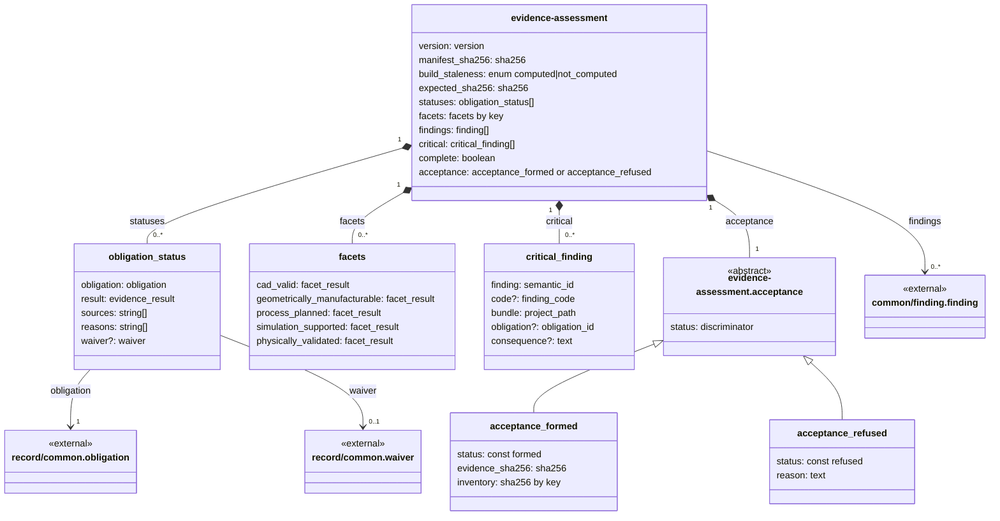

### `record/interfaces`

14 classes.

```mermaid
classDiagram
    class record_interfaces["interfaces"] {
        interfaces: object[]
    }
    class record_interfaces__interfaces["interfaces.interfaces"] {
        id: interface_id
        from: string
        to: string
        type: enum mounting|motion|electrical|thermal|clearance|other
        description: string
        pair?: part_ref[2]
        min_clearance_mm?: number
        margin_mm?: number
        limits?: object
        functional?: functional
    }
    class record_interfaces__interfaces__limits["interfaces.interfaces.limits"] {
        press_fit?: fit
        running_fit?: fit
        locating_fit?: fit
        heat_set?: heat_set[1..*]
    }
    class record_interfaces__functional["functional"] {
        critical: boolean_fact
        functions: function_entry[1..*] or fact_unknown
        requirements?: requirement_ids
        failure_consequence?: text_fact
        loads?: semantic_ids
        environment?: text
        surfaces?: object[1..*]
        acceptance?: object[1..*]
        variation?: object
        contact?: object
        play?: object
        assembly_operations?: assembly_operation_id[1..*]
        print_in_place?: object[1..*]
        inspections?: semantic_ids
        decisions?: decision[1..*]
    }
    class record_interfaces__functional__surfaces["functional.surfaces"] {
        PN: pn
        occurrence?: occurrence_ref
        component?: semantic_id
        feature: semantic_id
        region?: semantic_id
        role: enum
        datum?: datum_label
        source?: source
        dimension_state: dimension_state = as_manufactured|after_finish|assembled
    }
    class record_interfaces__functional__acceptance["functional.acceptance"] {
        criterion: criterion
        verification: object
    }
    class record_interfaces__functional__acceptance__verification["functional.acceptance.verification"] {
        method: enum I|A|D|T
        evidence_required: evidence_level = cad_valid|geometrically_manufacturable|process_planned|simulation_supported|physically_validated[1..*]
        stage: stage
    }
    class record_interfaces__functional__variation["functional.variation"] {
        stack_case: string
        contributors: enum[1..*]
        method: enum worst_case|justified_rss
        decision?: decision
    }
    class record_interfaces__functional__contact["functional.contact"] {
        materials: profile_id or fact_open[2]
        finish?: text_fact
        lubrication?: text_fact
        load?: quantity_fact
        speed?: quantity_fact
        duty?: text_fact
        life?: quantity_fact
        evidence?: evidence_id[1..*]
    }
    class record_interfaces__functional__play["functional.play"] {
        axial?: quantity_fact
        radial?: quantity_fact
        angular?: quantity_fact
        backlash?: quantity_fact
        compliance?: object
        scenario_cases?: string[1..*]
    }
    class record_interfaces__functional__play__compliance["functional.play.compliance"] {
        axial?: quantity_fact
        radial?: quantity_fact
        angular?: quantity_fact
    }
    class record_interfaces__functional__print_in_place["functional.print_in_place"] {
        joint: enum hinge|pin|ball|captive|living_hinge
        print_pose: number by key
        gap_features: face[2][1..*]
        break_free: object
    }
    class record_interfaces__face["face"] {
        PN: pn
        occurrence?: occurrence_ref
        component?: semantic_id
        feature: semantic_id
        region?: semantic_id
    }
    class record_interfaces__functional__print_in_place__break_free["functional.print_in_place.break_free"] {
        method: text
        force_n?: number
    }
    class record_common__boolean_fact["record/common.boolean_fact"] {
        <<external>>
    }
    class record_common__criterion["record/common.criterion"] {
        <<external>>
    }
    class record_common__fact_open["record/common.fact_open"] {
        <<external>>
    }
    class record_common__fact_unknown["record/common.fact_unknown"] {
        <<external>>
    }
    class record_common__function_entry["record/common.function_entry"] {
        <<external>>
    }
    class record_common__quantity_fact["record/common.quantity_fact"] {
        <<external>>
    }
    class record_common__source["record/common.source"] {
        <<external>>
    }
    class record_common__text_fact["record/common.text_fact"] {
        <<external>>
    }
    class record_drawing__fit["record/drawing.fit"] {
        <<external>>
    }
    class record_drawing__heat_set["record/drawing.heat_set"] {
        <<external>>
    }
    record_interfaces__interfaces__limits --> "0..1" record_drawing__fit : press_fit
    record_interfaces__interfaces__limits --> "0..1" record_drawing__fit : running_fit
    record_interfaces__interfaces__limits --> "0..1" record_drawing__fit : locating_fit
    record_interfaces__interfaces__limits --> "0..*" record_drawing__heat_set : heat_set
    record_interfaces__interfaces "1" *-- "0..1" record_interfaces__interfaces__limits : limits
    record_interfaces__functional --> "1" record_common__boolean_fact : critical
    record_interfaces__functional --> "0..*" record_common__function_entry : functions
    record_interfaces__functional --> "0..1" record_common__fact_unknown : functions
    record_interfaces__functional --> "0..1" record_common__text_fact : failure_consequence
    record_interfaces__functional__surfaces --> "0..1" record_common__source : source
    record_interfaces__functional "1" *-- "0..*" record_interfaces__functional__surfaces : surfaces
    record_interfaces__functional__acceptance --> "1" record_common__criterion : criterion
    record_interfaces__functional__acceptance "1" *-- "1" record_interfaces__functional__acceptance__verification : verification
    record_interfaces__functional "1" *-- "0..*" record_interfaces__functional__acceptance : acceptance
    record_interfaces__functional "1" *-- "0..1" record_interfaces__functional__variation : variation
    record_interfaces__functional__contact --> "0..2" record_common__fact_open : materials
    record_interfaces__functional__contact --> "0..1" record_common__text_fact : finish
    record_interfaces__functional__contact --> "0..1" record_common__text_fact : lubrication
    record_interfaces__functional__contact --> "0..1" record_common__quantity_fact : load
    record_interfaces__functional__contact --> "0..1" record_common__quantity_fact : speed
    record_interfaces__functional__contact --> "0..1" record_common__text_fact : duty
    record_interfaces__functional__contact --> "0..1" record_common__quantity_fact : life
    record_interfaces__functional "1" *-- "0..1" record_interfaces__functional__contact : contact
    record_interfaces__functional__play --> "0..1" record_common__quantity_fact : axial
    record_interfaces__functional__play --> "0..1" record_common__quantity_fact : radial
    record_interfaces__functional__play --> "0..1" record_common__quantity_fact : angular
    record_interfaces__functional__play --> "0..1" record_common__quantity_fact : backlash
    record_interfaces__functional__play__compliance --> "0..1" record_common__quantity_fact : axial
    record_interfaces__functional__play__compliance --> "0..1" record_common__quantity_fact : radial
    record_interfaces__functional__play__compliance --> "0..1" record_common__quantity_fact : angular
    record_interfaces__functional__play "1" *-- "0..1" record_interfaces__functional__play__compliance : compliance
    record_interfaces__functional "1" *-- "0..1" record_interfaces__functional__play : play
    record_interfaces__functional__print_in_place "1" *-- "2..*" record_interfaces__face : gap_features
    record_interfaces__functional__print_in_place "1" *-- "1" record_interfaces__functional__print_in_place__break_free : break_free
    record_interfaces__functional "1" *-- "0..*" record_interfaces__functional__print_in_place : print_in_place
    record_interfaces__interfaces "1" *-- "0..1" record_interfaces__functional : functional
    record_interfaces "1" *-- "0..*" record_interfaces__interfaces : interfaces
```

### `record/manufacturing-capabilities`

31 classes.

```mermaid
classDiagram
    class record_manufacturing_capabilities["manufacturing-capabilities"] {
        profiles: profile[]
    }
    class record_manufacturing_capabilities__profile["profile"] {
        id: profile_id
        revision: integer
        title: text
        process: semantic_id
        provider: enum local|outsourced
        template?: const true
        guidance?: texts
        supplier?: text_fact
        operator?: text_fact
        machine?: object
        envelope?: object
        materials: material_approval[1..*] or fact_open
        parameters: parameters
        tools?: object[1..*]
        workholding?: text_fact
        constraints?: texts
        calibrations: calibration[]
        guidelines?: guideline_ref[1..*]
        source?: source
    }
    class record_manufacturing_capabilities__profile__machine["profile.machine"] {
        identity: text_fact
        location?: text
    }
    class record_manufacturing_capabilities__profile__envelope["profile.envelope"] {
        x: quantity_fact
        y: quantity_fact
        z: quantity_fact
    }
    class record_manufacturing_capabilities__material_approval["material_approval"] {
        material: profile_id
        status: enum approved|forbidden
        thickness?: quantity_fact
        coating?: text_fact
        extraction?: text_fact
        operations?: enum[1..*]
        reason?: text
        source: source
    }
    class record_manufacturing_capabilities__parameters["parameters"] {
        nozzle_diameter?: fact and fact_nozzle_diameter
        layer_height?: fact and fact_layer_height
        hotend_max_temperature?: fact and fact_hotend_max_temperature
        bed_max_temperature?: fact and fact_bed_max_temperature
        max_speed?: fact and fact_max_speed
        travel_x?: fact and fact_travel_x
        travel_y?: fact and fact_travel_y
        travel_z?: fact and fact_travel_z
        spindle_max_speed?: fact and fact_spindle_max_speed
        power?: fact and fact_power
        pump_pressure?: fact and fact_pump_pressure
        press_brake_force?: fact and fact_press_brake_force
        [key]: fact
    }
    class record_manufacturing_capabilities__profile__tools["profile.tools"] {
        id: semantic_id
        description: text
        parameters: parameters
    }
    class record_manufacturing_capabilities__calibration["calibration"] {
        id: semantic_id
        characteristic: semantic_id
        scope: object
        result: object
        source: source
        date: date
        valid_until?: date
        decision?: decision
    }
    class record_manufacturing_capabilities__calibration__scope["calibration.scope"] {
        material: profile_id
        condition?: text
        feature?: text
        size?: quantity
        thickness?: quantity
        orientation?: text
        setup?: text
        tool?: semantic_id
        finish?: text
    }
    class record_manufacturing_capabilities__calibration__result["calibration.result"] {
        limits: quantity
        distribution?: text
        uncertainty?: quantity
        samples: integer
    }
    class record_manufacturing_capabilities__qty_nozzle_diameter["qty_nozzle_diameter"] {
        units?: enum mm|m|um
    }
    class record_manufacturing_capabilities__qty_layer_height["qty_layer_height"] {
        units?: enum mm|m|um
    }
    class record_manufacturing_capabilities__qty_hotend_max_temperature["qty_hotend_max_temperature"] {
        units?: enum deg_C|K
    }
    class record_manufacturing_capabilities__qty_bed_max_temperature["qty_bed_max_temperature"] {
        units?: enum deg_C|K
    }
    class record_manufacturing_capabilities__qty_max_speed["qty_max_speed"] {
        units?: enum mm_s|m_s
    }
    class record_manufacturing_capabilities__qty_travel_x["qty_travel_x"] {
        units?: enum mm|m|um
    }
    class record_manufacturing_capabilities__qty_travel_y["qty_travel_y"] {
        units?: enum mm|m|um
    }
    class record_manufacturing_capabilities__qty_travel_z["qty_travel_z"] {
        units?: enum mm|m|um
    }
    class record_manufacturing_capabilities__qty_spindle_max_speed["qty_spindle_max_speed"] {
        units?: enum rpm|Hz
    }
    class record_manufacturing_capabilities__qty_power["qty_power"] {
        units?: enum kW|W
    }
    class record_manufacturing_capabilities__qty_pump_pressure["qty_pump_pressure"] {
        units?: enum MPa|GPa|bar
    }
    class record_manufacturing_capabilities__qty_press_brake_force["qty_press_brake_force"] {
        units?: enum kN|N
    }
    class record_manufacturing_capabilities__qty_bridge_span["qty_bridge_span"] {
        units?: enum mm|m|um
    }
    class record_manufacturing_capabilities__qty_overhang_angle["qty_overhang_angle"] {
        units?: enum deg|rad
    }
    class record_manufacturing_capabilities__qty_min_wall["qty_min_wall"] {
        units?: enum mm|m|um
    }
    class record_manufacturing_capabilities__qty_min_feature["qty_min_feature"] {
        units?: enum mm|m|um
    }
    class record_manufacturing_capabilities__qty_min_hole["qty_min_hole"] {
        units?: enum mm|m|um
    }
    class record_manufacturing_capabilities__qty_deviation["qty_deviation"] {
        units?: enum mm|m|um
    }
    class record_manufacturing_capabilities__qty_clearance_per_side["qty_clearance_per_side"] {
        units?: enum mm|m|um
    }
    class record_manufacturing_capabilities__qty_interference_per_side["qty_interference_per_side"] {
        units?: enum mm|m|um
    }
    class record_manufacturing_capabilities__qty_min_bed_contact_area["qty_min_bed_contact_area"] {
        units?: enum mm2
    }
    class record_common__fact["record/common.fact"] {
        <<external>>
    }
    class record_common__fact_open["record/common.fact_open"] {
        <<external>>
    }
    class record_common__quantity["record/common.quantity"] {
        <<external>>
    }
    class record_common__quantity_fact["record/common.quantity_fact"] {
        <<external>>
    }
    class record_common__source["record/common.source"] {
        <<external>>
    }
    class record_common__text_fact["record/common.text_fact"] {
        <<external>>
    }
    class record_manufacturing_guideline__limit__quantities["record/manufacturing-guideline.limit.quantities"] {
        <<external>>
    }
    class record_manufacturing_guideline__scope__nozzle_diameter["record/manufacturing-guideline.scope.nozzle_diameter"] {
        <<external>>
    }
    record_manufacturing_capabilities__profile --> "0..1" record_common__text_fact : supplier
    record_manufacturing_capabilities__profile --> "0..1" record_common__text_fact : operator
    record_manufacturing_capabilities__profile__machine --> "1" record_common__text_fact : identity
    record_manufacturing_capabilities__profile "1" *-- "0..1" record_manufacturing_capabilities__profile__machine : machine
    record_manufacturing_capabilities__profile__envelope --> "1" record_common__quantity_fact : x
    record_manufacturing_capabilities__profile__envelope --> "1" record_common__quantity_fact : y
    record_manufacturing_capabilities__profile__envelope --> "1" record_common__quantity_fact : z
    record_manufacturing_capabilities__profile "1" *-- "0..1" record_manufacturing_capabilities__profile__envelope : envelope
    record_manufacturing_capabilities__material_approval --> "0..1" record_common__quantity_fact : thickness
    record_manufacturing_capabilities__material_approval --> "0..1" record_common__text_fact : coating
    record_manufacturing_capabilities__material_approval --> "0..1" record_common__text_fact : extraction
    record_manufacturing_capabilities__material_approval --> "1" record_common__source : source
    record_manufacturing_capabilities__profile "1" *-- "0..*" record_manufacturing_capabilities__material_approval : materials
    record_manufacturing_capabilities__profile --> "0..1" record_common__fact_open : materials
    record_manufacturing_capabilities__parameters --> "0..1" record_common__fact : nozzle_diameter
    record_manufacturing_capabilities__parameters --> "0..1" record_common__fact : layer_height
    record_manufacturing_capabilities__parameters --> "0..1" record_common__fact : hotend_max_temperature
    record_manufacturing_capabilities__parameters --> "0..1" record_common__fact : bed_max_temperature
    record_manufacturing_capabilities__parameters --> "0..1" record_common__fact : max_speed
    record_manufacturing_capabilities__parameters --> "0..1" record_common__fact : travel_x
    record_manufacturing_capabilities__parameters --> "0..1" record_common__fact : travel_y
    record_manufacturing_capabilities__parameters --> "0..1" record_common__fact : travel_z
    record_manufacturing_capabilities__parameters --> "0..1" record_common__fact : spindle_max_speed
    record_manufacturing_capabilities__parameters --> "0..1" record_common__fact : power
    record_manufacturing_capabilities__parameters --> "0..1" record_common__fact : pump_pressure
    record_manufacturing_capabilities__parameters --> "0..1" record_common__fact : press_brake_force
    record_manufacturing_capabilities__parameters --> "0..*" record_common__fact : [key]
    record_manufacturing_capabilities__profile "1" *-- "1" record_manufacturing_capabilities__parameters : parameters
    record_manufacturing_capabilities__profile__tools "1" *-- "1" record_manufacturing_capabilities__parameters : parameters
    record_manufacturing_capabilities__profile "1" *-- "0..*" record_manufacturing_capabilities__profile__tools : tools
    record_manufacturing_capabilities__profile --> "0..1" record_common__text_fact : workholding
    record_manufacturing_capabilities__calibration__scope --> "0..1" record_common__quantity : size
    record_manufacturing_capabilities__calibration__scope --> "0..1" record_common__quantity : thickness
    record_manufacturing_capabilities__calibration "1" *-- "1" record_manufacturing_capabilities__calibration__scope : scope
    record_manufacturing_capabilities__calibration__result --> "1" record_common__quantity : limits
    record_manufacturing_capabilities__calibration__result --> "0..1" record_common__quantity : uncertainty
    record_manufacturing_capabilities__calibration "1" *-- "1" record_manufacturing_capabilities__calibration__result : result
    record_manufacturing_capabilities__calibration --> "1" record_common__source : source
    record_manufacturing_capabilities__profile "1" *-- "0..*" record_manufacturing_capabilities__calibration : calibrations
    record_manufacturing_capabilities__profile --> "0..1" record_common__source : source
    record_manufacturing_capabilities "1" *-- "0..*" record_manufacturing_capabilities__profile : profiles
    record_manufacturing_capabilities__qty_nozzle_diameter <|-- record_manufacturing_guideline__scope__nozzle_diameter
    record_manufacturing_capabilities__qty_nozzle_diameter <|-- record_manufacturing_guideline__limit__quantities
```

### `record/manufacturing-check-result`

1 classes.

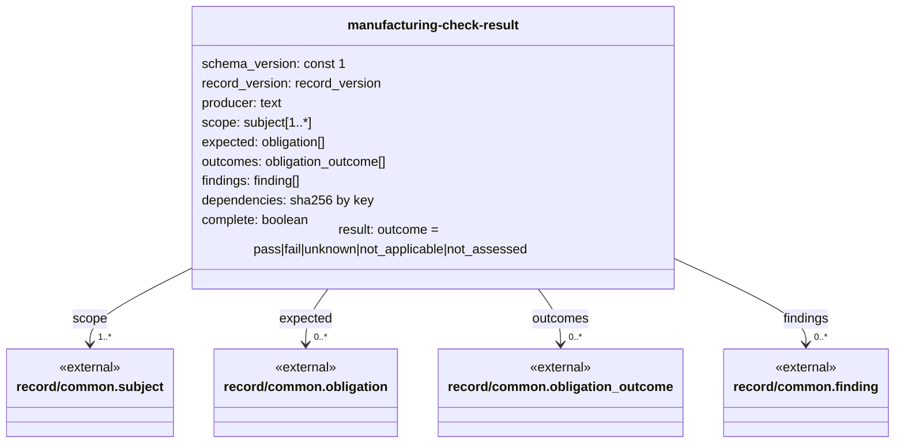

### `record/manufacturing-evidence`

5 classes.

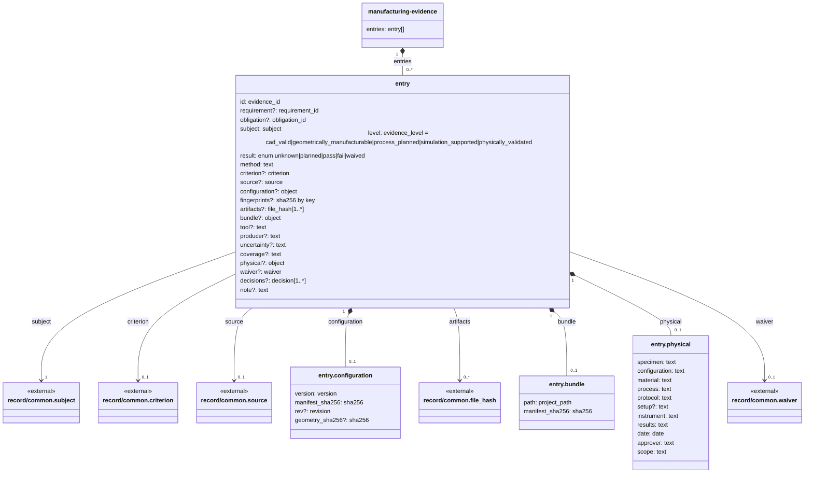

### `record/manufacturing-findings`

3 classes.

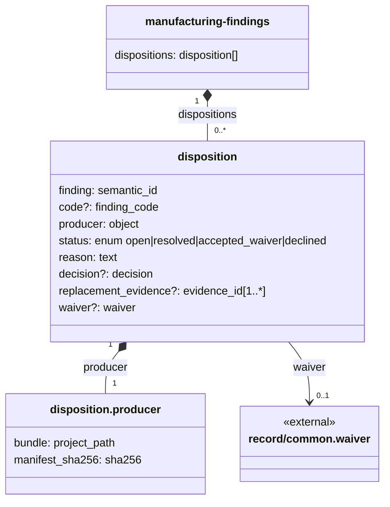

### `record/manufacturing-guideline`

9 classes.

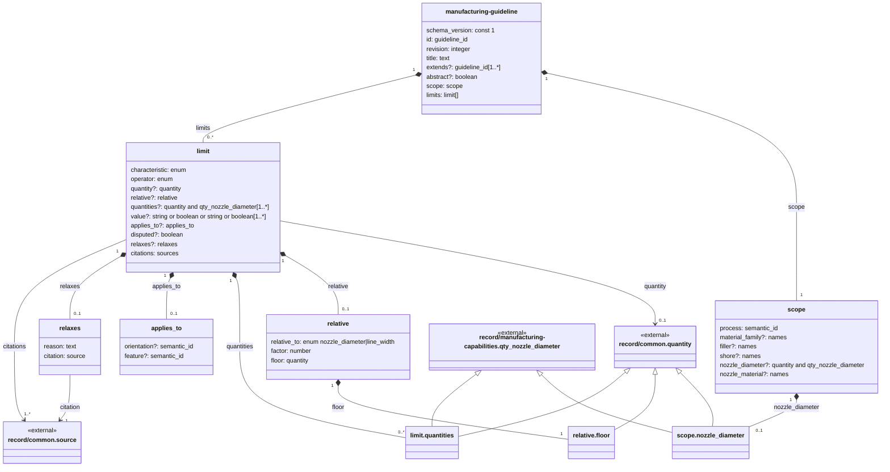

### `record/manufacturing-materials`

5 classes.

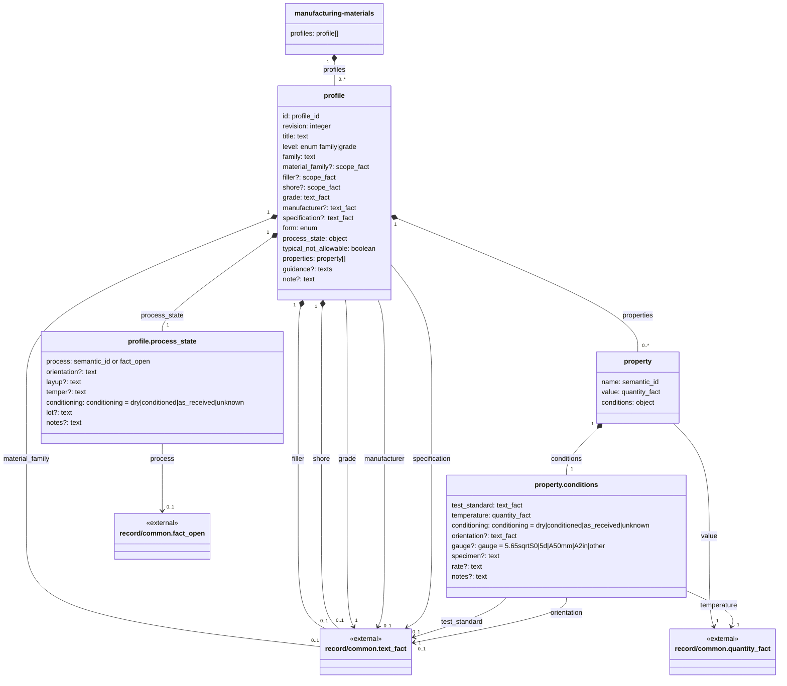

### `record/manufacturing-selection`

10 classes.

```mermaid
classDiagram
    class record_manufacturing_selection["manufacturing-selection"] {
        status: enum not_assessed|assessed|confirmed
        assessment?: object
        candidates: candidate[]
        recommendation?: recommendation
    }
    class record_manufacturing_selection__assessment["manufacturing-selection.assessment"] {
        input_sha256: sha256
        method: text
        date: date
        decision?: decision
    }
    class record_manufacturing_selection__candidate["candidate"] {
        id: semantic_id
        title: text
        architecture: text
        parts: candidate_part[1..*]
        interfaces?: interface_id[1..*]
        evaluations: not_assessed_rule[]
        changes?: object
        quantity?: quantity_fact
        cost?: money_fact
        lead_time?: quantity_fact
        maintenance?: text_fact
        evidence_confidence?: text
        obligations?: texts
        pros: texts
        cons: texts
        tradeoffs: texts
        preference_scores?: object[1..*]
    }
    class record_manufacturing_selection__candidate_part["candidate_part"] {
        PN: pn
        material_profile: profile_id or fact_open
        route: step[1..*]
        proposed?: proposed_part
        note?: text
    }
    class record_manufacturing_selection__step["step"] {
        kind: semantic_id
        capability: profile_id or fact_open
        provider?: enum local|outsourced
        purchase?: purchase
    }
    class record_manufacturing_selection__proposed_part["proposed_part"] {
        title: text
        sourcing: enum make|made_to_drawing|catalogue
        reason: text
        functions?: function_entry[1..*]
        transparency?: transparency = opaque|translucent|transparent
    }
    class record_manufacturing_selection__candidate__evaluations["candidate.evaluations"] {
        requirement: requirement_id
        outcome: outcome = pass|fail|unknown|not_applicable|not_assessed
        reason?: not_assessed_reason = calibration_off|no_capability_profile
        method: text
        criterion?: criterion
        value?: quantity or text
        uncertainty?: text
        source?: source
        note?: text
    }
    class record_manufacturing_selection__candidate__changes["candidate.changes"] {
        design?: texts
        equipment?: texts
        finishing?: texts
        inspection?: texts
        interfaces?: texts
        assembly?: texts
    }
    class record_manufacturing_selection__candidate__preference_scores["candidate.preference_scores"] {
        preference: preference_id
        score: number
        note?: text
    }
    class record_manufacturing_selection__recommendation["recommendation"] {
        status: enum conditional|final
        primary: semantic_id
        prototype?: semantic_id
        end_use?: semantic_id
        fallback?: semantic_id
        governing_requirements?: requirement_ids
        reasons: texts
        limits: texts
        prototype_validates?: texts
        what_would_change: texts
        proposed_changes?: texts
    }
    class record_common__criterion["record/common.criterion"] {
        <<external>>
    }
    class record_common__fact_open["record/common.fact_open"] {
        <<external>>
    }
    class record_common__function_entry["record/common.function_entry"] {
        <<external>>
    }
    class record_common__money_fact["record/common.money_fact"] {
        <<external>>
    }
    class record_common__quantity["record/common.quantity"] {
        <<external>>
    }
    class record_common__quantity_fact["record/common.quantity_fact"] {
        <<external>>
    }
    class record_common__source["record/common.source"] {
        <<external>>
    }
    class record_common__text_fact["record/common.text_fact"] {
        <<external>>
    }
    class record_part__purchase["record/part.purchase"] {
        <<external>>
    }
    record_manufacturing_selection "1" *-- "0..1" record_manufacturing_selection__assessment : assessment
    record_manufacturing_selection__candidate_part --> "0..1" record_common__fact_open : material_profile
    record_manufacturing_selection__step --> "0..1" record_common__fact_open : capability
    record_manufacturing_selection__step --> "0..1" record_part__purchase : purchase
    record_manufacturing_selection__candidate_part "1" *-- "1..*" record_manufacturing_selection__step : route
    record_manufacturing_selection__proposed_part --> "0..*" record_common__function_entry : functions
    record_manufacturing_selection__candidate_part "1" *-- "0..1" record_manufacturing_selection__proposed_part : proposed
    record_manufacturing_selection__candidate "1" *-- "1..*" record_manufacturing_selection__candidate_part : parts
    record_manufacturing_selection__candidate__evaluations --> "0..1" record_common__criterion : criterion
    record_manufacturing_selection__candidate__evaluations --> "0..1" record_common__quantity : value
    record_manufacturing_selection__candidate__evaluations --> "0..1" record_common__source : source
    record_manufacturing_selection__candidate "1" *-- "0..*" record_manufacturing_selection__candidate__evaluations : evaluations
    record_manufacturing_selection__candidate "1" *-- "0..1" record_manufacturing_selection__candidate__changes : changes
    record_manufacturing_selection__candidate --> "0..1" record_common__quantity_fact : quantity
    record_manufacturing_selection__candidate --> "0..1" record_common__money_fact : cost
    record_manufacturing_selection__candidate --> "0..1" record_common__quantity_fact : lead_time
    record_manufacturing_selection__candidate --> "0..1" record_common__text_fact : maintenance
    record_manufacturing_selection__candidate "1" *-- "0..*" record_manufacturing_selection__candidate__preference_scores : preference_scores
    record_manufacturing_selection "1" *-- "0..*" record_manufacturing_selection__candidate : candidates
    record_manufacturing_selection "1" *-- "0..1" record_manufacturing_selection__recommendation : recommendation
```

### `record/part`

26 classes.

```mermaid
classDiagram
    class record_part__purchase["purchase"] {
        identity: text_fact
        specification: text_fact
        ratings: text_fact
        optical?: text_fact
        thickness?: quantity_fact
        availability?: text_fact
        supplier_evidence?: sources
    }
    class record_part["part"] {
        PN: pn
        rev: revision
        title: string
        material: string
        process: primary_process
        finish: string
        mass_target: number or null
        make_buy: enum make|buy
        supplier?: string or null
        decisions?: decision[]
        model_frame?: enum assembly_zero|part_local
        form_class?: enum solid|frame|plate|skeleton|shell
        transparency?: enum opaque|translucent|transparent
        procurement?: procurement
        drawing?: part_drawing
        manufacture?: object
        intent?: intent
    }
    class record_part__manufacture["part.manufacture"] {
        relationship: enum same|different
        state?: string
        reason?: string
        decision?: decision
        volume_rel_tolerance?: number
        volume_abs_tolerance_mm3?: number
        mesh?: object
    }
    class record_part__manufacture__mesh["part.manufacture.mesh"] {
        linear_deflection_mm?: number
        angular_deflection_rad?: number
    }
    class record_part__intent["intent"] {
        functions: function_entry[1..*] or fact_unknown
        material_profile: profile_id or fact_open
        color?: string
        selection?: semantic_id
        service: object or fact_open
        components?: component[1..*]
        critical_surfaces: critical_surface[1..*] or fact_open
        route: operation[1..*] or fact_unknown
        rationale?: object
    }
    class record_part__intent__service["intent.service"] {
        <<union>>
    }
    class record_part__intent__service__1["intent.service.1"] {
        requirements?: requirement_ids
        loads?: semantic_ids
        environment?: text
        duty?: text
        life?: quantity_fact
        differences?: text
    }
    class record_part__component["component"] {
        id: semantic_id
        witness?: vector
        locator?: target
        material_profile?: profile_id or fact_open
        functions?: function_entry[1..*]
        multiplicity?: integer
        note?: text
    }
    class record_part__critical_surface["critical_surface"] {
        id: semantic_id
        feature: semantic_id
        region?: semantic_id
        component?: semantic_id
        role: enum
        interfaces?: interface_id[1..*]
        requirements?: requirement_ids
        criteria?: criterion[1..*]
        finish?: text
        inspection?: semantic_id
        dimension_state: dimension_state = as_manufactured|after_finish|assembled
    }
    class record_part__operation["operation"] {
        id: semantic_id
        kind: semantic_id
        title?: text
        capability?: profile_id or fact_unknown
        provider?: enum local|outsourced
        supplier?: text
        components?: semantic_ids
        depends_on?: semantic_ids
        input_state?: semantic_id
        output_state?: semantic_id
        material_state_in?: text
        material_state_out?: text
        targets?: target[1..*]
        setup?: setup
        orientation?: orientation or fact_open
        supports?: supports or fact_open
        allowances?: allowance[1..*]
        post_processing?: texts
        inspection?: inspection[1..*]
        requirements?: requirement_ids
        criteria?: criterion[1..*]
        evidence?: evidence_id[1..*]
        purchase?: purchase
    }
    class record_part__setup["setup"] {
        stock?: object
        datums?: semantic_ids
        workholding?: object
        access?: object
        inspection_access?: text_fact
    }
    class record_part__setup__stock["setup.stock"] {
        material_profile?: profile_id or fact_open
        grade?: text_fact
        form?: text_fact
        dimensions?: text_fact
        thickness?: quantity_fact
        state?: text
        supplier?: text
    }
    class record_part__setup__workholding["setup.workholding"] {
        method: text_fact
        contact_regions?: target[1..*]
        fixture?: text
        clamping_force?: quantity_fact
        allowable_deformation?: quantity_fact
    }
    class record_part__setup__access["setup.access"] {
        sides?: texts
        tools?: object[1..*]
    }
    class record_part__setup__access__tools["setup.access.tools"] {
        description: text
        capability?: profile_id
        diameter?: quantity_fact
        reach?: quantity_fact
        holder?: text_fact
    }
    class record_part__operation__orientation["operation.orientation"] {
        <<union>>
    }
    class record_part__orientation["orientation"] {
        status: enum proposed|approved
        rotation: object
        decision?: decision
        selection?: semantic_id
        note?: text
    }
    class record_part__orientation__rotation["orientation.rotation"] {
        <<union>>
    }
    class record_part__orientation__rotation__1["orientation.rotation.1"] {
        quaternion: number[4]
    }
    class record_part__orientation__rotation__2["orientation.rotation.2"] {
        axis: vector
        angle_deg: number
    }
    class record_part__operation__supports["operation.supports"] {
        <<union>>
    }
    class record_part__supports["supports"] {
        strategy: enum none|reachable_noncritical|finished_critical
        start_regions?: target[1..*]
        contact_regions?: target[1..*]
        material?: text
        removal?: object
        affected_surfaces?: target[1..*]
        allowance?: quantity
        finish?: text
        inspection?: semantic_ids
    }
    class record_part__supports__removal["supports.removal"] {
        tools: texts
        access: text
        path?: text
    }
    class record_part__allowance["allowance"] {
        feature: semantic_id
        region?: semantic_id
        dimension?: semantic_id
        amount: quantity
        purpose: enum stock|finish|coating|support_removal|shrinkage|other
        limits?: text
        source: source
    }
    class record_part__inspection["inspection"] {
        id: semantic_id
        feature?: semantic_id
        region?: semantic_id
        requirement?: requirement_id
        criterion?: criterion
        method: text
        instrument?: text
        capability?: profile_id
        state: dimension_state = as_manufactured|after_finish|assembled
        coupon?: boolean
        evidence?: evidence_id[1..*]
    }
    class record_part__intent__rationale["intent.rationale"] {
        decision?: decision
        selection?: semantic_id
        alternatives?: texts
        tradeoffs?: text
    }
    class record_common__criterion["record/common.criterion"] {
        <<external>>
    }
    class record_common__fact_open["record/common.fact_open"] {
        <<external>>
    }
    class record_common__fact_unknown["record/common.fact_unknown"] {
        <<external>>
    }
    class record_common__function_entry["record/common.function_entry"] {
        <<external>>
    }
    class record_common__quantity["record/common.quantity"] {
        <<external>>
    }
    class record_common__quantity_fact["record/common.quantity_fact"] {
        <<external>>
    }
    class record_common__source["record/common.source"] {
        <<external>>
    }
    class record_common__target["record/common.target"] {
        <<external>>
    }
    class record_common__text_fact["record/common.text_fact"] {
        <<external>>
    }
    class record_drawing__part_drawing["record/drawing.part_drawing"] {
        <<external>>
    }
    class record_drawing__procurement["record/drawing.procurement"] {
        <<external>>
    }
    record_part__purchase --> "1" record_common__text_fact : identity
    record_part__purchase --> "1" record_common__text_fact : specification
    record_part__purchase --> "1" record_common__text_fact : ratings
    record_part__purchase --> "0..1" record_common__text_fact : optical
    record_part__purchase --> "0..1" record_common__quantity_fact : thickness
    record_part__purchase --> "0..1" record_common__text_fact : availability
    record_part__purchase --> "0..*" record_common__source : supplier_evidence
    record_part --> "0..1" record_drawing__procurement : procurement
    record_part --> "0..1" record_drawing__part_drawing : drawing
    record_part__manufacture "1" *-- "0..1" record_part__manufacture__mesh : mesh
    record_part "1" *-- "0..1" record_part__manufacture : manufacture
    record_part__intent --> "0..*" record_common__function_entry : functions
    record_part__intent --> "0..1" record_common__fact_unknown : functions
    record_part__intent --> "0..1" record_common__fact_open : material_profile
    record_part__intent__service__1 --> "0..1" record_common__quantity_fact : life
    record_part__intent__service <|-- record_part__intent__service__1
    record_part__intent__service <|-- record_common__fact_open
    record_part__intent "1" *-- "1" record_part__intent__service : service
    record_part__component --> "0..1" record_common__target : locator
    record_part__component --> "0..1" record_common__fact_open : material_profile
    record_part__component --> "0..*" record_common__function_entry : functions
    record_part__intent "1" *-- "0..*" record_part__component : components
    record_part__critical_surface --> "0..*" record_common__criterion : criteria
    record_part__intent "1" *-- "0..*" record_part__critical_surface : critical_surfaces
    record_part__intent --> "0..1" record_common__fact_open : critical_surfaces
    record_part__operation --> "0..1" record_common__fact_unknown : capability
    record_part__operation --> "0..*" record_common__target : targets
    record_part__setup__stock --> "0..1" record_common__fact_open : material_profile
    record_part__setup__stock --> "0..1" record_common__text_fact : grade
    record_part__setup__stock --> "0..1" record_common__text_fact : form
    record_part__setup__stock --> "0..1" record_common__text_fact : dimensions
    record_part__setup__stock --> "0..1" record_common__quantity_fact : thickness
    record_part__setup "1" *-- "0..1" record_part__setup__stock : stock
    record_part__setup__workholding --> "1" record_common__text_fact : method
    record_part__setup__workholding --> "0..*" record_common__target : contact_regions
    record_part__setup__workholding --> "0..1" record_common__quantity_fact : clamping_force
    record_part__setup__workholding --> "0..1" record_common__quantity_fact : allowable_deformation
    record_part__setup "1" *-- "0..1" record_part__setup__workholding : workholding
    record_part__setup__access__tools --> "0..1" record_common__quantity_fact : diameter
    record_part__setup__access__tools --> "0..1" record_common__quantity_fact : reach
    record_part__setup__access__tools --> "0..1" record_common__text_fact : holder
    record_part__setup__access "1" *-- "0..*" record_part__setup__access__tools : tools
    record_part__setup "1" *-- "0..1" record_part__setup__access : access
    record_part__setup --> "0..1" record_common__text_fact : inspection_access
    record_part__operation "1" *-- "0..1" record_part__setup : setup
    record_part__orientation__rotation <|-- record_part__orientation__rotation__1
    record_part__orientation__rotation <|-- record_part__orientation__rotation__2
    record_part__orientation "1" *-- "1" record_part__orientation__rotation : rotation
    record_part__operation__orientation <|-- record_part__orientation
    record_part__operation__orientation <|-- record_common__fact_open
    record_part__operation "1" *-- "0..1" record_part__operation__orientation : orientation
    record_part__supports --> "0..*" record_common__target : start_regions
    record_part__supports --> "0..*" record_common__target : contact_regions
    record_part__supports "1" *-- "0..1" record_part__supports__removal : removal
    record_part__supports --> "0..*" record_common__target : affected_surfaces
    record_part__supports --> "0..1" record_common__quantity : allowance
    record_part__operation__supports <|-- record_part__supports
    record_part__operation__supports <|-- record_common__fact_open
    record_part__operation "1" *-- "0..1" record_part__operation__supports : supports
    record_part__allowance --> "1" record_common__quantity : amount
    record_part__allowance --> "1" record_common__source : source
    record_part__operation "1" *-- "0..*" record_part__allowance : allowances
    record_part__inspection --> "0..1" record_common__criterion : criterion
    record_part__operation "1" *-- "0..*" record_part__inspection : inspection
    record_part__operation --> "0..*" record_common__criterion : criteria
    record_part__operation "1" *-- "0..1" record_part__purchase : purchase
    record_part__intent "1" *-- "0..*" record_part__operation : route
    record_part__intent --> "0..1" record_common__fact_unknown : route
    record_part__intent "1" *-- "0..1" record_part__intent__rationale : rationale
    record_part "1" *-- "0..1" record_part__intent : intent
```

### `record/policy`

2 classes.

```mermaid
classDiagram
    class record_policy["policy"] {
        policy_version: const 1
        default?: mode = ask|chat|auto
        decision?: decision
        gates?: gate by key
    }
    class record_policy__gate["gate"] {
        mode: mode = ask|chat|auto
        decision?: decision
    }
    record_policy "1" *-- "0..*" record_policy__gate : gates
```

### `record/product`

30 classes.

```mermaid
classDiagram
    class record_product["product"] {
        record_version: record_version
        id: string
        units: const mm
        regime: enum iso|asme
        general_tolerance: number or string or fact_unknown
        license?: object
        flow: object
        build_volume?: object
        design?: object
        manufacturing?: object
        storage?: object
        drawing?: product_drawing
        use_case: use_case
    }
    class record_product__license["product.license"] {
        hardware?: string
        documentation?: string
    }
    class record_product__flow["product.flow"] {
        stage: stage
        recheck_from: stage
        frozen?: frozen
        change?: change
        profile?: profile
    }
    class record_product__frozen["frozen"] {
        version: version
        manifest_sha256: sha256
        decision: decision
        evidence_sha256?: sha256
    }
    class record_product__change["change"] {
        decision: decision
        baseline_version: version
        affected_parts: pn[1..*]
    }
    class record_product__profile["profile"] {
        decision?: decision
        fea: fea
        stack_up: enum auto|on|off
        critique: enum full|light|off
        motion: enum auto
        storage_results_in_git: boolean
        asked?: enum user|asked-accepted-default by key
        processes: object
    }
    class record_product__fea["fea"] {
        enabled: boolean
        mode?: enum fast|accurate
        fast_band_pct?: number
    }
    class record_product__profile__processes["profile.processes"] {
        fdm?: fdm_profile
    }
    class record_product__fdm_profile["fdm_profile"] {
        orientation: enum user|propose
        supports: enum allowed|free|off
        overhang_deg: number or enum calibrated|off
        bridge_mm: limit
        min_wall_mm: limit
        min_feature_mm: limit
        warp: enum calibrated|off
        cosmetic_faces: boolean
        print_in_place: boolean
        pip_clearance_mm: object
    }
    class record_product__fdm_profile__pip_clearance_mm["fdm_profile.pip_clearance_mm"] {
        xy: clearance
        z: clearance
    }
    class record_product__build_volume["product.build_volume"] {
        x_mm: number
        y_mm: number
        z_mm: number
        orientations?: enum xyz|xzy|yxz|yzx|zxy|zyx[1..*]
        margin_mm?: number
    }
    class record_product__design["product.design"] {
        clearance_margin_mm?: number
    }
    class record_product__manufacturing["product.manufacturing"] {
        processes?: primary_process[1..*]
        min_wall_mm?: object
    }
    class record_product__manufacturing__min_wall_mm["product.manufacturing.min_wall_mm"] {
        fdm?: number
        cnc?: number
    }
    class record_product__storage["product.storage"] {
        results_in_git?: boolean
    }
    class record_product__use_case["use_case"] {
        status: enum unknown|draft|confirmed
        decision?: decision
        service_class: fact_known or fact_unknown
        purpose: text_fact
        users: text_fact
        environment: object
        loads: load[1..*] or fact_open
        motion: object
        accuracy: object
        consequences: object
        logistics: object
        capability: object
        release_scope: object
        evidence_policy: fact_unknown or object
    }
    class record_product__use_case__service_class["use_case.service_class"] {
        <<abstract>>
        status: discriminator
    }
    class record_product__use_case__service_class__known["use_case.service_class.known"] {
        value?: service_class
    }
    class record_product__use_case__environment["use_case.environment"] {
        temperature: quantity_fact
        heat_sources: text_fact
        moisture: text_fact
        chemicals: text_fact
        uv: text_fact
        corrosion: text_fact
    }
    class record_product__use_case__motion["use_case.motion"] {
        speed: quantity_fact
        range: quantity_fact
        duty_cycle: text_fact
        friction: text_fact
        wear: text_fact
        service_life: quantity_fact
    }
    class record_product__use_case__accuracy["use_case.accuracy"] {
        tolerance: text_fact
        repeatability: text_fact
        surface_finish: text_fact
        dimensional_stability: text_fact
    }
    class record_product__use_case__consequences["use_case.consequences"] {
        failure: text_fact
        severity: fact_known or fact_unknown
        forbidden_outcomes: texts_fact
        standards: texts_fact
        supervision: text_fact
        approval_authority: text_fact
    }
    class record_product__use_case__consequences__severity["use_case.consequences.severity"] {
        <<abstract>>
        status: discriminator
    }
    class record_product__use_case__consequences__severity__known["use_case.consequences.severity.known"] {
        value?: consequence_severity = negligible|minor|major|critical
    }
    class record_product__use_case__logistics["use_case.logistics"] {
        quantity: quantity_fact
        budget: money_fact
        lead_time: quantity_fact
        maintenance: text_fact
        repair: text_fact
    }
    class record_product__use_case__capability["use_case.capability"] {
        equipment: profile_id[1..*] or fact_open
        operator: text_fact
        outsourcing: text_fact
    }
    class record_product__use_case__release_scope["use_case.release_scope"] {
        purpose: text_fact
        operating_limits: texts_fact
        exclusions: texts_fact
    }
    class record_product__use_case__evidence_policy["use_case.evidence_policy"] {
        <<union>>
    }
    class record_product__use_case__evidence_policy__2["use_case.evidence_policy.2"] {
        obligations: object[1..*]
        decision: decision
    }
    class record_product__use_case__evidence_policy__2__obligations["use_case.evidence_policy.2.obligations"] {
        requirement?: requirement_id
        subject?: subject
        level: evidence_level = cad_valid|geometrically_manufacturable|process_planned|simulation_supported|physically_validated
        note?: text
    }
    class record_common__fact_known["record/common.fact_known"] {
        <<external>>
    }
    class record_common__fact_open["record/common.fact_open"] {
        <<external>>
    }
    class record_common__fact_unknown["record/common.fact_unknown"] {
        <<external>>
    }
    class record_common__load["record/common.load"] {
        <<external>>
    }
    class record_common__money_fact["record/common.money_fact"] {
        <<external>>
    }
    class record_common__quantity_fact["record/common.quantity_fact"] {
        <<external>>
    }
    class record_common__subject["record/common.subject"] {
        <<external>>
    }
    class record_common__text_fact["record/common.text_fact"] {
        <<external>>
    }
    class record_common__texts_fact["record/common.texts_fact"] {
        <<external>>
    }
    class record_drawing__product_drawing["record/drawing.product_drawing"] {
        <<external>>
    }
    record_product --> "0..1" record_common__fact_unknown : general_tolerance
    record_product "1" *-- "0..1" record_product__license : license
    record_product__flow "1" *-- "0..1" record_product__frozen : frozen
    record_product__flow "1" *-- "0..1" record_product__change : change
    record_product__profile "1" *-- "1" record_product__fea : fea
    record_product__fdm_profile "1" *-- "1" record_product__fdm_profile__pip_clearance_mm : pip_clearance_mm
    record_product__profile__processes "1" *-- "0..1" record_product__fdm_profile : fdm
    record_product__profile "1" *-- "1" record_product__profile__processes : processes
    record_product__flow "1" *-- "0..1" record_product__profile : profile
    record_product "1" *-- "1" record_product__flow : flow
    record_product "1" *-- "0..1" record_product__build_volume : build_volume
    record_product "1" *-- "0..1" record_product__design : design
    record_product__manufacturing "1" *-- "0..1" record_product__manufacturing__min_wall_mm : min_wall_mm
    record_product "1" *-- "0..1" record_product__manufacturing : manufacturing
    record_product "1" *-- "0..1" record_product__storage : storage
    record_product --> "0..1" record_drawing__product_drawing : drawing
    record_common__fact_known <|-- record_product__use_case__service_class__known
    record_product__use_case__service_class <|-- record_product__use_case__service_class__known
    record_product__use_case__service_class <|-- record_common__fact_unknown
    record_product__use_case "1" *-- "1" record_product__use_case__service_class : service_class
    record_product__use_case --> "1" record_common__text_fact : purpose
    record_product__use_case --> "1" record_common__text_fact : users
    record_product__use_case__environment --> "1" record_common__quantity_fact : temperature
    record_product__use_case__environment --> "1" record_common__text_fact : heat_sources
    record_product__use_case__environment --> "1" record_common__text_fact : moisture
    record_product__use_case__environment --> "1" record_common__text_fact : chemicals
    record_product__use_case__environment --> "1" record_common__text_fact : uv
    record_product__use_case__environment --> "1" record_common__text_fact : corrosion
    record_product__use_case "1" *-- "1" record_product__use_case__environment : environment
    record_product__use_case --> "0..*" record_common__load : loads
    record_product__use_case --> "0..1" record_common__fact_open : loads
    record_product__use_case__motion --> "1" record_common__quantity_fact : speed
    record_product__use_case__motion --> "1" record_common__quantity_fact : range
    record_product__use_case__motion --> "1" record_common__text_fact : duty_cycle
    record_product__use_case__motion --> "1" record_common__text_fact : friction
    record_product__use_case__motion --> "1" record_common__text_fact : wear
    record_product__use_case__motion --> "1" record_common__quantity_fact : service_life
    record_product__use_case "1" *-- "1" record_product__use_case__motion : motion
    record_product__use_case__accuracy --> "1" record_common__text_fact : tolerance
    record_product__use_case__accuracy --> "1" record_common__text_fact : repeatability
    record_product__use_case__accuracy --> "1" record_common__text_fact : surface_finish
    record_product__use_case__accuracy --> "1" record_common__text_fact : dimensional_stability
    record_product__use_case "1" *-- "1" record_product__use_case__accuracy : accuracy
    record_product__use_case__consequences --> "1" record_common__text_fact : failure
    record_common__fact_known <|-- record_product__use_case__consequences__severity__known
    record_product__use_case__consequences__severity <|-- record_product__use_case__consequences__severity__known
    record_product__use_case__consequences__severity <|-- record_common__fact_unknown
    record_product__use_case__consequences "1" *-- "1" record_product__use_case__consequences__severity : severity
    record_product__use_case__consequences --> "1" record_common__texts_fact : forbidden_outcomes
    record_product__use_case__consequences --> "1" record_common__texts_fact : standards
    record_product__use_case__consequences --> "1" record_common__text_fact : supervision
    record_product__use_case__consequences --> "1" record_common__text_fact : approval_authority
    record_product__use_case "1" *-- "1" record_product__use_case__consequences : consequences
    record_product__use_case__logistics --> "1" record_common__quantity_fact : quantity
    record_product__use_case__logistics --> "1" record_common__money_fact : budget
    record_product__use_case__logistics --> "1" record_common__quantity_fact : lead_time
    record_product__use_case__logistics --> "1" record_common__text_fact : maintenance
    record_product__use_case__logistics --> "1" record_common__text_fact : repair
    record_product__use_case "1" *-- "1" record_product__use_case__logistics : logistics
    record_product__use_case__capability --> "0..1" record_common__fact_open : equipment
    record_product__use_case__capability --> "1" record_common__text_fact : operator
    record_product__use_case__capability --> "1" record_common__text_fact : outsourcing
    record_product__use_case "1" *-- "1" record_product__use_case__capability : capability
    record_product__use_case__release_scope --> "1" record_common__text_fact : purpose
    record_product__use_case__release_scope --> "1" record_common__texts_fact : operating_limits
    record_product__use_case__release_scope --> "1" record_common__texts_fact : exclusions
    record_product__use_case "1" *-- "1" record_product__use_case__release_scope : release_scope
    record_product__use_case__evidence_policy <|-- record_common__fact_unknown
    record_product__use_case__evidence_policy__2__obligations --> "0..1" record_common__subject : subject
    record_product__use_case__evidence_policy__2 "1" *-- "1..*" record_product__use_case__evidence_policy__2__obligations : obligations
    record_product__use_case__evidence_policy <|-- record_product__use_case__evidence_policy__2
    record_product__use_case "1" *-- "1" record_product__use_case__evidence_policy : evidence_policy
    record_product "1" *-- "1" record_product__use_case : use_case
```

### `record/requirements`

9 classes.

```mermaid
classDiagram
    class record_requirements["requirements"] {
        preferences?: object[]
        assumptions?: object[]
        open_questions?: object[]
        requirements: object[1..*]
    }
    class record_requirements__preferences["requirements.preferences"] {
        id: preference_id
        text: text
        source: source
        weight: number
        criterion?: criterion
        subjects?: subject[1..*]
    }
    class record_requirements__assumptions["requirements.assumptions"] {
        id: assumption_id
        text: text
        origin: text
        reason: text
        bounds?: quantity or text
        requirements?: requirement_ids
        owner: text
        validation: text
        status: enum open|validated|invalidated
        decision?: decision
    }
    class record_requirements__open_questions["requirements.open_questions"] {
        id: question_id
        question: text
        subjects?: subject[1..*]
        owner: text
        material_to_choice: boolean
        safety_relevant: boolean
        status: enum open|resolved
        resolution?: object
    }
    class record_requirements__open_questions__resolution["requirements.open_questions.resolution"] {
        answer: text
        source?: source
        decision?: decision
    }
    class record_requirements__requirements["requirements.requirements"] {
        id: requirement_id
        text: string
        rationale: string
        source: string
        priority: enum must|should|could|MUST|SHOULD|COULD
        verification: object
        subjects?: subject[1..*]
        acceptance?: criterion[1..*]
        conditions?: text
        risk?: object
        evidence_required?: evidence_level = cad_valid|geometrically_manufacturable|process_planned|simulation_supported|physically_validated[1..*]
        waiver_policy?: enum forbidden|approval_required
        visibility?: object[1..*]
    }
    class record_requirements__requirements__verification["requirements.requirements.verification"] {
        method: enum I|A|D|T
        criteria: string
        step?: enum
    }
    class record_requirements__requirements__risk["requirements.requirements.risk"] {
        severity: consequence_severity = negligible|minor|major|critical
        consequence: text
    }
    class record_requirements__requirements__visibility["requirements.requirements.visibility"] {
        view: string
        window: part_ref[1..*]
        targets: part_ref[1..*]
        min_visible_fraction?: number
    }
    class record_common__criterion["record/common.criterion"] {
        <<external>>
    }
    class record_common__quantity["record/common.quantity"] {
        <<external>>
    }
    class record_common__source["record/common.source"] {
        <<external>>
    }
    class record_common__subject["record/common.subject"] {
        <<external>>
    }
    record_requirements__preferences --> "1" record_common__source : source
    record_requirements__preferences --> "0..1" record_common__criterion : criterion
    record_requirements__preferences --> "0..*" record_common__subject : subjects
    record_requirements "1" *-- "0..*" record_requirements__preferences : preferences
    record_requirements__assumptions --> "0..1" record_common__quantity : bounds
    record_requirements "1" *-- "0..*" record_requirements__assumptions : assumptions
    record_requirements__open_questions --> "0..*" record_common__subject : subjects
    record_requirements__open_questions__resolution --> "0..1" record_common__source : source
    record_requirements__open_questions "1" *-- "0..1" record_requirements__open_questions__resolution : resolution
    record_requirements "1" *-- "0..*" record_requirements__open_questions : open_questions
    record_requirements__requirements "1" *-- "1" record_requirements__requirements__verification : verification
    record_requirements__requirements --> "0..*" record_common__subject : subjects
    record_requirements__requirements --> "0..*" record_common__criterion : acceptance
    record_requirements__requirements "1" *-- "0..1" record_requirements__requirements__risk : risk
    record_requirements__requirements "1" *-- "0..*" record_requirements__requirements__visibility : visibility
    record_requirements "1" *-- "1..*" record_requirements__requirements : requirements
```

### `record/verification-row`

1 classes.

```mermaid
classDiagram
    class record_verification_row["verification-row"] {
        requirement: requirement_id
        method: enum I|A|D|T
        criteria: string
        result: enum planned|pass|fail|waived|not_assessed
        evidence: string
    }
```
