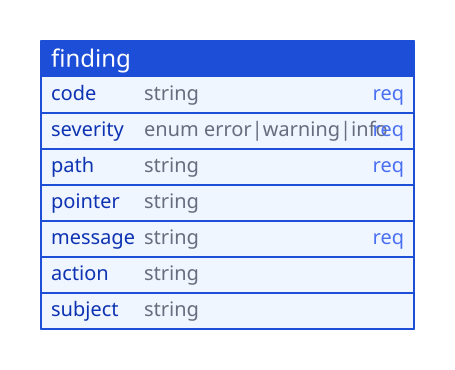

# `common/finding`

Generated by tools/gen (`just contracts`). Do not edit. Contract reference: [`common/finding`](../../common/finding.md). Source: [`contracts/common/finding.tsp`](../../../../../contracts/common/finding.tsp).

One problem a service reports, such as a record validation finding. code is stable and names the rule; message is for people and may change. error blocks; warning and info never do

## Diagrams

1 types in 1 diagrams.

### 1. `finding`

## Types

### `finding`

| Field | Type | Required | Description |
|---|---|---|---|
| `code` | `string` | yes |  |
| `severity` | `enum error\|warning\|info` | yes |  |
| `path` | `string` | yes | The file the finding is about, relative to the project root, with / separators |
| `pointer` | `string` | no | A JSON Pointer (RFC 6901) into the document at path; for a CSV file /<row index>/<column> |
| `message` | `string` | yes |  |
| `action` | `string` | no | What fixes it |
| `subject` | `string` | no | What the finding is about, for grouping: a part number or a document id |
