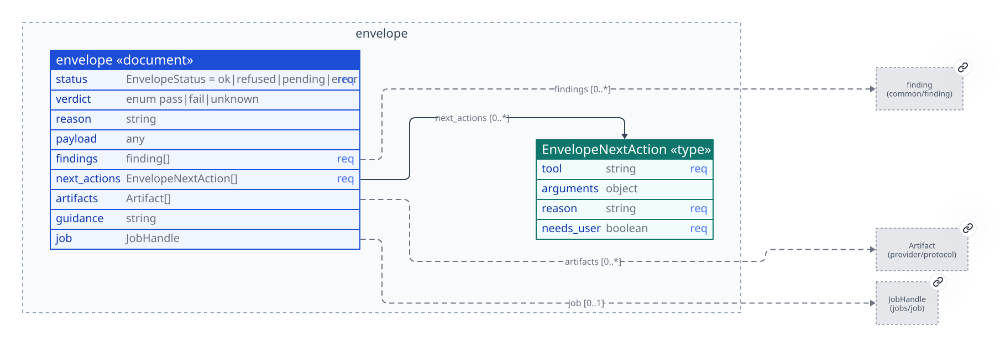

# `envelope/envelope`

Generated by tools/gen (`just contracts`). Do not edit. Contract reference: [`envelope/envelope`](../../envelope/envelope.md). Source: [`contracts/envelope/envelope.tsp`](../../../../../contracts/envelope/envelope.tsp).

Provisional: the result of every benchhand MCP tool call, carried as structuredContent. status is the call outcome: ok (the call did what was asked), refused (a guided refusal, such as an out-of-order transition, with a reason and at least one next action), pending (the work runs as a job, and job is its handle) or error (the tool failed, with at least one finding). verdict is the outcome of a check and is set only on an ok result of a check-type tool. Each tool's own result is the payload. The flow engine fills next_actions, so the agent rarely needs flow.guide again

## Diagrams

2 types in 1 diagrams.

### 1. `envelope`

Types of other contracts, drawn as stubs: [`common/finding`](../common/finding.md), [`jobs/job`](../jobs/job.md), [`provider/protocol`](../provider/protocol.md).

## Types

### `envelope`

| Field | Type | Required | Description |
|---|---|---|---|
| `status` | `EnvelopeStatus = ok\|refused\|pending\|error` | yes |  |
| `verdict` | `enum pass\|fail\|unknown` | no | A check's outcome: pass, fail, or unknown when coverage is missing. Never on a refused, pending or error result |
| `reason` | `string` | no | Why the call was refused, for a refused result |
| `payload` | `any` | no | The tool's own result. Each tool's output schema narrows it |
| `findings` | `finding[]` | yes |  |
| `next_actions` | `EnvelopeNextAction[]` | yes | What to do next, most useful first |
| `artifacts` | `Artifact[]` | no | Files the call wrote or names, each by its absolute path |
| `guidance` | `string` | no | Text for the agent: what the result means and how to go on |
| `job` | `JobHandle` | no | The job that carries a long call's work, for a pending result |

### `EnvelopeNextAction`

A tool call the agent can make next. arguments holds the arguments the server already knows; the agent supplies the rest. needs_user is true when the call must wait for the user, such as recording a human-gate decision

| Field | Type | Required | Description |
|---|---|---|---|
| `tool` | `string` | yes | The MCP tool name, such as flow.guide |
| `arguments` | `object` | no |  |
| `reason` | `string` | yes |  |
| `needs_user` | `boolean` | yes |  |

## Enums

Named enum definitions, and the enums of fields that have more than 6 values, which the field's type does not spell out. Enums have no colour in the diagrams.

| Enum | Values | Description |
|---|---|---|
| `EnvelopeStatus` | `ok`, `refused`, `pending`, `error` |  |
