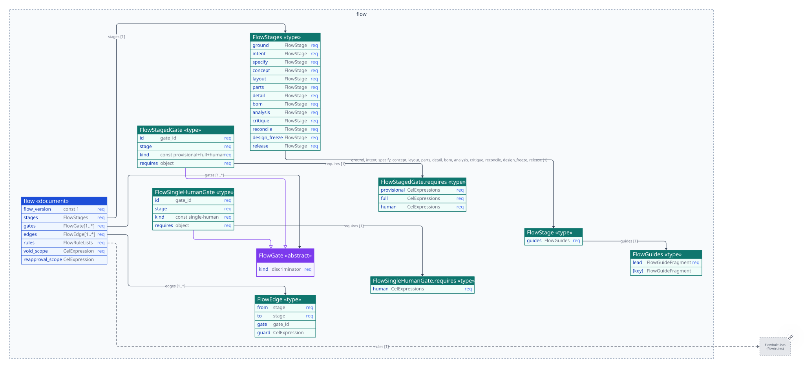
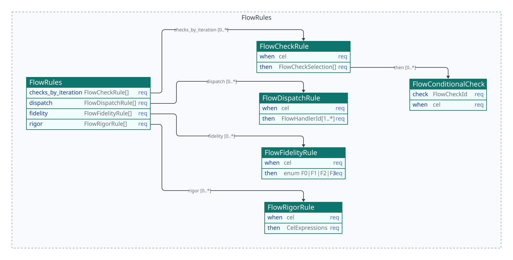
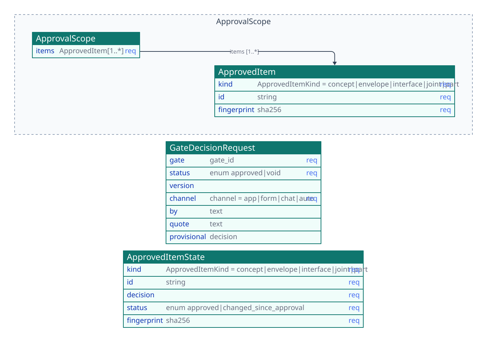

# `flow/flow`

Generated by tools/gen (`just contracts`). Do not edit. Contract reference: [`flow/flow`](../../flow/flow.md). Source: [`contracts/flow/flow.tsp`](../../../../../contracts/flow/flow.tsp).

Provisional: the flow definition, flow.yaml (ADR-0014). The stage and gate graph is data, and every condition in it is a CEL expression: the edge guards, the gate requirements, the VOID cascade scope and the ordered first-match rule lists. The schema checks the shape only; the flow interpreter compiles and type-checks every expression when it loads the file. A gate of kind single-human advances its edge when the user approves it; a gate of kind provisional+full+human advances its edge at the provisional gate, and its human gate opens after the full check

## Diagrams

19 types in 3 diagrams.

### 1. `flow`

### 2. `FlowRules`

### 3. `ApprovalScope`

## Types

### `flow`

In diagram 1.

| Field | Type | Required | Description |
|---|---|---|---|
| `flow_version` | `const 1` | yes |  |
| `stages` | `FlowStage[1..*]` | yes | Every stage, in flow order |
| `gates` | `FlowGate[]` | yes |  |
| `edges` | `FlowEdge[]` | yes |  |
| `void_scope` | `cel` | yes | Selects the stages a VOID reopens besides the voided stage, evaluated for each stage after it |
| `reapproval_scope` | `cel` | no | Provisional (ADR-0019, owned by Phase 2): selects the approved items a change affects, next to void_scope. An affected item whose fingerprint differs from its approval is changed_since_approval |
| `rules` | `FlowRules` | yes |  |

### `FlowStage`

In diagram 1.

| Field | Type | Required | Description |
|---|---|---|---|
| `id` | `stage` | yes |  |
| `guides` | `FlowGuides` | yes |  |

### `FlowGuides`

In diagram 1.

The guide fragment for each role at this stage, by role: lead is the lead agent, any other key an agent profile such as cad-part-designer. flow.guide returns a role's own fragment, else the lead's

| Field | Type | Required | Description |
|---|---|---|---|
| `lead` | `FlowGuideFragment` | yes |  |
| `[key]` | `FlowGuideFragment` | no |  |

### `FlowGate` «abstract»

In diagram 1.

| Field | Type | Required | Description |
|---|---|---|---|
| `kind` | `discriminator` | yes |  |

### `FlowSingleHumanGate`

In diagram 1.

A gate the user approves in one step. Each requirement must hold

| Field | Type | Required | Description |
|---|---|---|---|
| `id` | `gate_id` | yes |  |
| `stage` | `stage` | yes | The stage the gate closes |
| `kind` | `const single-human` | yes |  |
| `requires` | `object` | yes |  |

### `FlowSingleHumanGate.requires`

In diagram 1.

| Field | Type | Required | Description |
|---|---|---|---|
| `human` | `CelExpressions` | yes |  |

### `FlowStagedGate`

In diagram 1.

A gate that approves a built version in three steps: the provisional gate after the fast checks, the full check on the same version, then the human gate. Each step's requirements must hold

| Field | Type | Required | Description |
|---|---|---|---|
| `id` | `gate_id` | yes |  |
| `stage` | `stage` | yes | The stage the gate closes |
| `kind` | `const provisional+full+human` | yes |  |
| `requires` | `object` | yes |  |

### `FlowStagedGate.requires`

In diagram 1.

| Field | Type | Required | Description |
|---|---|---|---|
| `provisional` | `CelExpressions` | yes |  |
| `full` | `CelExpressions` | yes | When the full check counts as done |
| `human` | `CelExpressions` | yes |  |

### `FlowEdge`

In diagram 1.

A transition between two stages. gate names the gate it passes through; guard must also hold

| Field | Type | Required | Description |
|---|---|---|---|
| `from` | `stage` | yes |  |
| `to` | `stage` | yes |  |
| `gate` | `gate_id` | no |  |
| `guard` | `cel` | no |  |

### `FlowRules`

In diagram 2.

The ordered first-match rule lists: the first rule whose when holds gives the value, and no match gives none

| Field | Type | Required | Description |
|---|---|---|---|
| `checks_by_iteration` | `FlowCheckRule[]` | yes | Which checks run at an iteration (inner, commit, provisional, full, design_freeze, release) and stage, in run order |
| `dispatch` | `FlowDispatchRule[]` | yes | Which process-check handlers judge an obligation, from its process, operation and material. No match means UNKNOWN coverage, never a pass |
| `fidelity` | `FlowFidelityRule[]` | yes | The form-check fidelity at a stage |
| `rigor` | `FlowRigorRule[]` | yes | Requirements added under a rigor policy, such as regulated; each must hold as well as the gate's own |

### `FlowCheckRule`

In diagram 2.

| Field | Type | Required | Description |
|---|---|---|---|
| `when` | `cel` | yes |  |
| `then` | `FlowCheckSelection[]` | yes |  |

### `FlowConditionalCheck`

In diagram 2.

| Field | Type | Required | Description |
|---|---|---|---|
| `check` | `FlowCheckId` | yes |  |
| `when` | `cel` | yes |  |

### `FlowDispatchRule`

In diagram 2.

| Field | Type | Required | Description |
|---|---|---|---|
| `when` | `cel` | yes |  |
| `then` | `FlowHandlerId[1..*]` | yes |  |

### `FlowFidelityRule`

In diagram 2.

| Field | Type | Required | Description |
|---|---|---|---|
| `when` | `cel` | yes |  |
| `then` | `enum F0\|F1\|F2\|F3` | yes |  |

### `FlowRigorRule`

In diagram 2.

| Field | Type | Required | Description |
|---|---|---|---|
| `when` | `cel` | yes |  |
| `then` | `CelExpressions` | yes |  |

### `ApprovalScope`

In diagram 3.

Provisional (ADR-0019, owned by Phase 2): the items a human-gate approval covers, each with its fingerprint at approval time, computed the way the evidence service fingerprints its inputs. The decision contract refers to it once Phase 2 adds it there

| Field | Type | Required | Description |
|---|---|---|---|
| `items` | `ApprovedItem[1..*]` | yes |  |

### `ApprovedItem`

In diagram 3.

Provisional (ADR-0019): one approved item

| Field | Type | Required | Description |
|---|---|---|---|
| `kind` | `ApprovedItemKind = concept\|envelope\|interface\|joint\|part` | yes |  |
| `id` | `string` | yes | The item's id in the record, such as an interface id or a PN |
| `fingerprint` | `sha256` | yes |  |

### `GateDecisionRequest`

In diagram 3.

What the flow engine takes to record a human-gate decision, from the gate card (app) or from the user's reply in chat. status approved passes the gate, and void withdraws its provisional approval because of a change the user named. provisional cites the provisional decision of a provisional+full+human gate. Every channel but auto names who decided and quotes their words. form is refused: form elicitation is not used (ADR-0018)

| Field | Type | Required | Description |
|---|---|---|---|
| `gate` | `gate_id` | yes |  |
| `status` | `enum approved\|void` | yes |  |
| `version` | `version` | no | The built version the decision is on |
| `channel` | `channel = app\|form\|chat\|auto` | yes |  |
| `by` | `text` | no |  |
| `quote` | `text` | no | The user's words, quoted |
| `provisional` | `decision` | no |  |

### `ApprovedItemState`

In diagram 3.

Provisional (ADR-0019): an approved item now. approved: its fingerprint is the one recorded at approval; changed_since_approval: it differs, and the next human gate shows the item with a diff and confirms it. The stage stays where it is

| Field | Type | Required | Description |
|---|---|---|---|
| `kind` | `ApprovedItemKind = concept\|envelope\|interface\|joint\|part` | yes |  |
| `id` | `string` | yes |  |
| `decision` | `decision` | yes | The decision that approved it |
| `status` | `enum approved\|changed_since_approval` | yes |  |
| `fingerprint` | `sha256` | yes | The item's fingerprint now |

## Enums

Named enum definitions, and the enums of fields that have more than 6 values, which the field's type does not spell out. Enums have no colour in the diagrams.

| Enum | Values | Description |
|---|---|---|
| `ApprovedItemKind` | `concept`, `envelope`, `interface`, `joint`, `part` |  |
