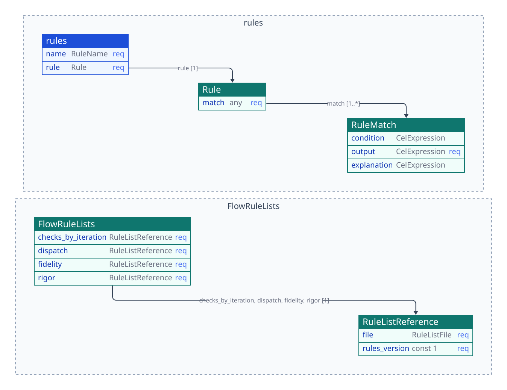
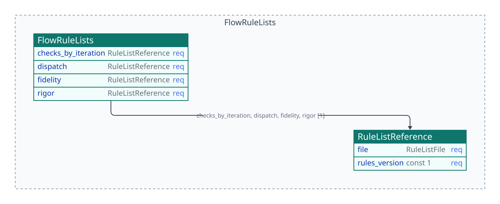

# `flow/rules`

Generated by tools/gen (`just contracts`). Do not edit. Contract reference: [`flow/rules`](../../flow/rules.md). Source: [`contracts/flow/rules.tsp`](../../../../../contracts/flow/rules.tsp).

Provisional: one rule-list file, <name>.rules.yaml (ADR-0014), written in the cel-policy format (github.com/cel-expr/cel-policy), restricted to one flat first-match match block with no aggregate, no variables and no nested rule. The first item whose condition holds gives its output; an item without a condition always holds, and the last item must be unconditional, so every list gives a value. A CI step compiles each list with the pinned cel-go policy compiler into one checked expression, and it refuses the last-item rule and the excluded features; the schema checks the rest of the shape. The file doesn't say which list it is: the reference to it in flow.yaml, or in a policy contribution, carries its kind and rules_version. The kind sets the type of every output. checks_by_iteration: a list of check ids, in run order, and [] runs none. dispatch: a handler id, or "unknown" for UNKNOWN coverage, never a pass. fidelity: the form-check fidelity, "F0" to "F3". rigor: a bool, true when the extra requirement under the project's rigor policy holds

## Diagrams

6 types in 2 diagrams.

### 1. `rules`

### 2. `FlowRuleLists`

## Types

### `rules`

In diagram 1.

| Field | Type | Required | Description |
|---|---|---|---|
| `name` | `RuleName` | yes | The policy's name |
| `description` | `string` | no |  |
| `imports` | `RuleImport[1..*]` | no | Type aliases for the expressions, as cel-policy imports them |
| `rule` | `Rule` | yes |  |

### `RuleImport`

In diagram 1.

| Field | Type | Required | Description |
|---|---|---|---|
| `name` | `string` | yes | A qualified type name, such as benchhand.flow.Obligation |

### `Rule`

In diagram 1.

The one rule of the list: an ordered, first-match list of items

| Field | Type | Required | Description |
|---|---|---|---|
| `id` | `RuleName` | no |  |
| `description` | `string` | no |  |
| `match` | `RuleMatch[1..*]` | yes |  |

### `RuleMatch`

In diagram 1.

One item: when condition holds, the list gives output. Without condition, the item always holds

| Field | Type | Required | Description |
|---|---|---|---|
| `condition` | `CelExpression` | no |  |
| `output` | `CelExpression` | yes |  |
| `explanation` | `CelExpression` | no | Why this item gave its output: a CEL expression that gives a string |

### `FlowRuleLists`

In diagram 2.

The rule lists, one file of each kind. The key is the list's kind, which sets the type of its outputs

| Field | Type | Required | Description |
|---|---|---|---|
| `checks_by_iteration` | `RuleListReference` | yes |  |
| `dispatch` | `RuleListReference` | yes |  |
| `fidelity` | `RuleListReference` | yes |  |
| `rigor` | `RuleListReference` | yes |  |

### `RuleListReference`

In diagram 2.

A reference to one rule-list file

| Field | Type | Required | Description |
|---|---|---|---|
| `file` | `RuleListFile` | yes | The file, relative to the file that refers to it |
| `rules_version` | `const 1` | yes | The version of the rule-list format the file is written in |
