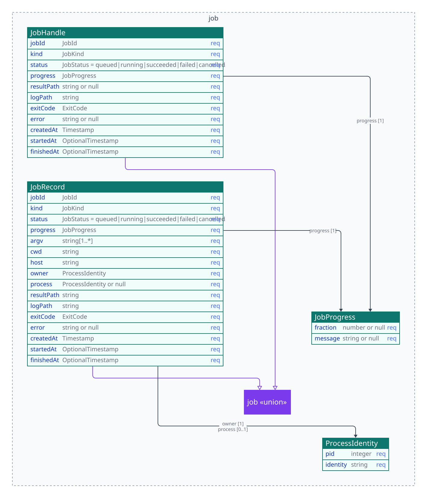

# `jobs/job`

Generated by tools/gen (`just contracts`). Do not edit. Contract reference: [`jobs/job`](../../jobs/job.md). Source: [`contracts/jobs/job.tsp`](../../../../../contracts/jobs/job.tsp).

A long-running job of the job service. JobRecord is the run record kept at <project>/.benchhand/runs/<jobId>.json; JobHandle is what jobs.start, jobs.status and jobs.result return to the agent.

## Diagrams

5 types in 1 diagrams.

### 1. `job`

## Types

### `job` «union»

No fields of its own.

### `JobRecord`

| Field | Type | Required | Description |
|---|---|---|---|
| `jobId` | `JobId` | yes |  |
| `kind` | `JobKind` | yes |  |
| `status` | `JobStatus = queued\|running\|succeeded\|failed\|cancelled` | yes |  |
| `progress` | `JobProgress` | yes |  |
| `argv` | `string[1..*]` | yes |  |
| `cwd` | `string` | yes |  |
| `host` | `string` | yes | The host the job runs on. A record of another host cannot be checked. |
| `owner` | `ProcessIdentity` | yes | The process of the job service that started the job. It reaps the job and writes its final status. |
| `process` | `ProcessIdentity or null` | yes | The job's supervisor: it starts the command in a process group of its own, ends that group when the command ends or its owner does, and exits with the command's status. Null while queued. |
| `resultPath` | `string` | yes | Where the job is to write its result. Absolute. |
| `logPath` | `string` | yes | The job's standard output and error. Absolute. |
| `exitCode` | `ExitCode` | yes |  |
| `error` | `string or null` | yes |  |
| `createdAt` | `Timestamp` | yes |  |
| `startedAt` | `OptionalTimestamp` | yes |  |
| `finishedAt` | `OptionalTimestamp` | yes |  |

### `JobProgress`

The last progress the job reported: the same fraction and message as a provider $/progress notification. Both are null until the first report.

| Field | Type | Required | Description |
|---|---|---|---|
| `fraction` | `number or null` | yes |  |
| `message` | `string or null` | yes |  |

### `ProcessIdentity`

A process id with its start identity. The kernel reuses ids, so a pid proves nothing once its process is gone: the process runs only while some process has that pid and that identity. On Linux the identity is the boot id and the start time, elsewhere ps lstart.

| Field | Type | Required | Description |
|---|---|---|---|
| `pid` | `integer` | yes |  |
| `identity` | `string` | yes |  |

### `JobHandle`

| Field | Type | Required | Description |
|---|---|---|---|
| `jobId` | `JobId` | yes |  |
| `kind` | `JobKind` | yes |  |
| `status` | `JobStatus = queued\|running\|succeeded\|failed\|cancelled` | yes |  |
| `progress` | `JobProgress` | yes |  |
| `resultPath` | `string or null` | yes | The job's result file. Set only once the job succeeded and wrote it; null otherwise. |
| `logPath` | `string` | yes |  |
| `exitCode` | `ExitCode` | yes |  |
| `error` | `string or null` | yes |  |
| `createdAt` | `Timestamp` | yes |  |
| `startedAt` | `OptionalTimestamp` | yes |  |
| `finishedAt` | `OptionalTimestamp` | yes |  |

## Enums

Named enum definitions, and the enums of fields that have more than 6 values, which the field's type does not spell out. Enums have no colour in the diagrams.

| Enum | Values | Description |
|---|---|---|
| `JobStatus` | `queued`, `running`, `succeeded`, `failed`, `cancelled` | queued: recorded, process not started. running. succeeded: the process exited 0. failed: it exited otherwise. cancelled: cancellation stopped it. |
