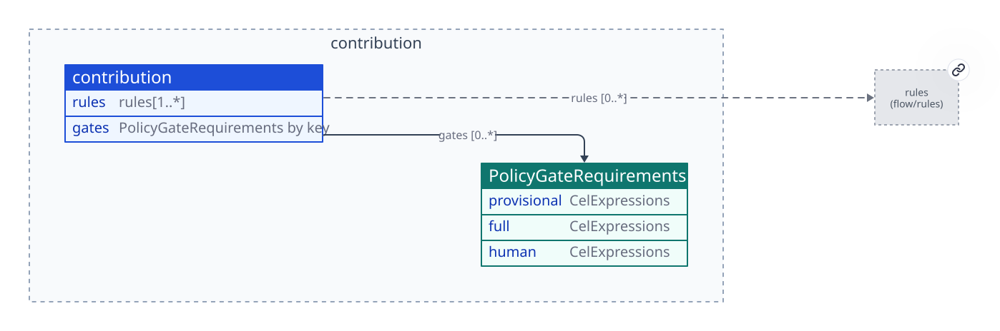

# `policy/contribution`

Generated by tools/gen (`just contracts`). Do not edit. Contract reference: [`policy/contribution`](../../policy/contribution.md). Source: [`contracts/policy/contribution.tsp`](../../../../../contracts/policy/contribution.tsp).

Provisional: what one policy provider adds to the flow (ADR-0014): rule-list files, by kind, in the shape of flow/rules.schema.json, and CEL requirements for the gates of flow.yaml. Each file is relative to the provider's root. The lists of one kind are evaluated in a fixed order: the contributions in ascending provider name, then flow.yaml's own list, whose result is final. For checks_by_iteration, dispatch and fidelity, a list that gives its kind's no-match value ([], "unknown" or "none") falls through to the next, and the first other value is the result. A contributed list ends in its kind's no-match value. rigor doesn't fall through: every list is evaluated, and the result is the union of their messages in evaluation order. Rigor holds only when the union is empty, so a contribution can add requirements but never waive the flow's. A gate's contributed requirements must hold as well as flow.yaml's, and are checked after them in the same provider order. A requirement for a step the gate doesn't have, or for a gate flow.yaml doesn't declare, is refused when the flow loads. The merge order and composition are open for the owner (ADR-0020, Open items)

## Diagrams

3 types in 1 diagrams.

### 1. `contribution`

Types of other contracts, drawn as stubs: [`flow/rules`](../flow/rules.md).

## Types

### `contribution`

| Field | Type | Required | Description |
|---|---|---|---|
| `rules` | `PolicyRuleLists` | no |  |
| `gates` | `PolicyGateRequirements by key` | no | Requirements by the gate id flow.yaml declares |

### `PolicyRuleLists`

The contributed rule-list files, by kind: at least one

| Field | Type | Required | Description |
|---|---|---|---|
| `checks_by_iteration` | `RuleListReference` | no |  |
| `dispatch` | `RuleListReference` | no |  |
| `fidelity` | `RuleListReference` | no |  |
| `rigor` | `RuleListReference` | no |  |

### `PolicyGateRequirements`

Extra requirements for the steps of one gate

| Field | Type | Required | Description |
|---|---|---|---|
| `provisional` | `CelExpressions` | no |  |
| `full` | `CelExpressions` | no |  |
| `human` | `CelExpressions` | no |  |
