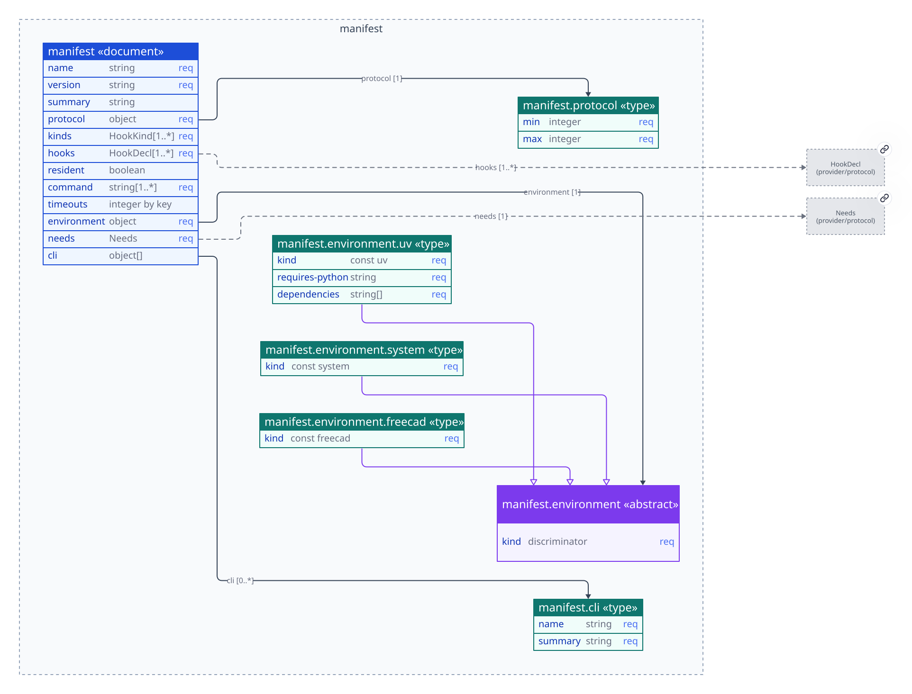

# `provider/manifest`

Generated by tools/gen (`just contracts`). Do not edit. Contract reference: [`provider/manifest`](../../provider/manifest.md). Source: [`contracts/provider/manifest.tsp`](../../../../../contracts/provider/manifest.tsp).

A provider's manifest, benchhand-provider.toml: its name and version, the protocol version and kinds it serves, its hooks, how to start it (command, environment, timeouts), what it needs, and its CLI.

## Diagrams

7 types in 1 diagrams.

### 1. `manifest`

Relationships in diagram 1:

| Source | Relation | Target | Cardinality |
|---|---|---|---|
| manifest | composition via `protocol` | manifest.protocol | 1 |
| manifest | association via `hooks` | HookDecl (provider/protocol) | 1..* |
| manifest.environment | inheritance (the source is the parent) | manifest.environment.uv | — |
| manifest.environment | inheritance (the source is the parent) | manifest.environment.freecad | — |
| manifest.environment | inheritance (the source is the parent) | manifest.environment.system | — |
| manifest | composition via `environment` | manifest.environment | 1 |
| manifest | association via `needs` | Needs (provider/protocol) | 1 |
| manifest | composition via `cli` | manifest.cli | 0..* |

Types of other contracts, drawn as stubs: [`provider/protocol`](protocol.md).

## Types

### `manifest`

| Field | Type | Required | Description |
|---|---|---|---|
| `name` | `string` | yes |  |
| `version` | `string` | yes |  |
| `summary` | `string` | no |  |
| `protocol` | `object` | yes |  |
| `kinds` | `HookKind[1..*]` | yes |  |
| `hooks` | `HookDecl[1..*]` | yes |  |
| `resident` | `boolean` | no |  |
| `command` | `string[1..*]` | yes |  |
| `timeouts` | `integer by key` | no | Seconds per hook method, e.g. {"solver/solve": 3600}. |
| `environment` | `object` | yes |  |
| `needs` | `Needs` | yes |  |
| `cli` | `object[]` | no |  |

### `manifest.protocol`

| Field | Type | Required | Description |
|---|---|---|---|
| `min` | `integer` | yes |  |
| `max` | `integer` | yes |  |

### `manifest.environment` «abstract»

| Field | Type | Required | Description |
|---|---|---|---|
| `kind` | `discriminator` | yes |  |

### `manifest.environment.uv`

| Field | Type | Required | Description |
|---|---|---|---|
| `kind` | `const uv` | yes |  |
| `requires-python` | `string` | yes |  |
| `dependencies` | `string[]` | yes |  |

### `manifest.environment.freecad`

| Field | Type | Required | Description |
|---|---|---|---|
| `kind` | `const freecad` | yes |  |

### `manifest.environment.system`

| Field | Type | Required | Description |
|---|---|---|---|
| `kind` | `const system` | yes |  |

### `manifest.cli`

| Field | Type | Required | Description |
|---|---|---|---|
| `name` | `string` | yes |  |
| `summary` | `string` | yes |  |
