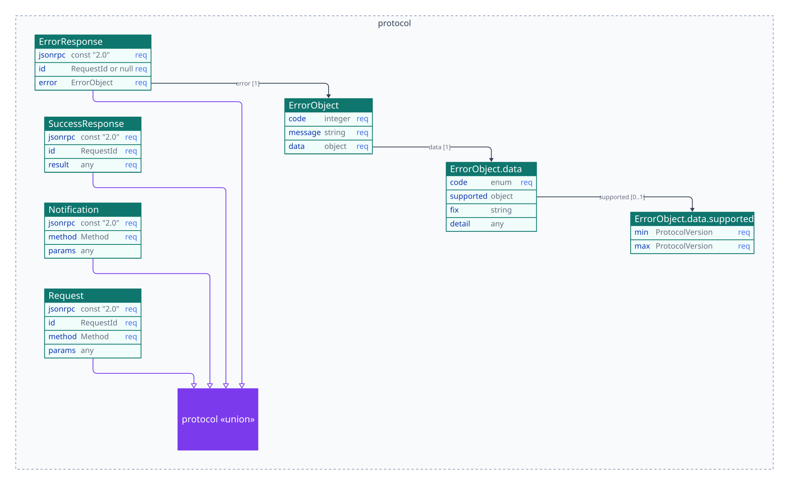
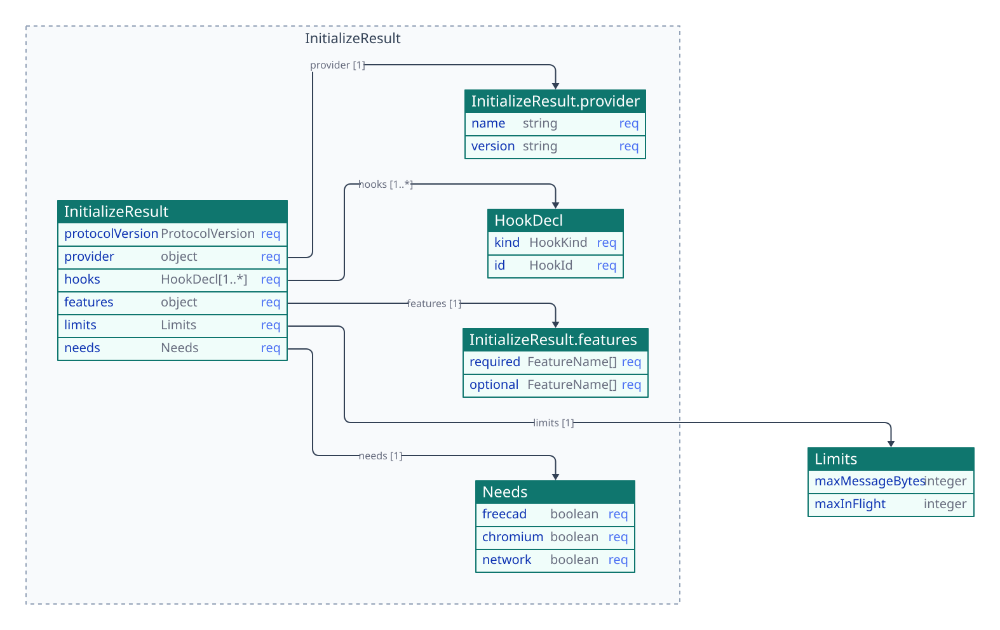
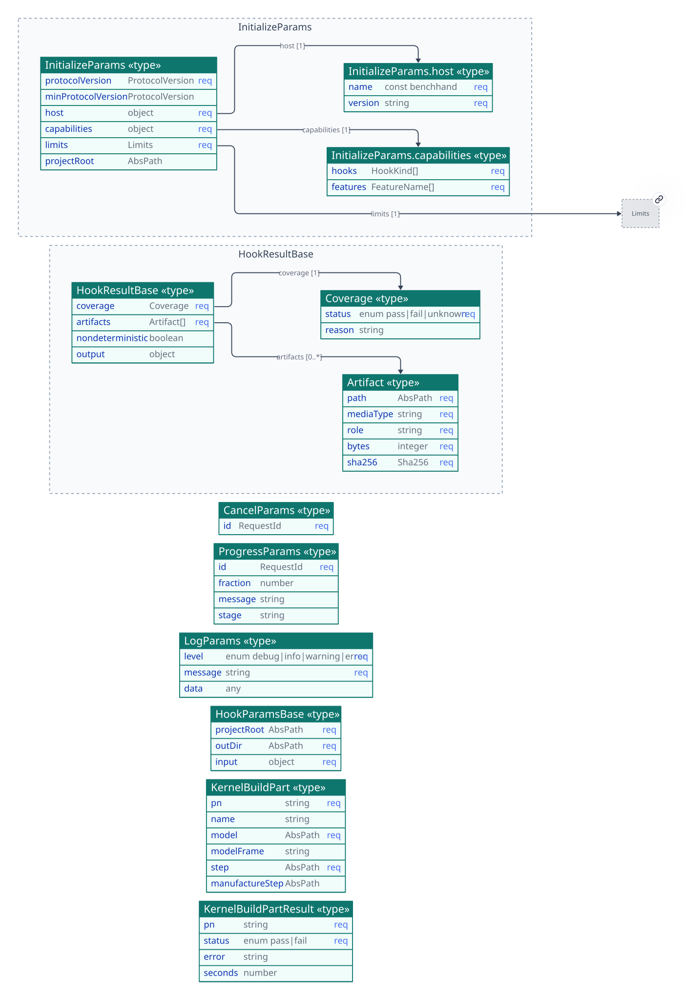

# `provider/protocol`

Generated by tools/gen (`just contracts`). Do not edit. Contract reference: [`provider/protocol`](../../provider/protocol.md). Source: [`contracts/provider/protocol.tsp`](../../../../../contracts/provider/protocol.tsp).

Message shapes of the benchhand provider protocol. Prose rules: docs/contract/provider-protocol.md.

## Diagrams

26 types in 3 diagrams.

### 1. `protocol`

Relationships in diagram 1:

| Source | Relation | Target | Cardinality |
|---|---|---|---|
| protocol | inheritance (the source is the parent) | Request | — |
| protocol | inheritance (the source is the parent) | Notification | — |
| protocol | inheritance (the source is the parent) | SuccessResponse | — |
| ErrorObject.data | composition via `supported` | ErrorObject.data.supported | 0..1 |
| ErrorObject | composition via `data` | ErrorObject.data | 1 |
| ErrorResponse | composition via `error` | ErrorObject | 1 |
| protocol | inheritance (the source is the parent) | ErrorResponse | — |

### 2. `InitializeResult`

Relationships in diagram 2:

| Source | Relation | Target | Cardinality |
|---|---|---|---|
| InitializeResult | composition via `provider` | InitializeResult.provider | 1 |
| InitializeResult | composition via `hooks` | HookDecl | 1..* |
| InitializeResult | composition via `features` | InitializeResult.features | 1 |
| InitializeResult | composition via `limits` | Limits | 1 |
| InitializeResult | composition via `needs` | Needs | 1 |

### 3. `InitializeParams`

Relationships in diagram 3:

| Source | Relation | Target | Cardinality |
|---|---|---|---|
| InitializeParams | composition via `host` | InitializeParams.host | 1 |
| InitializeParams | composition via `capabilities` | InitializeParams.capabilities | 1 |
| InitializeParams | composition via `limits` | Limits | 1 |
| HookResultBase | composition via `coverage` | Coverage | 1 |
| HookResultBase | composition via `artifacts` | Artifact | 0..* |

## Types

### `protocol` «union»

In diagram 1.

No fields of its own.

### `Request`

In diagram 1.

| Field | Type | Required | Description |
|---|---|---|---|
| `jsonrpc` | `const "2.0"` | yes |  |
| `id` | `RequestId` | yes |  |
| `method` | `Method` | yes |  |
| `params` | `any` | no |  |

### `Notification`

In diagram 1.

| Field | Type | Required | Description |
|---|---|---|---|
| `jsonrpc` | `const "2.0"` | yes |  |
| `method` | `Method` | yes |  |
| `params` | `any` | no |  |

### `SuccessResponse`

In diagram 1.

| Field | Type | Required | Description |
|---|---|---|---|
| `jsonrpc` | `const "2.0"` | yes |  |
| `id` | `RequestId` | yes |  |
| `result` | `any` | yes |  |

### `ErrorResponse`

In diagram 1.

| Field | Type | Required | Description |
|---|---|---|---|
| `jsonrpc` | `const "2.0"` | yes |  |
| `id` | `RequestId or null` | yes |  |
| `error` | `ErrorObject` | yes |  |

### `ErrorObject`

In diagram 1.

| Field | Type | Required | Description |
|---|---|---|---|
| `code` | `integer` | yes |  |
| `message` | `string` | yes |  |
| `data` | `object` | yes |  |

### `ErrorObject.data`

In diagram 1.

| Field | Type | Required | Description |
|---|---|---|---|
| `code` | `enum` | yes |  |
| `supported` | `object` | no |  |
| `fix` | `string` | no |  |
| `detail` | `any` | no |  |

### `ErrorObject.data.supported`

In diagram 1.

| Field | Type | Required | Description |
|---|---|---|---|
| `min` | `ProtocolVersion` | yes |  |
| `max` | `ProtocolVersion` | yes |  |

### `HookDecl`

In diagram 2.

| Field | Type | Required | Description |
|---|---|---|---|
| `kind` | `HookKind` | yes |  |
| `id` | `HookId` | yes |  |

### `Needs`

In diagram 2.

| Field | Type | Required | Description |
|---|---|---|---|
| `freecad` | `boolean` | yes |  |
| `chromium` | `boolean` | yes |  |
| `network` | `boolean` | yes |  |

### `InitializeResult`

In diagram 2.

| Field | Type | Required | Description |
|---|---|---|---|
| `protocolVersion` | `ProtocolVersion` | yes |  |
| `provider` | `object` | yes |  |
| `hooks` | `HookDecl[1..*]` | yes |  |
| `features` | `object` | yes |  |
| `limits` | `Limits` | yes |  |
| `needs` | `Needs` | yes |  |

### `InitializeResult.provider`

In diagram 2.

| Field | Type | Required | Description |
|---|---|---|---|
| `name` | `string` | yes |  |
| `version` | `string` | yes |  |

### `InitializeResult.features`

In diagram 2.

| Field | Type | Required | Description |
|---|---|---|---|
| `required` | `FeatureName[]` | yes |  |
| `optional` | `FeatureName[]` | yes |  |

### `Limits`

In diagram 2.

| Field | Type | Required | Description |
|---|---|---|---|
| `maxMessageBytes` | `integer` | no |  |
| `maxInFlight` | `integer` | no |  |

### `InitializeParams`

In diagram 3.

| Field | Type | Required | Description |
|---|---|---|---|
| `protocolVersion` | `ProtocolVersion` | yes |  |
| `minProtocolVersion` | `ProtocolVersion` | no |  |
| `host` | `object` | yes |  |
| `capabilities` | `object` | yes |  |
| `limits` | `Limits` | yes |  |
| `projectRoot` | `AbsPath` | no |  |

### `InitializeParams.host`

In diagram 3.

| Field | Type | Required | Description |
|---|---|---|---|
| `name` | `const benchhand` | yes |  |
| `version` | `string` | yes |  |

### `InitializeParams.capabilities`

In diagram 3.

| Field | Type | Required | Description |
|---|---|---|---|
| `hooks` | `HookKind[]` | yes |  |
| `features` | `FeatureName[]` | yes |  |

### `Artifact`

In diagram 3.

| Field | Type | Required | Description |
|---|---|---|---|
| `path` | `AbsPath` | yes |  |
| `mediaType` | `string` | yes |  |
| `role` | `string` | yes |  |
| `bytes` | `integer` | yes |  |
| `sha256` | `Sha256` | yes |  |

### `Coverage`

In diagram 3.

| Field | Type | Required | Description |
|---|---|---|---|
| `status` | `enum pass\|fail\|unknown` | yes |  |
| `reason` | `string` | no |  |

### `HookResultBase`

In diagram 3.

| Field | Type | Required | Description |
|---|---|---|---|
| `coverage` | `Coverage` | yes |  |
| `artifacts` | `Artifact[]` | yes |  |
| `nondeterministic` | `boolean` | no |  |
| `output` | `object` | no |  |

### `CancelParams`

In diagram 3.

| Field | Type | Required | Description |
|---|---|---|---|
| `id` | `RequestId` | yes |  |

### `ProgressParams`

In diagram 3.

| Field | Type | Required | Description |
|---|---|---|---|
| `id` | `RequestId` | yes |  |
| `fraction` | `number` | no |  |
| `message` | `string` | no |  |
| `stage` | `string` | no |  |

### `LogParams`

In diagram 3.

| Field | Type | Required | Description |
|---|---|---|---|
| `level` | `enum debug\|info\|warning\|error` | yes |  |
| `message` | `string` | yes |  |
| `data` | `any` | no |  |

### `HookParamsBase`

In diagram 3.

| Field | Type | Required | Description |
|---|---|---|---|
| `projectRoot` | `AbsPath` | yes |  |
| `outDir` | `AbsPath` | yes |  |
| `input` | `object` | yes |  |

### `KernelBuildPart`

In diagram 3.

| Field | Type | Required | Description |
|---|---|---|---|
| `pn` | `string` | yes |  |
| `name` | `string` | no |  |
| `model` | `AbsPath` | yes |  |
| `modelFrame` | `string` | no |  |
| `step` | `AbsPath` | yes |  |
| `manufactureStep` | `AbsPath` | no |  |

### `KernelBuildPartResult`

In diagram 3.

| Field | Type | Required | Description |
|---|---|---|---|
| `pn` | `string` | yes |  |
| `status` | `enum pass\|fail` | yes |  |
| `error` | `string` | no |  |
| `seconds` | `number` | no |  |

## Enums

Named enum definitions, and the enums of fields that have more than 6 values, which the field's type does not spell out. Enums have no colour in the diagrams.

| Enum | Values | Description |
|---|---|---|
| `HookKind` | `kernel`, `cad-app`, `solver`, `collision`, `renderer`, `viewer`, `process-check`, `store`, `policy`, `cli` |  |
| `Method` | `initialize`, `initialized`, `shutdown`, `exit`, `$/cancelRequest`, `$/progress`, `$/log`, `kernel/build`, `kernel/export`, `kernel/inspect`, `cad-app/drawing`, `cad-app/assembly`, `cad-app/fem`, `cad-app/unfold`, `solver/solve`, `collision/check`, `collision/sweep`, `renderer/render`, `renderer/snapshot`, `viewer/show`, `viewer/compare`, `viewer/capture`, `process-check/check`, `store/put`, `store/get`, `store/list`, `policy/evaluate`, `cli/run` |  |
| `ErrorObject.data.code` | `parse-error`, `invalid-request`, `method-not-found`, `invalid-params`, `internal-error`, `protocol-version-unsupported`, `required-feature-missing`, `not-initialized`, `message-too-large`, `request-cancelled`, `input-unsupported`, `external-missing` |  |
