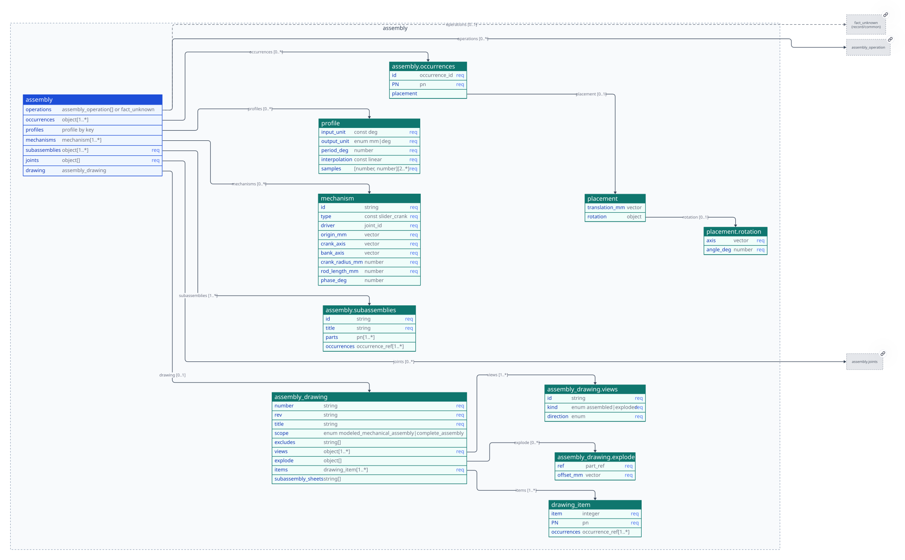
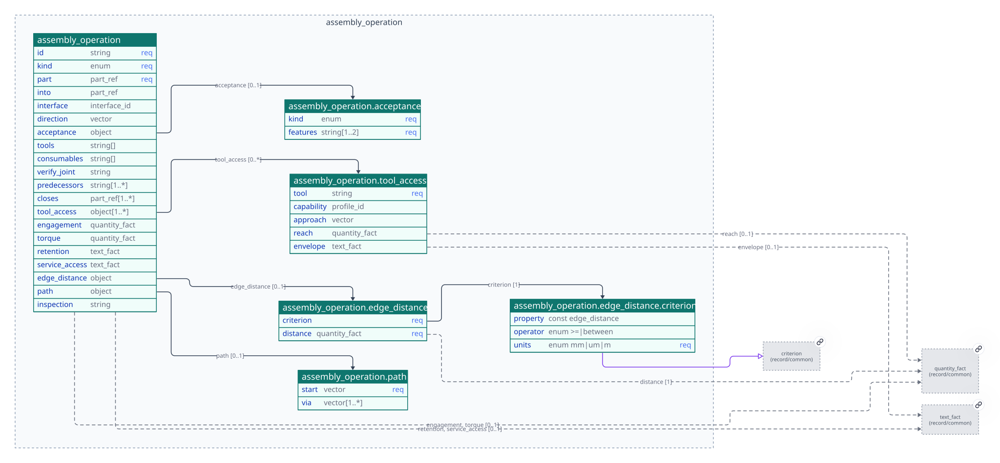
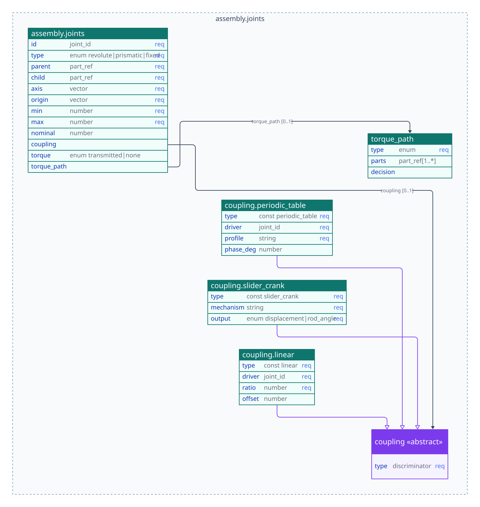

# `record/assembly`

Generated by tools/gen (`just contracts`). Do not edit. Contract reference: [`record/assembly`](../../record/assembly.md). Source: [`contracts/record/assembly.tsp`](../../../../../contracts/record/assembly.tsp).

The assembly record, hw/assembly.yaml: subassemblies and the joints between their parts, with occurrences, operations, coupling profiles and shared mechanisms, and the assembly drawing.

## Diagrams

23 types in 3 diagrams.

### 1. `assembly`

### 2. `assembly_operation`

### 3. `assembly.joints`

Types of other contracts, drawn as stubs: [`record/common`](common.md).

## Types

### `assembly`

In diagram 1.

| Field | Type | Required | Description |
|---|---|---|---|
| `operations` | `assembly_operation[] or fact_unknown` | no | Record version 2 installation, closure, fastening, adjustment, inspection and service operations, independent of drawings; unknown until recorded |
| `occurrences` | `object[1..*]` | no | Explicit placements of part definitions; a PN listed in a subassembly's parts is one implicit occurrence at the identity placement instead |
| `profiles` | `profile by key` | no | Reusable periodic tables a periodic_table coupling evaluates, by name |
| `mechanisms` | `mechanism[1..*]` | no | Shared mechanism parameters whose outputs several slider_crank couplings follow |
| `subassemblies` | `object[1..*]` | yes |  |
| `joints` | `object[]` | yes |  |
| `drawing` | `assembly_drawing` | no |  |

### `assembly.occurrences`

In diagram 1.

| Field | Type | Required | Description |
|---|---|---|---|
| `id` | `occurrence_id` | yes |  |
| `PN` | `pn` | yes |  |
| `placement` | `placement` | no |  |

### `placement`

In diagram 1.

Rest placement x -> R x + t: rotation about the definition's local origin, then translation (mm)

| Field | Type | Required | Description |
|---|---|---|---|
| `translation_mm` | `vector` | no |  |
| `rotation` | `object` | no |  |

### `placement.rotation`

In diagram 1.

| Field | Type | Required | Description |
|---|---|---|---|
| `axis` | `vector` | yes |  |
| `angle_deg` | `number` | yes |  |

### `profile`

In diagram 1.

Piecewise-linear periodic table: samples from 0 to period_deg with matching end values

| Field | Type | Required | Description |
|---|---|---|---|
| `input_unit` | `const deg` | yes |  |
| `output_unit` | `enum mm\|deg` | yes |  |
| `period_deg` | `number` | yes |  |
| `interpolation` | `const linear` | yes |  |
| `samples` | `[number, number][2..*]` | yes |  |

### `mechanism`

In diagram 1.

A centred slider-crank: the driver turns the crank about crank_axis through origin_mm; the piston slides along bank_axis

| Field | Type | Required | Description |
|---|---|---|---|
| `id` | `string` | yes |  |
| `type` | `const slider_crank` | yes |  |
| `driver` | `joint_id` | yes |  |
| `origin_mm` | `vector` | yes |  |
| `crank_axis` | `vector` | yes |  |
| `bank_axis` | `vector` | yes |  |
| `crank_radius_mm` | `number` | yes |  |
| `rod_length_mm` | `number` | yes |  |
| `phase_deg` | `number` | no |  |

### `assembly.subassemblies`

In diagram 1.

| Field | Type | Required | Description |
|---|---|---|---|
| `id` | `string` | yes |  |
| `title` | `string` | yes |  |
| `parts` | `pn[1..*]` | no |  |
| `occurrences` | `occurrence_ref[1..*]` | no |  |

### `assembly_drawing`

In diagram 1.

Assembly drawing intent: identity, views, presentation-only explode offsets, parts-list items, subassembly sheets and installation operations

| Field | Type | Required | Description |
|---|---|---|---|
| `number` | `string` | yes |  |
| `rev` | `string` | yes |  |
| `title` | `string` | yes |  |
| `scope` | `enum modeled_mechanical_assembly\|complete_assembly` | no |  |
| `excludes` | `string[]` | no | What a modelled scope leaves out, named on the drawing |
| `views` | `object[1..*]` | yes |  |
| `explode` | `object[]` | no | Exploded-view offsets in mm, assembly frame; each occurrence also moves by its kinematic ancestors' offsets |
| `items` | `drawing_item[1..*]` | yes |  |
| `subassembly_sheets` | `string[]` | no |  |

### `assembly_drawing.views`

In diagram 1.

| Field | Type | Required | Description |
|---|---|---|---|
| `id` | `string` | yes |  |
| `kind` | `enum assembled\|exploded` | yes |  |
| `direction` | `enum` | yes |  |

### `assembly_drawing.explode`

In diagram 1.

| Field | Type | Required | Description |
|---|---|---|---|
| `ref` | `part_ref` | yes |  |
| `offset_mm` | `vector` | yes |  |

### `drawing_item`

In diagram 1.

One assembly-drawing item row: a PN and, when it is placed more than once, the occurrences it stands for

| Field | Type | Required | Description |
|---|---|---|---|
| `item` | `integer` | yes |  |
| `PN` | `pn` | yes |  |
| `occurrences` | `occurrence_ref[1..*]` | no |  |

### `assembly_operation`

In diagram 2.

One assembly operation. An installation step puts `part` into `into` along `direction` (in the receiving part's model frame) until the acceptance holds; the fit, insert or ring comes from the interface limit of the same kind. predecessors name the operations that must come first, closes the parts it encloses, and tool_access the tools that must reach. A tool name alone is display text: its reach stays unknown. path, when given, is the part's insertion path; without it the part travels in a straight line along direction, and checks report that default. edge_distance is a fastener, insert or heat-set joint's distance from its hole to the nearest edge against its sourced criterion

| Field | Type | Required | Description |
|---|---|---|---|
| `id` | `string` | yes |  |
| `kind` | `enum` | yes |  |
| `part` | `part_ref` | yes |  |
| `into` | `part_ref` | no |  |
| `interface` | `interface_id` | no |  |
| `direction` | `vector` | no |  |
| `acceptance` | `object` | no |  |
| `tools` | `string[]` | no |  |
| `consumables` | `string[]` | no |  |
| `verify_joint` | `string` | no |  |
| `predecessors` | `string[1..*]` | no |  |
| `closes` | `part_ref[1..*]` | no | parts this operation encloses: no later operation reaches them |
| `tool_access` | `object[1..*]` | no |  |
| `engagement` | `quantity_fact` | no |  |
| `torque` | `quantity_fact` | no |  |
| `retention` | `text_fact` | no |  |
| `service_access` | `text_fact` | no |  |
| `edge_distance` | `object` | no | The joint's edge distance: the criterion it must meet (property edge_distance, a length bound with its source) and the distance the design gives, a known length (an interval's lower end governs) or an unknown with its reason |
| `path` | `object` | no | The insertion path of `part`: its offsets in mm from the installed pose, in the receiving part's model frame, keeping the installed orientation. The part starts at start, passes via in order and arrives installed; the last leg runs along direction |
| `inspection` | `string` | no |  |

### `assembly_operation.acceptance`

In diagram 2.

| Field | Type | Required | Description |
|---|---|---|---|
| `kind` | `enum` | yes |  |
| `features` | `string[1..2]` | yes |  |

### `assembly_operation.tool_access`

In diagram 2.

| Field | Type | Required | Description |
|---|---|---|---|
| `tool` | `string` | yes |  |
| `capability` | `profile_id` | no |  |
| `approach` | `vector` | no |  |
| `reach` | `quantity_fact` | no |  |
| `envelope` | `text_fact` | no |  |

### `assembly_operation.edge_distance`

In diagram 2.

| Field | Type | Required | Description |
|---|---|---|---|
| `criterion` | `criterion` | yes |  |
| `distance` | `quantity_fact` | yes |  |

### `assembly_operation.edge_distance.criterion`

In diagram 2.

| Field | Type | Required | Description |
|---|---|---|---|
| `property` | `const edge_distance` | yes |  |
| `operator` | `enum >=\|between` | yes |  |
| `units` | `enum mm\|um\|m` | yes |  |

### `assembly_operation.path`

In diagram 2.

| Field | Type | Required | Description |
|---|---|---|---|
| `start` | `vector` | yes |  |
| `via` | `vector[1..*]` | no |  |

### `assembly.joints`

In diagram 3.

| Field | Type | Required | Description |
|---|---|---|---|
| `id` | `joint_id` | yes |  |
| `type` | `enum revolute\|prismatic\|fixed` | yes |  |
| `parent` | `part_ref` | yes |  |
| `child` | `part_ref` | yes |  |
| `axis` | `vector` | yes |  |
| `origin` | `vector` | yes |  |
| `min` | `number` | yes |  |
| `max` | `number` | yes |  |
| `nominal` | `number` | no | The value of an independent joint; a coupled joint has none |
| `coupling` | `coupling` | no |  |
| `torque` | `enum transmitted\|none` | no | Whether the child carries drive torque. From stage parts on, every revolute declares it (none for a hand-positioned or free-running joint), and so does every fixed joint inside the drive train that a revolute not declared none starts; a fixed joint declared transmitted names its torque_path |
| `torque_path` | `torque_path` | no |  |

### `coupling` «abstract»

In diagram 3.

A dependent joint's law: its value derives from a driver joint

| Field | Type | Required | Description |
|---|---|---|---|
| `type` | `discriminator` | yes |  |

### `coupling.linear`

In diagram 3.

q = ratio * q_driver + offset; ratio in dependent units per driver unit

| Field | Type | Required | Description |
|---|---|---|---|
| `type` | `const linear` | yes |  |
| `driver` | `joint_id` | yes |  |
| `ratio` | `number` | yes |  |
| `offset` | `number` | no |  |

### `coupling.periodic_table`

In diagram 3.

q = profile((q_driver + phase_deg) mod period_deg); the driver is revolute

| Field | Type | Required | Description |
|---|---|---|---|
| `type` | `const periodic_table` | yes |  |
| `driver` | `joint_id` | yes |  |
| `profile` | `string` | yes |  |
| `phase_deg` | `number` | no |  |

### `coupling.slider_crank`

In diagram 3.

One output of a slider_crank mechanism: piston displacement (prismatic) or rod angle (revolute)

| Field | Type | Required | Description |
|---|---|---|---|
| `type` | `const slider_crank` | yes |  |
| `mechanism` | `string` | yes |  |
| `output` | `enum displacement\|rod_angle` | yes |  |

### `torque_path`

In diagram 3.

What carries the drive torque across a torque: transmitted joint; required on a fixed joint, optional on a revolute driven through an unmodelled shaft. Hardware types (key, set_screw, pin) name their modelled occurrences in parts

| Field | Type | Required | Description |
|---|---|---|---|
| `type` | `enum` | yes |  |
| `parts` | `part_ref[1..*]` | no |  |
| `decision` | `decision` | no |  |

## Enums

Named enum definitions, and the enums of fields that have more than 6 values, which the field's type does not spell out. Enums have no colour in the diagrams.

| Enum | Values | Description |
|---|---|---|
| `assembly_operation.kind` | `press_fit`, `heat_set`, `retaining_ring`, `insert`, `fasten`, `join`, `close`, `adjust`, `inspect`, `disassemble` |  |
| `assembly_operation.acceptance.kind` | `seated`, `standoff`, `flush`, `engaged`, `torqued`, `adjusted`, `inspected` |  |
| `torque_path.type` | `key`, `set_screw`, `d_flat`, `press_fit`, `spline`, `clamp`, `pin`, `adhesive` |  |
| `assembly_drawing.views.direction` | `front`, `back`, `left`, `right`, `top`, `bottom`, `iso` |  |
