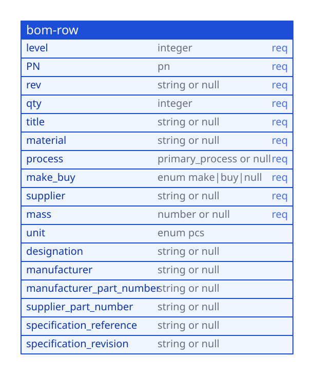

# `record/bom-row`

Generated by tools/gen (`just contracts`). Do not edit. Contract reference: [`record/bom-row`](../../record/bom-row.md). Source: [`contracts/record/bom-row.tsp`](../../../../../contracts/record/bom-row.tsp).

One hw/bom.csv row. The column order is the property order: the required columns, then optionally all seven procurement columns together. An empty cell is null, so a text value is never empty

## Diagrams

1 types in 1 diagrams.

### 1. `bom-row`

Diagram 1 has no relationships.

## Types

### `bom-row`

| Field | Type | Required | Description |
|---|---|---|---|
| `level` | `integer` | yes |  |
| `PN` | `pn` | yes |  |
| `rev` | `string or null` | yes |  |
| `qty` | `integer` | yes |  |
| `title` | `string or null` | yes |  |
| `material` | `string or null` | yes |  |
| `process` | `primary_process or null` | yes |  |
| `make_buy` | `enum make\|buy\|null` | yes |  |
| `supplier` | `string or null` | yes |  |
| `mass` | `number or null` | yes | grams, copied from the part mass_target |
| `unit` | `enum pcs` | no | what qty counts; the BOM counts STEP instances |
| `designation` | `string or null` | no |  |
| `manufacturer` | `string or null` | no |  |
| `manufacturer_part_number` | `string or null` | no |  |
| `supplier_part_number` | `string or null` | no |  |
| `specification_reference` | `string or null` | no |  |
| `specification_revision` | `string or null` | no |  |
