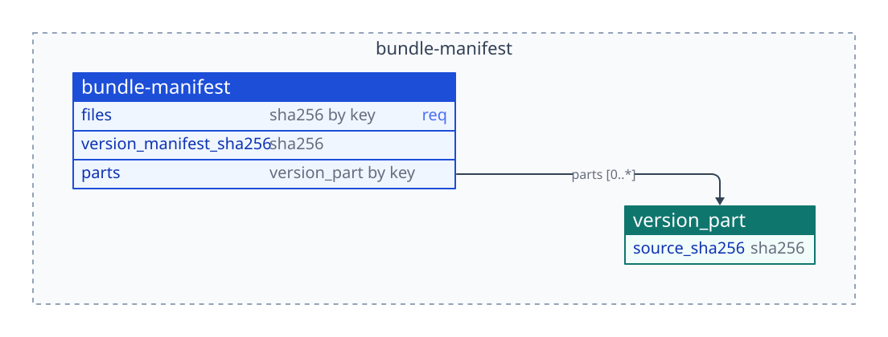

# `record/bundle-manifest`

Generated by tools/gen (`just contracts`). Do not edit. Contract reference: [`record/bundle-manifest`](../../record/bundle-manifest.md). Source: [`contracts/record/bundle-manifest.tsp`](../../../../../contracts/record/bundle-manifest.tsp).

Provisional: the manifest.json of a sealed directory, a built version (hw/versions/<V>/) or a version-bound bundle such as hw/checks/<V>/<S>/, with only the keys the evidence service reads. Phase 2's versioning work (snapshot, seal and verify) owns this contract and extends it; until then every other key is accepted unread

## Diagrams

2 types in 1 diagrams.

### 1. `bundle-manifest`

## Types

### `bundle-manifest`

| Field | Type | Required | Description |
|---|---|---|---|
| `files` | `sha256 by key` | yes | sha256 of every file the directory holds apart from manifest.json, by its path relative to the directory |
| `version_manifest_sha256` | `sha256` | no | a bundle's binding to its build: the sha256 of hw/versions/<V>/manifest.json |
| `parts` | `version_part by key` | no | a built version's parts, by PN |

### `version_part`

| Field | Type | Required | Description |
|---|---|---|---|
| `source_sha256` | `sha256` | no | sha256 of the model source the version built |
