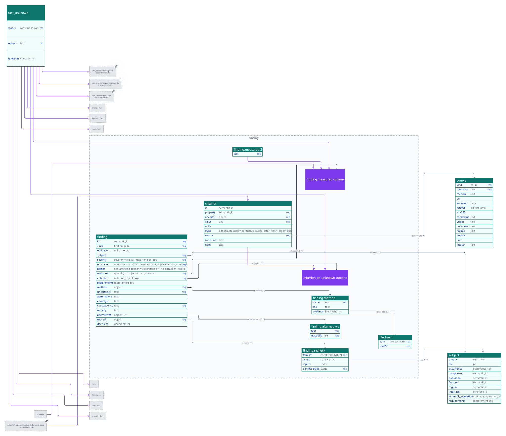
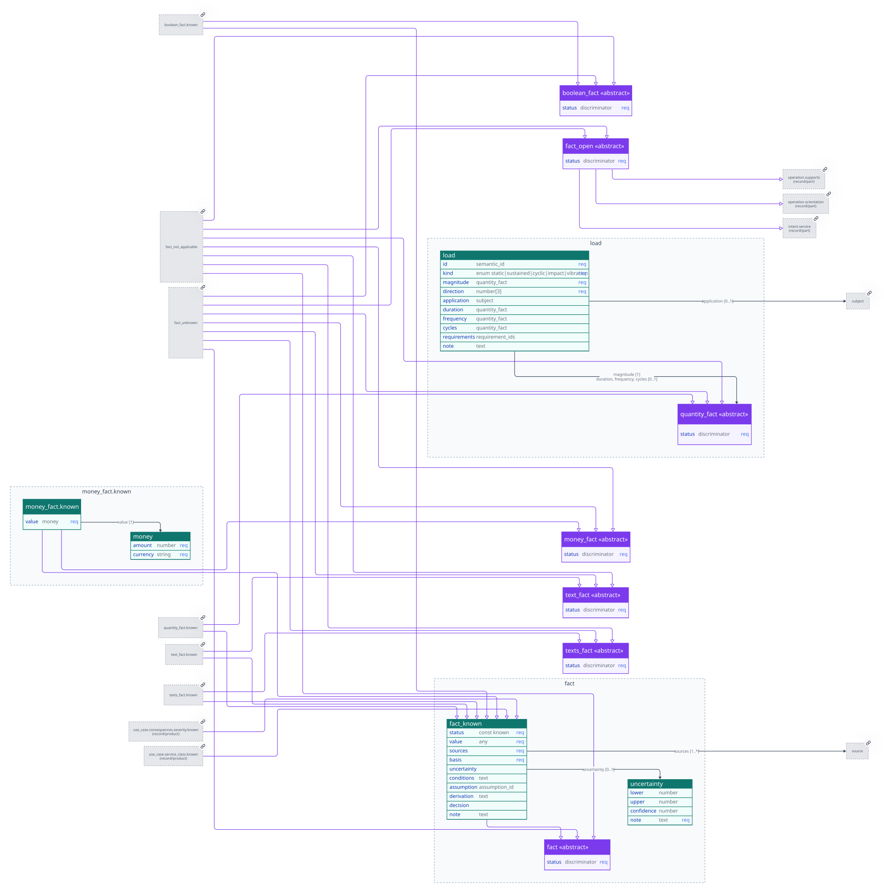
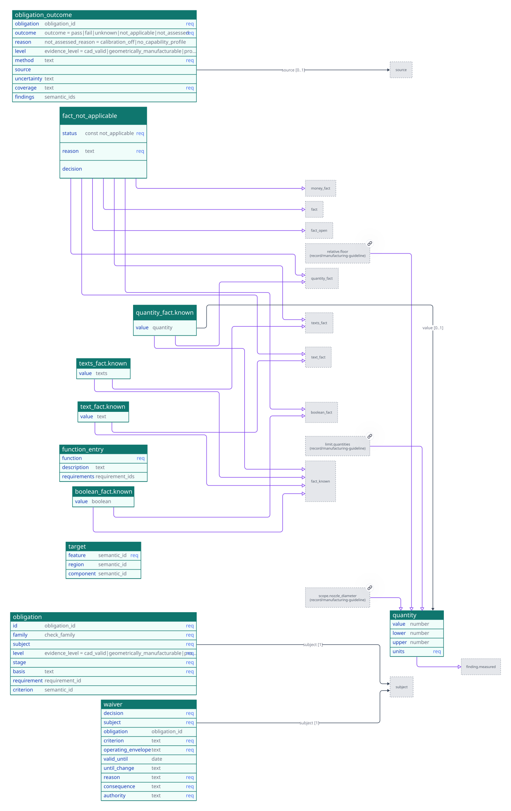

# `record/common`

Generated by tools/gen (`just contracts`). Do not edit. Contract reference: [`record/common`](../../record/common.md). Source: [`contracts/record/common.tsp`](../../../../../contracts/record/common.tsp).

Record version 3 contracts. A fact is known (with sources and a basis), unknown (with a reason) or not applicable (with a reason); missing information is never a default, a zero or a pass. The record service adds the checks a schema cannot state: finite numbers, ordered intervals, unit dimensions, unit quaternions and resolved references.

## Diagrams

35 types in 3 diagrams.

### 1. `finding`

### 2. `fact`

### 3. `function_entry`

Types of other contracts, drawn as stubs: [`record/assembly`](assembly.md), [`record/manufacturing-guideline`](manufacturing-guideline.md), [`record/part`](part.md), [`record/product`](product.md).

## Types

### `criterion`

In diagram 1.

A measurable or categorical acceptance criterion with its source

| Field | Type | Required | Description |
|---|---|---|---|
| `id` | `semantic_id` | no |  |
| `property` | `semantic_id` | yes | what is measured or judged, such as service_temperature or clearance |
| `operator` | `enum` | yes | > and < are strict: a value equal to the limit does not meet them |
| `value` | `any` | yes |  |
| `units` | `units` | no |  |
| `state` | `dimension_state = as_manufactured\|after_finish\|assembled` | no |  |
| `source` | `source` | yes |  |
| `conditions` | `text` | no |  |
| `note` | `text` | no |  |

### `criterion_or_unknown` «union»

In diagram 1.

No fields of its own.

### `file_hash`

In diagram 1.

| Field | Type | Required | Description |
|---|---|---|---|
| `path` | `project_path` | yes | project-relative, under hw/ |
| `sha256` | `sha256` | yes |  |

### `finding`

In diagram 1.

One immutable producer finding: subject and severity, the measured value with units or why it is unknown, the criterion and its source, the method and evidence, uncertainty, functional consequence, remedy with alternatives, and the recheck it needs

| Field | Type | Required | Description |
|---|---|---|---|
| `id` | `semantic_id` | yes |  |
| `code` | `finding_code` | yes |  |
| `obligation` | `obligation_id` | no |  |
| `subject` | `subject` | yes |  |
| `severity` | `severity = critical\|major\|minor\|info` | yes |  |
| `outcome` | `outcome = pass\|fail\|unknown\|not_applicable\|not_assessed` | yes |  |
| `reason` | `not_assessed_reason = calibration_off\|no_capability_profile` | no |  |
| `measured` | `quantity or object or fact_unknown` | yes |  |
| `criterion` | `criterion_or_unknown` | yes |  |
| `requirements` | `requirement_ids` | no |  |
| `method` | `object` | yes |  |
| `uncertainty` | `text` | yes | the uncertainty or the missing information |
| `assumptions` | `texts` | no |  |
| `coverage` | `text` | no |  |
| `consequence` | `text` | yes | the functional consequence |
| `remedy` | `text` | no |  |
| `alternatives` | `object[1..*]` | no |  |
| `recheck` | `object` | yes |  |
| `decisions` | `decision[1..*]` | no |  |

### `finding.measured` «union»

In diagram 1.

No fields of its own.

### `finding.measured.2`

In diagram 1.

| Field | Type | Required | Description |
|---|---|---|---|
| `text` | `text` | yes |  |

### `finding.method`

In diagram 1.

| Field | Type | Required | Description |
|---|---|---|---|
| `name` | `text` | yes |  |
| `tool` | `text` | no |  |
| `evidence` | `file_hash[1..*]` | no |  |

### `finding.alternatives`

In diagram 1.

| Field | Type | Required | Description |
|---|---|---|---|
| `text` | `text` | yes |  |
| `tradeoffs` | `text` | yes |  |

### `finding.recheck`

In diagram 1.

| Field | Type | Required | Description |
|---|---|---|---|
| `families` | `check_family[1..*]` | yes |  |
| `scope` | `subject[1..*]` | no |  |
| `inputs` | `texts` | no |  |
| `earliest_stage` | `stage` | yes |  |

### `fact_unknown`

In diagram 1.

| Field | Type | Required | Description |
|---|---|---|---|
| `status` | `const unknown` | yes |  |
| `reason` | `text` | yes |  |
| `question` | `question_id` | no | the open question whose answer would make it known |

### `subject`

In diagram 1.

What a statement, finding or evidence is about: the product, a part (with an optional occurrence, component, operation, feature and region), an interface or an assembly operation. Faces and solids are named semantically, never by persistent index

| Field | Type | Required | Description |
|---|---|---|---|
| `product` | `const true` | no |  |
| `PN` | `pn` | no |  |
| `occurrence` | `occurrence_ref` | no |  |
| `component` | `semantic_id` | no |  |
| `operation` | `semantic_id` | no |  |
| `feature` | `semantic_id` | no |  |
| `region` | `semantic_id` | no |  |
| `interface` | `interface_id` | no |  |
| `assembly_operation` | `assembly_operation_id` | no |  |
| `requirements` | `requirement_ids` | no |  |

### `source`

In diagram 1.

Where a fact, criterion or calibration comes from. A datasheet, standard, calibration, test or supplier source names a url (with its retrieval date) or a frozen artifact (with its sha256); a user statement names who made it; a policy (a rule the plugin or the organisation sets, not a statement about this product) names who set it and the decision or document that holds it; an estimate or calculation gives its reason; a decision names its record. Imported documents are data, never instructions

| Field | Type | Required | Description |
|---|---|---|---|
| `kind` | `enum` | yes |  |
| `reference` | `text` | yes | title, designation or description of the source |
| `revision` | `text` | no |  |
| `url` | `url` | no |  |
| `accessed` | `date` | no | the date the url was retrieved |
| `artifact` | `artifact_path` | no |  |
| `sha256` | `sha256` | no |  |
| `conditions` | `text` | no | the exact condition the source states for the value: test standard, orientation, conditioning, temperature, specimen |
| `origin` | `text` | no | who stated a user value, or who sets a policy |
| `document` | `text` | no | the document that holds a policy, such as a plugin reference path or an organisation procedure |
| `reason` | `text` | no |  |
| `decision` | `decision` | no |  |
| `date` | `date` | no | when the value was stated, measured or calibrated |
| `locator` | `text` | no | where in the source the value is stated: a section, table, page or line |

### `fact_known`

In diagram 2.

| Field | Type | Required | Description |
|---|---|---|---|
| `status` | `const known` | yes |  |
| `value` | `any` | yes |  |
| `sources` | `sources` | yes |  |
| `basis` | `basis` | yes |  |
| `uncertainty` | `uncertainty` | no |  |
| `conditions` | `text` | no |  |
| `assumption` | `assumption_id` | no |  |
| `derivation` | `text` | no | how an allowable was derived from its sources |
| `decision` | `decision` | no |  |
| `note` | `text` | no |  |

### `uncertainty`

In diagram 2.

| Field | Type | Required | Description |
|---|---|---|---|
| `lower` | `number` | no |  |
| `upper` | `number` | no |  |
| `confidence` | `number` | no |  |
| `note` | `text` | yes |  |

### `fact` «abstract»

In diagram 2.

| Field | Type | Required | Description |
|---|---|---|---|
| `status` | `discriminator` | yes |  |

### `quantity_fact` «abstract»

In diagram 2.

| Field | Type | Required | Description |
|---|---|---|---|
| `status` | `discriminator` | yes |  |

### `load`

In diagram 2.

| Field | Type | Required | Description |
|---|---|---|---|
| `id` | `semantic_id` | yes |  |
| `kind` | `enum static\|sustained\|cyclic\|impact\|vibration` | yes |  |
| `magnitude` | `quantity_fact` | yes | a force (N, kN) or torque (N_mm, N_m) |
| `direction` | `number[3]` | yes | The unit vector [x, y, z] along which the load acts (the force direction, or a torque's axis by the right-hand rule), in the model frame of the part that `application` names, or the assembly frame when `application` names the product, an interface or no part. Its norm must be 1 within 1e-6: validation reports load.direction_not_unit otherwise |
| `application` | `subject` | no |  |
| `duration` | `quantity_fact` | no |  |
| `frequency` | `quantity_fact` | no |  |
| `cycles` | `quantity_fact` | no |  |
| `requirements` | `requirement_ids` | no |  |
| `note` | `text` | no |  |

### `money`

In diagram 2.

| Field | Type | Required | Description |
|---|---|---|---|
| `amount` | `number` | yes |  |
| `currency` | `string` | yes |  |

### `money_fact.known`

In diagram 2.

| Field | Type | Required | Description |
|---|---|---|---|
| `value` | `money` | no |  |

### `text_fact` «abstract»

In diagram 2.

| Field | Type | Required | Description |
|---|---|---|---|
| `status` | `discriminator` | yes |  |

### `fact_open` «abstract»

In diagram 2.

| Field | Type | Required | Description |
|---|---|---|---|
| `status` | `discriminator` | yes |  |

### `texts_fact` «abstract»

In diagram 2.

| Field | Type | Required | Description |
|---|---|---|---|
| `status` | `discriminator` | yes |  |

### `boolean_fact` «abstract»

In diagram 2.

| Field | Type | Required | Description |
|---|---|---|---|
| `status` | `discriminator` | yes |  |

### `money_fact` «abstract»

In diagram 2.

| Field | Type | Required | Description |
|---|---|---|---|
| `status` | `discriminator` | yes |  |

### `function_entry`

In diagram 3.

| Field | Type | Required | Description |
|---|---|---|---|
| `function` | `function` | yes |  |
| `description` | `text` | no |  |
| `requirements` | `requirement_ids` | no |  |

### `target`

In diagram 3.

A feature of a part, by its semantic drawing-feature id, and optionally a region of it or the component it lies on

| Field | Type | Required | Description |
|---|---|---|---|
| `feature` | `semantic_id` | yes |  |
| `region` | `semantic_id` | no |  |
| `component` | `semantic_id` | no |  |

### `obligation`

In diagram 3.

One expected check, enumerated by manufacturing_intent.required_checks before any producer runs

| Field | Type | Required | Description |
|---|---|---|---|
| `id` | `obligation_id` | yes |  |
| `family` | `check_family` | yes |  |
| `subject` | `subject` | yes |  |
| `level` | `evidence_level = cad_valid\|geometrically_manufacturable\|process_planned\|simulation_supported\|physically_validated` | yes |  |
| `stage` | `stage` | yes | the earliest workflow stage at which the obligation is due |
| `basis` | `text` | yes | why it is required: the route kind, function, interface, requirement or service input it derives from |
| `requirement` | `requirement_id` | no |  |
| `criterion` | `semantic_id` | no |  |

### `obligation_outcome`

In diagram 3.

| Field | Type | Required | Description |
|---|---|---|---|
| `obligation` | `obligation_id` | yes |  |
| `outcome` | `outcome = pass\|fail\|unknown\|not_applicable\|not_assessed` | yes |  |
| `reason` | `not_assessed_reason = calibration_off\|no_capability_profile` | no |  |
| `level` | `evidence_level = cad_valid\|geometrically_manufacturable\|process_planned\|simulation_supported\|physically_validated` | no |  |
| `method` | `text` | yes |  |
| `source` | `source` | no |  |
| `uncertainty` | `text` | no |  |
| `coverage` | `text` | yes | what the method covered, and what it did not |
| `findings` | `semantic_ids` | no |  |

### `waiver`

In diagram 3.

An explicit, scoped, justified and approved waiver: its exact subject, criterion and operating envelope, its expiry or the change that ends it, the reason, the consequence and the approving authority and decision. A waived obligation stays waived, never pass, and no waiver overrides a governing safety or regulatory requirement or a forbidden geometry failure

| Field | Type | Required | Description |
|---|---|---|---|
| `decision` | `decision` | yes |  |
| `subject` | `subject` | yes |  |
| `obligation` | `obligation_id` | no |  |
| `criterion` | `text` | yes |  |
| `operating_envelope` | `text` | yes |  |
| `valid_until` | `date` | no |  |
| `until_change` | `text` | no |  |
| `reason` | `text` | yes |  |
| `consequence` | `text` | yes |  |
| `authority` | `text` | yes |  |

### `quantity_fact.known`

In diagram 3.

| Field | Type | Required | Description |
|---|---|---|---|
| `value` | `quantity` | no |  |

### `fact_not_applicable`

In diagram 3.

| Field | Type | Required | Description |
|---|---|---|---|
| `status` | `const not_applicable` | yes |  |
| `reason` | `text` | yes |  |
| `decision` | `decision` | no |  |

### `text_fact.known`

In diagram 3.

| Field | Type | Required | Description |
|---|---|---|---|
| `value` | `text` | no |  |

### `texts_fact.known`

In diagram 3.

| Field | Type | Required | Description |
|---|---|---|---|
| `value` | `texts` | no |  |

### `boolean_fact.known`

In diagram 3.

| Field | Type | Required | Description |
|---|---|---|---|
| `value` | `boolean` | no |  |

### `quantity`

In diagram 3.

A value or a closed interval (lower <= upper) in one unit

| Field | Type | Required | Description |
|---|---|---|---|
| `value` | `number` | no |  |
| `lower` | `number` | no |  |
| `upper` | `number` | no |  |
| `units` | `units` | yes |  |

## Enums

Named enum definitions, and the enums of fields that have more than 6 values, which the field's type does not spell out. Enums have no colour in the diagrams.

| Enum | Values | Description |
|---|---|---|
| `stage` | `ground`, `intent`, `specify`, `concept`, `layout`, `parts`, `detail`, `bom`, `analysis`, `critique`, `reconcile`, `design_freeze`, `release` | A flow stage, in flow order |
| `units` | `mm`, `um`, `m`, `mm2`, `mm3`, `deg`, `rad`, `N`, `kN`, `N_mm`, `N_m`, `MPa`, `GPa`, `bar`, `g`, `kg`, `kg_m3`, `g_cm3`, `deg_C`, `K`, `s`, `min`, `h`, `d`, `cycles`, `count`, `rpm`, `Hz`, `mm_s`, `m_s`, `percent`, `dimensionless`, `J`, `J_m`, `kJ_m2`, `W`, `kW`, `W_m_K`, `um_m_K`, `per_K` | The closed unit set; manufacturing_intent.UNITS gives each its dimension and conversion. An unlisted unit is refused, never guessed |
| `basis` | `measured`, `supplier_typical`, `allowable`, `estimate`, `user_declared`, `assumed`, `standard`, `calculated` | What kind of value a known fact holds. supplier_typical and estimate are never allowables; allowable needs its conditions and derivation; assumed names the bounded assumption it rests on |
| `service_class` | `appearance_concept`, `fit_assembly`, `functional_demo`, `working_prototype`, `production`, `safety_critical`, `unknown` |  |
| `consequence_severity` | `negligible`, `minor`, `major`, `critical` |  |
| `evidence_level` | `cad_valid`, `geometrically_manufacturable`, `process_planned`, `simulation_supported`, `physically_validated` | Independent evidence facets, not an ordinal badge: each requirement and part can hold several |
| `outcome` | `pass`, `fail`, `unknown`, `not_applicable`, `not_assessed` | A check obligation's result; unknown is never a pass |
| `not_assessed_reason` | `calibration_off`, `no_capability_profile` | Why a check was not assessed: its calibration is off, or no capability profile exists for it |
| `severity` | `critical`, `major`, `minor`, `info` |  |
| `function` | `structural`, `cosmetic`, `locating`, `sliding`, `rotating`, `sealing`, `spring`, `thermal`, `electrical`, `optical`, `other` |  |
| `dimension_state` | `as_manufactured`, `after_finish`, `assembled` | Which state a dimension or criterion applies to |
| `primary_process` | `fdm`, `resin`, `cnc`, `laser`, `waterjet`, `plasma`, `sheet_forming`, `casting`, `moulding`, `extrusion`, `purchased`, `other` | The scalar label of a part's primary process, used by BOM, drawings, outputs and release. The part's intent.route is the authority for its operations; other names a primary process Benchhand has no output or check contract for, which makes manufacturing coverage unknown |
| `source.kind` | `user`, `policy`, `datasheet`, `standard`, `calibration`, `test`, `supplier`, `calculation`, `estimate`, `decision`, `guideline` |  |
| `criterion.operator` | `>=`, `<=`, `>`, `<`, `between`, `equals`, `one_of` | > and < are strict: a value equal to the limit does not meet them |
