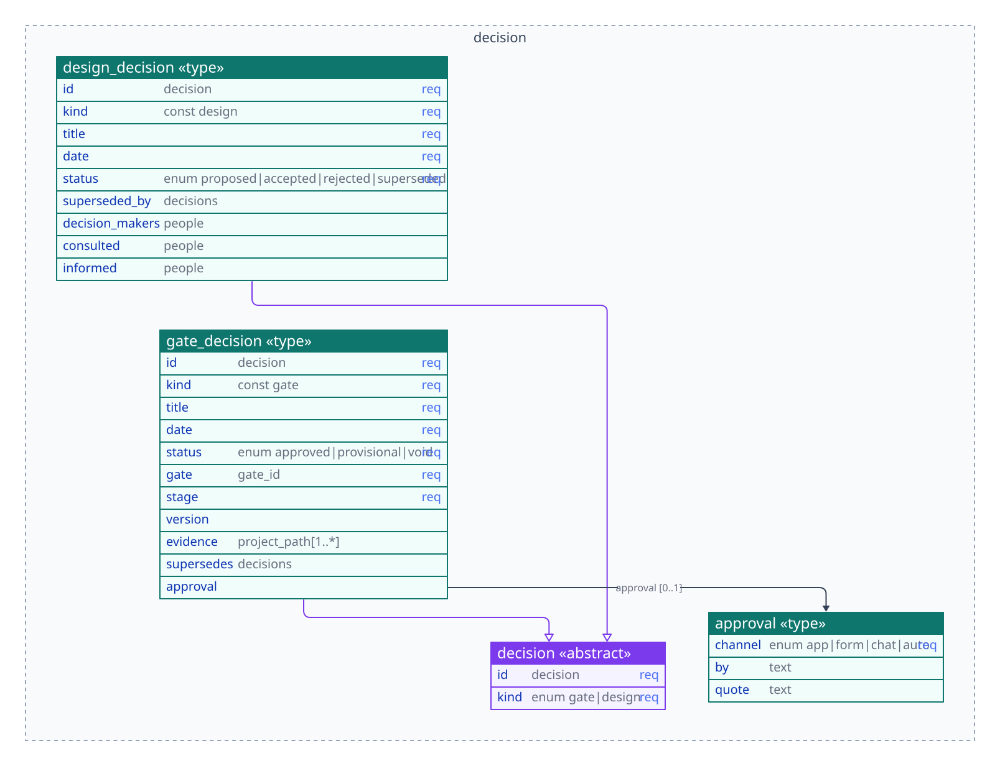

# `record/decision`

Generated by tools/gen (`just contracts`). Do not edit. Contract reference: [`record/decision`](../../record/decision.md). Source: [`contracts/record/decision.tsp`](../../../../../contracts/record/decision.tsp).

The YAML front matter between the two --- lines at the top of a decision record; the Markdown body after it is kept verbatim and has no required sections. kind gate records a flow gate state (approved, provisional or void); kind design records a design decision (proposed, accepted, rejected or superseded). A decision cited as the approval of a freeze, an engineering change or the flow profile must be a gate decision with status approved or a design decision with status accepted

## Diagrams

4 types in 1 diagrams.

### 1. `decision`

Relationships in diagram 1:

| Source | Relation | Target | Cardinality |
|---|---|---|---|
| gate_decision | composition via `approval` | approval | 0..1 |
| decision | inheritance (the source is the parent) | gate_decision | — |
| decision | inheritance (the source is the parent) | design_decision | — |

## Types

### `decision` «abstract»

| Field | Type | Required | Description |
|---|---|---|---|
| `id` | `decision` | yes |  |
| `kind` | `enum gate\|design` | yes |  |

### `gate_decision`

A flow gate state. provisional: the fast checks passed and the flow may build on it until the full check and the human gate; approved: the gate is passed; void: a provisional or approved gate is withdrawn. An approved gate supersedes its provisional one, and a void supersedes what it withdraws. An approved gate carries its approval unless the policy mode of its gate is auto, which validation checks against hw/policy.yaml

| Field | Type | Required | Description |
|---|---|---|---|
| `id` | `decision` | yes |  |
| `kind` | `const gate` | yes |  |
| `title` | `title` | yes |  |
| `date` | `date` | yes |  |
| `status` | `enum approved\|provisional\|void` | yes |  |
| `gate` | `gate_id` | yes |  |
| `stage` | `stage` | yes | The flow stage the gate belongs to |
| `version` | `version` | no | The built version the gate decided on |
| `evidence` | `project_path[1..*]` | no | The result files the gate decided on |
| `supersedes` | `decisions` | no |  |
| `approval` | `approval` | no |  |

### `approval`

Who approved a gate and through which channel: app (an MCP App), form (a form elicitation), chat (the user's words in the conversation) or auto (the policy mode auto, without a human). Every channel but auto names who approved and quotes their words

| Field | Type | Required | Description |
|---|---|---|---|
| `channel` | `enum app\|form\|chat\|auto` | yes |  |
| `by` | `text` | no |  |
| `quote` | `text` | no |  |

### `design_decision`

A design decision. superseded names the decisions that replace it in superseded_by; no other status has superseded_by

| Field | Type | Required | Description |
|---|---|---|---|
| `id` | `decision` | yes |  |
| `kind` | `const design` | yes |  |
| `title` | `title` | yes |  |
| `date` | `date` | yes |  |
| `status` | `enum proposed\|accepted\|rejected\|superseded` | yes |  |
| `superseded_by` | `decisions` | no |  |
| `decision_makers` | `people` | no |  |
| `consulted` | `people` | no |  |
| `informed` | `people` | no |  |
