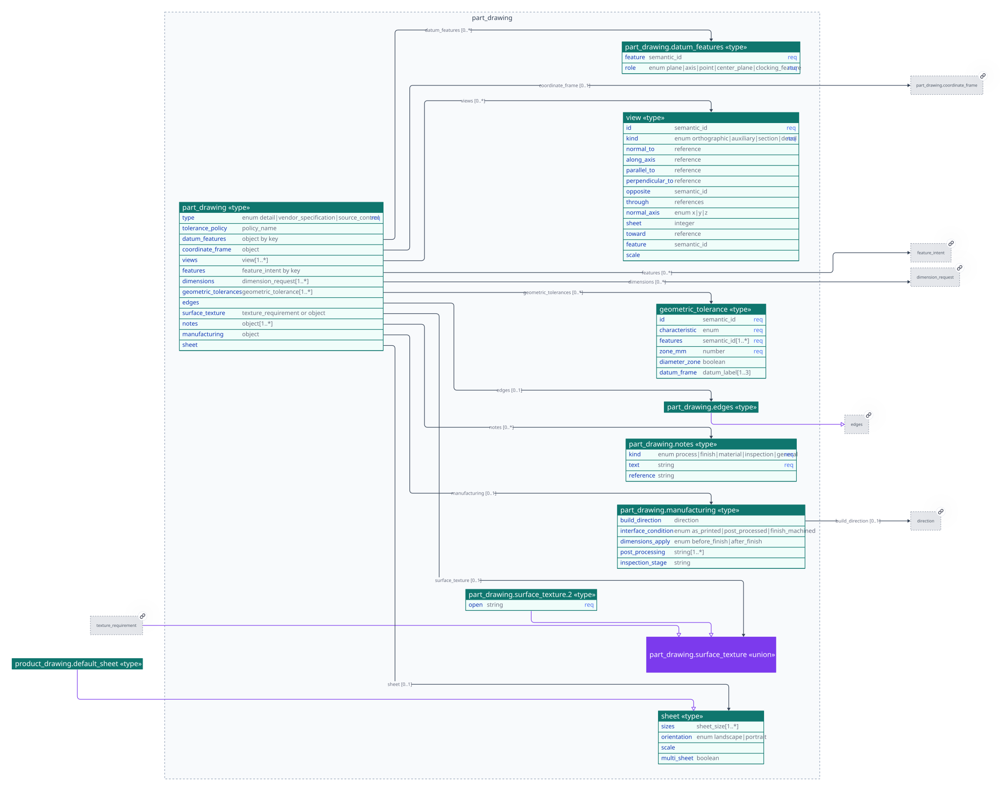
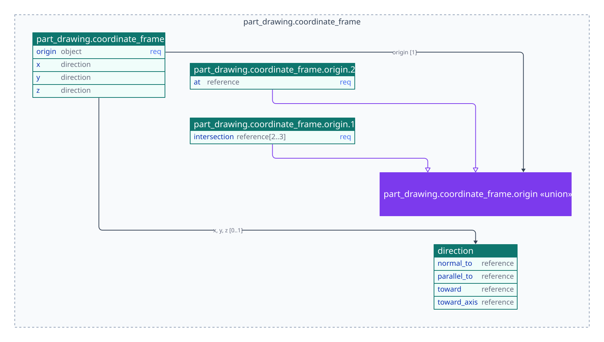
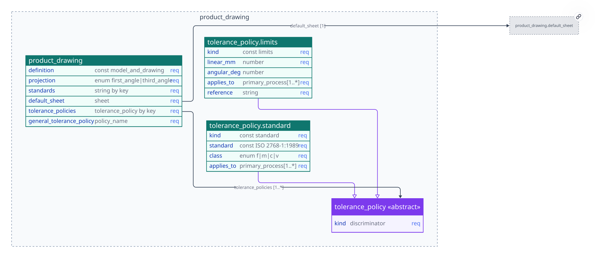
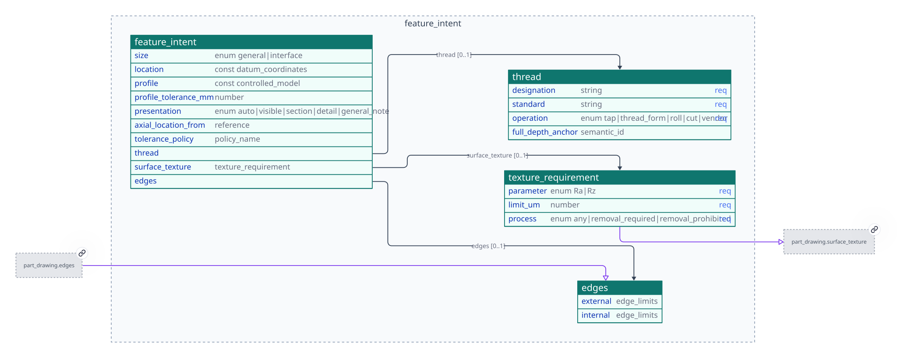
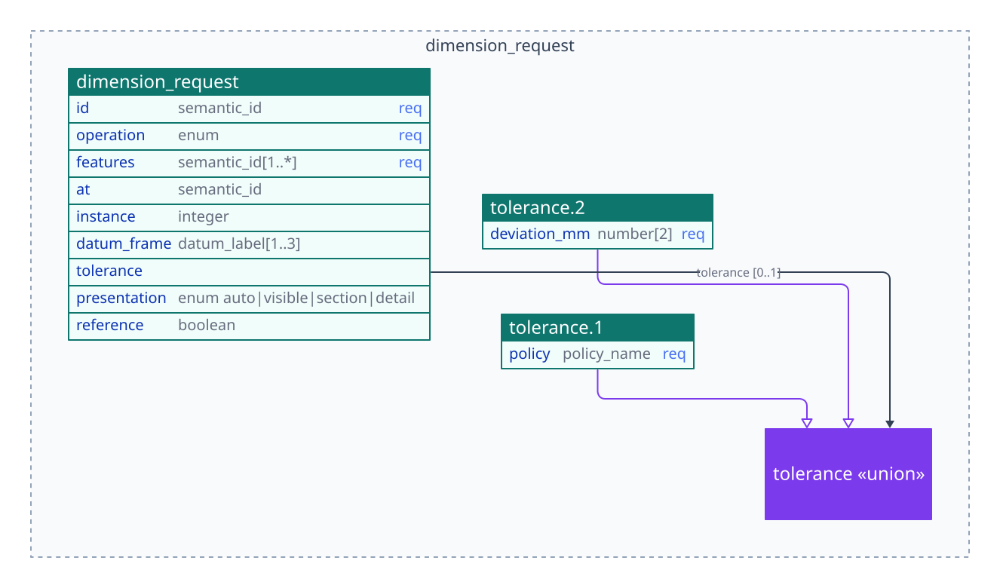
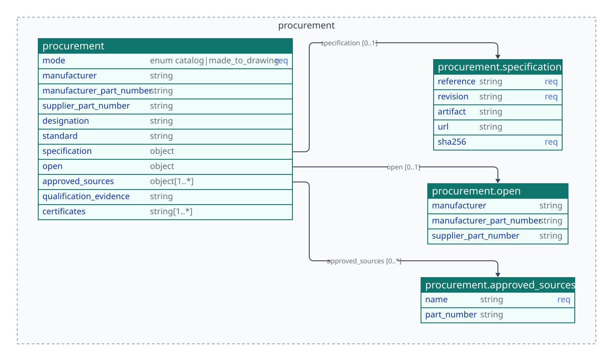
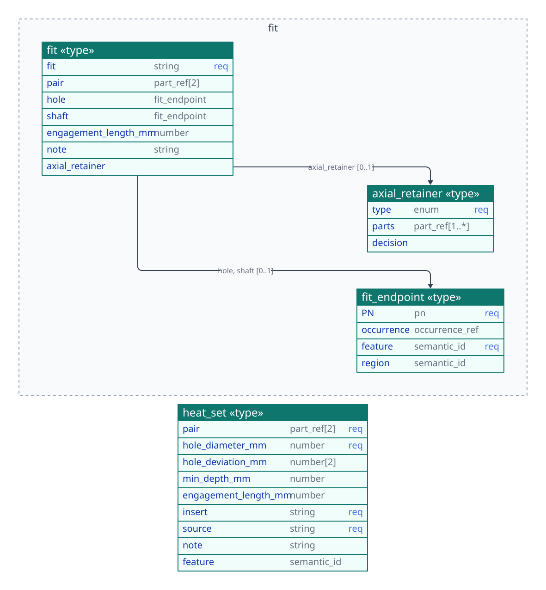

# `record/drawing`

Generated by tools/gen (`just contracts`). Do not edit. Contract reference: [`record/drawing`](../../record/drawing.md). Source: [`contracts/record/drawing.tsp`](../../../../../contracts/record/drawing.tsp).

A library of definitions, with no document of its own: the drawing intent that the product, part and interface records state, such as sheets, views, tolerances and tolerance policies, dimension requests, fits and threads.

## Diagrams

36 types in 7 diagrams.

### 1. `part_drawing`

Relationships in diagram 1:

| Source | Relation | Target | Cardinality |
|---|---|---|---|
| sheet | inheritance (the source is the parent) | product_drawing.default_sheet | — |
| part_drawing | composition via `datum_features` | part_drawing.datum_features | 0..* |
| part_drawing | composition via `coordinate_frame` | part_drawing.coordinate_frame | 0..1 |
| part_drawing | composition via `views` | view | 0..* |
| part_drawing | composition via `features` | feature_intent | 0..* |
| part_drawing | composition via `dimensions` | dimension_request | 0..* |
| part_drawing | composition via `geometric_tolerances` | geometric_tolerance | 0..* |
| edges | inheritance (the source is the parent) | part_drawing.edges | — |
| part_drawing | composition via `edges` | part_drawing.edges | 0..1 |
| part_drawing.surface_texture | inheritance (the source is the parent) | texture_requirement | — |
| part_drawing.surface_texture | inheritance (the source is the parent) | part_drawing.surface_texture.2 | — |
| part_drawing | composition via `surface_texture` | part_drawing.surface_texture | 0..1 |
| part_drawing | composition via `notes` | part_drawing.notes | 0..* |
| part_drawing.manufacturing | composition via `build_direction` | direction | 0..1 |
| part_drawing | composition via `manufacturing` | part_drawing.manufacturing | 0..1 |
| part_drawing | composition via `sheet` | sheet | 0..1 |

### 2. `part_drawing.coordinate_frame`

Relationships in diagram 2:

| Source | Relation | Target | Cardinality |
|---|---|---|---|
| part_drawing.coordinate_frame.origin | inheritance (the source is the parent) | part_drawing.coordinate_frame.origin.1 | — |
| part_drawing.coordinate_frame.origin | inheritance (the source is the parent) | part_drawing.coordinate_frame.origin.2 | — |
| part_drawing.coordinate_frame | composition via `origin` | part_drawing.coordinate_frame.origin | 1 |
| part_drawing.coordinate_frame | composition via `x` | direction | 0..1 |
| part_drawing.coordinate_frame | composition via `y` | direction | 0..1 |
| part_drawing.coordinate_frame | composition via `z` | direction | 0..1 |

### 3. `product_drawing`

Relationships in diagram 3:

| Source | Relation | Target | Cardinality |
|---|---|---|---|
| tolerance_policy | inheritance (the source is the parent) | tolerance_policy.standard | — |
| tolerance_policy | inheritance (the source is the parent) | tolerance_policy.limits | — |
| product_drawing | composition via `default_sheet` | product_drawing.default_sheet | 1 |
| product_drawing | composition via `tolerance_policies` | tolerance_policy | 1..* |

### 4. `feature_intent`

Relationships in diagram 4:

| Source | Relation | Target | Cardinality |
|---|---|---|---|
| feature_intent | composition via `thread` | thread | 0..1 |
| feature_intent | composition via `surface_texture` | texture_requirement | 0..1 |
| feature_intent | composition via `edges` | edges | 0..1 |
| edges | inheritance (the source is the parent) | part_drawing.edges | — |
| part_drawing.surface_texture | inheritance (the source is the parent) | texture_requirement | — |

### 5. `dimension_request`

Relationships in diagram 5:

| Source | Relation | Target | Cardinality |
|---|---|---|---|
| tolerance | inheritance (the source is the parent) | tolerance.1 | — |
| tolerance | inheritance (the source is the parent) | tolerance.2 | — |
| dimension_request | composition via `tolerance` | tolerance | 0..1 |

### 6. `procurement`

Relationships in diagram 6:

| Source | Relation | Target | Cardinality |
|---|---|---|---|
| procurement | composition via `specification` | procurement.specification | 0..1 |
| procurement | composition via `open` | procurement.open | 0..1 |
| procurement | composition via `approved_sources` | procurement.approved_sources | 0..* |

### 7. `fit`

Relationships in diagram 7:

| Source | Relation | Target | Cardinality |
|---|---|---|---|
| fit | composition via `hole` | fit_endpoint | 0..1 |
| fit | composition via `shaft` | fit_endpoint | 0..1 |
| fit | composition via `axial_retainer` | axial_retainer | 0..1 |

## Types

### `sheet`

In diagram 1.

| Field | Type | Required | Description |
|---|---|---|---|
| `sizes` | `sheet_size[1..*]` | no |  |
| `orientation` | `enum landscape\|portrait` | no |  |
| `scale` | `scale` | no |  |
| `multi_sheet` | `boolean` | no |  |

### `view`

In diagram 1.

| Field | Type | Required | Description |
|---|---|---|---|
| `id` | `semantic_id` | yes |  |
| `kind` | `enum orthographic\|auxiliary\|section\|detail` | yes |  |
| `normal_to` | `reference` | no |  |
| `along_axis` | `reference` | no |  |
| `parallel_to` | `reference` | no |  |
| `perpendicular_to` | `reference` | no |  |
| `opposite` | `semantic_id` | no |  |
| `through` | `references` | no |  |
| `normal_axis` | `enum x\|y\|z` | no | section: the cutting plane is normal to this frame axis and passes through the centre of the one through reference |
| `sheet` | `integer` | no | the sheet the view is drawn on; the principal view is on sheet 1 |
| `toward` | `reference` | no |  |
| `feature` | `semantic_id` | no |  |
| `scale` | `scale` | no |  |

### `geometric_tolerance`

In diagram 1.

A geometrical tolerance of ISO 1101 or ASME Y14.5 on resolved features; the zone is design intent, never a measured value

| Field | Type | Required | Description |
|---|---|---|---|
| `id` | `semantic_id` | yes |  |
| `characteristic` | `enum` | yes |  |
| `features` | `semantic_id[1..*]` | yes |  |
| `zone_mm` | `number` | yes |  |
| `diameter_zone` | `boolean` | no |  |
| `datum_frame` | `datum_label[1..3]` | no |  |

### `part_drawing`

In diagram 1.

| Field | Type | Required | Description |
|---|---|---|---|
| `type` | `enum detail\|vendor_specification\|source_control` | yes |  |
| `tolerance_policy` | `policy_name` | no |  |
| `datum_features` | `object by key` | no |  |
| `coordinate_frame` | `object` | no |  |
| `views` | `view[1..*]` | no |  |
| `features` | `feature_intent by key` | no |  |
| `dimensions` | `dimension_request[1..*]` | no |  |
| `geometric_tolerances` | `geometric_tolerance[1..*]` | no |  |
| `edges` | `edges` | no | the general indication of the edges of undefined shape (ISO 13715:2017 §4.5.4); a detail drawing needs it |
| `surface_texture` | `texture_requirement or object` | no | the general surface texture of the surfaces with no texture of their own (ISO 21920-1 §9.1.2), or open with the reason no value has a basis yet; a detail drawing needs it |
| `notes` | `object[1..*]` | no |  |
| `manufacturing` | `object` | no |  |
| `sheet` | `sheet` | no |  |

### `part_drawing.datum_features`

In diagram 1.

| Field | Type | Required | Description |
|---|---|---|---|
| `feature` | `semantic_id` | yes |  |
| `role` | `enum plane\|axis\|point\|center_plane\|clocking_feature` | yes |  |

### `part_drawing.edges`

In diagram 1.

No fields of its own.

### `part_drawing.surface_texture` «union»

In diagram 1.

No fields of its own.

### `part_drawing.surface_texture.2`

In diagram 1.

| Field | Type | Required | Description |
|---|---|---|---|
| `open` | `string` | yes |  |

### `part_drawing.notes`

In diagram 1.

| Field | Type | Required | Description |
|---|---|---|---|
| `kind` | `enum process\|finish\|material\|inspection\|general` | yes |  |
| `text` | `string` | yes |  |
| `reference` | `string` | no |  |

### `part_drawing.manufacturing`

In diagram 1.

| Field | Type | Required | Description |
|---|---|---|---|
| `build_direction` | `direction` | no |  |
| `interface_condition` | `enum as_printed\|post_processed\|finish_machined` | no |  |
| `dimensions_apply` | `enum before_finish\|after_finish` | no |  |
| `post_processing` | `string[1..*]` | no |  |
| `inspection_stage` | `string` | no |  |

### `product_drawing.default_sheet`

In diagram 1.

No fields of its own.

### `direction`

In diagram 2.

An axis built from resolved datums or features: normal_to or parallel_to fixes the line, toward or toward_axis its sense

| Field | Type | Required | Description |
|---|---|---|---|
| `normal_to` | `reference` | no |  |
| `parallel_to` | `reference` | no |  |
| `toward` | `reference` | no |  |
| `toward_axis` | `reference` | no |  |

### `part_drawing.coordinate_frame`

In diagram 2.

| Field | Type | Required | Description |
|---|---|---|---|
| `origin` | `object` | yes |  |
| `x` | `direction` | no |  |
| `y` | `direction` | no |  |
| `z` | `direction` | no |  |

### `part_drawing.coordinate_frame.origin` «union»

In diagram 2.

No fields of its own.

### `part_drawing.coordinate_frame.origin.1`

In diagram 2.

| Field | Type | Required | Description |
|---|---|---|---|
| `intersection` | `reference[2..3]` | yes |  |

### `part_drawing.coordinate_frame.origin.2`

In diagram 2.

| Field | Type | Required | Description |
|---|---|---|---|
| `at` | `reference` | yes |  |

### `tolerance_policy` «abstract»

In diagram 3.

| Field | Type | Required | Description |
|---|---|---|---|
| `kind` | `discriminator` | yes |  |

### `tolerance_policy.standard`

In diagram 3.

| Field | Type | Required | Description |
|---|---|---|---|
| `kind` | `const standard` | yes |  |
| `standard` | `const ISO 2768-1:1989` | yes |  |
| `class` | `enum f\|m\|c\|v` | yes |  |
| `applies_to` | `primary_process[1..*]` | yes |  |

### `tolerance_policy.limits`

In diagram 3.

| Field | Type | Required | Description |
|---|---|---|---|
| `kind` | `const limits` | yes |  |
| `linear_mm` | `number` | yes |  |
| `angular_deg` | `number` | no |  |
| `applies_to` | `primary_process[1..*]` | yes |  |
| `reference` | `string` | yes |  |

### `product_drawing`

In diagram 3.

| Field | Type | Required | Description |
|---|---|---|---|
| `definition` | `const model_and_drawing` | yes |  |
| `projection` | `enum first_angle\|third_angle` | yes |  |
| `standards` | `string by key` | yes |  |
| `default_sheet` | `sheet` | yes |  |
| `tolerance_policies` | `tolerance_policy by key` | yes |  |
| `general_tolerance_policy` | `policy_name` | yes |  |

### `feature_intent`

In diagram 4.

| Field | Type | Required | Description |
|---|---|---|---|
| `size` | `enum general\|interface` | no |  |
| `location` | `const datum_coordinates` | no |  |
| `profile` | `const controlled_model` | no |  |
| `profile_tolerance_mm` | `number` | no |  |
| `presentation` | `enum auto\|visible\|section\|detail\|general_note` | no | general_note: a round's or chamfer's size goes in the sheet's general note of undimensioned edge fillets and edge breaks |
| `axial_location_from` | `reference` | no |  |
| `tolerance_policy` | `policy_name` | no |  |
| `thread` | `thread` | no |  |
| `surface_texture` | `texture_requirement` | no |  |
| `edges` | `edges` | no |  |

### `thread`

In diagram 4.

A thread on a bore or shaft feature, drawn conventionally (ISO 6410-1, ASME Y14.6); the full-thread depth is the measured distance from the feature's entry to its locator anchor

| Field | Type | Required | Description |
|---|---|---|---|
| `designation` | `string` | yes |  |
| `standard` | `string` | yes |  |
| `operation` | `enum tap\|thread_form\|roll\|cut\|vendor` | yes |  |
| `full_depth_anchor` | `semantic_id` | no |  |

### `texture_requirement`

In diagram 4.

An ISO 21920-1 (ASME Y14.36) surface texture requirement: the parameter's upper limit in micrometres and whether material shall be removed

| Field | Type | Required | Description |
|---|---|---|---|
| `parameter` | `enum Ra\|Rz` | yes |  |
| `limit_um` | `number` | yes |  |
| `process` | `enum any\|removal_required\|removal_prohibited` | yes |  |

### `edges`

In diagram 4.

Edges of undefined shape: the external and internal edge size limits; on a feature, exceptions to the drawing's general indication

| Field | Type | Required | Description |
|---|---|---|---|
| `external` | `edge_limits` | no |  |
| `internal` | `edge_limits` | no |  |

### `tolerance` «union»

In diagram 5.

No fields of its own.

### `tolerance.1`

In diagram 5.

| Field | Type | Required | Description |
|---|---|---|---|
| `policy` | `policy_name` | yes |  |

### `tolerance.2`

In diagram 5.

| Field | Type | Required | Description |
|---|---|---|---|
| `deviation_mm` | `number[2]` | yes |  |

### `dimension_request`

In diagram 5.

An additional measured dimension; its value always comes from the model, so there is no value field

| Field | Type | Required | Description |
|---|---|---|---|
| `id` | `semantic_id` | yes |  |
| `operation` | `enum` | yes |  |
| `features` | `semantic_id[1..*]` | yes |  |
| `at` | `semantic_id` | no | A plane feature a width, thickness or separation is stated at: between two planes that are not parallel (a drafted wall, inclined flanks), the distance between the lines where they meet this plane |
| `instance` | `integer` | no | A distance from a plane_face to a bore's or shaft's centres: which of their distances from that plane it states, 1 the nearest; centres at one distance share the dimension. Required when the centres lie at several distances |
| `datum_frame` | `datum_label[1..3]` | no |  |
| `tolerance` | `tolerance` | no |  |
| `presentation` | `enum auto\|visible\|section\|detail` | no |  |
| `reference` | `boolean` | no |  |

### `procurement`

In diagram 6.

| Field | Type | Required | Description |
|---|---|---|---|
| `mode` | `enum catalog\|made_to_drawing` | yes |  |
| `manufacturer` | `string` | no |  |
| `manufacturer_part_number` | `string` | no |  |
| `supplier_part_number` | `string` | no |  |
| `designation` | `string` | no |  |
| `standard` | `string` | no | the product standard of a standard part, such as DIN 471 or ISO 4762; its designation states the standard with its designation items (DIN 471 - 5x0.6) and identifies the item without a manufacturer or manufacturer part number |
| `specification` | `object` | no | the datasheet or standard that defines the item, identified by its sha256; with only a url the frozen copy is a sourcing input kept outside the record |
| `open` | `object` | no | orderable identity fields deliberately left open, each with the reason; every one blocks release |
| `approved_sources` | `object[1..*]` | no |  |
| `qualification_evidence` | `string` | no |  |
| `certificates` | `string[1..*]` | no |  |

### `procurement.specification`

In diagram 6.

| Field | Type | Required | Description |
|---|---|---|---|
| `reference` | `string` | yes |  |
| `revision` | `string` | yes |  |
| `artifact` | `string` | no | frozen copy of the specification, relative to hw/ |
| `url` | `string` | no | where the publisher serves the specification |
| `sha256` | `sha256` | yes |  |

### `procurement.open`

In diagram 6.

| Field | Type | Required | Description |
|---|---|---|---|
| `manufacturer` | `string` | no |  |
| `manufacturer_part_number` | `string` | no |  |
| `supplier_part_number` | `string` | no |  |

### `procurement.approved_sources`

In diagram 6.

| Field | Type | Required | Description |
|---|---|---|---|
| `name` | `string` | yes |  |
| `part_number` | `string` | no |  |

### `fit_endpoint`

In diagram 7.

| Field | Type | Required | Description |
|---|---|---|---|
| `PN` | `pn` | yes |  |
| `occurrence` | `occurrence_ref` | no |  |
| `feature` | `semantic_id` | yes |  |
| `region` | `semantic_id` | no |  |

### `fit`

In diagram 7.

An ISO 286 fit between two parts: a part pair, or a hole and a shaft feature endpoint

| Field | Type | Required | Description |
|---|---|---|---|
| `fit` | `string` | yes |  |
| `pair` | `part_ref[2]` | no |  |
| `hole` | `fit_endpoint` | no |  |
| `shaft` | `fit_endpoint` | no |  |
| `engagement_length_mm` | `number` | no | engagement_length_mm: positive number, in mm. The travel along the insertion axis, back from the installed pose, over which the interfering surface of the inserted part still overlaps its partner. For a press fit seated on a bore floor, use the bore depth (an entry chamfer or counterbore may be ignored); not the press-band length and not the overlap at the installed pose. For a heat-set insert, use its embedded length. For a press fit or a heat-set insert, assembly access exempts interference up to this length plus one minimum sampling step. A running or locating fit records the length but gets no exemption. Optional; never derived. |
| `note` | `string` | no |  |
| `axial_retainer` | `axial_retainer` | no |  |

### `axial_retainer`

In diagram 7.

What keeps a press_fit or locating_fit from walking along its axis; the record validator requires one from stage parts on. Hardware types (circlip, set_screw, nut, pin, cap) name their modelled occurrences in parts

| Field | Type | Required | Description |
|---|---|---|---|
| `type` | `enum` | yes |  |
| `parts` | `part_ref[1..*]` | no |  |
| `decision` | `decision` | no |  |

### `heat_set`

In diagram 7.

A heat-set insert installed in its host part's bore; the pair is [host, insert], each a PN or an @occurrence reference

| Field | Type | Required | Description |
|---|---|---|---|
| `pair` | `part_ref[2]` | yes |  |
| `hole_diameter_mm` | `number` | yes | The bore diameter, in mm |
| `hole_deviation_mm` | `number[2]` | no | The bore's [lower, upper] deviation from hole_diameter_mm, in mm |
| `min_depth_mm` | `number` | no | The minimum bore depth, in mm |
| `engagement_length_mm` | `number` | no | engagement_length_mm: positive number, in mm. The travel along the insertion axis, back from the installed pose, over which the interfering surface of the inserted part still overlaps its partner. For a press fit seated on a bore floor, use the bore depth (an entry chamfer or counterbore may be ignored); not the press-band length and not the overlap at the installed pose. For a heat-set insert, use its embedded length. For a press fit or a heat-set insert, assembly access exempts interference up to this length plus one minimum sampling step. A running or locating fit records the length but gets no exemption. Optional; never derived. |
| `insert` | `string` | yes |  |
| `source` | `string` | yes |  |
| `note` | `string` | no |  |
| `feature` | `semantic_id` | no | the host part's bore feature that takes the insert |

## Enums

Named enum definitions, and the enums of fields that have more than 6 values, which the field's type does not spell out. Enums have no colour in the diagrams.

| Enum | Values | Description |
|---|---|---|
| `sheet_size` | `A4`, `A3`, `A2`, `A1`, `A0`, `ANSI A`, `ANSI B`, `ANSI C`, `ANSI D`, `ANSI E` |  |
| `geometric_tolerance.characteristic` | `position`, `coaxiality`, `perpendicularity`, `parallelism`, `flatness`, `cylindricity`, `circular_runout`, `total_runout`, `profile_surface` |  |
| `dimension_request.operation` | `diameter`, `radius`, `distance`, `plane_separation`, `axis_distance`, `location`, `axis_location`, `angle`, `depth`, `width`, `length`, `thickness`, `chamfer` |  |
| `axial_retainer.type` | `shoulder`, `circlip`, `set_screw`, `nut`, `pin`, `cap`, `captured`, `press_fit`, `adhesive` |  |
