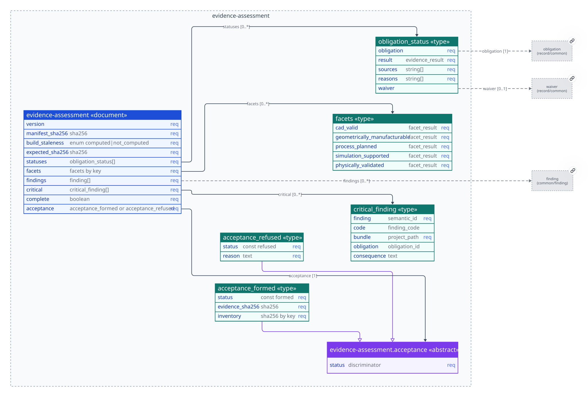

# `record/evidence-assessment`

Generated by tools/gen (`just contracts`). Do not edit. Contract reference: [`record/evidence-assessment`](../../record/evidence-assessment.md). Source: [`contracts/record/evidence-assessment.tsp`](../../../../../contracts/record/evidence-assessment.tsp).

The evidence of one built record version: the status of every obligation the record implies, each from three sources only (the record itself, the sealed required-check packets of the version and the accepted ledger hw/manufacturing/evidence.yaml), the result of each evidence level per requirement, part, interface, assembly operation and the product as independent facets, the findings about the evidence, the unresolved critical producer findings and the acceptance digest a freeze records and a release checks. Unknown, planned and untested never become pass; stale evidence counts as nothing; a waived obligation stays waived

## Diagrams

7 types in 1 diagrams.

### 1. `evidence-assessment`

Types of other contracts, drawn as stubs: [`common/finding`](../common/finding.md), [`record/common`](common.md).

## Types

### `evidence-assessment`

| Field | Type | Required | Description |
|---|---|---|---|
| `version` | `version` | yes |  |
| `manifest_sha256` | `sha256` | yes | sha256 of hw/versions/<V>/manifest.json |
| `build_staleness` | `enum computed\|not_computed` | yes | computed: producer outcomes whose inputs changed since the build are stale. not_computed: the built record could not be compared with the current one, so no producer pass, fail or not_applicable outcome counts, and a finding says why |
| `expected_sha256` | `sha256` | yes | sha256 of the expected obligations, as canonical JSON |
| `statuses` | `obligation_status[]` | yes | one status per expected obligation, sorted by obligation id |
| `facets` | `facets by key` | yes | per requirement, part, interface, op:<assembly operation> and product: each evidence level's worst status over its obligations, or not_required where none applies |
| `findings` | `finding[]` | yes |  |
| `critical` | `critical_finding[]` | yes | producer findings of severity critical whose outcome is fail or unknown and that no disposition settles |
| `complete` | `boolean` | yes | false when a producer packet was partial or refused |
| `acceptance` | `acceptance_formed or acceptance_refused` | yes |  |

### `obligation_status`

| Field | Type | Required | Description |
|---|---|---|---|
| `obligation` | `obligation` | yes |  |
| `result` | `evidence_result` | yes |  |
| `sources` | `string[]` | yes | the packet bundles, ledger entry ids or `record` that decided it |
| `reasons` | `string[]` | yes |  |
| `waiver` | `waiver` | no | the approved waiver, when the result is waived |

### `facets`

| Field | Type | Required | Description |
|---|---|---|---|
| `cad_valid` | `facet_result` | yes |  |
| `geometrically_manufacturable` | `facet_result` | yes |  |
| `process_planned` | `facet_result` | yes |  |
| `simulation_supported` | `facet_result` | yes |  |
| `physically_validated` | `facet_result` | yes |  |

### `critical_finding`

| Field | Type | Required | Description |
|---|---|---|---|
| `finding` | `semantic_id` | yes |  |
| `code` | `finding_code` | no |  |
| `bundle` | `project_path` | yes |  |
| `obligation` | `obligation_id` | no |  |
| `consequence` | `text` | no |  |

### `evidence-assessment.acceptance` «abstract»

| Field | Type | Required | Description |
|---|---|---|---|
| `status` | `discriminator` | yes |  |

### `acceptance_formed`

The acceptance inventory (hw/ path to sha256) and its digest: sha256 of {"schema": "cad-acceptance-inventory/1", "files": the sorted [path, sha256] pairs} as canonical JSON

| Field | Type | Required | Description |
|---|---|---|---|
| `status` | `const formed` | yes |  |
| `evidence_sha256` | `sha256` | yes |  |
| `inventory` | `sha256 by key` | yes |  |

### `acceptance_refused`

| Field | Type | Required | Description |
|---|---|---|---|
| `status` | `const refused` | yes |  |
| `reason` | `text` | yes | why the inventory cannot be formed: a missing, linked, escaping or refused path |

## Enums

Named enum definitions, and the enums of fields that have more than 6 values, which the field's type does not spell out. Enums have no colour in the diagrams.

| Enum | Values | Description |
|---|---|---|
| `evidence_result` | `pass`, `fail`, `waived`, `not_applicable`, `not_assessed`, `stale`, `planned`, `unknown` |  |
