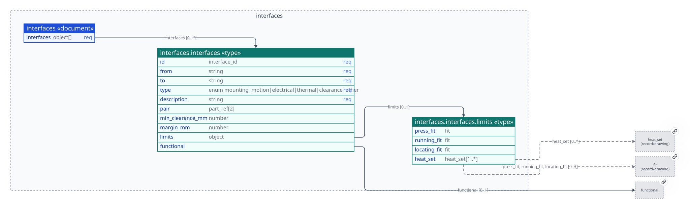
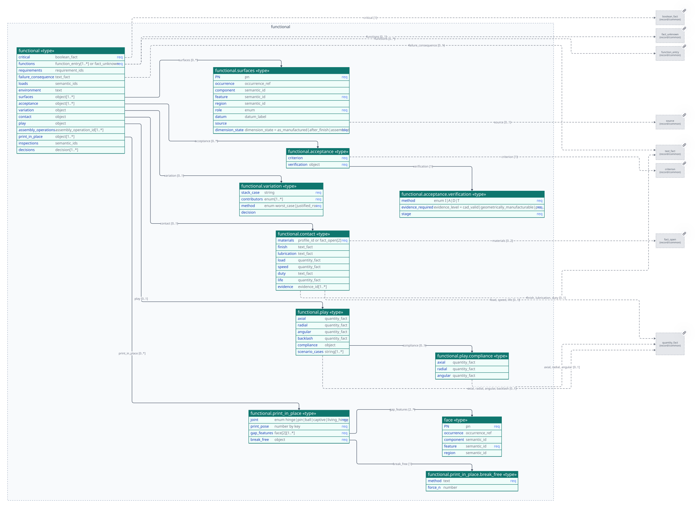

# `record/interfaces`

Generated by tools/gen (`just contracts`). Do not edit. Contract reference: [`record/interfaces`](../../record/interfaces.md). Source: [`contracts/record/interfaces.tsp`](../../../../../contracts/record/interfaces.tsp).

The interfaces record, hw/interfaces.yaml: each interface between two parts, from one to the other, with its type and description.

## Diagrams

14 types in 2 diagrams.

### 1. `interfaces`

Relationships in diagram 1:

| Source | Relation | Target | Cardinality |
|---|---|---|---|
| interfaces.interfaces.limits | association via `press_fit` | fit (record/drawing) | 0..1 |
| interfaces.interfaces.limits | association via `running_fit` | fit (record/drawing) | 0..1 |
| interfaces.interfaces.limits | association via `locating_fit` | fit (record/drawing) | 0..1 |
| interfaces.interfaces.limits | association via `heat_set` | heat_set (record/drawing) | 0..* |
| interfaces.interfaces | composition via `limits` | interfaces.interfaces.limits | 0..1 |
| interfaces.interfaces | composition via `functional` | functional | 0..1 |
| interfaces | composition via `interfaces` | interfaces.interfaces | 0..* |

### 2. `functional`

Relationships in diagram 2:

| Source | Relation | Target | Cardinality |
|---|---|---|---|
| functional | association via `critical` | boolean_fact (record/common) | 1 |
| functional | association via `functions` | function_entry (record/common) | 0..* |
| functional | association via `functions` | fact_unknown (record/common) | 0..1 |
| functional | association via `failure_consequence` | text_fact (record/common) | 0..1 |
| functional.surfaces | association via `source` | source (record/common) | 0..1 |
| functional | composition via `surfaces` | functional.surfaces | 0..* |
| functional.acceptance | association via `criterion` | criterion (record/common) | 1 |
| functional.acceptance | composition via `verification` | functional.acceptance.verification | 1 |
| functional | composition via `acceptance` | functional.acceptance | 0..* |
| functional | composition via `variation` | functional.variation | 0..1 |
| functional.contact | association via `materials` | fact_open (record/common) | 0..2 |
| functional.contact | association via `finish` | text_fact (record/common) | 0..1 |
| functional.contact | association via `lubrication` | text_fact (record/common) | 0..1 |
| functional.contact | association via `load` | quantity_fact (record/common) | 0..1 |
| functional.contact | association via `speed` | quantity_fact (record/common) | 0..1 |
| functional.contact | association via `duty` | text_fact (record/common) | 0..1 |
| functional.contact | association via `life` | quantity_fact (record/common) | 0..1 |
| functional | composition via `contact` | functional.contact | 0..1 |
| functional.play | association via `axial` | quantity_fact (record/common) | 0..1 |
| functional.play | association via `radial` | quantity_fact (record/common) | 0..1 |
| functional.play | association via `angular` | quantity_fact (record/common) | 0..1 |
| functional.play | association via `backlash` | quantity_fact (record/common) | 0..1 |
| functional.play.compliance | association via `axial` | quantity_fact (record/common) | 0..1 |
| functional.play.compliance | association via `radial` | quantity_fact (record/common) | 0..1 |
| functional.play.compliance | association via `angular` | quantity_fact (record/common) | 0..1 |
| functional.play | composition via `compliance` | functional.play.compliance | 0..1 |
| functional | composition via `play` | functional.play | 0..1 |
| functional.print_in_place | composition via `gap_features` | face | 2..* |
| functional.print_in_place | composition via `break_free` | functional.print_in_place.break_free | 1 |
| functional | composition via `print_in_place` | functional.print_in_place | 0..* |

Types of other contracts, drawn as stubs: [`record/common`](common.md), [`record/drawing`](drawing.md).

## Types

### `interfaces`

In diagram 1.

| Field | Type | Required | Description |
|---|---|---|---|
| `interfaces` | `object[]` | yes |  |

### `interfaces.interfaces`

In diagram 1.

| Field | Type | Required | Description |
|---|---|---|---|
| `id` | `interface_id` | yes |  |
| `from` | `string` | yes |  |
| `to` | `string` | yes |  |
| `type` | `enum mounting\|motion\|electrical\|thermal\|clearance\|other` | yes |  |
| `description` | `string` | yes |  |
| `pair` | `part_ref[2]` | no | A clearance requirement's two parts, each a PN placed at most once or an @occurrence reference |
| `min_clearance_mm` | `number` | no | The smallest distance the pair may come to, at the nominal pose and at every swept pose |
| `margin_mm` | `number` | no | This requirement's margin above min_clearance_mm, overriding product.yaml design.clearance_margin_mm |
| `limits` | `object` | no |  |
| `functional` | `functional` | no |  |

### `interfaces.interfaces.limits`

In diagram 1.

| Field | Type | Required | Description |
|---|---|---|---|
| `press_fit` | `fit` | no |  |
| `running_fit` | `fit` | no |  |
| `locating_fit` | `fit` | no |  |
| `heat_set` | `heat_set[1..*]` | no |  |

### `functional`

In diagram 2.

Record version 2 functional contract of an interface. Desired fit limits (limits), calibrated process precision (capability profiles) and inspected finished dimensions (acceptance) stay three distinct things; no tolerance is inferred from a fit name

| Field | Type | Required | Description |
|---|---|---|---|
| `critical` | `boolean_fact` | yes |  |
| `functions` | `function_entry[1..*] or fact_unknown` | yes |  |
| `requirements` | `requirement_ids` | no |  |
| `failure_consequence` | `text_fact` | no |  |
| `loads` | `semantic_ids` | no | product.yaml use_case.loads ids |
| `environment` | `text` | no |  |
| `surfaces` | `object[1..*]` | no |  |
| `acceptance` | `object[1..*]` | no |  |
| `variation` | `object` | no | The tolerance stack: its managed analysis case, the contributors it includes and the governing method; RSS needs the decision that justifies its statistical assumptions |
| `contact` | `object` | no |  |
| `play` | `object` | no | The joint's free movement at this interface: each component the total play about the nominal, centred pose (an interval's upper bound governs the extremes), axial along the joint axis, radial across it, angular as tilt of the axis, backlash along the joint's own coordinate; compliance the elastic displacement under the interface's declared loads (spring preload, operating loads), sourced from a calculation or test, added to the play at the extremes. A component the interface function needs and the record does not declare is unknown, never zero. scenario_cases name the motion cases evaluated under play |
| `assembly_operations` | `assembly_operation_id[1..*]` | no |  |
| `print_in_place` | `object[1..*]` | no | The joints at this interface that print already assembled: each joint's kind, the joint value it prints at, the face pairs its gap separates and how it breaks free after printing. min_clearance_mm must be at least the governing product.yaml flow.profile processes.fdm.pip_clearance_mm |
| `inspections` | `semantic_ids` | no |  |
| `decisions` | `decision[1..*]` | no |  |

### `functional.surfaces`

In diagram 2.

| Field | Type | Required | Description |
|---|---|---|---|
| `PN` | `pn` | yes |  |
| `occurrence` | `occurrence_ref` | no |  |
| `component` | `semantic_id` | no |  |
| `feature` | `semantic_id` | yes |  |
| `region` | `semantic_id` | no |  |
| `role` | `enum` | yes |  |
| `datum` | `datum_label` | no |  |
| `source` | `source` | no |  |
| `dimension_state` | `dimension_state = as_manufactured\|after_finish\|assembled` | yes |  |

### `functional.acceptance`

In diagram 2.

| Field | Type | Required | Description |
|---|---|---|---|
| `criterion` | `criterion` | yes |  |
| `verification` | `object` | yes |  |

### `functional.acceptance.verification`

In diagram 2.

| Field | Type | Required | Description |
|---|---|---|---|
| `method` | `enum I\|A\|D\|T` | yes |  |
| `evidence_required` | `evidence_level = cad_valid\|geometrically_manufacturable\|process_planned\|simulation_supported\|physically_validated[1..*]` | yes |  |
| `stage` | `stage` | yes |  |

### `functional.variation`

In diagram 2.

| Field | Type | Required | Description |
|---|---|---|---|
| `stack_case` | `string` | yes | an hw/analysis/cases/<ID> case id |
| `contributors` | `enum[1..*]` | yes |  |
| `method` | `enum worst_case\|justified_rss` | yes |  |
| `decision` | `decision` | no |  |

### `functional.contact`

In diagram 2.

| Field | Type | Required | Description |
|---|---|---|---|
| `materials` | `profile_id or fact_open[2]` | yes |  |
| `finish` | `text_fact` | no |  |
| `lubrication` | `text_fact` | no |  |
| `load` | `quantity_fact` | no |  |
| `speed` | `quantity_fact` | no |  |
| `duty` | `text_fact` | no |  |
| `life` | `quantity_fact` | no |  |
| `evidence` | `evidence_id[1..*]` | no |  |

### `functional.play`

In diagram 2.

| Field | Type | Required | Description |
|---|---|---|---|
| `axial` | `quantity_fact` | no |  |
| `radial` | `quantity_fact` | no |  |
| `angular` | `quantity_fact` | no |  |
| `backlash` | `quantity_fact` | no |  |
| `compliance` | `object` | no |  |
| `scenario_cases` | `string[1..*]` | no | hw/motion/cases/<ID> case ids |

### `functional.play.compliance`

In diagram 2.

| Field | Type | Required | Description |
|---|---|---|---|
| `axial` | `quantity_fact` | no |  |
| `radial` | `quantity_fact` | no |  |
| `angular` | `quantity_fact` | no |  |

### `functional.print_in_place`

In diagram 2.

| Field | Type | Required | Description |
|---|---|---|---|
| `joint` | `enum hinge\|pin\|ball\|captive\|living_hinge` | yes |  |
| `print_pose` | `number by key` | yes | the value each assembly.yaml joint prints at, in that joint's units |
| `gap_features` | `face[2][1..*]` | yes |  |
| `break_free` | `object` | yes |  |

### `face`

In diagram 2.

One face of a part, by its semantic feature id

| Field | Type | Required | Description |
|---|---|---|---|
| `PN` | `pn` | yes |  |
| `occurrence` | `occurrence_ref` | no |  |
| `component` | `semantic_id` | no |  |
| `feature` | `semantic_id` | yes |  |
| `region` | `semantic_id` | no |  |

### `functional.print_in_place.break_free`

In diagram 2.

| Field | Type | Required | Description |
|---|---|---|---|
| `method` | `text` | yes |  |
| `force_n` | `number` | no |  |

## Enums

Named enum definitions, and the enums of fields that have more than 6 values, which the field's type does not spell out. Enums have no colour in the diagrams.

| Enum | Values | Description |
|---|---|---|
| `functional.surfaces.role` | `datum`, `bore`, `seat`, `journal`, `running`, `sliding`, `flank`, `cam`, `seal`, `fastener`, `locating`, `optical`, `other` |  |
| `functional.variation.contributors` | `manufacture`, `assembly`, `thermal`, `moisture`, `wear`, `deformation`, `coating`, `adhesive`, `joining` |  |
