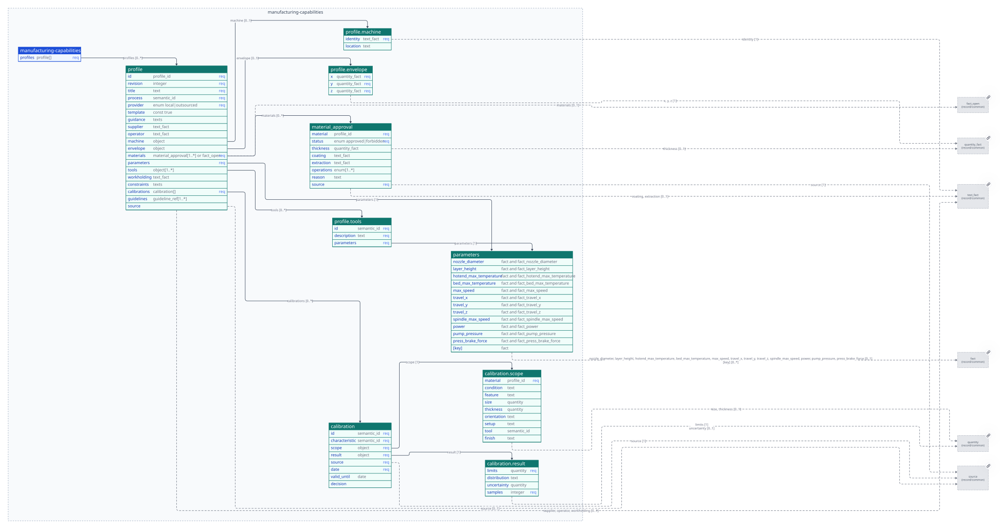
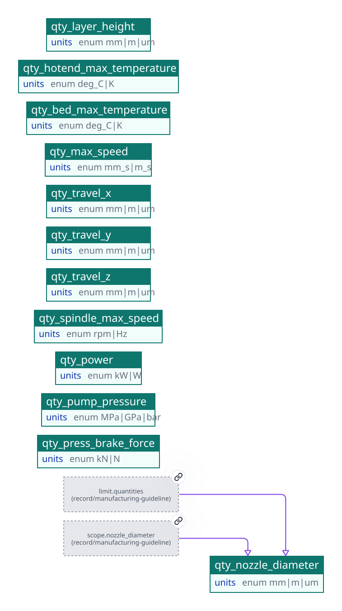
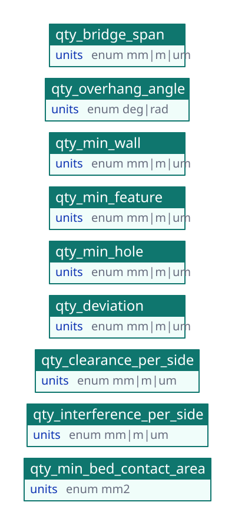

# `record/manufacturing-capabilities`

Generated by tools/gen (`just contracts`). Do not edit. Contract reference: [`record/manufacturing-capabilities`](../../record/manufacturing-capabilities.md). Source: [`contracts/record/manufacturing-capabilities.tsp`](../../../../../contracts/record/manufacturing-capabilities.tsp).

What the user's actual machines, operators and suppliers can do, kept apart from design requirements. Nominal resolution, machine specifications and drawing labels are parameters that describe the machine, never its achieved accuracy: achievable dimensional performance comes only from calibrations, each scoped to a material, feature, orientation, setup and tool, with its evidence. The plugin's capability templates carry template: true and hold no machine numbers; a template is never a capability. Parameter names per process kind are manufacturing_intent.CAPABILITY_PARAMETERS

## Diagrams

31 types in 3 diagrams.

### 1. `manufacturing-capabilities`

### 2. `qty_nozzle_diameter`

### 3. `qty_bridge_span`

Types of other contracts, drawn as stubs: [`record/common`](common.md), [`record/manufacturing-guideline`](manufacturing-guideline.md).

## Types

### `manufacturing-capabilities`

In diagram 1.

| Field | Type | Required | Description |
|---|---|---|---|
| `profiles` | `profile[]` | yes |  |

### `profile`

In diagram 1.

| Field | Type | Required | Description |
|---|---|---|---|
| `id` | `profile_id` | yes |  |
| `revision` | `integer` | yes |  |
| `title` | `text` | yes |  |
| `process` | `semantic_id` | yes |  |
| `provider` | `enum local\|outsourced` | yes |  |
| `template` | `const true` | no | present only on a plugin template: copy it, record your own values, then remove this flag |
| `guidance` | `texts` | no |  |
| `supplier` | `text_fact` | no |  |
| `operator` | `text_fact` | no |  |
| `machine` | `object` | no |  |
| `envelope` | `object` | no | The usable working envelope in the machine frame |
| `materials` | `material_approval[1..*] or fact_open` | yes | The exact materials and stock the profile is approved or forbidden for; for laser, waterjet and plasma also its thickness, coating and extraction approval. An unidentified material is never approved |
| `parameters` | `parameters` | yes |  |
| `tools` | `object[1..*]` | no |  |
| `workholding` | `text_fact` | no |  |
| `constraints` | `texts` | no |  |
| `calibrations` | `calibration[]` | yes |  |
| `guidelines` | `guideline_ref[1..*]` | no | The manufacturing guideline sets (id@revision) that this profile's machine layer names. They rank above every set that scope selects, and a calibration ranks above them. Sets of the generic, material and nozzle layers resolve by their scope and need no pin. It has no default |
| `source` | `source` | no |  |

### `profile.machine`

In diagram 1.

| Field | Type | Required | Description |
|---|---|---|---|
| `identity` | `text_fact` | yes | make, model and the machine's own identity |
| `location` | `text` | no |  |

### `profile.envelope`

In diagram 1.

| Field | Type | Required | Description |
|---|---|---|---|
| `x` | `quantity_fact` | yes |  |
| `y` | `quantity_fact` | yes |  |
| `z` | `quantity_fact` | yes |  |

### `material_approval`

In diagram 1.

| Field | Type | Required | Description |
|---|---|---|---|
| `material` | `profile_id` | yes | a material profile id |
| `status` | `enum approved\|forbidden` | yes |  |
| `thickness` | `quantity_fact` | no |  |
| `coating` | `text_fact` | no |  |
| `extraction` | `text_fact` | no |  |
| `operations` | `enum[1..*]` | no |  |
| `reason` | `text` | no |  |
| `source` | `source` | yes |  |

### `parameters`

In diagram 1.

Parameters by name. A named parameter that has a hard bound is checked in every unit of its dimension; the bounds are in the qty_* and fact_* definitions below and the plausibility band (x-plausible, a warning) beside them. layer_height at most nozzle_diameter compares two facts in possibly different units, so the config loader checks it

| Field | Type | Required | Description |
|---|---|---|---|
| `nozzle_diameter` | `fact and fact_nozzle_diameter` | no |  |
| `layer_height` | `fact and fact_layer_height` | no |  |
| `hotend_max_temperature` | `fact and fact_hotend_max_temperature` | no |  |
| `bed_max_temperature` | `fact and fact_bed_max_temperature` | no |  |
| `max_speed` | `fact and fact_max_speed` | no |  |
| `travel_x` | `fact and fact_travel_x` | no |  |
| `travel_y` | `fact and fact_travel_y` | no |  |
| `travel_z` | `fact and fact_travel_z` | no |  |
| `spindle_max_speed` | `fact and fact_spindle_max_speed` | no |  |
| `power` | `fact and fact_power` | no |  |
| `pump_pressure` | `fact and fact_pump_pressure` | no |  |
| `press_brake_force` | `fact and fact_press_brake_force` | no |  |
| `[key]` | `fact` | no |  |

### `profile.tools`

In diagram 1.

| Field | Type | Required | Description |
|---|---|---|---|
| `id` | `semantic_id` | yes |  |
| `description` | `text` | yes |  |
| `parameters` | `parameters` | yes |  |

### `calibration`

In diagram 1.

One demonstrated capability: the characteristic measured, its exact scope and the measured limits with their uncertainty and evidence

| Field | Type | Required | Description |
|---|---|---|---|
| `id` | `semantic_id` | yes |  |
| `characteristic` | `semantic_id` | yes | such as hole_diameter_deviation, min_wall, kerf, flatness or bridge_span |
| `scope` | `object` | yes |  |
| `result` | `object` | yes |  |
| `source` | `source` | yes |  |
| `date` | `date` | yes |  |
| `valid_until` | `date` | no |  |
| `decision` | `decision` | no |  |

### `calibration.scope`

In diagram 1.

| Field | Type | Required | Description |
|---|---|---|---|
| `material` | `profile_id` | yes | a material profile id |
| `condition` | `text` | no |  |
| `feature` | `text` | no |  |
| `size` | `quantity` | no |  |
| `thickness` | `quantity` | no |  |
| `orientation` | `text` | no |  |
| `setup` | `text` | no |  |
| `tool` | `semantic_id` | no |  |
| `finish` | `text` | no |  |

### `calibration.result`

In diagram 1.

| Field | Type | Required | Description |
|---|---|---|---|
| `limits` | `quantity` | yes | the measured range of the characteristic |
| `distribution` | `text` | no |  |
| `uncertainty` | `quantity` | no | the measurement uncertainty |
| `samples` | `integer` | yes |  |

### `qty_nozzle_diameter`

In diagram 2.

Nozzle diameter: above 0 and at most 3 mm

| Field | Type | Required | Description |
|---|---|---|---|
| `units` | `enum mm\|m\|um` | no |  |

### `qty_layer_height`

In diagram 2.

Layer height: above 0 and at most 3 mm, the largest nozzle; a plausible layer is at most 0.8 of the nozzle diameter

| Field | Type | Required | Description |
|---|---|---|---|
| `units` | `enum mm\|m\|um` | no |  |

### `qty_hotend_max_temperature`

In diagram 2.

Hotend limit: 0 to 500 deg_C; a plausible limit is at most 350 deg_C, which current printers reach: the Bambu Lab H2D (https://bambulab.com/uk/h2d/tech-specs, Max Nozzle Temperature 350 °C) and the Creality K2 Plus (https://www.creality.com/products/k2-series-3d-printer, Max Nozzle Temperature 350 °C)

| Field | Type | Required | Description |
|---|---|---|---|
| `units` | `enum deg_C\|K` | no |  |

### `qty_bed_max_temperature`

In diagram 2.

Bed limit: 0 to 150 deg_C

| Field | Type | Required | Description |
|---|---|---|---|
| `units` | `enum deg_C\|K` | no |  |

### `qty_max_speed`

In diagram 2.

Print speed: above 0 and at most 1000 mm/s. It has no separate plausibility band: current printers such as the Bambu Lab H2D reach the hard bound (https://bambulab.com/uk/h2d/tech-specs, Max Speed of Toolhead 1000 mm/s)

| Field | Type | Required | Description |
|---|---|---|---|
| `units` | `enum mm_s\|m_s` | no |  |

### `qty_travel_x`

In diagram 2.

Axis travel: above 0 and at most 10 m

| Field | Type | Required | Description |
|---|---|---|---|
| `units` | `enum mm\|m\|um` | no |  |

### `qty_travel_y`

In diagram 2.

Axis travel: above 0 and at most 10 m

| Field | Type | Required | Description |
|---|---|---|---|
| `units` | `enum mm\|m\|um` | no |  |

### `qty_travel_z`

In diagram 2.

Axis travel: above 0 and at most 10 m

| Field | Type | Required | Description |
|---|---|---|---|
| `units` | `enum mm\|m\|um` | no |  |

### `qty_spindle_max_speed`

In diagram 2.

Spindle limit: above 0 and at most 200000 rpm

| Field | Type | Required | Description |
|---|---|---|---|
| `units` | `enum rpm\|Hz` | no |  |

### `qty_power`

In diagram 2.

Laser power: above 0 and at most 10 kW; a desktop laser stays under 300 W

| Field | Type | Required | Description |
|---|---|---|---|
| `units` | `enum kW\|W` | no |  |

### `qty_pump_pressure`

In diagram 2.

Waterjet pump pressure: above 0 and at most 700 MPa

| Field | Type | Required | Description |
|---|---|---|---|
| `units` | `enum MPa\|GPa\|bar` | no |  |

### `qty_press_brake_force`

In diagram 2.

Press brake force: above 0 and at most 10000 kN

| Field | Type | Required | Description |
|---|---|---|---|
| `units` | `enum kN\|N` | no |  |

### `qty_bridge_span`

In diagram 3.

Calibrated unsupported bridge: 0 to 256 mm, the largest build volume

| Field | Type | Required | Description |
|---|---|---|---|
| `units` | `enum mm\|m\|um` | no |  |

### `qty_overhang_angle`

In diagram 3.

Calibrated unsupported overhang, from vertical: 0 to 90 deg

| Field | Type | Required | Description |
|---|---|---|---|
| `units` | `enum deg\|rad` | no |  |

### `qty_min_wall`

In diagram 3.

Calibrated thinnest wall: 0.1 to 25 mm

| Field | Type | Required | Description |
|---|---|---|---|
| `units` | `enum mm\|m\|um` | no |  |

### `qty_min_feature`

In diagram 3.

Calibrated smallest reliable pin or boss diameter: 0.2 to 20 mm

| Field | Type | Required | Description |
|---|---|---|---|
| `units` | `enum mm\|m\|um` | no |  |

### `qty_min_hole`

In diagram 3.

Calibrated smallest reliable cut hole diameter: 0.1 to 25 mm. The 0.5 to 10 mm plausibility band is a heuristic with no source table and only warns; the sourced guideline value is 2.0 mm (Protolabs, S3 in the FDM survey)

| Field | Type | Required | Description |
|---|---|---|---|
| `units` | `enum mm\|m\|um` | no |  |

### `qty_deviation`

In diagram 3.

Calibrated as-made minus nominal deviation: -2 to 2 mm

| Field | Type | Required | Description |
|---|---|---|---|
| `units` | `enum mm\|m\|um` | no |  |

### `qty_clearance_per_side`

In diagram 3.

Sliding clearance per side between mating parts: above 0 to 5 mm. A fact of the machine and material, so it has no default. The 0.1 to 0.5 mm plausibility band is a heuristic with no source table and only warns; the sourced value is 0.3 mm per side (S4 in the FDM survey). A press fit is not a negative clearance: use qty_interference_per_side

| Field | Type | Required | Description |
|---|---|---|---|
| `units` | `enum mm\|m\|um` | no |  |

### `qty_interference_per_side`

In diagram 3.

Press-fit interference per side, shaft larger than hole: above 0 to 1 mm, never negative. A fact of the machine and material, so it has no default. The 0.05 to 0.3 mm plausibility band is a heuristic with no source table and only warns; the intended press-fit range is 0.10 to 0.15 mm per side

| Field | Type | Required | Description |
|---|---|---|---|
| `units` | `enum mm\|m\|um` | no |  |

### `qty_min_bed_contact_area`

In diagram 3.

Calibrated smallest reliable first-layer contact area: above 0 mm2. A fact of the machine and material, so it has no default. The plausibility band waits for more calibrations (#141)

| Field | Type | Required | Description |
|---|---|---|---|
| `units` | `enum mm2` | no |  |

## Enums

Named enum definitions, and the enums of fields that have more than 6 values, which the field's type does not spell out. Enums have no colour in the diagrams.

| Enum | Values | Description |
|---|---|---|
| `material_approval.operations` | `cut`, `score`, `engrave`, `machine`, `print`, `form`, `join`, `other` |  |
