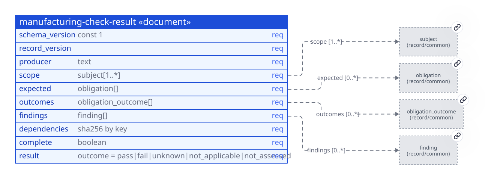

# `record/manufacturing-check-result`

Generated by tools/gen (`just contracts`). Do not edit. Contract reference: [`record/manufacturing-check-result`](../../record/manufacturing-check-result.md). Source: [`contracts/record/manufacturing-check-result.tsp`](../../../../../contracts/record/manufacturing-check-result.tsp).

One producer's required-check packet for one version: the obligations it was asked to cover (enumerated from the record before it ran), one outcome per obligation, its findings, the dependency fingerprints it read and whether it covered every expected obligation. A producer cannot shrink its scope by omission: an expected obligation without an outcome makes the packet incomplete, and unknown never counts as pass. Ported to v3 from the prototype's manufacturing-check-result schema at reference_commit 412b5d9: its record_version is the v3 record_version

## Diagrams

1 types in 1 diagrams.

### 1. `manufacturing-check-result`

Relationships in diagram 1:

| Source | Relation | Target | Cardinality |
|---|---|---|---|
| manufacturing-check-result | association via `scope` | subject (record/common) | 1..* |
| manufacturing-check-result | association via `expected` | obligation (record/common) | 0..* |
| manufacturing-check-result | association via `outcomes` | obligation_outcome (record/common) | 0..* |
| manufacturing-check-result | association via `findings` | finding (record/common) | 0..* |

Types of other contracts, drawn as stubs: [`record/common`](common.md).

## Types

### `manufacturing-check-result`

| Field | Type | Required | Description |
|---|---|---|---|
| `schema_version` | `const 1` | yes |  |
| `record_version` | `record_version` | yes |  |
| `producer` | `text` | yes | the writing tool and its version |
| `scope` | `subject[1..*]` | yes |  |
| `expected` | `obligation[]` | yes |  |
| `outcomes` | `obligation_outcome[]` | yes |  |
| `findings` | `finding[]` | yes |  |
| `dependencies` | `sha256 by key` | yes | sha256 of each input the producer read, by name, such as the part record, material and capability profiles and the geometry |
| `complete` | `boolean` | yes | true only when every expected obligation has an outcome |
| `result` | `outcome = pass\|fail\|unknown\|not_applicable\|not_assessed` | yes | fail if any outcome fails, else unknown if any is unknown or the packet is incomplete, else not_assessed if any outcome is, else pass (not_applicable outcomes aside) |
