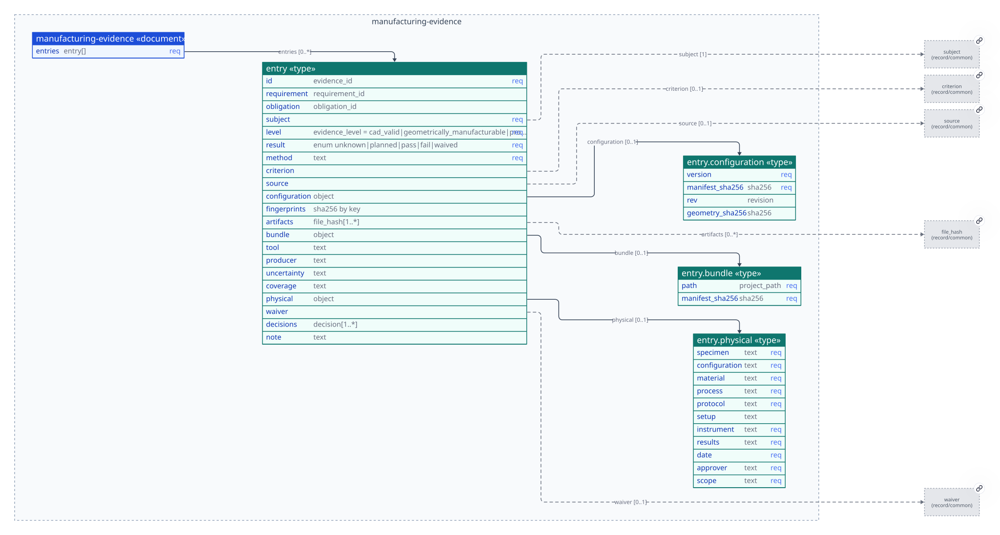

# `record/manufacturing-evidence`

Generated by tools/gen (`just contracts`). Do not edit. Contract reference: [`record/manufacturing-evidence`](../../record/manufacturing-evidence.md). Source: [`contracts/record/manufacturing-evidence.tsp`](../../../../../contracts/record/manufacturing-evidence.tsp).

Accepted evidence per requirement, part, component, interface or operation, one entry per evidence level: CAD-valid, geometrically manufacturable, process planned, simulation-supported and physically validated are independent facets. A pass or fail cites its artifacts or sealed bundle and the configuration, material, process and conditions it applies to; physically validated evidence also records the specimen, protocol, instrument calibration, results, date, approver and scope. Planned and unknown are never a pass, and waived stays waived

## Diagrams

5 types in 1 diagrams.

### 1. `manufacturing-evidence`

Relationships in diagram 1:

| Source | Relation | Target | Cardinality |
|---|---|---|---|
| entry | association via `subject` | subject (record/common) | 1 |
| entry | association via `criterion` | criterion (record/common) | 0..1 |
| entry | association via `source` | source (record/common) | 0..1 |
| entry | composition via `configuration` | entry.configuration | 0..1 |
| entry | association via `artifacts` | file_hash (record/common) | 0..* |
| entry | composition via `bundle` | entry.bundle | 0..1 |
| entry | composition via `physical` | entry.physical | 0..1 |
| entry | association via `waiver` | waiver (record/common) | 0..1 |
| manufacturing-evidence | composition via `entries` | entry | 0..* |

Types of other contracts, drawn as stubs: [`record/common`](common.md).

## Types

### `manufacturing-evidence`

| Field | Type | Required | Description |
|---|---|---|---|
| `entries` | `entry[]` | yes |  |

### `entry`

| Field | Type | Required | Description |
|---|---|---|---|
| `id` | `evidence_id` | yes |  |
| `requirement` | `requirement_id` | no |  |
| `obligation` | `obligation_id` | no |  |
| `subject` | `subject` | yes |  |
| `level` | `evidence_level = cad_valid\|geometrically_manufacturable\|process_planned\|simulation_supported\|physically_validated` | yes |  |
| `result` | `enum unknown\|planned\|pass\|fail\|waived` | yes |  |
| `method` | `text` | yes |  |
| `criterion` | `criterion` | no |  |
| `source` | `source` | no |  |
| `configuration` | `object` | no |  |
| `fingerprints` | `sha256 by key` | no | sha256 of each normalized dependency the evidence relied on, by domain; a changed fingerprint makes the evidence stale until an impact assessment carries it forward |
| `artifacts` | `file_hash[1..*]` | no |  |
| `bundle` | `object` | no |  |
| `tool` | `text` | no |  |
| `producer` | `text` | no |  |
| `uncertainty` | `text` | no |  |
| `coverage` | `text` | no |  |
| `physical` | `object` | no |  |
| `waiver` | `waiver` | no |  |
| `decisions` | `decision[1..*]` | no |  |
| `note` | `text` | no |  |

### `entry.configuration`

| Field | Type | Required | Description |
|---|---|---|---|
| `version` | `version` | yes |  |
| `manifest_sha256` | `sha256` | yes |  |
| `rev` | `revision` | no |  |
| `geometry_sha256` | `sha256` | no |  |

### `entry.bundle`

| Field | Type | Required | Description |
|---|---|---|---|
| `path` | `project_path` | yes |  |
| `manifest_sha256` | `sha256` | yes |  |

### `entry.physical`

| Field | Type | Required | Description |
|---|---|---|---|
| `specimen` | `text` | yes | the actual item tested: coupon, part or assembly, with its identity |
| `configuration` | `text` | yes | the as-built configuration and revision |
| `material` | `text` | yes | the material and lot as used |
| `process` | `text` | yes | the route and settings as used |
| `protocol` | `text` | yes |  |
| `setup` | `text` | no |  |
| `instrument` | `text` | yes | the instrument and its calibration |
| `results` | `text` | yes |  |
| `date` | `date` | yes |  |
| `approver` | `text` | yes |  |
| `scope` | `text` | yes | what the result covers: a coupon covers its coupon scope, not assembly or end-use life |

## Enums

Named enum definitions, and the enums of fields that have more than 6 values, which the field's type does not spell out. Enums have no colour in the diagrams.

| Enum | Values | Description |
|---|---|---|
| `fingerprint_domain` | `material`, `lot`, `condition`, `process`, `route`, `orientation`, `setup`, `capability`, `finish`, `load`, `environment`, `interface`, `occurrences`, `criterion`, `source`, `geometry`, `use_case`, `appearance` |  |
