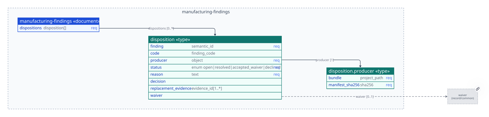

# `record/manufacturing-findings`

Generated by tools/gen (`just contracts`). Do not edit. Contract reference: [`record/manufacturing-findings`](../../record/manufacturing-findings.md). Source: [`contracts/record/manufacturing-findings.tsp`](../../../../../contracts/record/manufacturing-findings.tsp).

The lead's dispositions of immutable producer findings. Each names the finding id and the exact producer bundle manifest it lives in; producer rows are never copied or edited here. Declining or waiving a finding never turns a mandatory fail or unknown into a pass: the original outcome is evaluated together with the permitted, scoped disposition

## Diagrams

3 types in 1 diagrams.

### 1. `manufacturing-findings`

Types of other contracts, drawn as stubs: [`record/common`](common.md).

## Types

### `manufacturing-findings`

| Field | Type | Required | Description |
|---|---|---|---|
| `dispositions` | `disposition[]` | yes |  |

### `disposition`

| Field | Type | Required | Description |
|---|---|---|---|
| `finding` | `semantic_id` | yes |  |
| `code` | `finding_code` | no |  |
| `producer` | `object` | yes |  |
| `status` | `enum open\|resolved\|accepted_waiver\|declined` | yes |  |
| `reason` | `text` | yes |  |
| `decision` | `decision` | no |  |
| `replacement_evidence` | `evidence_id[1..*]` | no |  |
| `waiver` | `waiver` | no |  |

### `disposition.producer`

| Field | Type | Required | Description |
|---|---|---|---|
| `bundle` | `project_path` | yes | the producer bundle directory, project-relative |
| `manifest_sha256` | `sha256` | yes |  |
