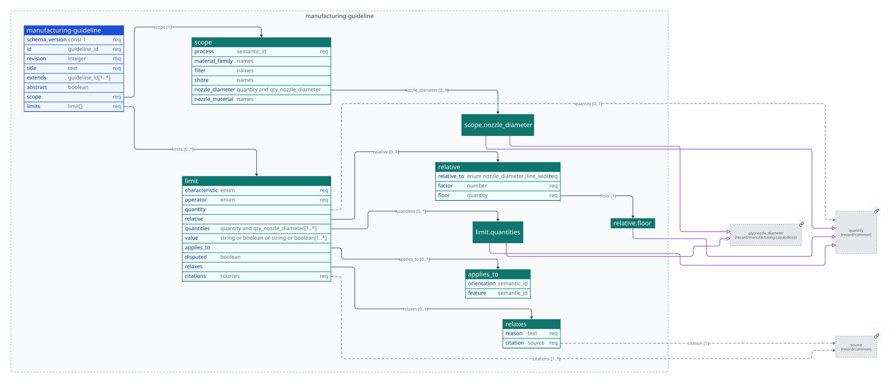

# `record/manufacturing-guideline`

Generated by tools/gen (`just contracts`). Do not edit. Contract reference: [`record/manufacturing-guideline`](../../record/manufacturing-guideline.md). Source: [`contracts/record/manufacturing-guideline.tsp`](../../../../../contracts/record/manufacturing-guideline.tsp).

One file of published design-for-manufacturing guidance for a process. A guideline is never a calibration: the grade of a resolved limit is the kind of the source it cites, and a resolved criterion cites a source of kind guideline (id, revision and sha256 of this file), never the inner citations. Scope is declarative selectors, never expressions; which layer a limit sits at follows from how specific its scope is. A machine is reached only through the capability profile's guidelines pin. A guideline may only tighten the limit of a less specific one; a limit that relaxes needs `relaxes` with a reason and a citation. A value a source does not publish is left out, never defaulted. Layer height, shrinkage and Z strength are not guideline limits: they are a capability parameter and material-profile properties

## Diagrams

9 types in 1 diagrams.

### 1. `manufacturing-guideline`

Relationships in diagram 1:

| Source | Relation | Target | Cardinality |
|---|---|---|---|
| quantity (record/common) | inheritance (the source is the parent) | scope.nozzle_diameter | — |
| qty_nozzle_diameter (record/manufacturing-capabilities) | inheritance (the source is the parent) | scope.nozzle_diameter | — |
| scope | composition via `nozzle_diameter` | scope.nozzle_diameter | 0..1 |
| manufacturing-guideline | composition via `scope` | scope | 1 |
| limit | association via `quantity` | quantity (record/common) | 0..1 |
| quantity (record/common) | inheritance (the source is the parent) | relative.floor | — |
| relative | composition via `floor` | relative.floor | 1 |
| limit | composition via `relative` | relative | 0..1 |
| quantity (record/common) | inheritance (the source is the parent) | limit.quantities | — |
| qty_nozzle_diameter (record/manufacturing-capabilities) | inheritance (the source is the parent) | limit.quantities | — |
| limit | composition via `quantities` | limit.quantities | 0..* |
| limit | composition via `applies_to` | applies_to | 0..1 |
| relaxes | association via `citation` | source (record/common) | 1 |
| limit | composition via `relaxes` | relaxes | 0..1 |
| limit | association via `citations` | source (record/common) | 1..* |
| manufacturing-guideline | composition via `limits` | limit | 0..* |

Types of other contracts, drawn as stubs: [`record/common`](common.md), [`record/manufacturing-capabilities`](manufacturing-capabilities.md).

## Types

### `manufacturing-guideline`

| Field | Type | Required | Description |
|---|---|---|---|
| `schema_version` | `const 1` | yes |  |
| `id` | `guideline_id` | yes |  |
| `revision` | `integer` | yes |  |
| `title` | `text` | yes |  |
| `extends` | `guideline_id[1..*]` | no | parent guideline ids, in order; a later parent is read after an earlier one |
| `abstract` | `boolean` | no | an abstract set is reached through extends; it is matched on its own only when the capability profile's pin names it |
| `scope` | `scope` | yes |  |
| `limits` | `limit[]` | yes |  |

### `scope`

What the set applies to. Every selector present must match; a set with more selectors is more specific. nozzle_diameter is the interval of nozzle diameters it covers

| Field | Type | Required | Description |
|---|---|---|---|
| `process` | `semantic_id` | yes |  |
| `material_family` | `names` | no |  |
| `filler` | `names` | no |  |
| `shore` | `names` | no |  |
| `nozzle_diameter` | `quantity and qty_nozzle_diameter` | no |  |
| `nozzle_material` | `names` | no |  |

### `scope.nozzle_diameter`

No fields of its own.

### `limit`

| Field | Type | Required | Description |
|---|---|---|---|
| `characteristic` | `enum` | yes | only a characteristic whose quantity the capability schema bounds, so no limit holds an unbounded value |
| `operator` | `enum` | yes |  |
| `quantity` | `quantity` | no | the limit as a value (>=, <=) or an interval (between), in one unit |
| `relative` | `relative` | no |  |
| `quantities` | `quantity and qty_nozzle_diameter[1..*]` | no | the discrete nozzle diameters a one_of limit on nozzle_diameter allows, each one value; compared as whole micrometres |
| `value` | `string or boolean or string or boolean[1..*]` | no | the categorical requirement of equals and one_of, such as enclosure true or nozzle_material hardened_steel; no default |
| `applies_to` | `applies_to` | no |  |
| `disputed` | `boolean` | no | true when the cited sources disagree; the stricter value applies |
| `relaxes` | `relaxes` | no |  |
| `citations` | `sources` | yes |  |

### `relative`

factor times the profile's line width (or nozzle diameter), never below floor

| Field | Type | Required | Description |
|---|---|---|---|
| `relative_to` | `enum nozzle_diameter\|line_width` | yes |  |
| `factor` | `number` | yes |  |
| `floor` | `quantity` | yes |  |

### `relative.floor`

No fields of its own.

### `limit.quantities`

No fields of its own.

### `applies_to`

| Field | Type | Required | Description |
|---|---|---|---|
| `orientation` | `semantic_id` | no |  |
| `feature` | `semantic_id` | no |  |

### `relaxes`

a limit less strict than the less specific one it overrides needs the reason and the source

| Field | Type | Required | Description |
|---|---|---|---|
| `reason` | `text` | yes |  |
| `citation` | `source` | yes |  |

## Enums

Named enum definitions, and the enums of fields that have more than 6 values, which the field's type does not spell out. Enums have no colour in the diagrams.

| Enum | Values | Description |
|---|---|---|
| `limit.characteristic` | `bridge_span`, `overhang_angle`, `min_wall`, `min_feature`, `min_hole`, `nozzle_diameter`, `hole_diameter_deviation`, `dimensional_deviation`, `profile_deviation`, `sliding_clearance`, `enclosure`, `nozzle_material` | only a characteristic whose quantity the capability schema bounds, so no limit holds an unbounded value |
| `limit.operator` | `>=`, `<=`, `>`, `<`, `between`, `equals`, `one_of` |  |
