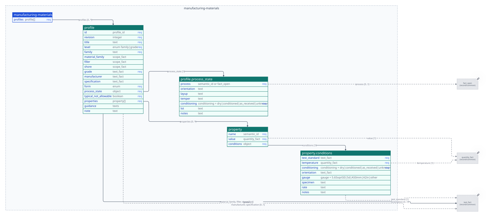

# `record/manufacturing-materials`

Generated by tools/gen (`just contracts`). Do not edit. Contract reference: [`record/manufacturing-materials`](../../record/manufacturing-materials.md). Source: [`contracts/record/manufacturing-materials.tsp`](../../../../../contracts/record/manufacturing-materials.tsp).

Material identity and properties with their conditions. A family profile (PLA+, nylon, PETG, aluminium) is guidance, never a grade specification; a grade profile names the manufacturer's grade. Printed, moulded, bulk, cast and wrought properties are different profiles; every property states its test standard, temperature, conditioning and, for printed forms, orientation. A typical_not_allowable profile holds only typical or estimated values, never design allowables. Density is never strength. Property names and their dimensions are manufacturing_intent.MATERIAL_PROPERTIES

## Diagrams

5 types in 1 diagrams.

### 1. `manufacturing-materials`

Relationships in diagram 1:

| Source | Relation | Target | Cardinality |
|---|---|---|---|
| profile | composition via `material_family` | text_fact (record/common) | 0..1 |
| profile | composition via `filler` | text_fact (record/common) | 0..1 |
| profile | composition via `shore` | text_fact (record/common) | 0..1 |
| profile | association via `grade` | text_fact (record/common) | 1 |
| profile | association via `manufacturer` | text_fact (record/common) | 0..1 |
| profile | association via `specification` | text_fact (record/common) | 0..1 |
| profile.process_state | association via `process` | fact_open (record/common) | 0..1 |
| profile | composition via `process_state` | profile.process_state | 1 |
| property | association via `value` | quantity_fact (record/common) | 1 |
| property.conditions | association via `test_standard` | text_fact (record/common) | 1 |
| property.conditions | association via `temperature` | quantity_fact (record/common) | 1 |
| property.conditions | association via `orientation` | text_fact (record/common) | 0..1 |
| property | composition via `conditions` | property.conditions | 1 |
| profile | composition via `properties` | property | 0..* |
| manufacturing-materials | composition via `profiles` | profile | 0..* |

Types of other contracts, drawn as stubs: [`record/common`](common.md).

## Types

### `manufacturing-materials`

| Field | Type | Required | Description |
|---|---|---|---|
| `profiles` | `profile[]` | yes |  |

### `profile`

| Field | Type | Required | Description |
|---|---|---|---|
| `id` | `profile_id` | yes |  |
| `revision` | `integer` | yes |  |
| `title` | `text` | yes |  |
| `level` | `enum family\|grade` | yes |  |
| `family` | `text` | yes |  |
| `material_family` | `scope_fact` | no | the structured family a guideline scope matches on, such as pla, petg, pa or tpu; unknown when not stated. It has no default |
| `filler` | `scope_fact` | no | the fill a guideline scope matches on, such as cf or gf; not applicable for an unfilled material. It has no default |
| `shore` | `scope_fact` | no | the Shore hardness a guideline scope matches on, such as 95A or 85A. It has no default |
| `grade` | `text_fact` | yes |  |
| `manufacturer` | `text_fact` | no |  |
| `specification` | `text_fact` | no | the standard or datasheet designation the grade conforms to |
| `form` | `enum` | yes |  |
| `process_state` | `object` | yes |  |
| `typical_not_allowable` | `boolean` | yes |  |
| `properties` | `property[]` | yes |  |
| `guidance` | `texts` | no | family guidance and cautions, such as fibre fill wear on nozzles and mating surfaces; never a grade allowable |
| `note` | `text` | no |  |

### `profile.process_state`

| Field | Type | Required | Description |
|---|---|---|---|
| `process` | `semantic_id or fact_open` | yes | the route kind that made the tested material, or unknown |
| `orientation` | `text` | no |  |
| `layup` | `text` | no |  |
| `temper` | `text` | no |  |
| `conditioning` | `conditioning = dry\|conditioned\|as_received\|unknown` | yes |  |
| `lot` | `text` | no |  |
| `notes` | `text` | no |  |

### `property`

| Field | Type | Required | Description |
|---|---|---|---|
| `name` | `semantic_id` | yes |  |
| `value` | `quantity_fact` | yes |  |
| `conditions` | `object` | yes |  |

### `property.conditions`

| Field | Type | Required | Description |
|---|---|---|---|
| `test_standard` | `text_fact` | yes |  |
| `temperature` | `quantity_fact` | yes |  |
| `conditioning` | `conditioning = dry\|conditioned\|as_received\|unknown` | yes |  |
| `orientation` | `text_fact` | no | the print or grain orientation of the specimen |
| `gauge` | `gauge = 5.65sqrtS0\|5d\|A50mm\|A2in\|other` | no | allowed on elongation_at_break only; optional |
| `specimen` | `text` | no |  |
| `rate` | `text` | no |  |
| `notes` | `text` | no |  |

## Enums

Named enum definitions, and the enums of fields that have more than 6 values, which the field's type does not spell out. Enums have no colour in the diagrams.

| Enum | Values | Description |
|---|---|---|
| `conditioning` | `dry`, `conditioned`, `as_received`, `unknown` | dry as moulded or dried, moisture-conditioned, as received, or not stated |
| `gauge` | `5.65sqrtS0`, `5d`, `A50mm`, `A2in`, `other` | The gauge length the elongation after fracture was measured on. Elongations on different gauges are not comparable: ASME uses k=5, EN uses 5.65*sqrt(S0), ASTM E8 uses 50 mm or 2 in. A missing gauge means the value cannot be compared with a ductility threshold, so a gate treats the material as not shown ductile (unknown). The thresholds are percentages and the value is a ratio, so 14% is 0.14. EN 13445-2:2014 4.1.4 requires at least 14% on 5.65*sqrt(S0) for steels, and EN 1993-1-1 3.2.2 recommends at least 15% with fu/fy of at least 1.10; both clause numbers are from secondary sources and are not checked against the standards |
| `profile.form` | `printed`, `bulk`, `wrought`, `cast`, `moulded`, `sheet`, `rod`, `film`, `purchased`, `unknown` |  |
