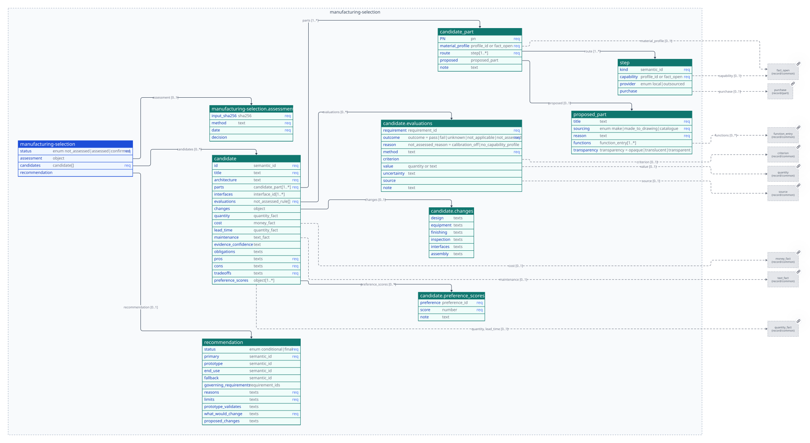

# `record/manufacturing-selection`

Generated by tools/gen (`just contracts`). Do not edit. Contract reference: [`record/manufacturing-selection`](../../record/manufacturing-selection.md). Source: [`contracts/record/manufacturing-selection.tsp`](../../../../../contracts/record/manufacturing-selection.tsp).

Whole candidate routes compared together: architecture, per-part material profile and complete route with capabilities, an evaluation of every mandatory requirement, the changes each introduces, cost and lead time at quantity, maintenance, evidence confidence, pros, cons and tradeoffs. A mandatory fail eliminates a candidate and an unknown keeps it conditional; preferences rank only feasible candidates. A final recommendation needs the confirming decision; the selection never writes product records

## Diagrams

10 types in 1 diagrams.

### 1. `manufacturing-selection`

Types of other contracts, drawn as stubs: [`record/common`](common.md), [`record/part`](part.md).

## Types

### `manufacturing-selection`

| Field | Type | Required | Description |
|---|---|---|---|
| `status` | `enum not_assessed\|assessed\|confirmed` | yes |  |
| `assessment` | `object` | no |  |
| `candidates` | `candidate[]` | yes |  |
| `recommendation` | `recommendation` | no |  |

### `manufacturing-selection.assessment`

| Field | Type | Required | Description |
|---|---|---|---|
| `input_sha256` | `sha256` | yes | The selection input digest of the record inputs the assessment read (its DIGEST_SCOPE); a different current digest makes the assessment stale |
| `method` | `text` | yes |  |
| `date` | `date` | yes |  |
| `decision` | `decision` | no |  |

### `candidate`

| Field | Type | Required | Description |
|---|---|---|---|
| `id` | `semantic_id` | yes |  |
| `title` | `text` | yes |  |
| `architecture` | `text` | yes |  |
| `parts` | `candidate_part[1..*]` | yes |  |
| `interfaces` | `interface_id[1..*]` | no |  |
| `evaluations` | `not_assessed_rule[]` | yes |  |
| `changes` | `object` | no |  |
| `quantity` | `quantity_fact` | no | the quantity cost and lead time are stated at |
| `cost` | `money_fact` | no |  |
| `lead_time` | `quantity_fact` | no |  |
| `maintenance` | `text_fact` | no |  |
| `evidence_confidence` | `text` | no |  |
| `obligations` | `texts` | no | validation still outstanding |
| `pros` | `texts` | yes |  |
| `cons` | `texts` | yes |  |
| `tradeoffs` | `texts` | yes |  |
| `preference_scores` | `object[1..*]` | no |  |

### `candidate_part`

One part of a candidate: a declared part (hw/parts/<PN>/part.yaml) or, with `proposed`, a part the candidate introduces that the record does not hold yet

| Field | Type | Required | Description |
|---|---|---|---|
| `PN` | `pn` | yes |  |
| `material_profile` | `profile_id or fact_open` | yes |  |
| `route` | `step[1..*]` | yes |  |
| `proposed` | `proposed_part` | no |  |
| `note` | `text` | no |  |

### `step`

One route step of a candidate part. A purchased step may carry the purchase criteria of the bought item, so a purchased alternative to a made part can be assessed before any part record holds them

| Field | Type | Required | Description |
|---|---|---|---|
| `kind` | `semantic_id` | yes |  |
| `capability` | `profile_id or fact_open` | yes |  |
| `provider` | `enum local\|outsourced` | no |  |
| `purchase` | `purchase` | no |  |

### `proposed_part`

Marks a candidate part as proposed: a new purchased or made part the candidate's architecture introduces. Its PN must not be declared under hw/parts; it is never an existing record, gets no check obligations, and becomes a part only when the approved change creates its part.yaml. A catalogue proposal is bought (its route is the purchase, whose criteria identify the item); a made or made-to-drawing proposal lists the operations that make it

| Field | Type | Required | Description |
|---|---|---|---|
| `title` | `text` | yes |  |
| `sourcing` | `enum make\|made_to_drawing\|catalogue` | yes | make, made_to_drawing (bought to this drawing) or catalogue (bought as listed) |
| `reason` | `text` | yes | why the candidate needs the new part |
| `functions` | `function_entry[1..*]` | no | what the new part does, so function-driven constraints (optical, structural) apply to it |
| `transparency` | `transparency = opaque\|translucent\|transparent` | no |  |

### `candidate.evaluations`

| Field | Type | Required | Description |
|---|---|---|---|
| `requirement` | `requirement_id` | yes |  |
| `outcome` | `outcome = pass\|fail\|unknown\|not_applicable\|not_assessed` | yes |  |
| `reason` | `not_assessed_reason = calibration_off\|no_capability_profile` | no |  |
| `method` | `text` | yes |  |
| `criterion` | `criterion` | no |  |
| `value` | `quantity or text` | no |  |
| `uncertainty` | `text` | no |  |
| `source` | `source` | no |  |
| `note` | `text` | no |  |

### `candidate.changes`

| Field | Type | Required | Description |
|---|---|---|---|
| `design` | `texts` | no |  |
| `equipment` | `texts` | no |  |
| `finishing` | `texts` | no |  |
| `inspection` | `texts` | no |  |
| `interfaces` | `texts` | no |  |
| `assembly` | `texts` | no |  |

### `candidate.preference_scores`

| Field | Type | Required | Description |
|---|---|---|---|
| `preference` | `preference_id` | yes |  |
| `score` | `number` | yes |  |
| `note` | `text` | no |  |

### `recommendation`

| Field | Type | Required | Description |
|---|---|---|---|
| `status` | `enum conditional\|final` | yes | conditional while material-to-choice or safety inputs are missing |
| `primary` | `semantic_id` | yes |  |
| `prototype` | `semantic_id` | no |  |
| `end_use` | `semantic_id` | no |  |
| `fallback` | `semantic_id` | no |  |
| `governing_requirements` | `requirement_ids` | no |  |
| `reasons` | `texts` | yes |  |
| `limits` | `texts` | yes |  |
| `prototype_validates` | `texts` | no | what the prototype route can and cannot validate |
| `what_would_change` | `texts` | yes |  |
| `proposed_changes` | `texts` | no |  |
