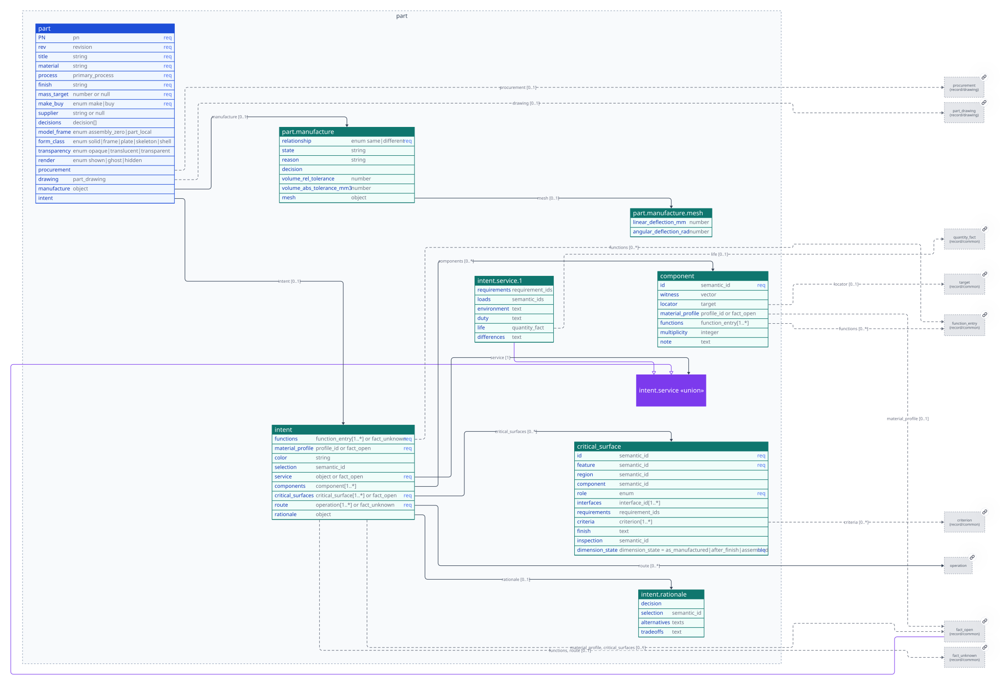
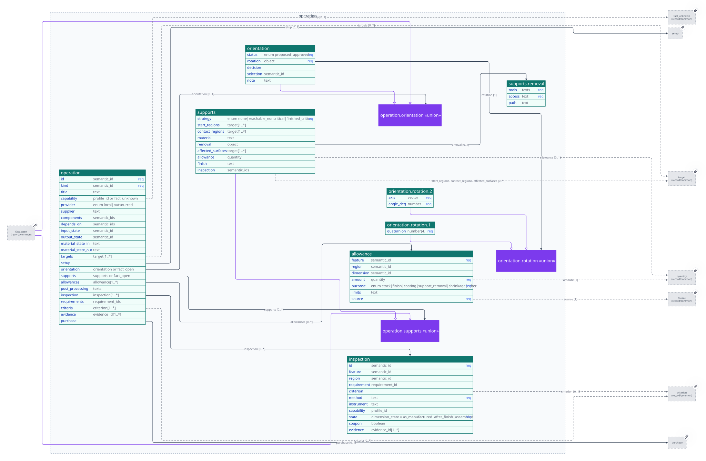
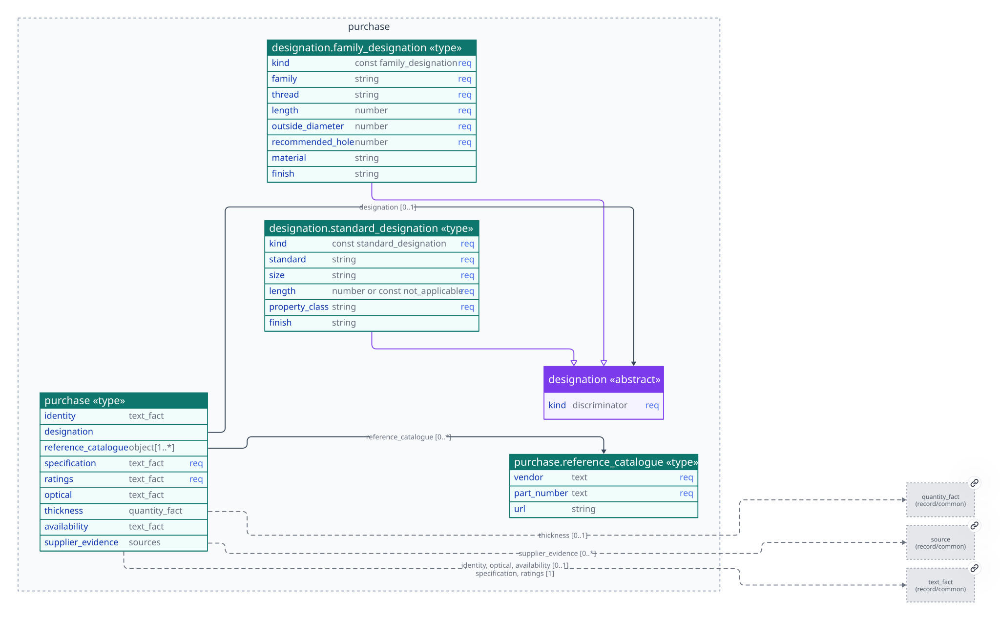
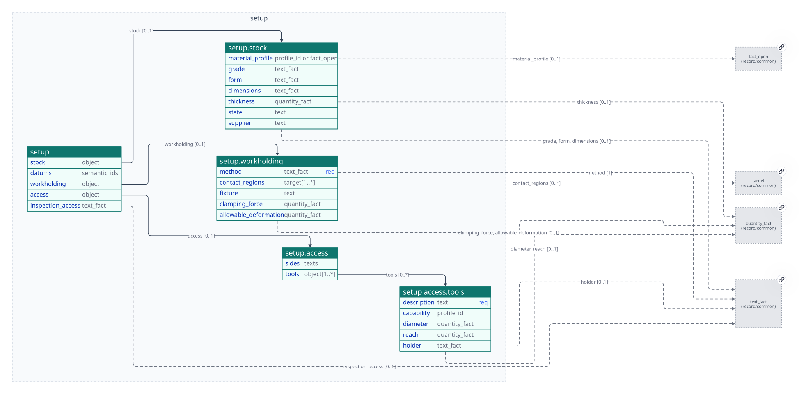

# `record/part`

Generated by tools/gen (`just contracts`). Do not edit. Contract reference: [`record/part`](../../record/part.md). Source: [`contracts/record/part.tsp`](../../../../../contracts/record/part.tsp).

One part's record, hw/parts/\<PN>/part.yaml: identity and revision, material, process and finish, whether it is made or bought, its drawing, how it is manufactured, and its design intent.

## Diagrams

30 types in 4 diagrams.

### 1. `part`

Relationships in diagram 1:

| Source | Relation | Target | Cardinality |
|---|---|---|---|
| part | association via `procurement` | procurement (record/drawing) | 0..1 |
| part | association via `drawing` | part_drawing (record/drawing) | 0..1 |
| part.manufacture | composition via `mesh` | part.manufacture.mesh | 0..1 |
| part | composition via `manufacture` | part.manufacture | 0..1 |
| intent | association via `functions` | function_entry (record/common) | 0..* |
| intent | association via `functions` | fact_unknown (record/common) | 0..1 |
| intent | association via `material_profile` | fact_open (record/common) | 0..1 |
| intent.service.1 | association via `life` | quantity_fact (record/common) | 0..1 |
| intent.service | inheritance (the source is the parent) | intent.service.1 | — |
| intent.service | inheritance (the source is the parent) | fact_open (record/common) | — |
| intent | composition via `service` | intent.service | 1 |
| component | association via `locator` | target (record/common) | 0..1 |
| component | association via `material_profile` | fact_open (record/common) | 0..1 |
| component | association via `functions` | function_entry (record/common) | 0..* |
| intent | composition via `components` | component | 0..* |
| critical_surface | association via `criteria` | criterion (record/common) | 0..* |
| intent | composition via `critical_surfaces` | critical_surface | 0..* |
| intent | association via `critical_surfaces` | fact_open (record/common) | 0..1 |
| intent | composition via `route` | operation | 0..* |
| intent | association via `route` | fact_unknown (record/common) | 0..1 |
| intent | composition via `rationale` | intent.rationale | 0..1 |
| part | composition via `intent` | intent | 0..1 |

### 2. `operation`

Relationships in diagram 2:

| Source | Relation | Target | Cardinality |
|---|---|---|---|
| operation | association via `capability` | fact_unknown (record/common) | 0..1 |
| operation | association via `targets` | target (record/common) | 0..* |
| operation | composition via `setup` | setup | 0..1 |
| orientation.rotation | inheritance (the source is the parent) | orientation.rotation.1 | — |
| orientation.rotation | inheritance (the source is the parent) | orientation.rotation.2 | — |
| orientation | composition via `rotation` | orientation.rotation | 1 |
| operation.orientation | inheritance (the source is the parent) | orientation | — |
| operation.orientation | inheritance (the source is the parent) | fact_open (record/common) | — |
| operation | composition via `orientation` | operation.orientation | 0..1 |
| supports | association via `start_regions` | target (record/common) | 0..* |
| supports | association via `contact_regions` | target (record/common) | 0..* |
| supports | composition via `removal` | supports.removal | 0..1 |
| supports | association via `affected_surfaces` | target (record/common) | 0..* |
| supports | association via `allowance` | quantity (record/common) | 0..1 |
| operation.supports | inheritance (the source is the parent) | supports | — |
| operation.supports | inheritance (the source is the parent) | fact_open (record/common) | — |
| operation | composition via `supports` | operation.supports | 0..1 |
| allowance | association via `amount` | quantity (record/common) | 1 |
| allowance | association via `source` | source (record/common) | 1 |
| operation | composition via `allowances` | allowance | 0..* |
| inspection | association via `criterion` | criterion (record/common) | 0..1 |
| operation | composition via `inspection` | inspection | 0..* |
| operation | association via `criteria` | criterion (record/common) | 0..* |
| operation | composition via `purchase` | purchase | 0..1 |

### 3. `purchase`

Relationships in diagram 3:

| Source | Relation | Target | Cardinality |
|---|---|---|---|
| purchase | association via `identity` | text_fact (record/common) | 0..1 |
| designation | inheritance (the source is the parent) | designation.standard_designation | — |
| designation | inheritance (the source is the parent) | designation.family_designation | — |
| purchase | composition via `designation` | designation | 0..1 |
| purchase | composition via `reference_catalogue` | purchase.reference_catalogue | 0..* |
| purchase | association via `specification` | text_fact (record/common) | 1 |
| purchase | association via `ratings` | text_fact (record/common) | 1 |
| purchase | association via `optical` | text_fact (record/common) | 0..1 |
| purchase | association via `thickness` | quantity_fact (record/common) | 0..1 |
| purchase | association via `availability` | text_fact (record/common) | 0..1 |
| purchase | association via `supplier_evidence` | source (record/common) | 0..* |

### 4. `setup`

Relationships in diagram 4:

| Source | Relation | Target | Cardinality |
|---|---|---|---|
| setup.stock | association via `material_profile` | fact_open (record/common) | 0..1 |
| setup.stock | association via `grade` | text_fact (record/common) | 0..1 |
| setup.stock | association via `form` | text_fact (record/common) | 0..1 |
| setup.stock | association via `dimensions` | text_fact (record/common) | 0..1 |
| setup.stock | association via `thickness` | quantity_fact (record/common) | 0..1 |
| setup | composition via `stock` | setup.stock | 0..1 |
| setup.workholding | association via `method` | text_fact (record/common) | 1 |
| setup.workholding | association via `contact_regions` | target (record/common) | 0..* |
| setup.workholding | association via `clamping_force` | quantity_fact (record/common) | 0..1 |
| setup.workholding | association via `allowable_deformation` | quantity_fact (record/common) | 0..1 |
| setup | composition via `workholding` | setup.workholding | 0..1 |
| setup.access.tools | association via `diameter` | quantity_fact (record/common) | 0..1 |
| setup.access.tools | association via `reach` | quantity_fact (record/common) | 0..1 |
| setup.access.tools | association via `holder` | text_fact (record/common) | 0..1 |
| setup.access | composition via `tools` | setup.access.tools | 0..* |
| setup | composition via `access` | setup.access | 0..1 |
| setup | association via `inspection_access` | text_fact (record/common) | 0..1 |

Types of other contracts, drawn as stubs: [`record/common`](common.md), [`record/drawing`](drawing.md).

## Types

### `part`

In diagram 1.

| Field | Type | Required | Description |
|---|---|---|---|
| `PN` | `pn` | yes |  |
| `rev` | `revision` | yes |  |
| `title` | `string` | yes |  |
| `material` | `string` | yes | A declaration of the part's material, kept for BOM and drawings; it is not a sourced grade or property. intent.material_profile names the qualified profile |
| `process` | `primary_process` | yes | The scalar label of the primary process; intent.route is the authority for the operations |
| `finish` | `string` | yes |  |
| `mass_target` | `number or null` | yes | grams |
| `make_buy` | `enum make\|buy` | yes |  |
| `supplier` | `string or null` | no |  |
| `decisions` | `decision[]` | no |  |
| `model_frame` | `enum assembly_zero\|part_local` | no | Frame of model.py's geometry: assembly_zero (default) is assembly coordinates at the zero joint pose, one identity-placed occurrence only; part_local is the definition's own origin and axes, placed by each occurrence |
| `form_class` | `enum solid\|frame\|plate\|skeleton\|shell` | no | The part's form type for the form check; absent means solid, and only a solid part is judged block_like |
| `transparency` | `enum opaque\|translucent\|transparent` | no | How much light the part passes; absent means opaque. Only a transparent part is see-through to the visibility check. An optical requirement is a hard selection constraint met by a purchased transparent part or identified transparent stock on a suitable route, never by an opaque process |
| `render` | `enum shown\|ghost\|hidden` | no | How a render or a motion render draws the part by default; absent means shown. ghost draws it translucent with visible edges and never as an occluder, hidden leaves it out of the picture. A reference body that blocks the view is ghost or hidden. A render's own show, ghost and hide choices override it. A visibility target cannot be hidden |
| `procurement` | `procurement` | no |  |
| `drawing` | `part_drawing` | no |  |
| `manufacture` | `object` | no | How a custom-made part is manufactured relative to its installed definition. Absent: relationship same, compared to 1e-9 relative volume, default mesh. |
| `intent` | `intent` | no |  |

### `part.manufacture`

In diagram 1.

| Field | Type | Required | Description |
|---|---|---|---|
| `relationship` | `enum same\|different` | yes | same: made in its installed shape; different: model.py build_manufacture(params) defines the manufacturing state |
| `state` | `string` | no | name of the manufacturing state, such as flat |
| `reason` | `string` | no | why the states differ, such as elastic_bending |
| `decision` | `decision` | no | the decision record approving the difference |
| `volume_rel_tolerance` | `number` | no | allowed \|V_manufactured - V_installed\| / V_installed |
| `volume_abs_tolerance_mm3` | `number` | no | absolute floor of the allowed volume difference |
| `mesh` | `object` | no | FDM part.stl tessellation, overriding the layout default (0.05 mm, 0.1 rad) |

### `part.manufacture.mesh`

In diagram 1.

| Field | Type | Required | Description |
|---|---|---|---|
| `linear_deflection_mm` | `number` | no |  |
| `angular_deflection_rad` | `number` | no |  |

### `intent`

In diagram 1.

Record version 2 manufacturing intent: what the part does, the qualified material profile, the service it sees, its critical surfaces and its complete ordered route. make_buy and procurement.mode stay the sourcing authority; manufacture stays the manufacturing-state authority. A sole solid is the implicit main component; a part with several solids lists components

| Field | Type | Required | Description |
|---|---|---|---|
| `functions` | `function_entry[1..*] or fact_unknown` | yes |  |
| `material_profile` | `profile_id or fact_open` | yes | a profile id in manufacturing/materials.yaml |
| `color` | `string` | no | The part's print colour as an sRGB hex string #RRGGBB (for example #FF8000 for orange). 3MF export uses it as the part's display colour |
| `selection` | `semantic_id` | no | the selection.yaml candidate this intent implements |
| `service` | `object or fact_open` | yes |  |
| `components` | `component[1..*]` | no |  |
| `critical_surfaces` | `critical_surface[1..*] or fact_open` | yes |  |
| `route` | `operation[1..*] or fact_unknown` | yes |  |
| `rationale` | `object` | no |  |

### `intent.service` «union»

In diagram 1.

No fields of its own.

### `intent.service.1`

In diagram 1.

| Field | Type | Required | Description |
|---|---|---|---|
| `requirements` | `requirement_ids` | no |  |
| `loads` | `semantic_ids` | no | product.yaml use_case.loads ids |
| `environment` | `text` | no |  |
| `duty` | `text` | no |  |
| `life` | `quantity_fact` | no |  |
| `differences` | `text` | no | where this part's service differs from the product use case |

### `component`

In diagram 1.

One disconnected solid of the part, bound by an interior witness point in the native manufacturing frame (mm) or a semantic locator; every solid binds exactly once. Equivalent members list their multiplicity

| Field | Type | Required | Description |
|---|---|---|---|
| `id` | `semantic_id` | yes |  |
| `witness` | `vector` | no |  |
| `locator` | `target` | no |  |
| `material_profile` | `profile_id or fact_open` | no |  |
| `functions` | `function_entry[1..*]` | no |  |
| `multiplicity` | `integer` | no |  |
| `note` | `text` | no |  |

### `critical_surface`

In diagram 1.

| Field | Type | Required | Description |
|---|---|---|---|
| `id` | `semantic_id` | yes |  |
| `feature` | `semantic_id` | yes |  |
| `region` | `semantic_id` | no |  |
| `component` | `semantic_id` | no |  |
| `role` | `enum` | yes |  |
| `interfaces` | `interface_id[1..*]` | no |  |
| `requirements` | `requirement_ids` | no |  |
| `criteria` | `criterion[1..*]` | no |  |
| `finish` | `text` | no |  |
| `inspection` | `semantic_id` | no | the route inspection id that verifies it |
| `dimension_state` | `dimension_state = as_manufactured\|after_finish\|assembled` | yes |  |

### `intent.rationale`

In diagram 1.

| Field | Type | Required | Description |
|---|---|---|---|
| `decision` | `decision` | no |  |
| `selection` | `semantic_id` | no |  |
| `alternatives` | `texts` | no |  |
| `tradeoffs` | `text` | no |  |

### `operation`

In diagram 2.

One route operation, in route order: the previous operation is its predecessor unless depends_on names the true dependencies. A made operation names its capability profile or why it is unknown; a purchase names its identity or designation, specification and ratings

| Field | Type | Required | Description |
|---|---|---|---|
| `id` | `semantic_id` | yes |  |
| `kind` | `semantic_id` | yes |  |
| `title` | `text` | no |  |
| `capability` | `profile_id or fact_unknown` | no |  |
| `provider` | `enum local\|outsourced` | no |  |
| `supplier` | `text` | no |  |
| `components` | `semantic_ids` | no |  |
| `depends_on` | `semantic_ids` | no |  |
| `input_state` | `semantic_id` | no | stock, or the output_state of an earlier operation |
| `output_state` | `semantic_id` | no | installed, part.yaml manufacture.state, or an intermediate state |
| `material_state_in` | `text` | no |  |
| `material_state_out` | `text` | no |  |
| `targets` | `target[1..*]` | no |  |
| `setup` | `setup` | no |  |
| `orientation` | `orientation or fact_open` | no |  |
| `supports` | `supports or fact_open` | no |  |
| `allowances` | `allowance[1..*]` | no |  |
| `post_processing` | `texts` | no |  |
| `inspection` | `inspection[1..*]` | no |  |
| `requirements` | `requirement_ids` | no |  |
| `criteria` | `criterion[1..*]` | no |  |
| `evidence` | `evidence_id[1..*]` | no |  |
| `purchase` | `purchase` | no |  |

### `operation.orientation` «union»

In diagram 2.

No fields of its own.

### `orientation`

In diagram 2.

The fixed manufacturing orientation in the native manufacture frame: a proper rotation, as a unit quaternion [w, x, y, z] or an axis and angle. An approved orientation names its decision; an envelope auto-fit is never approved

| Field | Type | Required | Description |
|---|---|---|---|
| `status` | `enum proposed\|approved` | yes |  |
| `rotation` | `object` | yes |  |
| `decision` | `decision` | no |  |
| `selection` | `semantic_id` | no |  |
| `note` | `text` | no |  |

### `orientation.rotation` «union»

In diagram 2.

No fields of its own.

### `orientation.rotation.1`

In diagram 2.

| Field | Type | Required | Description |
|---|---|---|---|
| `quaternion` | `number[4]` | yes |  |

### `orientation.rotation.2`

In diagram 2.

| Field | Type | Required | Description |
|---|---|---|---|
| `axis` | `vector` | yes |  |
| `angle_deg` | `number` | yes |  |

### `operation.supports` «union»

In diagram 2.

No fields of its own.

### `supports`

In diagram 2.

Where supports start, touch and come off. reachable_noncritical keeps them on reachable non-critical surfaces; finished_critical names the finishing, allowance and inspection that restore a critical surface. Absent supports are unknown, never none

| Field | Type | Required | Description |
|---|---|---|---|
| `strategy` | `enum none\|reachable_noncritical\|finished_critical` | yes |  |
| `start_regions` | `target[1..*]` | no |  |
| `contact_regions` | `target[1..*]` | no |  |
| `material` | `text` | no |  |
| `removal` | `object` | no |  |
| `affected_surfaces` | `target[1..*]` | no |  |
| `allowance` | `quantity` | no |  |
| `finish` | `text` | no |  |
| `inspection` | `semantic_ids` | no |  |

### `supports.removal`

In diagram 2.

| Field | Type | Required | Description |
|---|---|---|---|
| `tools` | `texts` | yes |  |
| `access` | `text` | yes |  |
| `path` | `text` | no |  |

### `allowance`

In diagram 2.

| Field | Type | Required | Description |
|---|---|---|---|
| `feature` | `semantic_id` | yes |  |
| `region` | `semantic_id` | no |  |
| `dimension` | `semantic_id` | no |  |
| `amount` | `quantity` | yes |  |
| `purpose` | `enum stock\|finish\|coating\|support_removal\|shrinkage\|other` | yes |  |
| `limits` | `text` | no |  |
| `source` | `source` | yes |  |

### `inspection`

In diagram 2.

| Field | Type | Required | Description |
|---|---|---|---|
| `id` | `semantic_id` | yes |  |
| `feature` | `semantic_id` | no |  |
| `region` | `semantic_id` | no |  |
| `requirement` | `requirement_id` | no |  |
| `criterion` | `criterion` | no |  |
| `method` | `text` | yes |  |
| `instrument` | `text` | no |  |
| `capability` | `profile_id` | no |  |
| `state` | `dimension_state = as_manufactured\|after_finish\|assembled` | yes |  |
| `coupon` | `boolean` | no | true when a representative coupon or test piece is the inspected item |
| `evidence` | `evidence_id[1..*]` | no |  |

### `purchase`

In diagram 3.

Traceable purchase criteria: the identity, specification and ratings that make a bought item the right one, never an unidentified description. A commodity item names a designation instead of, or beside, an identity

| Field | Type | Required | Description |
|---|---|---|---|
| `identity` | `text_fact` | no | manufacturer and part number (kind manufacturer_pn), or a free-text identification |
| `designation` | `designation` | no |  |
| `reference_catalogue` | `object[1..*]` | no | Non-binding example listings of a commodity item (vendor, part number, URL). They show where the item can be found and never restrict the supplier |
| `specification` | `text_fact` | yes | material grade, standard or datasheet the item conforms to |
| `ratings` | `text_fact` | yes | load, speed, temperature or other ratings |
| `optical` | `text_fact` | no | optical grade and transmission, for a transparent item |
| `thickness` | `quantity_fact` | no |  |
| `availability` | `text_fact` | no | a named supplier, or `commodity` (any supplier) for a standard or family designation |
| `supplier_evidence` | `sources` | no |  |

### `designation` «abstract»

In diagram 3.

A commodity item identified by standard or family instead of a vendor part number. standard_designation names the standard (ISO 4762, ISO 7380, ISO 4032, ISO 7089, ISO 8734 ...), size, length, property class or material and finish; family_designation covers items no ISO standard defines, such as a heat-set insert (thread, length, outside diameter, recommended hole)

| Field | Type | Required | Description |
|---|---|---|---|
| `kind` | `discriminator` | yes |  |

### `designation.standard_designation`

In diagram 3.

A part standard and its designation items: size; length in mm, or not_applicable for an item without a length (a nut, a washer); property_class, the strength class or material (8.8, A2-70, 300 HV); and an optional finish

| Field | Type | Required | Description |
|---|---|---|---|
| `kind` | `const standard_designation` | yes |  |
| `standard` | `string` | yes |  |
| `size` | `string` | yes |  |
| `length` | `number or const not_applicable` | yes |  |
| `property_class` | `string` | yes |  |
| `finish` | `string` | no |  |

### `designation.family_designation`

In diagram 3.

A commodity family no ISO standard defines, such as heat_set_insert: its thread, and its length, outside diameter and recommended hole in mm

| Field | Type | Required | Description |
|---|---|---|---|
| `kind` | `const family_designation` | yes |  |
| `family` | `string` | yes |  |
| `thread` | `string` | yes |  |
| `length` | `number` | yes |  |
| `outside_diameter` | `number` | yes |  |
| `recommended_hole` | `number` | yes |  |
| `material` | `string` | no |  |
| `finish` | `string` | no |  |

### `purchase.reference_catalogue`

In diagram 3.

| Field | Type | Required | Description |
|---|---|---|---|
| `vendor` | `text` | yes |  |
| `part_number` | `text` | yes |  |
| `url` | `string` | no |  |

### `setup`

In diagram 4.

Stock, datums, workholding and access of one operation. Nothing here is guessed from a bounding box

| Field | Type | Required | Description |
|---|---|---|---|
| `stock` | `object` | no |  |
| `datums` | `semantic_ids` | no |  |
| `workholding` | `object` | no |  |
| `access` | `object` | no |  |
| `inspection_access` | `text_fact` | no |  |

### `setup.stock`

In diagram 4.

| Field | Type | Required | Description |
|---|---|---|---|
| `material_profile` | `profile_id or fact_open` | no |  |
| `grade` | `text_fact` | no |  |
| `form` | `text_fact` | no |  |
| `dimensions` | `text_fact` | no |  |
| `thickness` | `quantity_fact` | no |  |
| `state` | `text` | no |  |
| `supplier` | `text` | no |  |

### `setup.workholding`

In diagram 4.

| Field | Type | Required | Description |
|---|---|---|---|
| `method` | `text_fact` | yes |  |
| `contact_regions` | `target[1..*]` | no |  |
| `fixture` | `text` | no |  |
| `clamping_force` | `quantity_fact` | no |  |
| `allowable_deformation` | `quantity_fact` | no |  |

### `setup.access`

In diagram 4.

| Field | Type | Required | Description |
|---|---|---|---|
| `sides` | `texts` | no |  |
| `tools` | `object[1..*]` | no |  |

### `setup.access.tools`

In diagram 4.

| Field | Type | Required | Description |
|---|---|---|---|
| `description` | `text` | yes |  |
| `capability` | `profile_id` | no |  |
| `diameter` | `quantity_fact` | no |  |
| `reach` | `quantity_fact` | no |  |
| `holder` | `text_fact` | no |  |

## Enums

Named enum definitions, and the enums of fields that have more than 6 values, which the field's type does not spell out. Enums have no colour in the diagrams.

| Enum | Values | Description |
|---|---|---|
| `critical_surface.role` | `datum`, `bore`, `seat`, `journal`, `running`, `sliding`, `flank`, `cam`, `seal`, `fastener`, `locating`, `optical`, `other` |  |
