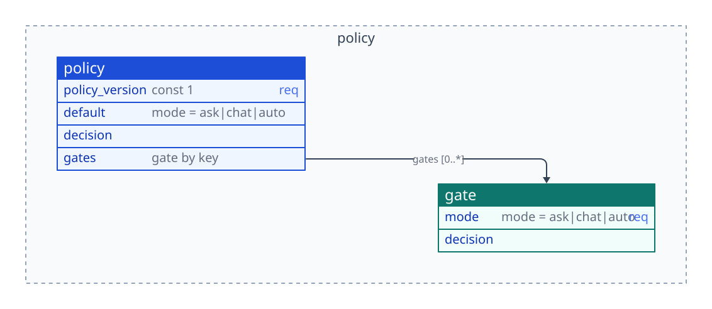

# `record/policy`

Generated by tools/gen (`just contracts`). Do not edit. Contract reference: [`record/policy`](../../record/policy.md). Source: [`contracts/record/policy.tsp`](../../../../../contracts/record/policy.tsp).

How each flow gate asks for approval (ADR-0003): ask (the default) asks the user through the richest interaction the client offers, chat asks in the conversation, auto approves without a human (for development and tests). Gates guide the process; they are not a security control. Every relaxation from ask cites the decision that records it. rigor is the rigor policy: regulated adds the requirements of flow.yaml's rigor rules. An absent file means every gate asks and the rigor is standard

## Diagrams

2 types in 1 diagrams.

### 1. `policy`

## Types

### `policy`

| Field | Type | Required | Description |
|---|---|---|---|
| `policy_version` | `const 1` | yes |  |
| `default` | `mode = ask\|chat\|auto` | no | The mode of every gate without its own entry |
| `decision` | `decision` | no | The decision that records a default other than ask |
| `gates` | `gate by key` | no | Per-gate modes, keyed by the gate id flow.yaml declares |
| `rigor` | `enum standard\|regulated` | no | The rigor policy. An absent rigor is standard |

### `gate`

| Field | Type | Required | Description |
|---|---|---|---|
| `mode` | `mode = ask\|chat\|auto` | yes |  |
| `decision` | `decision` | no |  |

## Enums

Named enum definitions, and the enums of fields that have more than 6 values, which the field's type does not spell out. Enums have no colour in the diagrams.

| Enum | Values | Description |
|---|---|---|
| `mode` | `ask`, `chat`, `auto` |  |
