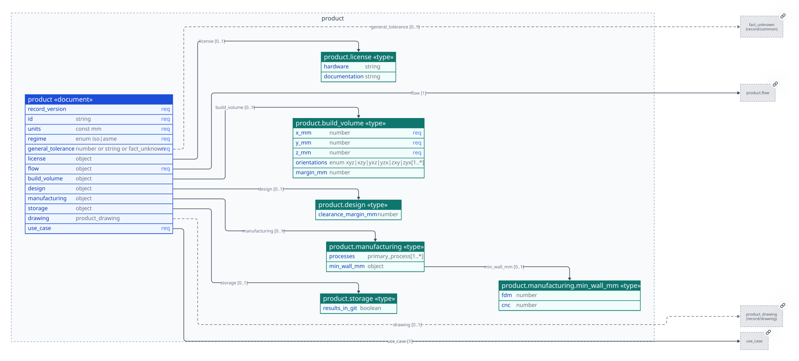
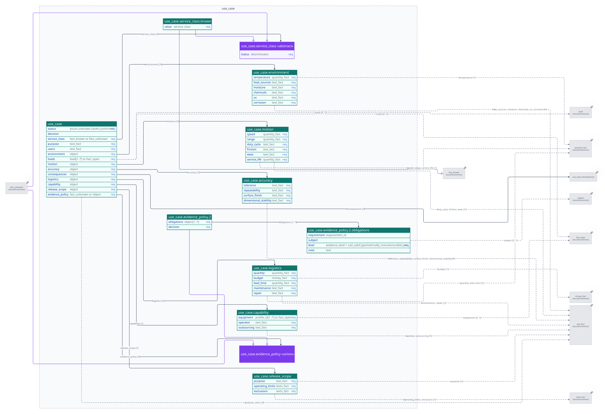
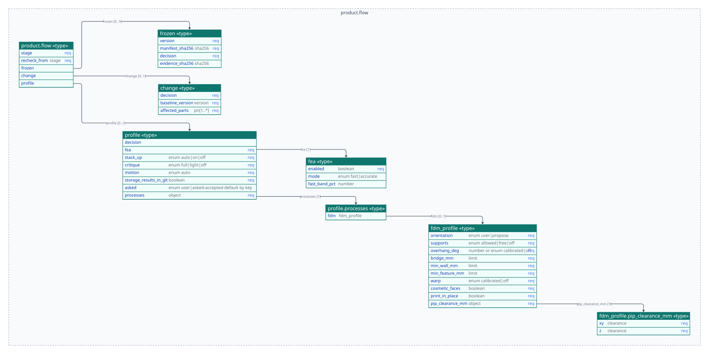
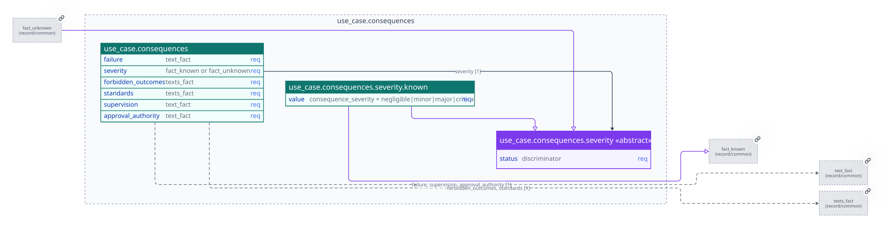

# `record/product`

Generated by tools/gen (`just contracts`). Do not edit. Contract reference: [`record/product`](../../record/product.md). Source: [`contracts/record/product.tsp`](../../../../../contracts/record/product.tsp).

The product record, hw/product.yaml: the product's identity, units, regime and general tolerance, its use case, the flow settings, and its design, manufacturing, storage and drawing defaults.

## Diagrams

30 types in 4 diagrams.

### 1. `product`

Relationships in diagram 1:

| Source | Relation | Target | Cardinality |
|---|---|---|---|
| product | association via `general_tolerance` | fact_unknown (record/common) | 0..1 |
| product | composition via `license` | product.license | 0..1 |
| product | composition via `flow` | product.flow | 1 |
| product | composition via `build_volume` | product.build_volume | 0..1 |
| product | composition via `design` | product.design | 0..1 |
| product.manufacturing | composition via `min_wall_mm` | product.manufacturing.min_wall_mm | 0..1 |
| product | composition via `manufacturing` | product.manufacturing | 0..1 |
| product | composition via `storage` | product.storage | 0..1 |
| product | association via `drawing` | product_drawing (record/drawing) | 0..1 |
| product | composition via `use_case` | use_case | 1 |

### 2. `use_case`

Relationships in diagram 2:

| Source | Relation | Target | Cardinality |
|---|---|---|---|
| fact_known (record/common) | inheritance (the source is the parent) | use_case.service_class.known | — |
| use_case.service_class | inheritance (the source is the parent) | use_case.service_class.known | — |
| use_case.service_class | inheritance (the source is the parent) | fact_unknown (record/common) | — |
| use_case | composition via `service_class` | use_case.service_class | 1 |
| use_case | association via `purpose` | text_fact (record/common) | 1 |
| use_case | association via `users` | text_fact (record/common) | 1 |
| use_case.environment | association via `temperature` | quantity_fact (record/common) | 1 |
| use_case.environment | association via `heat_sources` | text_fact (record/common) | 1 |
| use_case.environment | association via `moisture` | text_fact (record/common) | 1 |
| use_case.environment | association via `chemicals` | text_fact (record/common) | 1 |
| use_case.environment | association via `uv` | text_fact (record/common) | 1 |
| use_case.environment | association via `corrosion` | text_fact (record/common) | 1 |
| use_case | composition via `environment` | use_case.environment | 1 |
| use_case | association via `loads` | load (record/common) | 0..* |
| use_case | association via `loads` | fact_open (record/common) | 0..1 |
| use_case.motion | association via `speed` | quantity_fact (record/common) | 1 |
| use_case.motion | association via `range` | quantity_fact (record/common) | 1 |
| use_case.motion | association via `duty_cycle` | text_fact (record/common) | 1 |
| use_case.motion | association via `friction` | text_fact (record/common) | 1 |
| use_case.motion | association via `wear` | text_fact (record/common) | 1 |
| use_case.motion | association via `service_life` | quantity_fact (record/common) | 1 |
| use_case | composition via `motion` | use_case.motion | 1 |
| use_case.accuracy | association via `tolerance` | text_fact (record/common) | 1 |
| use_case.accuracy | association via `repeatability` | text_fact (record/common) | 1 |
| use_case.accuracy | association via `surface_finish` | text_fact (record/common) | 1 |
| use_case.accuracy | association via `dimensional_stability` | text_fact (record/common) | 1 |
| use_case | composition via `accuracy` | use_case.accuracy | 1 |
| use_case | composition via `consequences` | use_case.consequences | 1 |
| use_case.logistics | association via `quantity` | quantity_fact (record/common) | 1 |
| use_case.logistics | association via `budget` | money_fact (record/common) | 1 |
| use_case.logistics | association via `lead_time` | quantity_fact (record/common) | 1 |
| use_case.logistics | association via `maintenance` | text_fact (record/common) | 1 |
| use_case.logistics | association via `repair` | text_fact (record/common) | 1 |
| use_case | composition via `logistics` | use_case.logistics | 1 |
| use_case.capability | association via `equipment` | fact_open (record/common) | 0..1 |
| use_case.capability | association via `operator` | text_fact (record/common) | 1 |
| use_case.capability | association via `outsourcing` | text_fact (record/common) | 1 |
| use_case | composition via `capability` | use_case.capability | 1 |
| use_case.release_scope | association via `purpose` | text_fact (record/common) | 1 |
| use_case.release_scope | association via `operating_limits` | texts_fact (record/common) | 1 |
| use_case.release_scope | association via `exclusions` | texts_fact (record/common) | 1 |
| use_case | composition via `release_scope` | use_case.release_scope | 1 |
| use_case.evidence_policy | inheritance (the source is the parent) | fact_unknown (record/common) | — |
| use_case.evidence_policy.2.obligations | association via `subject` | subject (record/common) | 0..1 |
| use_case.evidence_policy.2 | composition via `obligations` | use_case.evidence_policy.2.obligations | 1..* |
| use_case.evidence_policy | inheritance (the source is the parent) | use_case.evidence_policy.2 | — |
| use_case | composition via `evidence_policy` | use_case.evidence_policy | 1 |

### 3. `product.flow`

Relationships in diagram 3:

| Source | Relation | Target | Cardinality |
|---|---|---|---|
| product.flow | composition via `frozen` | frozen | 0..1 |
| product.flow | composition via `change` | change | 0..1 |
| profile | composition via `fea` | fea | 1 |
| fdm_profile | composition via `pip_clearance_mm` | fdm_profile.pip_clearance_mm | 1 |
| profile.processes | composition via `fdm` | fdm_profile | 0..1 |
| profile | composition via `processes` | profile.processes | 1 |
| product.flow | composition via `profile` | profile | 0..1 |

### 4. `use_case.consequences`

Relationships in diagram 4:

| Source | Relation | Target | Cardinality |
|---|---|---|---|
| use_case.consequences | association via `failure` | text_fact (record/common) | 1 |
| fact_known (record/common) | inheritance (the source is the parent) | use_case.consequences.severity.known | — |
| use_case.consequences.severity | inheritance (the source is the parent) | use_case.consequences.severity.known | — |
| use_case.consequences.severity | inheritance (the source is the parent) | fact_unknown (record/common) | — |
| use_case.consequences | composition via `severity` | use_case.consequences.severity | 1 |
| use_case.consequences | association via `forbidden_outcomes` | texts_fact (record/common) | 1 |
| use_case.consequences | association via `standards` | texts_fact (record/common) | 1 |
| use_case.consequences | association via `supervision` | text_fact (record/common) | 1 |
| use_case.consequences | association via `approval_authority` | text_fact (record/common) | 1 |

Types of other contracts, drawn as stubs: [`record/common`](common.md), [`record/drawing`](drawing.md).

## Types

### `product`

In diagram 1.

| Field | Type | Required | Description |
|---|---|---|---|
| `record_version` | `record_version` | yes |  |
| `id` | `string` | yes |  |
| `units` | `const mm` | yes |  |
| `regime` | `enum iso\|asme` | yes |  |
| `general_tolerance` | `number or string or fact_unknown` | yes | The general tolerance a drawing states for dimensions without their own: a linear value in mm or a standard label such as ISO 2768-m. A tunable, so it defaults to ISO 2768-m and the user changes it. Unknown, with the open question that would settle it, is also valid; validation refuses a drawing while it is unknown |
| `license` | `object` | no | Explicit SPDX license expressions approved for the product's hardware and documentation, such as CERN-OHL-S-2.0 or (MIT OR Apache-2.0); omitted means not recorded. The expression's shape is meant to be checked (identifiers, LicenseRef-, +, WITH, AND, OR, parentheses) but bundles no SPDX license list, so an unlisted identifier such as CERN-OHL-S passes |
| `flow` | `object` | yes |  |
| `build_volume` | `object` | no | A printer envelope for the legacy build-volume diagnostic. The sizes are facts about the machine, not tunables, so they have no default: they come from the active capability profile's envelope. Margin is a tunable. Fitting it is not printability; a capability profile's envelope and an approved orientation govern manufacturability |
| `design` | `object` | no | Product-wide design rules |
| `manufacturing` | `object` | no | Product-wide manufacturing plan and rules |
| `storage` | `object` | no | Repository storage choices the user made |
| `drawing` | `product_drawing` | no |  |
| `use_case` | `use_case` | yes |  |

### `product.license`

In diagram 1.

| Field | Type | Required | Description |
|---|---|---|---|
| `hardware` | `string` | no |  |
| `documentation` | `string` | no |  |

### `product.build_volume`

In diagram 1.

| Field | Type | Required | Description |
|---|---|---|---|
| `x_mm` | `number` | yes |  |
| `y_mm` | `number` | yes |  |
| `z_mm` | `number` | yes |  |
| `orientations` | `enum xyz\|xzy\|yxz\|yzx\|zxy\|zyx[1..*]` | no |  |
| `margin_mm` | `number` | no | Unusable rim on each side, in mm; at most half the smallest side, which the config loader checks |

### `product.design`

In diagram 1.

| Field | Type | Required | Description |
|---|---|---|---|
| `clearance_margin_mm` | `number` | no | Margin above each clearance requirement's minimum (default 0.1); a distance at or above the minimum but below minimum + margin is a margin warning, never a failure. A clearance interface's margin_mm overrides it |

### `product.manufacturing`

In diagram 1.

| Field | Type | Required | Description |
|---|---|---|---|
| `processes` | `primary_process[1..*]` | no | The processes planned at INTENT, before any part record exists |
| `min_wall_mm` | `object` | no | Minimum wall per made-part process, overriding the form check's built-in defaults. A diagnostic heuristic, never a calibrated capability |

### `product.manufacturing.min_wall_mm`

In diagram 1.

| Field | Type | Required | Description |
|---|---|---|---|
| `fdm` | `number` | no |  |
| `cnc` | `number` | no | A fact of the shop, not a tunable, so it has no default: it comes from the CNC capability profile and stays UNKNOWN until one exists |

### `product.storage`

In diagram 1.

| Field | Type | Required | Description |
|---|---|---|---|
| `results_in_git` | `boolean` | no | Whether generated results (STEP, GLB, renders, check bundles) are tracked in git; absent means the user has not been asked |

### `use_case`

In diagram 2.

What the product must actually do, recorded before any process or material is chosen. Every field is a fact: known with its sources, unknown with the open question that would answer it, or not applicable. confirmed needs the approving decision; a service class never replaces governing safety or regulatory policy

| Field | Type | Required | Description |
|---|---|---|---|
| `status` | `enum unknown\|draft\|confirmed` | yes |  |
| `decision` | `decision` | no |  |
| `service_class` | `fact_known or fact_unknown` | yes |  |
| `purpose` | `text_fact` | yes |  |
| `users` | `text_fact` | yes |  |
| `environment` | `object` | yes |  |
| `loads` | `load[1..*] or fact_open` | yes |  |
| `motion` | `object` | yes |  |
| `accuracy` | `object` | yes | Required accuracy: these are requirements, never manufacturing capability |
| `consequences` | `object` | yes |  |
| `logistics` | `object` | yes |  |
| `capability` | `object` | yes | What is available to make it. Availability is not a requirement |
| `release_scope` | `object` | yes |  |
| `evidence_policy` | `fact_unknown or object` | yes |  |

### `use_case.service_class` «abstract»

In diagram 2.

| Field | Type | Required | Description |
|---|---|---|---|
| `status` | `discriminator` | yes |  |

### `use_case.service_class.known`

In diagram 2.

| Field | Type | Required | Description |
|---|---|---|---|
| `value` | `service_class` | yes |  |

### `use_case.environment`

In diagram 2.

| Field | Type | Required | Description |
|---|---|---|---|
| `temperature` | `quantity_fact` | yes | the operating temperature range, deg_C |
| `heat_sources` | `text_fact` | yes |  |
| `moisture` | `text_fact` | yes |  |
| `chemicals` | `text_fact` | yes |  |
| `uv` | `text_fact` | yes |  |
| `corrosion` | `text_fact` | yes |  |

### `use_case.motion`

In diagram 2.

| Field | Type | Required | Description |
|---|---|---|---|
| `speed` | `quantity_fact` | yes |  |
| `range` | `quantity_fact` | yes |  |
| `duty_cycle` | `text_fact` | yes |  |
| `friction` | `text_fact` | yes |  |
| `wear` | `text_fact` | yes |  |
| `service_life` | `quantity_fact` | yes |  |

### `use_case.accuracy`

In diagram 2.

| Field | Type | Required | Description |
|---|---|---|---|
| `tolerance` | `text_fact` | yes |  |
| `repeatability` | `text_fact` | yes |  |
| `surface_finish` | `text_fact` | yes |  |
| `dimensional_stability` | `text_fact` | yes |  |

### `use_case.logistics`

In diagram 2.

| Field | Type | Required | Description |
|---|---|---|---|
| `quantity` | `quantity_fact` | yes | how many, in count |
| `budget` | `money_fact` | yes |  |
| `lead_time` | `quantity_fact` | yes |  |
| `maintenance` | `text_fact` | yes |  |
| `repair` | `text_fact` | yes |  |

### `use_case.capability`

In diagram 2.

| Field | Type | Required | Description |
|---|---|---|---|
| `equipment` | `profile_id[1..*] or fact_open` | yes |  |
| `operator` | `text_fact` | yes |  |
| `outsourcing` | `text_fact` | yes |  |

### `use_case.release_scope`

In diagram 2.

| Field | Type | Required | Description |
|---|---|---|---|
| `purpose` | `text_fact` | yes |  |
| `operating_limits` | `texts_fact` | yes |  |
| `exclusions` | `texts_fact` | yes |  |

### `use_case.evidence_policy` «union»

In diagram 2.

No fields of its own.

### `use_case.evidence_policy.2`

In diagram 2.

| Field | Type | Required | Description |
|---|---|---|---|
| `obligations` | `object[1..*]` | yes |  |
| `decision` | `decision` | yes |  |

### `use_case.evidence_policy.2.obligations`

In diagram 2.

| Field | Type | Required | Description |
|---|---|---|---|
| `requirement` | `requirement_id` | no |  |
| `subject` | `subject` | no |  |
| `level` | `evidence_level = cad_valid\|geometrically_manufacturable\|process_planned\|simulation_supported\|physically_validated` | yes |  |
| `note` | `text` | no |  |

### `product.flow`

In diagram 3.

| Field | Type | Required | Description |
|---|---|---|---|
| `stage` | `stage` | yes |  |
| `recheck_from` | `stage` | yes |  |
| `frozen` | `frozen` | no |  |
| `change` | `change` | no |  |
| `profile` | `profile` | no |  |

### `frozen`

In diagram 3.

The frozen configuration: the built version the design_freeze gate approved, its manifest sha256 and the approving decision. Once set, layout findings stay blocking at every stage. A freeze also anchors evidence_sha256, the canonical digest of its acceptance inventory (verification, evidence and finding dispositions, relied-on bundle manifests and source bytes); a freeze without it is refused by a release until a new freeze records one.

| Field | Type | Required | Description |
|---|---|---|---|
| `version` | `version` | yes |  |
| `manifest_sha256` | `sha256` | yes |  |
| `decision` | `decision` | yes |  |
| `evidence_sha256` | `sha256` | no |  |

### `change`

In diagram 3.

An approved engineering change against the frozen baseline, while it is open

| Field | Type | Required | Description |
|---|---|---|---|
| `decision` | `decision` | yes |  |
| `baseline_version` | `version` | yes |  |
| `affected_parts` | `pn[1..*]` | yes |  |

### `profile`

In diagram 3.

The user's answers to the project-start questions , recorded at INTENT with the decision that holds them. Each question has a default the user is shown; asked records, per question, whether the user answered (user) or accepted the default (asked-accepted-default). A number is the user's design limit; calibrated stays unknown until a calibration exists; off means not assessed. A two-state answer is a boolean; a word answer is a string, written quoted, since YAML reads a bare on, off, yes or no as a boolean

| Field | Type | Required | Description |
|---|---|---|---|
| `decision` | `decision` | no |  |
| `fea` | `fea` | yes |  |
| `stack_up` | `enum auto\|on\|off` | yes | auto turns on when SPECIFY names a critical interface or a stack case |
| `critique` | `enum full\|light\|off` | yes | light: both reviewers at the L2 light-review scope, rerun on the analysed version |
| `motion` | `enum auto` | yes | auto: on once a joint moves; stated to the user, never asked |
| `storage_results_in_git` | `boolean` | yes |  |
| `asked` | `enum user\|asked-accepted-default by key` | no | How each project-start question was settled, keyed by its field path below flow.profile (fea, stack_up, processes/fdm/orientation, processes/fdm/pip_clearance_mm/xy, ...) |
| `processes` | `object` | yes |  |

### `fea`

In diagram 3.

Whether and how FEA runs, the shape agreed with package A. mode is required when enabled. fast escalates a case to accurate when the fast result lies within fast_band_pct of its criterion limit, |limit - result| / limit x 100 <= fast_band_pct; without fast_band_pct, the analysis uses its measured default band, twice the worst-case bias.

| Field | Type | Required | Description |
|---|---|---|---|
| `enabled` | `boolean` | yes |  |
| `mode` | `enum fast\|accurate` | no |  |
| `fast_band_pct` | `number` | no |  |

### `profile.processes`

In diagram 3.

| Field | Type | Required | Description |
|---|---|---|---|
| `fdm` | `fdm_profile` | no |  |

### `fdm_profile`

In diagram 3.

| Field | Type | Required | Description |
|---|---|---|---|
| `orientation` | `enum user\|propose` | yes |  |
| `supports` | `enum allowed\|free\|off` | yes |  |
| `overhang_deg` | `number or enum calibrated\|off` | yes |  |
| `bridge_mm` | `limit` | yes |  |
| `min_wall_mm` | `limit` | yes |  |
| `min_feature_mm` | `limit` | yes |  |
| `warp` | `enum calibrated\|off` | yes |  |
| `cosmetic_faces` | `boolean` | yes | true adds the critical-surface role cosmetic, which supports may not touch |
| `print_in_place` | `boolean` | yes | true: offer to print hinges and joints already assembled where that fits; false: assemble them |
| `pip_clearance_mm` | `object` | yes | The smallest print-in-place gap that separates, across the layers (xy) and between layers (z) |

### `fdm_profile.pip_clearance_mm`

In diagram 3.

| Field | Type | Required | Description |
|---|---|---|---|
| `xy` | `clearance` | yes |  |
| `z` | `clearance` | yes |  |

### `use_case.consequences`

In diagram 4.

| Field | Type | Required | Description |
|---|---|---|---|
| `failure` | `text_fact` | yes |  |
| `severity` | `fact_known or fact_unknown` | yes |  |
| `forbidden_outcomes` | `texts_fact` | yes |  |
| `standards` | `texts_fact` | yes |  |
| `supervision` | `text_fact` | yes |  |
| `approval_authority` | `text_fact` | yes |  |

### `use_case.consequences.severity` «abstract»

In diagram 4.

| Field | Type | Required | Description |
|---|---|---|---|
| `status` | `discriminator` | yes |  |

### `use_case.consequences.severity.known`

In diagram 4.

| Field | Type | Required | Description |
|---|---|---|---|
| `value` | `consequence_severity = negligible\|minor\|major\|critical` | yes |  |

## Enums

Named enum definitions, and the enums of fields that have more than 6 values, which the field's type does not spell out. Enums have no colour in the diagrams.

| Enum | Values | Description |
|---|---|---|
| `iso_52900_category` | `mex`, `pbf`, `vpp`, `bjt`, `ded`, `mjt`, `shl`, `null` | The ISO/ASTM 52900 additive process category of a flow.profile process, null for a subtractive or forming process |
