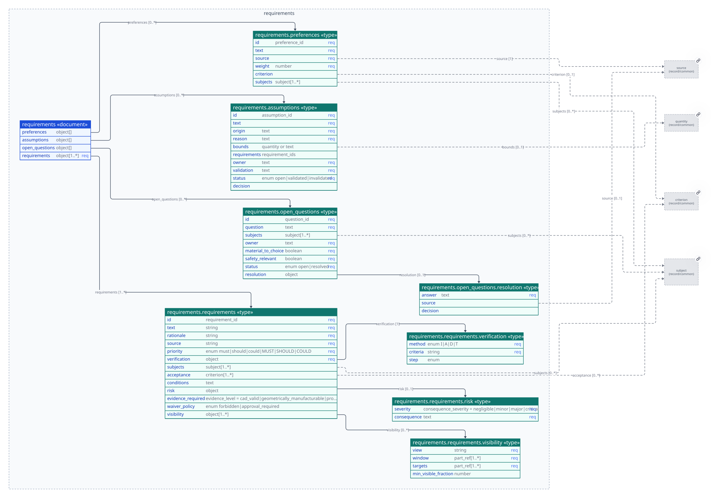

# `record/requirements`

Generated by tools/gen (`just contracts`). Do not edit. Contract reference: [`record/requirements`](../../record/requirements.md). Source: [`contracts/record/requirements.tsp`](../../../../../contracts/record/requirements.tsp).

Requirements, preferences, assumptions and open questions, kept apart: a mandatory requirement is never downgraded into a preference or an assumption to pass, and an unknown with a filled-in reason is still unknown. Record version 2 carries all four lists; preferences, assumptions and open_questions may be empty.

## Diagrams

9 types in 1 diagrams.

### 1. `requirements`

Types of other contracts, drawn as stubs: [`record/common`](common.md).

## Types

### `requirements`

| Field | Type | Required | Description |
|---|---|---|---|
| `preferences` | `object[]` | no | What ranks feasible options; a preference never compensates a mandatory failure |
| `assumptions` | `object[]` | no | Bounded statements taken as true for now, each with its owner and the obligation that would validate it |
| `open_questions` | `object[]` | no | Questions still to answer; material_to_choice or safety_relevant open questions block a final material/process recommendation |
| `requirements` | `object[1..*]` | yes |  |

### `requirements.preferences`

| Field | Type | Required | Description |
|---|---|---|---|
| `id` | `preference_id` | yes |  |
| `text` | `text` | yes |  |
| `source` | `source` | yes |  |
| `weight` | `number` | yes |  |
| `criterion` | `criterion` | no |  |
| `subjects` | `subject[1..*]` | no |  |

### `requirements.assumptions`

| Field | Type | Required | Description |
|---|---|---|---|
| `id` | `assumption_id` | yes |  |
| `text` | `text` | yes |  |
| `origin` | `text` | yes |  |
| `reason` | `text` | yes |  |
| `bounds` | `quantity or text` | no |  |
| `requirements` | `requirement_ids` | no |  |
| `owner` | `text` | yes |  |
| `validation` | `text` | yes | the check, test or answer that would confirm or refute it |
| `status` | `enum open\|validated\|invalidated` | yes |  |
| `decision` | `decision` | no |  |

### `requirements.open_questions`

| Field | Type | Required | Description |
|---|---|---|---|
| `id` | `question_id` | yes |  |
| `question` | `text` | yes |  |
| `subjects` | `subject[1..*]` | no |  |
| `owner` | `text` | yes |  |
| `material_to_choice` | `boolean` | yes |  |
| `safety_relevant` | `boolean` | yes |  |
| `status` | `enum open\|resolved` | yes |  |
| `resolution` | `object` | no |  |

### `requirements.open_questions.resolution`

| Field | Type | Required | Description |
|---|---|---|---|
| `answer` | `text` | yes |  |
| `source` | `source` | no |  |
| `decision` | `decision` | no |  |

### `requirements.requirements`

| Field | Type | Required | Description |
|---|---|---|---|
| `id` | `requirement_id` | yes |  |
| `text` | `string` | yes |  |
| `rationale` | `string` | yes |  |
| `source` | `string` | yes |  |
| `priority` | `enum must\|should\|could\|MUST\|SHOULD\|COULD` | yes |  |
| `verification` | `object` | yes |  |
| `subjects` | `subject[1..*]` | no |  |
| `acceptance` | `criterion[1..*]` | no | Structured acceptance criteria; the prose criteria stay, and a final selection evaluates these, never an automatic reading of prose |
| `conditions` | `text` | no | the service conditions the requirement holds under |
| `risk` | `object` | no |  |
| `evidence_required` | `evidence_level = cad_valid\|geometrically_manufacturable\|process_planned\|simulation_supported\|physically_validated[1..*]` | no | The evidence levels a pass needs |
| `waiver_policy` | `enum forbidden\|approval_required` | no |  |
| `visibility` | `object[1..*]` | no | Show-the-motion checks: from view, rendering only the window and target parts at the nominal pose, each target's own visible share of its projected area must reach min_visible_fraction (default 0.5); the check fails when any target falls short. Only transparency: transparent window parts are see-through |

### `requirements.requirements.verification`

| Field | Type | Required | Description |
|---|---|---|---|
| `method` | `enum I\|A\|D\|T` | yes |  |
| `criteria` | `string` | yes |  |
| `step` | `enum` | no | The flow step that verifies it, so validation can flag a profile that turns that step off (flow.conflict): fea for a strength or stiffness requirement, physical for a trial or inspection outside CAD |

### `requirements.requirements.risk`

| Field | Type | Required | Description |
|---|---|---|---|
| `severity` | `consequence_severity = negligible\|minor\|major\|critical` | yes |  |
| `consequence` | `text` | yes |  |

### `requirements.requirements.visibility`

| Field | Type | Required | Description |
|---|---|---|---|
| `view` | `string` | yes | A render view: iso, front, side, or a dir-X-Y-Z direction in assembly coordinates |
| `window` | `part_ref[1..*]` | yes |  |
| `targets` | `part_ref[1..*]` | yes |  |
| `min_visible_fraction` | `number` | no |  |

## Enums

Named enum definitions, and the enums of fields that have more than 6 values, which the field's type does not spell out. Enums have no colour in the diagrams.

| Enum | Values | Description |
|---|---|---|
| `requirements.requirements.verification.step` | `interference`, `form`, `visibility`, `access`, `process`, `motion`, `stack_up`, `fea`, `drawing`, `critique`, `physical` | The flow step that verifies it, so validation can flag a profile that turns that step off (flow.conflict): fea for a strength or stiffness requirement, physical for a trial or inspection outside CAD |
