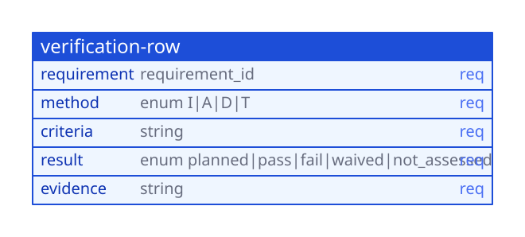

# `record/verification-row`

Generated by tools/gen (`just contracts`). Do not edit. Contract reference: [`record/verification-row`](../../record/verification-row.md). Source: [`contracts/record/verification-row.tsp`](../../../../../contracts/record/verification-row.tsp).

One hw/verification.csv row; the column order is the property order

## Diagrams

1 types in 1 diagrams.

### 1. `verification-row`

## Types

### `verification-row`

| Field | Type | Required | Description |
|---|---|---|---|
| `requirement` | `requirement_id` | yes |  |
| `method` | `enum I\|A\|D\|T` | yes |  |
| `criteria` | `string` | yes |  |
| `result` | `enum planned\|pass\|fail\|waived\|not_assessed` | yes |  |
| `evidence` | `string` | yes |  |
