# Phase 2 specs

Generated by `tools/specs` (`just specs --write`) from the specs' front matter, `docs/architecture/capabilities.yaml` and `docs/migration/issue-register.yaml`. Don't edit it: change a spec and regenerate. The spec format is in [README.md](README.md).

## Capabilities

Every Phase 2 capability of the catalogue, in catalogue order.

| Capability | Title | Catalogue status | Spec |
|---|---|---|---|
| [flow-engine](../architecture/capabilities.md#flow-engine) | Flow engine | planned | [flow-engine](flow-engine.md) |
| [cel-rule-pipeline](../architecture/capabilities.md#cel-rule-pipeline) | CEL rule pipeline | planned | [cel-pipeline](cel-pipeline.md) |
| [rule-lists](../architecture/capabilities.md#rule-lists) | Rule lists | planned | [cel-pipeline](cel-pipeline.md) |
| [gate-policy](../architecture/capabilities.md#gate-policy) | Gate policy | planned | [flow-engine](flow-engine.md) |
| [decision-records](../architecture/capabilities.md#decision-records) | Gate decisions and decision records | planned | [approvals](approvals.md) |
| [scoped-reapproval](../architecture/capabilities.md#scoped-reapproval) | Scoped approvals and changed-since-approval | planned | [approvals](approvals.md) |
| [result-envelope](../architecture/capabilities.md#result-envelope) | Result envelope and next actions | partial | [flow-engine](flow-engine.md) |
| [guide-service](../architecture/capabilities.md#guide-service) | Guidance from the server | planned | not yet specced |
| [version-snapshots](../architecture/capabilities.md#version-snapshots) | Version snapshots, seal and verify | planned | not yet specced |
| [state-database](../architecture/capabilities.md#state-database) | The project state database | planned | not yet specced |
| [managed-ignores](../architecture/capabilities.md#managed-ignores) | Managed .benchhand/.gitignore and .gitattributes | planned | not yet specced |
| [object-store](../architecture/capabilities.md#object-store) | Content-addressed object store | planned | not yet specced |
| [job-journal](../architecture/capabilities.md#job-journal) | In-memory jobs with a journal in the state database | planned | not yet specced |
| [run-leases](../architecture/capabilities.md#run-leases) | Run leases | planned | not yet specced |
| [project-profile](../architecture/capabilities.md#project-profile) | Project-start profile | planned | not yet specced |
| [selection-assessment](../architecture/capabilities.md#selection-assessment) | Use case and candidate selection | planned | not yet specced |
| [change-impact](../architecture/capabilities.md#change-impact) | Change impact | planned | not yet specced |
| [existing-equipment](../architecture/capabilities.md#existing-equipment) | Existing equipment and occurrence roles | planned | not yet specced |
| [assembly-steps-and-coupons](../architecture/capabilities.md#assembly-steps-and-coupons) | Assembly steps and joint evidence | planned | not yet specced |
| [annotation-set](../architecture/capabilities.md#annotation-set) | Annotation set | planned | not yet specced |
| [freecad-environment-pins](../architecture/capabilities.md#freecad-environment-pins) | FreeCAD addon pins and Python lock | planned | not yet specced |
| [purchased-part-fidelity](../architecture/capabilities.md#purchased-part-fidelity) | Bought-part fidelity levels | planned | not yet specced |
| [supplier-calibration](../architecture/capabilities.md#supplier-calibration) | Supplier data as calibration | planned | not yet specced |
| [product-identity](../architecture/capabilities.md#product-identity) | Product identity fields | planned | not yet specced |
| [decision-manifest-hash](../architecture/capabilities.md#decision-manifest-hash) | The manifest hash of an approval | planned | not yet specced |

The specs also cover capabilities of other phases: `record-validate` (record-validation), `record-migrate` (record-validation).

## Specs

| Spec | Title | Status | Capabilities | Blocks | Sizes |
|---|---|---|---|---|---|
| [cel-pipeline](cel-pipeline.md) | The CEL pipeline and the flow's rule lists | draft | `cel-rule-pipeline`, `rule-lists` | 13 | 3 S, 9 M, 1 L |
| [flow-engine](flow-engine.md) | The flow engine, gate policy and next actions | draft | `flow-engine`, `gate-policy`, `result-envelope` | 14 | 4 S, 9 M, 1 L |
| [approvals](approvals.md) | Decision records and scoped re-approval | draft | `decision-records`, `scoped-reapproval` | 9 | 3 S, 6 M |
| [record-validation](record-validation.md) | Record validation and migration in Phase 2 | draft | `record-validate`, `record-migrate` | 10 | 7 S, 3 M |

## Block graph

An arrow runs from what a block needs to the block. A hexagon is an open question in the catalogue, and a rounded box a capability that no spec covers yet.

```mermaid
flowchart TD
  subgraph spec_cel_pipeline["cel-pipeline"]
    CP_1["CP-1 (M): Rule scopes and the structural-scope check"]
    CP_2["CP-2 (S): The profile-manifest and rules-bundle contracts, and where a bundle lives"]
    CP_3["CP-3 (M): The descriptor set for each scope"]
    CP_4["CP-4 (S): The JCS digest and its test vector"]
    CP_5["CP-5 (M): The profile manifest and the env YAML for each scope"]
    CP_6["CP-6 (M): The pinned cel-go tool and its environment checks"]
    CP_7["CP-7 (M): Compiling a rule list in the restricted profile"]
    CP_8["CP-8 (S): Writing the rules bundle"]
    CP_9["CP-9 (M): The host adapter and bundle verification"]
    CP_10["CP-10 (M): The presence lint"]
    CP_11["CP-11 (M): The flow's four rule lists and the stale-entry step in CI"]
    CP_12["CP-12 (M): Both checkers of record on every shipped expression in CI"]
    CP_13["CP-13 (L): The supported-profile conformance gate in CI"]
  end
  subgraph spec_flow_engine["flow-engine"]
    FE_1["FE-1 (M): The flow loader"]
    FE_2["FE-2 (M): The real flow/flow.yaml"]
    FE_3["FE-3 (S): The result envelope in core"]
    FE_4["FE-4 (L): The interpreter, its transitions and refusals"]
    FE_5["FE-5 (M): Gate obligations from the evidence assessment"]
    FE_6["FE-6 (M): The VOID cascade"]
    FE_7["FE-7 (M): Gate modes, rigor and policy changes"]
    FE_8["FE-8 (M): Merging contributed rule lists and gate requirements"]
    FE_9["FE-9 (S): Middle gates without the user under the key-gates profile"]
    FE_10["FE-10 (M): Next actions from the gate state"]
    FE_11["FE-11 (S): Tool calls against flow.stage"]
    FE_12["FE-12 (M): The design freeze"]
    FE_13["FE-13 (M): The flow end to end through the services"]
    FE_14["FE-14 (S): A version frozen through a provisional and VOID cycle"]
  end
  subgraph spec_approvals["approvals"]
    AP_9["AP-9 (S): The transition request in the flow contract"]
    AP_1["AP-1 (M): The decision writer"]
    AP_2["AP-2 (S): Decisions for undeclared transitions"]
    AP_3["AP-3 (M): Several chosen options and a carry-forward disposition"]
    AP_4["AP-4 (S): Recording a provisional approval"]
    AP_5["AP-5 (M): The approval scope in the decision contract"]
    AP_6["AP-6 (M): Changed since approval"]
    AP_7["AP-7 (M): Confirmation at the next human gate"]
    AP_8["AP-8 (M): Migrated decisions without a scope"]
  end
  subgraph spec_record_validation["record-validation"]
    RV_1["RV-1 (S): Verification rows by header name"]
    RV_2["RV-2 (M): A not_applicable verification result"]
    RV_3["RV-3 (S): Evidence paths that name a current file"]
    RV_4["RV-4 (M): Torque paths from design_rules.py"]
    RV_5["RV-5 (S): Welded, brazed and soldered torque paths"]
    RV_6["RV-6 (S): Missing inputs only from the stage that produces them"]
    RV_7["RV-7 (M): Axial retainers from design_rules.py"]
    RV_8["RV-8 (S): Clearance margins from design_rules.py"]
    RV_9["RV-9 (S): Visibility bindings from design_rules.py"]
    RV_10["RV-10 (S): Clearance margins read from a version snapshot"]
  end
  question_user_bundle_location{{"question: user-bundle-location"}}
  question_envelope_phase{{"question: envelope-phase"}}
  capability_evidence_assessment(["capability: evidence-assessment"])
  capability_version_snapshots(["capability: version-snapshots"])
  capability_selection_assessment(["capability: selection-assessment"])
  question_user_bundle_location --> CP_1
  question_user_bundle_location --> CP_2
  CP_1 --> CP_3
  CP_2 --> CP_4
  CP_3 --> CP_5
  CP_4 --> CP_5
  CP_5 --> CP_6
  CP_6 --> CP_7
  CP_7 --> CP_8
  CP_5 --> CP_9
  CP_8 --> CP_9
  CP_9 --> CP_10
  CP_8 --> CP_11
  CP_9 --> CP_11
  CP_11 --> CP_12
  FE_2 --> CP_12
  CP_9 --> CP_13
  CP_10 --> CP_13
  CP_9 --> FE_1
  FE_1 --> FE_2
  CP_11 --> FE_2
  question_envelope_phase --> FE_3
  FE_2 --> FE_4
  FE_3 --> FE_4
  AP_1 --> FE_4
  FE_4 --> FE_5
  capability_evidence_assessment --> FE_5
  FE_4 --> FE_6
  AP_1 --> FE_6
  FE_4 --> FE_7
  FE_8 --> FE_7
  AP_1 --> FE_7
  FE_1 --> FE_8
  CP_11 --> FE_8
  FE_7 --> FE_9
  FE_4 --> FE_10
  FE_4 --> FE_11
  FE_5 --> FE_12
  capability_version_snapshots --> FE_12
  FE_6 --> FE_13
  FE_7 --> FE_13
  FE_10 --> FE_13
  capability_selection_assessment --> FE_13
  FE_6 --> FE_14
  FE_12 --> FE_14
  AP_9 --> AP_1
  AP_1 --> AP_2
  FE_1 --> AP_2
  AP_1 --> AP_4
  FE_4 --> AP_4
  AP_1 --> AP_5
  capability_evidence_assessment --> AP_5
  AP_5 --> AP_6
  FE_1 --> AP_6
  FE_4 --> AP_6
  AP_6 --> AP_7
  FE_4 --> AP_7
  FE_12 --> AP_7
  AP_7 --> AP_8
  RV_4 --> RV_5
  RV_8 --> RV_10
  capability_version_snapshots --> RV_10
```

## Suggested order

The blocks in dependency waves. A block's wave follows the latest wave of the blocks it depends on, so the blocks of one wave can run side by side. Within a wave, the README's spec order comes first, then each spec's own order. A block that waits on an open question or an unspecced capability keeps its wave, and it starts once that is settled.

The port of prototype PRs #331 to #341 is the first Phase 2 work (`docs/phases/phase-0-1.md:117`). Its capabilities have no spec yet, so it isn't in these waves; `docs/phases/prototype-port-331-341.md` orders it.

### Wave 1

- **CP-1** (M, cel-pipeline): Rule scopes and the structural-scope check. Waits on `user-bundle-location` (non-blocking).
- **CP-2** (S, cel-pipeline): The profile-manifest and rules-bundle contracts, and where a bundle lives. Waits on `user-bundle-location` (non-blocking).
- **FE-3** (S, flow-engine): The result envelope in core. Waits on `envelope-phase` (non-blocking).
- **AP-9** (S, approvals): The transition request in the flow contract.
- **AP-3** (M, approvals): Several chosen options and a carry-forward disposition.
- **RV-1** (S, record-validation): Verification rows by header name.
- **RV-2** (M, record-validation): A not_applicable verification result.
- **RV-3** (S, record-validation): Evidence paths that name a current file.
- **RV-4** (M, record-validation): Torque paths from design_rules.py.
- **RV-6** (S, record-validation): Missing inputs only from the stage that produces them.
- **RV-7** (M, record-validation): Axial retainers from design_rules.py.
- **RV-8** (S, record-validation): Clearance margins from design_rules.py.
- **RV-9** (S, record-validation): Visibility bindings from design_rules.py.

### Wave 2

- **CP-3** (M, cel-pipeline): The descriptor set for each scope. After CP-1.
- **CP-4** (S, cel-pipeline): The JCS digest and its test vector. After CP-2.
- **AP-1** (M, approvals): The decision writer. After AP-9.
- **RV-5** (S, record-validation): Welded, brazed and soldered torque paths. After RV-4.
- **RV-10** (S, record-validation): Clearance margins read from a version snapshot. After RV-8. Waits on capability `version-snapshots`.

### Wave 3

- **CP-5** (M, cel-pipeline): The profile manifest and the env YAML for each scope. After CP-3, CP-4.
- **AP-5** (M, approvals): The approval scope in the decision contract. After AP-1. Waits on capability `evidence-assessment`.

### Wave 4

- **CP-6** (M, cel-pipeline): The pinned cel-go tool and its environment checks. After CP-5.

### Wave 5

- **CP-7** (M, cel-pipeline): Compiling a rule list in the restricted profile. After CP-6.

### Wave 6

- **CP-8** (S, cel-pipeline): Writing the rules bundle. After CP-7.

### Wave 7

- **CP-9** (M, cel-pipeline): The host adapter and bundle verification. After CP-5, CP-8.

### Wave 8

- **CP-10** (M, cel-pipeline): The presence lint. After CP-9.
- **CP-11** (M, cel-pipeline): The flow's four rule lists and the stale-entry step in CI. After CP-8, CP-9.
- **FE-1** (M, flow-engine): The flow loader. After CP-9.

### Wave 9

- **CP-13** (L, cel-pipeline): The supported-profile conformance gate in CI. After CP-9, CP-10.
- **FE-2** (M, flow-engine): The real flow/flow.yaml. After FE-1, CP-11.
- **FE-8** (M, flow-engine): Merging contributed rule lists and gate requirements. After FE-1, CP-11.
- **AP-2** (S, approvals): Decisions for undeclared transitions. After AP-1, FE-1.

### Wave 10

- **CP-12** (M, cel-pipeline): Both checkers of record on every shipped expression in CI. After CP-11, FE-2.
- **FE-4** (L, flow-engine): The interpreter, its transitions and refusals. After FE-2, FE-3, AP-1.

### Wave 11

- **FE-5** (M, flow-engine): Gate obligations from the evidence assessment. After FE-4. Waits on capability `evidence-assessment`.
- **FE-6** (M, flow-engine): The VOID cascade. After FE-4, AP-1.
- **FE-7** (M, flow-engine): Gate modes, rigor and policy changes. After FE-4, FE-8, AP-1.
- **FE-10** (M, flow-engine): Next actions from the gate state. After FE-4.
- **FE-11** (S, flow-engine): Tool calls against flow.stage. After FE-4.
- **AP-4** (S, approvals): Recording a provisional approval. After AP-1, FE-4.
- **AP-6** (M, approvals): Changed since approval. After AP-5, FE-1, FE-4.

### Wave 12

- **FE-9** (S, flow-engine): Middle gates without the user under the key-gates profile. After FE-7.
- **FE-12** (M, flow-engine): The design freeze. After FE-5. Waits on capability `version-snapshots`.
- **FE-13** (M, flow-engine): The flow end to end through the services. After FE-6, FE-7, FE-10. Waits on capability `selection-assessment`.

### Wave 13

- **FE-14** (S, flow-engine): A version frozen through a provisional and VOID cycle. After FE-6, FE-12.
- **AP-7** (M, approvals): Confirmation at the next human gate. After AP-6, FE-4, FE-12.

### Wave 14

- **AP-8** (M, approvals): Migrated decisions without a scope. After AP-7.

## Open questions that hold blocks

| Question | Blocking | Owner | Blocks it holds |
|---|---|---|---|
| [user-bundle-location](../architecture/capabilities.md#user-bundle-location) | no | none | CP-1, CP-2 |
| [envelope-phase](../architecture/capabilities.md#envelope-phase) | no | none | FE-3 |

## Phase 2 register entries no spec closes

70 of the 82 Phase 2 entries of the issue register. "Deferred to" names the capability that a spec has handed the entry to.

| Entry | Disposition | Deferred to | Title |
|---|---|---|---|
| IR-003 | contract | none | No category for customer-furnished reference geometry, which then needs purchase facts and ships in the product export, BOM and release. |
| IR-005 | port-fix | none | The assembly order allows one base, so a subassembly built on the bench and then joined as a unit can't be recorded. |
| IR-006 | contract | none | Free-text step instructions and hand work have no field, so every named tool counts as an unmodelled envelope and access stays unknown. |
| IR-007 | already-covered | none | Every installing step except closing is a joint, so a washer, sleeve or located ring needs a retention source that can never exist. |
| IR-010 | port-fix | none | Several stations or size classes in one record put each other in every access path and tool approach. |
| IR-012 | design-input | none | OS metadata files enter version snapshots and make sealed versions stale; the tools have no project ignore rules. |
| IR-014 | contract | none | A press or locating fit must carry an ISO 286 class, so a crush-rib or vendor-limit interference has no truthful form. |
| IR-015 | contract | none | A retaining-ring groove bound to a feature needs an ISO groove class, so a printed groove with explicit limits is refused. |
| IR-020 | contract | none | The machine profile has no field for a printer's calibration state (standard built-in or custom). |
| IR-025 | contract | none | A loose kit item (a shipped tool or a length option) must be placed in the assembly, which puts it in the checks, the sweep and the access plan. |
| IR-028 | contract | none | A fixed joint silently ignores a non-zero value, so a placement offset given there is lost. |
| IR-029 | contract | assembly-steps-and-coupons | There is no way to offset a whole subassembly without editing every child placement. |
| IR-036 | contract | none | There are no assembly configurations, so a sweep can't cover alternative operating envelopes such as several bundle sizes. |
| IR-039 | contract | none | Validate accepts an operation acceptance with the wrong feature count for its kind, which the access check then refuses. |
| IR-043 | design-input | check-orchestration | The commit-scope evidence run stops at the first failing step, so later producers never run and their obligations show as unknown. |
| IR-049 | contract | evidence-assessment | The service-class rules live as code and prose in several copies, and two lists of the service classes can drift apart. |
| IR-050 | contract | none | A CAD-and-simulation release can't close a physical obligation as checked before use. |
| IR-051 | port-fix | version-snapshots | After a release, the next change is validated against the released version's rules and frozen digest, so it can't add a planned row. |
| IR-052 | port-fix | none | An expired waiver from an earlier version blocks a part that has since been tested. |
| IR-054 | contract | none | A waived verification row can't cite the result or decision that justified the waiver. |
| IR-057 | contract | none | A route can't start from a bought blank, so a machined catalogue part can't be declared and a drilled stock plate has no primary process. |
| IR-059 | port-fix | none | A waiver limited to a change outlives that change. |
| IR-062 | port-fix | none | The evidence digest exits 2 on a missing or overlong cited file, and its refusal output is not checked against its schema. |
| IR-064 | port-fix | none | A dropped physical not-assessed outcome leaves no trace, and validate doesn't check a stated not-assessed result. |
| IR-065 | port-fix | none | Selection matches results and approvals by operation kind and material, so a rejected shop eliminates the approved one, engraving approval counts for cutting, and a result matches without its dimension state or conditions. |
| IR-066 | port-fix | none | Candidate-only declarations vanish from selection, and a candidate's supplier evidence is read from the current route. |
| IR-067 | port-fix | none | A translucent diffuser is eliminated by the transparent-window rule for any additive step. |
| IR-068 | design-input | selection-assessment | References that name a part by occurrence are not resolved everywhere, so selection, change impact, the heat-set check and drawing intent drop or misjudge them. |
| IR-069 | port-fix | none | An authored pass overrides a computed unknown allowable with no basis. |
| IR-070 | port-fix | none | Selection coverage is the union of every alternative, so a rejected alternative counts as covered. |
| IR-071 | port-fix | none | Two obligations of the same kind on one feature, or two policy requirements at one level, collapse into one and the second is lost silently. |
| IR-072 | port-fix | none | A populated loads list hides a load whose magnitude is unknown. |
| IR-073 | contract | none | The unit vocabulary has no electrical, pressure or inch units, and a load can only be a force or torque along one direction. |
| IR-075 | contract | none | A multi-material part is judged on one part-level material. |
| IR-076 | contract | none | A misspelled limit key passes the schema and silently drops the inspection obligation it would create. |
| IR-077 | design-input | selection-assessment | A new project deadlocks at the start, because validate demands records before the stage that writes them and selection needs a digest only a valid run gives. |
| IR-078 | design-input | none | A headline status is stronger than its weakest part, such as a form check that passes while its manufacturing result is unknown, or a sweep reported complete that skips pairs. |
| IR-079 | port-fix | none | The quantity reader overflows on huge integers and labels a non-finite number a units error because of the message text. |
| IR-080 | port-fix | none | Selection crashes on a list-valued recommendation role when candidates exist. |
| IR-086 | already-covered | version-snapshots | Release compares file drift with the built snapshot when no design freeze exists, which invites calling the build frozen. |
| IR-087 | port-fix | design-recheck | Recheck stamps compared dates, so a decision at 23:59 and a recheck at 00:01 failed, and malformed stamp or gate input exits 2. |
| IR-089 | contract | none | An existing host part can't give the temperature limit of a joint, because its material can only come through make intent. |
| IR-090 | port-fix | none | Print-in-place members are reported as never installed. |
| IR-092 | contract | none | Hard schema maxima act as plausibility checks, capping pair clearance and margin at small values. |
| IR-093 | contract | none | Each check keeps its own short list of qualifying source kinds, so a retention calculation or a guideline value can't be a source. |
| IR-095 | contract | none | Designation parsers disagree and are incomplete, so JIS screws, Unified threads and fine-pitch metric threads are refused, and a blank standard crashes the BOM. |
| IR-096 | contract | none | A cosmetic purchase needs a functional rating, and a not-applicable rating with a reason still counts as unknown. |
| IR-097 | port-fix | none | Zero thread engagement passes the engagement check. |
| IR-130 | contract | none | A supplier STEP can only be used through a Python wrapper; a part can't declare a STEP as its model. |
| IR-133 | contract | none | Service access is only checked in the nominal posture, with no per-operation joint pose. |
| IR-134 | contract | none | Removal paths can't use the waypoints that insertion accepts. |
| IR-136 | contract | assembly-steps-and-coupons | A cylindrical joint, sliding and rotating on one pair, is rejected. |
| IR-138 | contract | none | Play needs a direct joint between the contacting parts, so a cam with a guided follower gets no verdict. |
| IR-141 | already-covered | none | Motion-plan validation in the scratch tool and the motion-plan schema disagree on step bounds. |
| IR-143 | contract | none | An as-printed finish can't be declared sufficient, so a printed part's drawing needs edge limits and a roughness value. |
| IR-146 | contract | none | Decorative ribs need individual dimensions. |
| IR-153 | port-fix | none | The assembly-drawing guide's own worked example is rejected by the record checks. |
| IR-160 | design-input | none | A fixed joint needs the parts to touch, so a flexible member such as a belt has no honest mount. |
| IR-162 | port-fix | none | The connection check reports assembly structure errors one build at a time. |
| IR-165 | port-fix | none | The start questions are not chosen by applicability, so a project with no printing is asked every filament setting, and a skipped option is not named when an answer is also missing. |
| IR-166 | design-input | guide-service | Approved profile choices, such as no FEA, no stack-up or light critique, are ignored by the stage instructions. |
| IR-168 | contract | none | Separate operating loads must all be in every FEA case, because the record has no notion of load combination. |
| IR-171 | port-fix | none | The printer question still offers to wait for a test print. |
| IR-173 | contract | selection-assessment | The use-case questions are one fixed list, so an appearance-only project is asked about cyclic load, wear life and standards. |
| IR-174 | port-fix | none | The profile writer exits 2 on an inline flow mapping, and replacing a quoted profile key writes a duplicate. |
| IR-175 | design-input | guide-service | The start questions don't ask whether the product targets one model or a class of equipment, or which power and data routes are allowed. |
| IR-176 | port-fix | none | The flow asks for and blocks on a printer profile, and rejects a machine identity the user declares. |
| IR-177 | design-input | none | There is no guided machine setup that builds a capability profile from published specifications. |
| IR-190 | port-fix | none | Scratch delivery copies and renames by path name, so a linked parts folder can redirect publication outside the record. |
| IR-202 | port-fix | none | A killed build leaves its staging folder behind for good, and while it is there the store's garbage collection refuses to run. |
